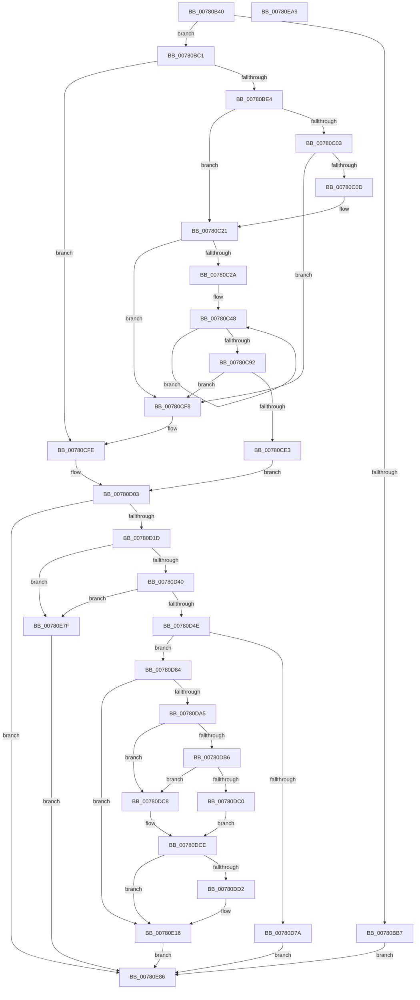

# NtCreateThread

- RVA: `0x00780B40`–`0x00780EAA` (길이 `874` bytes)
- VA: `0x0000000140780B40`
- 실행 섹션: `PAGE`
- PDB 이름 있음: `예`; PDB Function 태그: `아니요`
- unwind 정보 RVA: `0x000CE1B4`
- 디코드: `200`개 명령, `874/874` bytes 표시
- 미해석 바이트: `0` (있으면 어셈블리에 `.byte`로 보존)

> 이 문서는 커널 이미지의 기계어와 PDB 기호를 분석해 생성했습니다. 4번과 5번은 함수 원형과 자료형을 바이너리 사용 방식에서 추정한 C 해석이며 원본 소스 복구 결과는 아닙니다.

## 1. Dependencies

- 직접 호출 지점: **5**; 고유 호출 대상: **5**
- 직접 호출자로 확인된 함수: **0**
- RIP 상대 이미지 참조: **1**

### Outgoing calls
- `0x00780B97` → [memset](../../text/6C/memset_function_006C6C40.md) (function, `0x006C6C40`)
- `0x00780CF8` → [ExRaiseDatatypeMisalignment](../89/ExRaiseDatatypeMisalignment_function_00899FD0.md) (function, `0x00899FD0`)
- `0x00780D07` → [RtlpSanitizeContextFlags](../../text/3D/RtlpSanitizeContextFlags_function_003D7070.md) (function, `0x003D7070`)
- `0x00780E78` → [PspCreateThread](../9E/PspCreateThread_function_009EF034.md) (function, `0x009EF034`)
- `0x00780E91` → [_security_check_cookie](../../text/6A/_security_check_cookie_function_006AC640.md) (function, `0x006AC640`)

### Direct callers
- 이 함수 시작 RVA로 연결되는 직접 call은 확인되지 않았습니다. 간접 호출은 완전히 역산할 수 없습니다.

### Static image references
- `0x00780B53` → RVA `0x00E0A740` (`.data`; read)

## 2. Other-region calls and transfers

- 다른 실행 섹션으로 향하는 call: **3**
  - `0x00780B97` → [memset](../../text/6C/memset_function_006C6C40.md) (`PAGE` → `.text`)
  - `0x00780D07` → [RtlpSanitizeContextFlags](../../text/3D/RtlpSanitizeContextFlags_function_003D7070.md) (`PAGE` → `.text`)
  - `0x00780E91` → [_security_check_cookie](../../text/6A/_security_check_cookie_function_006AC640.md) (`PAGE` → `.text`)
- 별도 외부 분기/꼬리 이동을 확인하지 못했습니다.

## 3. Assembly (complete function range)

```asm
00780B40  40 53                           push rbx
00780B42  56                              push rsi
00780B43  57                              push rdi
00780B44  41 54                           push r12
00780B46  41 55                           push r13
00780B48  41 56                           push r14
00780B4A  41 57                           push r15
00780B4C  48 81 EC F0 05 00 00            sub rsp, 0x5f0
00780B53  48 8B 05 E6 9B 68 00            mov rax, qword ptr [rip + 0x689be6]
00780B5A  48 33 C4                        xor rax, rsp
00780B5D  48 89 84 24 E0 05 00 00         mov qword ptr [rsp + 0x5e0], rax
00780B65  4D 8B E9                        mov r13, r9
00780B68  4D 8B E0                        mov r12, r8
00780B6B  44 8B FA                        mov r15d, edx
00780B6E  4C 8B F1                        mov r14, rcx
00780B71  48 8B BC 24 60 06 00 00         mov rdi, qword ptr [rsp + 0x660]
00780B79  48 8B 9C 24 58 06 00 00         mov rbx, qword ptr [rsp + 0x658]
00780B81  48 8B B4 24 50 06 00 00         mov rsi, qword ptr [rsp + 0x650]
00780B89  33 D2                           xor edx, edx
00780B8B  44 8D 42 48                     lea r8d, [rdx + 0x48]
00780B8F  48 8D 8C 24 90 00 00 00         lea rcx, [rsp + 0x90]
00780B97  E8 A4 60 F4 FF                  call 0x1406c6c40
00780B9C  33 C0                           xor eax, eax
00780B9E  0F 57 C0                        xorps xmm0, xmm0
00780BA1  F3 0F 7F 84 24 F1 00 00 00      movdqu xmmword ptr [rsp + 0xf1], xmm0
00780BAA  48 21 84 24 01 01 00 00         and qword ptr [rsp + 0x101], rax
00780BB2  48 85 DB                        test rbx, rbx
00780BB5  75 0A                           jne 0x140780bc1
00780BB7  B8 0D 00 00 C0                  mov eax, 0xc000000d
00780BBC  E9 C5 02 00 00                  jmp 0x140780e86
00780BC1  65 48 8B 04 25 88 01 00 00      mov rax, qword ptr gs:[0x188]
00780BCA  48 89 84 24 E0 00 00 00         mov qword ptr [rsp + 0xe0], rax
00780BD2  8A 90 32 02 00 00               mov dl, byte ptr [rax + 0x232]
00780BD8  88 54 24 70                     mov byte ptr [rsp + 0x70], dl
00780BDC  84 D2                           test dl, dl
00780BDE  0F 84 1A 01 00 00               je 0x140780cfe
00780BE4  48 BA 00 00 FF FF FF 7F 00 00   movabs rdx, 0x7fffffff0000
00780BEE  48 8B CA                        mov rcx, rdx
00780BF1  4C 3B F2                        cmp r14, rdx
00780BF4  49 0F 42 CE                     cmovb rcx, r14
00780BF8  48 8B 01                        mov rax, qword ptr [rcx]
00780BFB  48 89 01                        mov qword ptr [rcx], rax
00780BFE  48 85 F6                        test rsi, rsi
00780C01  74 1E                           je 0x140780c21
00780C03  40 F6 C6 03                     test sil, 3
00780C07  0F 85 EB 00 00 00               jne 0x140780cf8
00780C0D  48 8B CA                        mov rcx, rdx
00780C10  48 3B F2                        cmp rsi, rdx
00780C13  48 0F 42 CE                     cmovb rcx, rsi
00780C17  8A 01                           mov al, byte ptr [rcx]
00780C19  88 01                           mov byte ptr [rcx], al
00780C1B  8A 41 0F                        mov al, byte ptr [rcx + 0xf]
00780C1E  88 41 0F                        mov byte ptr [rcx + 0xf], al
00780C21  F6 C3 0F                        test bl, 0xf
00780C24  0F 85 CE 00 00 00               jne 0x140780cf8
00780C2A  48 8B C2                        mov rax, rdx
00780C2D  48 3B DA                        cmp rbx, rdx
00780C30  48 0F 42 C3                     cmovb rax, rbx
00780C34  90                              nop
00780C35  8A 00                           mov al, byte ptr [rax]
00780C37  48 8D 84 24 10 01 00 00         lea rax, [rsp + 0x110]
00780C3F  B9 09 00 00 00                  mov ecx, 9
00780C44  44 8D 41 77                     lea r8d, [rcx + 0x77]
00780C48  0F 10 03                        movups xmm0, xmmword ptr [rbx]
00780C4B  0F 11 00                        movups xmmword ptr [rax], xmm0
00780C4E  0F 10 4B 10                     movups xmm1, xmmword ptr [rbx + 0x10]
00780C52  0F 11 48 10                     movups xmmword ptr [rax + 0x10], xmm1
00780C56  0F 10 43 20                     movups xmm0, xmmword ptr [rbx + 0x20]
00780C5A  0F 11 40 20                     movups xmmword ptr [rax + 0x20], xmm0
00780C5E  0F 10 4B 30                     movups xmm1, xmmword ptr [rbx + 0x30]
00780C62  0F 11 48 30                     movups xmmword ptr [rax + 0x30], xmm1
00780C66  0F 10 43 40                     movups xmm0, xmmword ptr [rbx + 0x40]
00780C6A  0F 11 40 40                     movups xmmword ptr [rax + 0x40], xmm0
00780C6E  0F 10 4B 50                     movups xmm1, xmmword ptr [rbx + 0x50]
00780C72  0F 11 48 50                     movups xmmword ptr [rax + 0x50], xmm1
00780C76  0F 10 43 60                     movups xmm0, xmmword ptr [rbx + 0x60]
00780C7A  0F 11 40 60                     movups xmmword ptr [rax + 0x60], xmm0
00780C7E  49 03 C0                        add rax, r8
00780C81  0F 10 4B 70                     movups xmm1, xmmword ptr [rbx + 0x70]
00780C85  0F 11 48 F0                     movups xmmword ptr [rax - 0x10], xmm1
00780C89  49 03 D8                        add rbx, r8
00780C8C  48 83 E9 01                     sub rcx, 1
00780C90  75 B6                           jne 0x140780c48
00780C92  0F 10 03                        movups xmm0, xmmword ptr [rbx]
00780C95  0F 11 00                        movups xmmword ptr [rax], xmm0
00780C98  0F 10 4B 10                     movups xmm1, xmmword ptr [rbx + 0x10]
00780C9C  0F 11 48 10                     movups xmmword ptr [rax + 0x10], xmm1
00780CA0  0F 10 43 20                     movups xmm0, xmmword ptr [rbx + 0x20]
00780CA4  0F 11 40 20                     movups xmmword ptr [rax + 0x20], xmm0
00780CA8  0F 10 4B 30                     movups xmm1, xmmword ptr [rbx + 0x30]
00780CAC  0F 11 48 30                     movups xmmword ptr [rax + 0x30], xmm1
00780CB0  0F 10 43 40                     movups xmm0, xmmword ptr [rbx + 0x40]
00780CB4  0F 11 40 40                     movups xmmword ptr [rax + 0x40], xmm0
00780CB8  48 8D 84 24 10 01 00 00         lea rax, [rsp + 0x110]
00780CC0  48 89 44 24 78                  mov qword ptr [rsp + 0x78], rax
00780CC5  48 8B 84 24 A8 01 00 00         mov rax, qword ptr [rsp + 0x1a8]
00780CCD  48 83 E0 F0                     and rax, 0xfffffffffffffff0
00780CD1  48 83 E8 28                     sub rax, 0x28
00780CD5  48 89 84 24 A8 01 00 00         mov qword ptr [rsp + 0x1a8], rax
00780CDD  40 F6 C7 03                     test dil, 3
00780CE1  75 15                           jne 0x140780cf8
00780CE3  48 3B FA                        cmp rdi, rdx
00780CE6  48 0F 42 D7                     cmovb rdx, rdi
00780CEA  90                              nop
00780CEB  8A 02                           mov al, byte ptr [rdx]
00780CED  48 8B 5C 24 78                  mov rbx, qword ptr [rsp + 0x78]
00780CF2  8A 54 24 70                     mov dl, byte ptr [rsp + 0x70]
00780CF6  EB 0B                           jmp 0x140780d03
00780CF8  E8 D3 92 11 00                  call 0x140899fd0
00780CFD  CC                              int3
00780CFE  48 89 5C 24 78                  mov qword ptr [rsp + 0x78], rbx
00780D03  48 8D 4B 30                     lea rcx, [rbx + 0x30]
00780D07  E8 64 63 C5 FF                  call 0x1403d7070
00780D0C  89 84 24 80 00 00 00            mov dword ptr [rsp + 0x80], eax
00780D13  33 D2                           xor edx, edx
00780D15  85 C0                           test eax, eax
00780D17  0F 88 69 01 00 00               js 0x140780e86
00780D1D  81 63 30 1F 00 10 00            and dword ptr [rbx + 0x30], 0x10001f
00780D24  49 89 16                        mov qword ptr [r14], rdx
00780D27  0F 10 07                        movups xmm0, xmmword ptr [rdi]
00780D2A  0F 29 84 24 90 00 00 00         movaps xmmword ptr [rsp + 0x90], xmm0
00780D32  66 48 0F 7E C0                  movq rax, xmm0
00780D37  48 85 C0                        test rax, rax
00780D3A  0F 85 3F 01 00 00               jne 0x140780e7f
00780D40  48 39 94 24 98 00 00 00         cmp qword ptr [rsp + 0x98], rdx
00780D48  0F 85 31 01 00 00               jne 0x140780e7f
00780D4E  0F 29 84 24 90 00 00 00         movaps xmmword ptr [rsp + 0x90], xmm0
00780D56  0F 10 4F 10                     movups xmm1, xmmword ptr [rdi + 0x10]
00780D5A  0F 29 8C 24 A0 00 00 00         movaps xmmword ptr [rsp + 0xa0], xmm1
00780D62  F2 0F 10 47 20                  movsd xmm0, qword ptr [rdi + 0x20]
00780D67  F2 0F 11 84 24 B0 00 00 00      movsd qword ptr [rsp + 0xb0], xmm0
00780D70  48 39 94 24 B0 00 00 00         cmp qword ptr [rsp + 0xb0], rdx
00780D78  75 0A                           jne 0x140780d84
00780D7A  B8 0D 00 00 C0                  mov eax, 0xc000000d
00780D7F  E9 02 01 00 00                  jmp 0x140780e86
00780D84  65 48 8B 04 25 88 01 00 00      mov rax, qword ptr gs:[0x188]
00780D8D  48 89 84 24 E8 00 00 00         mov qword ptr [rsp + 0xe8], rax
00780D95  48 8B 80 B8 00 00 00            mov rax, qword ptr [rax + 0xb8]
00780D9C  48 39 90 10 03 00 00            cmp qword ptr [rax + 0x310], rdx
00780DA3  74 71                           je 0x140780e16
00780DA5  0F B7 80 EC 06 00 00            movzx eax, word ptr [rax + 0x6ec]
00780DAC  B9 4C 01 00 00                  mov ecx, 0x14c
00780DB1  66 3B C1                        cmp ax, cx
00780DB4  74 12                           je 0x140780dc8
00780DB6  B9 C4 01 00 00                  mov ecx, 0x1c4
00780DBB  66 3B C1                        cmp ax, cx
00780DBE  74 08                           je 0x140780dc8
00780DC0  8A C2                           mov al, dl
00780DC2  88 54 24 71                     mov byte ptr [rsp + 0x71], dl
00780DC6  EB 06                           jmp 0x140780dce
00780DC8  B0 01                           mov al, 1
00780DCA  88 44 24 71                     mov byte ptr [rsp + 0x71], al
00780DCE  84 C0                           test al, al
00780DD0  74 44                           je 0x140780e16
00780DD2  48 8B 84 24 B0 00 00 00         mov rax, qword ptr [rsp + 0xb0]
00780DDA  48 89 84 24 C8 00 00 00         mov qword ptr [rsp + 0xc8], rax
00780DE2  48 8B 84 24 A0 00 00 00         mov rax, qword ptr [rsp + 0xa0]
00780DEA  48 89 84 24 B8 00 00 00         mov qword ptr [rsp + 0xb8], rax
00780DF2  48 8B 84 24 A8 00 00 00         mov rax, qword ptr [rsp + 0xa8]
00780DFA  48 89 84 24 C0 00 00 00         mov qword ptr [rsp + 0xc0], rax
00780E02  48 89 94 24 B0 00 00 00         mov qword ptr [rsp + 0xb0], rdx
00780E0A  0F 57 C0                        xorps xmm0, xmm0
00780E0D  66 0F 7F 84 24 A0 00 00 00      movdqa xmmword ptr [rsp + 0xa0], xmm0
00780E16  C6 84 24 F0 00 00 00 01         mov byte ptr [rsp + 0xf0], 1
00780E1E  8B C2                           mov eax, edx
00780E20  80 BC 24 68 06 00 00 01         cmp byte ptr [rsp + 0x668], 1
00780E28  0F 94 C0                        sete al
00780E2B  48 8D 8C 24 F0 00 00 00         lea rcx, [rsp + 0xf0]
00780E33  48 89 4C 24 60                  mov qword ptr [rsp + 0x60], rcx
00780E38  48 89 54 24 58                  mov qword ptr [rsp + 0x58], rdx
00780E3D  48 89 54 24 50                  mov qword ptr [rsp + 0x50], rdx
00780E42  89 44 24 48                     mov dword ptr [rsp + 0x48], eax
00780E46  48 8D 84 24 90 00 00 00         lea rax, [rsp + 0x90]
00780E4E  48 89 44 24 40                  mov qword ptr [rsp + 0x40], rax
00780E53  48 8B 44 24 78                  mov rax, qword ptr [rsp + 0x78]
00780E58  48 89 44 24 38                  mov qword ptr [rsp + 0x38], rax
00780E5D  48 89 74 24 30                  mov qword ptr [rsp + 0x30], rsi
00780E62  48 89 54 24 28                  mov qword ptr [rsp + 0x28], rdx
00780E67  48 89 54 24 20                  mov qword ptr [rsp + 0x20], rdx
00780E6C  4D 8B CD                        mov r9, r13
00780E6F  4D 8B C4                        mov r8, r12
00780E72  41 8B D7                        mov edx, r15d
00780E75  49 8B CE                        mov rcx, r14
00780E78  E8 B7 E1 26 00                  call 0x1409ef034
00780E7D  EB 07                           jmp 0x140780e86
00780E7F  B8 BB 00 00 C0                  mov eax, 0xc00000bb
00780E84  EB 00                           jmp 0x140780e86
00780E86  48 8B 8C 24 E0 05 00 00         mov rcx, qword ptr [rsp + 0x5e0]
00780E8E  48 33 CC                        xor rcx, rsp
00780E91  E8 AA B7 F2 FF                  call 0x1406ac640
00780E96  48 81 C4 F0 05 00 00            add rsp, 0x5f0
00780E9D  41 5F                           pop r15
00780E9F  41 5E                           pop r14
00780EA1  41 5D                           pop r13
00780EA3  41 5C                           pop r12
00780EA5  5F                              pop rdi
00780EA6  5E                              pop rsi
00780EA7  5B                              pop rbx
00780EA8  C3                              ret
00780EA9  CC                              int3
```

## 4. C-style interpretation (structured pseudocode)

```c
__int64 __fastcall NtCreateThread(__int64 a1, int a2, __int64 a3, __int64 a4, __int64 a5, __int64 a6, __int64 a7, unsigned __int8 a8)
{
    __int64 result;
    __int64 v_rbx;
    __int64 v_rsp;
    unsigned __int64 v_stack_m48;
    unsigned __int64 v_stack_m480;
    unsigned __int64 v_stack_m518;
    unsigned __int64 v_stack_m527;
    unsigned __int64 v_stack_m537;
    unsigned __int8 v_stack_m538;
    unsigned __int64 v_stack_m540;
    unsigned __int64 v_stack_m548;
    unsigned __int64 v_stack_m560;
    unsigned __int64 v_stack_m568;
    unsigned __int64 v_stack_m570;
    unsigned __int64 v_stack_m578;
    unsigned __int64 v_stack_m580;
    unsigned __int64 v_stack_m588;
    unsigned __int64 v_stack_m590;
    unsigned __int64 v_stack_m598;
    unsigned int v_stack_m5A8;
    unsigned __int64 v_stack_m5B0;
    unsigned __int8 v_stack_m5B7;
    unsigned __int8 v_stack_m5B8;
    unsigned __int64 v_stack_m5C8;
    unsigned __int64 v_stack_m5D0;
    unsigned __int64 v_stack_m5D8;
    unsigned int v_stack_m5E0;
    unsigned __int64 v_stack_m5E8;
    unsigned __int64 v_stack_m5F0;
    unsigned __int64 v_stack_m5F8;
    unsigned __int64 v_stack_m600;
    unsigned __int64 v_stack_m608;

    v_rsp = (v_rsp) - (0x5F0ULL);
    result = (*(unsigned __int64 *)(v_rip + 6855654)) ^ (v_rsp);
    v_stack_m48 = result;
    a2 = 0;
    result = memset(v_stack_m598, a2, a2 + 72, a4);
    result = 0;
    v_stack_m537 = v_xmm0;
    if (a6 != 0) goto loc_00780BC1;
    goto loc_00780E86;
loc_00780BC1:
    v_stack_m548 = *(unsigned __int64 *)(gs_base + (0 + 392));
    v_stack_m5B8 = (unsigned __int8)(*(unsigned __int8 *)(*(unsigned __int64 *)(gs_base + (0 + 392)) + 562));
    if ((unsigned __int8)(*(unsigned __int8 *)(*(unsigned __int64 *)(gs_base + (0 + 392)) + 562)) == 0) goto loc_00780CFE;
    a1 = *(unsigned __int8 *)(*(unsigned __int64 *)(gs_base + (0 + 392)) + 562);
    if (a1 < (*(unsigned __int8 *)(*(unsigned __int64 *)(gs_base + (0 + 392)) + 562))) { a1 = a1; }
    *(unsigned __int64 *)(a1) = *(unsigned __int64 *)(a1);
    if (a5 == 0) goto loc_00780C21;
    if ((((unsigned __int8)(a5)) & (3)) != 0) goto loc_00780CF8;
    a1 = *(unsigned __int8 *)(*(unsigned __int64 *)(gs_base + (0 + 392)) + 562);
    if (a5 < (*(unsigned __int8 *)(*(unsigned __int64 *)(gs_base + (0 + 392)) + 562))) { a1 = a5; }
    *(unsigned __int8 *)(a1) = (unsigned __int8)(*(unsigned __int8 *)(a1));
    *(unsigned __int8 *)(a1 + 15) = (unsigned __int8)(*(unsigned __int8 *)(a1 + 15));
loc_00780C21:
    if ((((unsigned __int8)(a6)) & (15)) != 0) goto loc_00780CF8;
    result = *(unsigned __int8 *)(*(unsigned __int64 *)(gs_base + (0 + 392)) + 562);
    if (a6 < (*(unsigned __int8 *)(*(unsigned __int64 *)(gs_base + (0 + 392)) + 562))) { result = a6; }
loc_00780C48:
    *(unsigned __int64 *)(v_stack_m518) = v_xmm0;
    *(unsigned __int64 *)(v_stack_m518 + 16) = v_xmm1;
    *(unsigned __int64 *)(v_stack_m518 + 32) = v_xmm0;
    *(unsigned __int64 *)(v_stack_m518 + 48) = v_xmm1;
    *(unsigned __int64 *)(v_stack_m518 + 64) = v_xmm0;
    *(unsigned __int64 *)(v_stack_m518 + 80) = v_xmm1;
    *(unsigned __int64 *)(v_stack_m518 + 96) = v_xmm0;
    result = (v_stack_m518) + (9 + 119);
    *(unsigned __int64 *)(result - 16) = v_xmm1;
    v_rbx = (a6) + (9 + 119);
    a1 = (9) - (1);
    if (condition_is_not_equal) goto loc_00780C48;
    *(unsigned __int64 *)(result) = v_xmm0;
    *(unsigned __int64 *)(result + 16) = v_xmm1;
    *(unsigned __int64 *)(result + 32) = v_xmm0;
    *(unsigned __int64 *)(result + 48) = v_xmm1;
    *(unsigned __int64 *)(result + 64) = v_xmm0;
    v_stack_m5B0 = v_stack_m518;
    result = (v_stack_m480) & (-16);
    result = (result) - (40);
    v_stack_m480 = result;
    if ((((unsigned __int8)(a7)) & (3)) != 0) goto loc_00780CF8;
    a2 = *(unsigned __int8 *)(*(unsigned __int64 *)(gs_base + (0 + 392)) + 562);
    if (a7 < (*(unsigned __int8 *)(*(unsigned __int64 *)(gs_base + (0 + 392)) + 562))) { a2 = a7; }
    goto loc_00780D03;
loc_00780CF8:
    result = ExRaiseDatatypeMisalignment(a1, v_stack_m5B8, 9 + 119, a4);
loc_00780CFE:
    v_stack_m5B0 = v_stack_m5B0;
loc_00780D03:
    result = RtlpSanitizeContextFlags(v_stack_m5B0 + 48, v_stack_m5B8, 9 + 119, a4);
    v_stack_m5A8 = (unsigned int)(result);
    a2 = 0;
    if (sign_flag) goto loc_00780E86;
    *(unsigned __int64 *)(a1) = 0;
    v_stack_m598 = v_xmm0;
    if (result != 0) goto loc_00780E7F;
    if (v_stack_m590 != 0) goto loc_00780E7F;
    v_stack_m598 = v_xmm0;
    v_stack_m588 = v_xmm1;
    v_stack_m578 = v_xmm0;
    if (v_stack_m578 != 0) goto loc_00780D84;
    goto loc_00780E86;
loc_00780D84:
    v_stack_m540 = *(unsigned __int64 *)(gs_base + (0 + 392));
    if ((*(unsigned __int64 *)(*(unsigned __int64 *)(*(unsigned __int64 *)(gs_base + (0 + 392)) + 184) + 784)) == 0) goto loc_00780E16;
    if (((unsigned __int16)(*(unsigned __int16 *)(*(unsigned __int64 *)(*(unsigned __int64 *)(gs_base + (0 + 392)) + 184) + 1772))) == 332) goto loc_00780DC8;
    if (((unsigned __int16)(*(unsigned __int16 *)(*(unsigned __int64 *)(*(unsigned __int64 *)(gs_base + (0 + 392)) + 184) + 1772))) == 452) goto loc_00780DC8;
    v_stack_m5B7 = 0;
    goto loc_00780DCE;
loc_00780DC8:
    v_stack_m5B7 = 1;
loc_00780DCE:
    result = 1;
    if (1 != 0) {
        result = v_stack_m578;
        v_stack_m560 = result;
        result = v_stack_m588;
        v_stack_m570 = result;
        result = v_stack_m580;
        v_stack_m568 = result;
        v_stack_m578 = 0;
        v_stack_m588 = v_xmm0;
    }
    v_stack_m538 = 1;
    result = (a8 == 1) ? 1 : 0;
    v_stack_m5C8 = v_stack_m538;
    v_stack_m5D0 = 0;
    v_stack_m5D8 = 0;
    v_stack_m5E0 = (unsigned int)(result);
    v_stack_m5E8 = v_stack_m598;
    v_stack_m5F0 = v_stack_m5B0;
    v_stack_m5F8 = a5;
    v_stack_m600 = 0;
    v_stack_m608 = 0;
    result = PspCreateThread(a1, (unsigned int)((unsigned int)((unsigned int)(a2))), a3, a4);
    goto loc_00780E86;
loc_00780E7F:
    goto loc_00780E86;
loc_00780E86:
    a1 = (v_stack_m48) ^ (v_rsp);
    result = _security_check_cookie(a1, (unsigned int)((unsigned int)((unsigned int)(a2))), a3, a4);
    v_rsp = (v_rsp) + (0x5F0ULL);
    return result;
}
```

## 5. (Beta) C Style

```c
int64_t NtCreateThread(int64_t Arg1, int32_t Arg2, int64_t Arg3, int64_t Arg4, int64_t Arg5, int64_t Arg6, int64_t Arg7, uint8_t Arg8)
{
    int64_t result;
    int64_t local_rbx;
    int64_t local_rsp;
    uint64_t v_stack_m48;
    uint64_t v_stack_m480;
    uint64_t v_stack_m518;
    uint64_t v_stack_m527;
    uint64_t v_stack_m537;
    uint8_t v_stack_m538;
    uint64_t v_stack_m540;
    uint64_t v_stack_m548;
    uint64_t v_stack_m560;
    uint64_t v_stack_m568;
    uint64_t v_stack_m570;
    uint64_t v_stack_m578;
    uint64_t v_stack_m580;
    uint64_t v_stack_m588;
    uint64_t v_stack_m590;
    uint64_t v_stack_m598;
    uint32_t v_stack_m5A8;
    uint64_t v_stack_m5B0;
    uint8_t v_stack_m5B7;
    uint8_t v_stack_m5B8;
    uint64_t v_stack_m5C8;
    uint64_t v_stack_m5D0;
    uint64_t v_stack_m5D8;
    uint32_t v_stack_m5E0;
    uint64_t v_stack_m5E8;
    uint64_t v_stack_m5F0;
    uint64_t v_stack_m5F8;
    uint64_t v_stack_m600;
    uint64_t v_stack_m608;

    local_rsp = (local_rsp) - (0x5F0ULL);
    result = (*(uint64_t *)(v_rip + 0x689BE6)) ^ (local_rsp);
    v_stack_m48 = result;
    Arg2 = 0;
    result = memset(v_stack_m598, Arg2, Arg2 + 72, Arg4);
    result = 0;
    v_stack_m537 = v_xmm0;
    if (Arg6 != 0) goto loc_00780BC1;
    goto loc_00780E86;
loc_00780BC1:
    v_stack_m548 = *(uint64_t *)(gs_base + (0 + 0x188));
    v_stack_m5B8 = (uint8_t)(*(uint8_t *)(*(uint64_t *)(gs_base + (0 + 0x188)) + 0x232));
    if ((uint8_t)(*(uint8_t *)(*(uint64_t *)(gs_base + (0 + 0x188)) + 0x232)) == 0) goto loc_00780CFE;
    Arg1 = *(uint8_t *)(*(uint64_t *)(gs_base + (0 + 0x188)) + 0x232);
    if (Arg1 < (*(uint8_t *)(*(uint64_t *)(gs_base + (0 + 0x188)) + 0x232))) { Arg1 = Arg1; }
    *(uint64_t *)(Arg1) = *(uint64_t *)(Arg1);
    if (Arg5 == 0) goto loc_00780C21;
    if ((((uint8_t)(Arg5)) & (3)) != 0) goto loc_00780CF8;
    Arg1 = *(uint8_t *)(*(uint64_t *)(gs_base + (0 + 0x188)) + 0x232);
    if (Arg5 < (*(uint8_t *)(*(uint64_t *)(gs_base + (0 + 0x188)) + 0x232))) { Arg1 = Arg5; }
    *(uint8_t *)(Arg1) = (uint8_t)(*(uint8_t *)(Arg1));
    *(uint8_t *)(Arg1 + 0xF) = (uint8_t)(*(uint8_t *)(Arg1 + 0xF));
loc_00780C21:
    if ((((uint8_t)(Arg6)) & (15)) != 0) goto loc_00780CF8;
    result = *(uint8_t *)(*(uint64_t *)(gs_base + (0 + 0x188)) + 0x232);
    if (Arg6 < (*(uint8_t *)(*(uint64_t *)(gs_base + (0 + 0x188)) + 0x232))) { result = Arg6; }
loc_00780C48:
    *(uint64_t *)(v_stack_m518) = v_xmm0;
    *(uint64_t *)(v_stack_m518 + 0x10) = v_xmm1;
    *(uint64_t *)(v_stack_m518 + 0x20) = v_xmm0;
    *(uint64_t *)(v_stack_m518 + 0x30) = v_xmm1;
    *(uint64_t *)(v_stack_m518 + 0x40) = v_xmm0;
    *(uint64_t *)(v_stack_m518 + 0x50) = v_xmm1;
    *(uint64_t *)(v_stack_m518 + 0x60) = v_xmm0;
    result = (v_stack_m518) + (9 + 119);
    *(uint64_t *)(result - 0x10) = v_xmm1;
    local_rbx = (Arg6) + (9 + 119);
    Arg1 = (9) - (1);
    if (condition_is_not_equal) goto loc_00780C48;
    *(uint64_t *)(result) = v_xmm0;
    *(uint64_t *)(result + 0x10) = v_xmm1;
    *(uint64_t *)(result + 0x20) = v_xmm0;
    *(uint64_t *)(result + 0x30) = v_xmm1;
    *(uint64_t *)(result + 0x40) = v_xmm0;
    v_stack_m5B0 = v_stack_m518;
    result = (v_stack_m480) & (-16);
    result = (result) - (40);
    v_stack_m480 = result;
    if ((((uint8_t)(Arg7)) & (3)) != 0) goto loc_00780CF8;
    Arg2 = *(uint8_t *)(*(uint64_t *)(gs_base + (0 + 0x188)) + 0x232);
    if (Arg7 < (*(uint8_t *)(*(uint64_t *)(gs_base + (0 + 0x188)) + 0x232))) { Arg2 = Arg7; }
    goto loc_00780D03;
loc_00780CF8:
    result = ExRaiseDatatypeMisalignment(Arg1, v_stack_m5B8, 9 + 119, Arg4);
loc_00780CFE:
    v_stack_m5B0 = v_stack_m5B0;
loc_00780D03:
    result = RtlpSanitizeContextFlags(v_stack_m5B0 + 48, v_stack_m5B8, 9 + 119, Arg4);
    v_stack_m5A8 = (uint32_t)(result);
    Arg2 = 0;
    if (sign_flag) goto loc_00780E86;
    *(uint64_t *)(Arg1) = 0;
    v_stack_m598 = v_xmm0;
    if (result != 0) goto loc_00780E7F;
    if (v_stack_m590 != 0) goto loc_00780E7F;
    v_stack_m598 = v_xmm0;
    v_stack_m588 = v_xmm1;
    v_stack_m578 = v_xmm0;
    if (v_stack_m578 != 0) goto loc_00780D84;
    goto loc_00780E86;
loc_00780D84:
    v_stack_m540 = *(uint64_t *)(gs_base + (0 + 0x188));
    if ((*(uint64_t *)(*(uint64_t *)(*(uint64_t *)(gs_base + (0 + 0x188)) + 0xB8) + 0x310)) == 0) goto loc_00780E16;
    if (((uint16_t)(*(uint16_t *)(*(uint64_t *)(*(uint64_t *)(gs_base + (0 + 0x188)) + 0xB8) + 0x6EC))) == 332) goto loc_00780DC8;
    if (((uint16_t)(*(uint16_t *)(*(uint64_t *)(*(uint64_t *)(gs_base + (0 + 0x188)) + 0xB8) + 0x6EC))) == 452) goto loc_00780DC8;
    v_stack_m5B7 = 0;
    goto loc_00780DCE;
loc_00780DC8:
    v_stack_m5B7 = 1;
loc_00780DCE:
    result = 1;
    if (1 != 0) {
        result = v_stack_m578;
        v_stack_m560 = result;
        result = v_stack_m588;
        v_stack_m570 = result;
        result = v_stack_m580;
        v_stack_m568 = result;
        v_stack_m578 = 0;
        v_stack_m588 = v_xmm0;
    }
    v_stack_m538 = 1;
    result = (Arg8 == 1) ? 1 : 0;
    v_stack_m5C8 = v_stack_m538;
    v_stack_m5D0 = 0;
    v_stack_m5D8 = 0;
    v_stack_m5E0 = (uint32_t)(result);
    v_stack_m5E8 = v_stack_m598;
    v_stack_m5F0 = v_stack_m5B0;
    v_stack_m5F8 = Arg5;
    v_stack_m600 = 0;
    v_stack_m608 = 0;
    result = PspCreateThread(Arg1, (uint32_t)((uint32_t)((uint32_t)(Arg2))), Arg3, Arg4);
    goto loc_00780E86;
loc_00780E7F:
    goto loc_00780E86;
loc_00780E86:
    Arg1 = (v_stack_m48) ^ (local_rsp);
    result = _security_check_cookie(Arg1, (uint32_t)((uint32_t)((uint32_t)(Arg2))), Arg3, Arg4);
    local_rsp = (local_rsp) + (0x5F0ULL);
    return result;
}
```

## 6. Execution-region graph

[열기: 2D/3D 그래프와 함수 탐색 컨트롤 패널](../../../control-panel.html?section=page&rva=0x00780B40&view=graph)

- 2D 그래프는 위에서 아래로 흐르고, 3D 그래프는 빈 공간을 드래그해 회전합니다. Shift+드래그는 이동, 휠은 확대·축소, 함수 노드 선택은 대상 보고서 이동입니다.

### Static fallback


