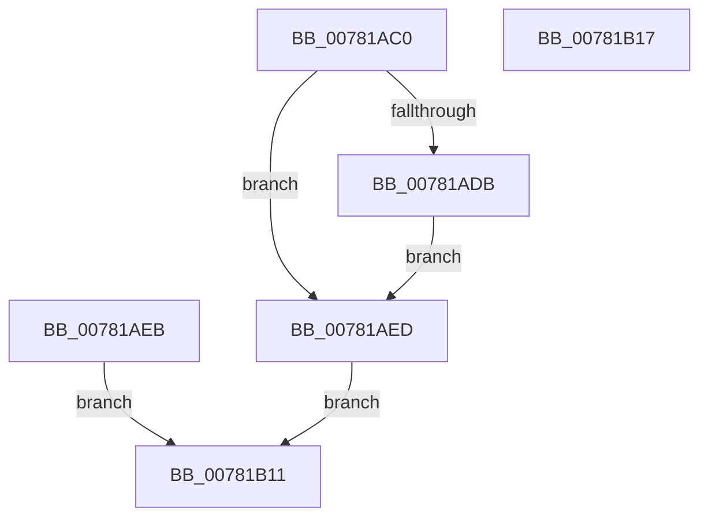

# NtGetCurrentProcessorNumberEx

- RVA: `0x00781AC0`–`0x00781B18` (길이 `88` bytes)
- VA: `0x0000000140781AC0`
- 실행 섹션: `PAGE`
- PDB 이름 있음: `예`; PDB Function 태그: `아니요`
- unwind 정보 RVA: `0x000CEA80`
- 디코드: `23`개 명령, `88/88` bytes 표시
- 미해석 바이트: `0` (있으면 어셈블리에 `.byte`로 보존)

> 이 문서는 커널 이미지의 기계어와 PDB 기호를 분석해 생성했습니다. 4번과 5번은 함수 원형과 자료형을 바이너리 사용 방식에서 추정한 C 해석이며 원본 소스 복구 결과는 아닙니다.

## 1. Dependencies

- 직접 호출 지점: **1**; 고유 호출 대상: **1**
- 직접 호출자로 확인된 함수: **0**
- RIP 상대 이미지 참조: **0**

### Outgoing calls
- `0x00781AE4` → [ProbeForWrite](../8E/ProbeForWrite_function_008E91C0.md) (function, `0x008E91C0`)

### Direct callers
- 이 함수 시작 RVA로 연결되는 직접 call은 확인되지 않았습니다. 간접 호출은 완전히 역산할 수 없습니다.

### Static image references
- 디코드된 RIP-relative 메모리 참조가 없습니다.

## 2. Other-region calls and transfers

- 다른 실행 섹션으로 향하는 call: **0**
- 별도 외부 분기/꼬리 이동을 확인하지 못했습니다.

## 3. Assembly (complete function range)

```asm
00781AC0  40 53                           push rbx
00781AC2  48 83 EC 30                     sub rsp, 0x30
00781AC6  48 8B D9                        mov rbx, rcx
00781AC9  65 48 8B 04 25 88 01 00 00      mov rax, qword ptr gs:[0x188]
00781AD2  80 B8 32 02 00 00 00            cmp byte ptr [rax + 0x232], 0
00781AD9  74 12                           je 0x140781aed
00781ADB  BA 04 00 00 00                  mov edx, 4
00781AE0  44 8D 42 FD                     lea r8d, [rdx - 3]
00781AE4  E8 D7 76 16 00                  call 0x1408e91c0
00781AE9  EB 02                           jmp 0x140781aed
00781AEB  EB 24                           jmp 0x140781b11
00781AED  65 48 8B 0C 25 20 00 00 00      mov rcx, qword ptr gs:[0x20]
00781AF6  0F B6 81 D0 00 00 00            movzx eax, byte ptr [rcx + 0xd0]
00781AFD  66 89 03                        mov word ptr [rbx], ax
00781B00  8A 81 D1 00 00 00               mov al, byte ptr [rcx + 0xd1]
00781B06  88 43 02                        mov byte ptr [rbx + 2], al
00781B09  C6 43 03 00                     mov byte ptr [rbx + 3], 0
00781B0D  33 C0                           xor eax, eax
00781B0F  EB 00                           jmp 0x140781b11
00781B11  48 83 C4 30                     add rsp, 0x30
00781B15  5B                              pop rbx
00781B16  C3                              ret
00781B17  CC                              int3
```

## 4. C-style interpretation (structured pseudocode)

```c
__int64 __fastcall NtGetCurrentProcessorNumberEx(__int64 a1)
{
    __int64 result;
    __int64 v_rsp;

    v_rsp = (v_rsp) - (48);
    if ((*(unsigned __int8 *)(*(unsigned __int64 *)(gs_base + (0 + 392)) + 562)) == 0) goto loc_00781AED;
    result = ProbeForWrite(a1, 4, 4 - 3, a4);
    goto loc_00781AED;
loc_00781AED:
    *(unsigned __int16 *)(a1) = (unsigned __int16)(*(unsigned __int8 *)(*(unsigned __int64 *)(gs_base + (0 + 32)) + 208));
    *(unsigned __int8 *)(a1 + 2) = (unsigned __int8)(*(unsigned __int8 *)(*(unsigned __int64 *)(gs_base + (0 + 32)) + 209));
    *(unsigned __int8 *)(a1 + 3) = 0;
    result = 0;
    goto loc_00781B11;
loc_00781B11:
    v_rsp = (v_rsp) + (48);
    return result;
}
```

## 5. (Beta) C Style

```c
int64_t NtGetCurrentProcessorNumberEx(void *Arg1)
{
    uint8_t *arg1 = (uint8_t *)Arg1;

    int64_t result;
    int64_t local_rsp;

    local_rsp = (local_rsp) - (48);
    if ((*(uint8_t *)(*(uint64_t *)(gs_base + (0 + 0x188)) + 0x232)) == 0) goto loc_00781AED;
    result = ProbeForWrite(Arg1, 4, 4 - 3, a4);
    goto loc_00781AED;
loc_00781AED:
    *(uint16_t *)(arg1) = (uint16_t)(*(uint8_t *)(*(uint64_t *)(gs_base + (0 + 0x20)) + 0xD0));
    *(uint8_t *)(arg1 + 0x2) = (uint8_t)(*(uint8_t *)(*(uint64_t *)(gs_base + (0 + 0x20)) + 0xD1));
    *(uint8_t *)(arg1 + 0x3) = 0;
    result = 0;
    goto loc_00781B11;
loc_00781B11:
    local_rsp = (local_rsp) + (48);
    return result;
}
```

### 관측된 메모리 오프셋

구조체 형식이 확인되지 않은 접근은 인자 기준의 오프셋으로만 기록했습니다.

| 기준 인자 | 오프셋 표현 | 폭 (bit) | 접근 |
|---|---:|---:|---|
| `Arg1` | `+ 0x0` | `16` | `W` |
| `Arg1` | `+ 0x2` | `8` | `W` |
| `Arg1` | `+ 0x3` | `8` | `W` |

## 6. Execution-region graph

[열기: 2D/3D 그래프와 함수 탐색 컨트롤 패널](../../../control-panel.html?section=page&rva=0x00781AC0&view=graph)

- 2D 그래프는 위에서 아래로 흐르고, 3D 그래프는 빈 공간을 드래그해 회전합니다. Shift+드래그는 이동, 휠은 확대·축소, 함수 노드 선택은 대상 보고서 이동입니다.

### Static fallback


