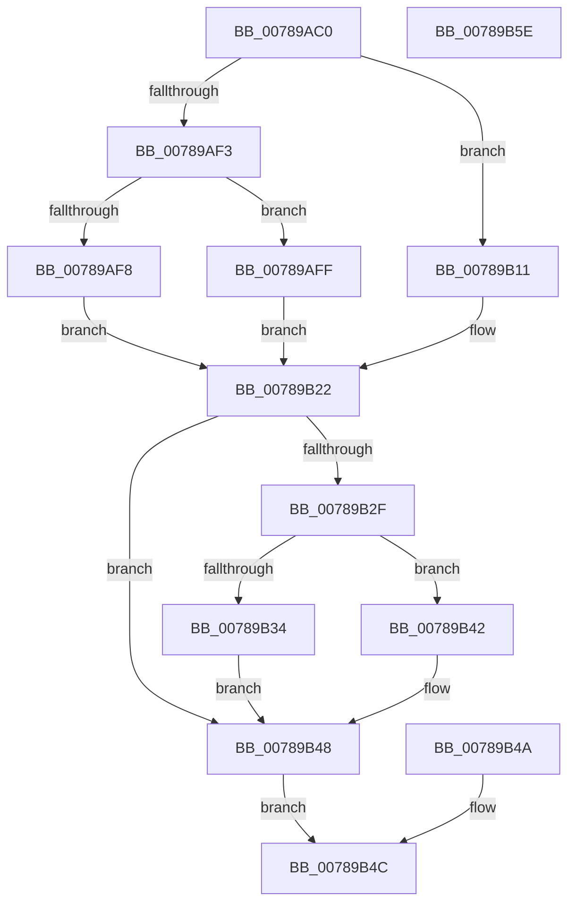

# NtManageWobTicket

- RVA: `0x00789AC0`–`0x00789B5F` (길이 `159` bytes)
- VA: `0x0000000140789AC0`
- 실행 섹션: `PAGE`
- PDB 이름 있음: `예`; PDB Function 태그: `아니요`
- unwind 정보 RVA: `0x000CF64C`
- 디코드: `49`개 명령, `159/159` bytes 표시
- 미해석 바이트: `0` (있으면 어셈블리에 `.byte`로 보존)

> 이 문서는 커널 이미지의 기계어와 PDB 기호를 분석해 생성했습니다. 4번과 5번은 함수 원형과 자료형을 바이너리 사용 방식에서 추정한 C 해석이며 원본 소스 복구 결과는 아닙니다.

## 1. Dependencies

- 직접 호출 지점: **3**; 고유 호출 대상: **3**
- 직접 호출자로 확인된 함수: **0**
- RIP 상대 이미지 참조: **0**

### Outgoing calls
- `0x00789B0A` → [PspQueryWobTicketPriority](PspQueryWobTicketPriority_function_007898C8.md) (function, `0x007898C8`)
- `0x00789B1C` → [PspQueryWobTicketQos](PspQueryWobTicketQos_function_007899B0.md) (function, `0x007899B0`)
- `0x00789B3B` → [RtlWriteULongToUser](../70/RtlWriteULongToUser_function_00705E8C.md) (function, `0x00705E8C`)

### Direct callers
- 이 함수 시작 RVA로 연결되는 직접 call은 확인되지 않았습니다. 간접 호출은 완전히 역산할 수 없습니다.

### Static image references
- 디코드된 RIP-relative 메모리 참조가 없습니다.

## 2. Other-region calls and transfers

- 다른 실행 섹션으로 향하는 call: **0**
- 별도 외부 분기/꼬리 이동을 확인하지 못했습니다.

## 3. Assembly (complete function range)

```asm
00789AC0  48 89 5C 24 10                  mov qword ptr [rsp + 0x10], rbx
00789AC5  48 89 74 24 18                  mov qword ptr [rsp + 0x18], rsi
00789ACA  57                              push rdi
00789ACB  48 83 EC 30                     sub rsp, 0x30
00789ACF  49 8B F9                        mov rdi, r9
00789AD2  4C 8B D2                        mov r10, rdx
00789AD5  83 64 24 20 00                  and dword ptr [rsp + 0x20], 0
00789ADA  65 48 8B 04 25 88 01 00 00      mov rax, qword ptr gs:[0x188]
00789AE3  40 8A B0 32 02 00 00            mov sil, byte ptr [rax + 0x232]
00789AEA  40 88 74 24 40                  mov byte ptr [rsp + 0x40], sil
00789AEF  85 C9                           test ecx, ecx
00789AF1  74 1E                           je 0x140789b11
00789AF3  83 F9 01                        cmp ecx, 1
00789AF6  74 07                           je 0x140789aff
00789AF8  B8 03 00 00 C0                  mov eax, 0xc0000003
00789AFD  EB 23                           jmp 0x140789b22
00789AFF  4C 8D 4C 24 20                  lea r9, [rsp + 0x20]
00789B04  40 8A D6                        mov dl, sil
00789B07  49 8B CA                        mov rcx, r10
00789B0A  E8 B9 FD FF FF                  call 0x1407898c8
00789B0F  EB 11                           jmp 0x140789b22
00789B11  4C 8D 4C 24 20                  lea r9, [rsp + 0x20]
00789B16  40 8A D6                        mov dl, sil
00789B19  49 8B CA                        mov rcx, r10
00789B1C  E8 8F FE FF FF                  call 0x1407899b0
00789B21  90                              nop
00789B22  90                              nop
00789B23  33 DB                           xor ebx, ebx
00789B25  85 C0                           test eax, eax
00789B27  0F 48 D8                        cmovs ebx, eax
00789B2A  48 85 FF                        test rdi, rdi
00789B2D  74 19                           je 0x140789b48
00789B2F  40 84 F6                        test sil, sil
00789B32  74 0E                           je 0x140789b42
00789B34  8B 54 24 20                     mov edx, dword ptr [rsp + 0x20]
00789B38  48 8B CF                        mov rcx, rdi
00789B3B  E8 4C C3 F7 FF                  call 0x140705e8c
00789B40  EB 06                           jmp 0x140789b48
00789B42  8B 44 24 20                     mov eax, dword ptr [rsp + 0x20]
00789B46  89 07                           mov dword ptr [rdi], eax
00789B48  EB 02                           jmp 0x140789b4c
00789B4A  8B D8                           mov ebx, eax
00789B4C  8B C3                           mov eax, ebx
00789B4E  48 8B 5C 24 48                  mov rbx, qword ptr [rsp + 0x48]
00789B53  48 8B 74 24 50                  mov rsi, qword ptr [rsp + 0x50]
00789B58  48 83 C4 30                     add rsp, 0x30
00789B5C  5F                              pop rdi
00789B5D  C3                              ret
00789B5E  CC                              int3
```

## 4. C-style interpretation (structured pseudocode)

```c
__int64 __fastcall NtManageWobTicket(int a1, __int64 a2, __int64 a3, __int64 a4)
{
    __int64 result;
    __int64 v_rbx;
    __int64 v_rsp;
    unsigned int v_stack_m18;
    unsigned __int64 v_stack_p10;
    unsigned __int64 v_stack_p18;
    unsigned __int8 v_stack_p8;

    v_stack_p10 = v_rbx;
    v_stack_p18 = v_rsi;
    v_rsp = (v_rsp) - (48);
    v_stack_p8 = (unsigned __int8)(*(unsigned __int8 *)(*(unsigned __int64 *)(gs_base + (0 + 392)) + 562));
    if (a1 == 0) goto loc_00789B11;
    if (a1 == 1) goto loc_00789AFF;
    goto loc_00789B22;
loc_00789AFF:
    result = PspQueryWobTicketPriority(a2, (unsigned __int8)(*(unsigned __int8 *)(*(unsigned __int64 *)(gs_base + (0 + 392)) + 562)), a3, v_stack_m18);
    goto loc_00789B22;
loc_00789B11:
    result = PspQueryWobTicketQos(a2, (unsigned __int8)(*(unsigned __int8 *)(*(unsigned __int64 *)(gs_base + (0 + 392)) + 562)), a3, v_stack_m18);
loc_00789B22:
    v_rbx = 0;
    if (sign_flag) { v_rbx = (unsigned int)(result); }
    if (a4 == 0) goto loc_00789B48;
    if ((unsigned __int8)(*(unsigned __int8 *)(*(unsigned __int64 *)(gs_base + (0 + 392)) + 562)) == 0) goto loc_00789B42;
    result = RtlWriteULongToUser(a4, (unsigned int)(v_stack_m18), a3, v_stack_m18);
    goto loc_00789B48;
loc_00789B42:
    *(unsigned int *)(a4) = (unsigned int)((unsigned int)(v_stack_m18));
loc_00789B48:
    goto loc_00789B4C;
loc_00789B4C:
    v_rsp = (v_rsp) + (48);
    return (unsigned int)((unsigned int)(v_rbx));
}
```

## 5. (Beta) C Style

```c
int64_t NtManageWobTicket(int32_t Arg1, int64_t Arg2, int64_t Arg3, int64_t Arg4)
{
    int64_t result;
    int64_t local_rbx;
    int64_t local_rsp;
    uint32_t v_stack_m18;
    uint64_t v_stack_p10;
    uint64_t v_stack_p18;
    uint8_t v_stack_p8;

    v_stack_p10 = local_rbx;
    v_stack_p18 = local_rsi;
    local_rsp = (local_rsp) - (48);
    v_stack_p8 = (uint8_t)(*(uint8_t *)(*(uint64_t *)(gs_base + (0 + 0x188)) + 0x232));
    if (Arg1 == 0) goto loc_00789B11;
    if (Arg1 == 1) goto loc_00789AFF;
    goto loc_00789B22;
loc_00789AFF:
    result = PspQueryWobTicketPriority(Arg2, (uint8_t)(*(uint8_t *)(*(uint64_t *)(gs_base + (0 + 0x188)) + 0x232)), Arg3, v_stack_m18);
    goto loc_00789B22;
loc_00789B11:
    result = PspQueryWobTicketQos(Arg2, (uint8_t)(*(uint8_t *)(*(uint64_t *)(gs_base + (0 + 0x188)) + 0x232)), Arg3, v_stack_m18);
loc_00789B22:
    local_rbx = 0;
    if (sign_flag) { local_rbx = (uint32_t)(result); }
    if (Arg4 == 0) goto loc_00789B48;
    if ((uint8_t)(*(uint8_t *)(*(uint64_t *)(gs_base + (0 + 0x188)) + 0x232)) == 0) goto loc_00789B42;
    result = RtlWriteULongToUser(Arg4, (uint32_t)(v_stack_m18), Arg3, v_stack_m18);
    goto loc_00789B48;
loc_00789B42:
    *(uint32_t *)(Arg4) = (uint32_t)((uint32_t)(v_stack_m18));
loc_00789B48:
    goto loc_00789B4C;
loc_00789B4C:
    local_rsp = (local_rsp) + (48);
    return (uint32_t)((uint32_t)(local_rbx));
}
```

## 6. Execution-region graph

[열기: 2D/3D 그래프와 함수 탐색 컨트롤 패널](../../../control-panel.html?section=page&rva=0x00789AC0&view=graph)

- 2D 그래프는 위에서 아래로 흐르고, 3D 그래프는 빈 공간을 드래그해 회전합니다. Shift+드래그는 이동, 휠은 확대·축소, 함수 노드 선택은 대상 보고서 이동입니다.

### Static fallback


