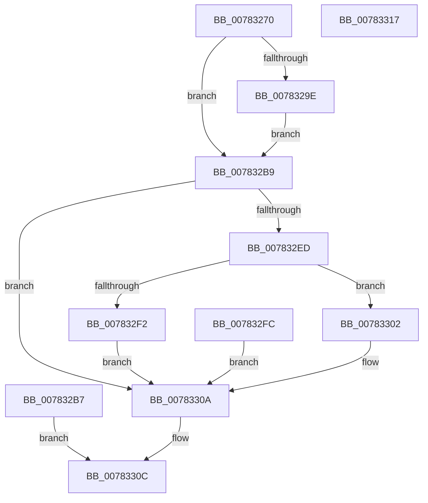

# NtOpenCpuPartition

- RVA: `0x00783270`–`0x00783318` (길이 `168` bytes)
- VA: `0x0000000140783270`
- 실행 섹션: `PAGE`
- PDB 이름 있음: `예`; PDB Function 태그: `아니요`
- unwind 정보 RVA: `0x000CEFC0`
- 디코드: `46`개 명령, `168/168` bytes 표시
- 미해석 바이트: `0` (있으면 어셈블리에 `.byte`로 보존)

> 이 문서는 커널 이미지의 기계어와 PDB 기호를 분석해 생성했습니다. 4번과 5번은 함수 원형과 자료형을 바이너리 사용 방식에서 추정한 C 해석이며 원본 소스 복구 결과는 아닙니다.

## 1. Dependencies

- 직접 호출 지점: **1**; 고유 호출 대상: **1**
- 직접 호출자로 확인된 함수: **0**
- RIP 상대 이미지 참조: **1**

### Outgoing calls
- `0x007832DE` → [ObOpenObjectByName](../89/ObOpenObjectByName_function_00899F50.md) (function, `0x00899F50`)

### Direct callers
- 이 함수 시작 RVA로 연결되는 직접 call은 확인되지 않았습니다. 간접 호출은 완전히 역산할 수 없습니다.

### Static image references
- `0x007832D4` → RVA `0x00FC6DF0` (`ALMOSTRO`; read)

## 2. Other-region calls and transfers

- 다른 실행 섹션으로 향하는 call: **0**
- 별도 외부 분기/꼬리 이동을 확인하지 못했습니다.

## 3. Assembly (complete function range)

```asm
00783270  48 89 5C 24 08                  mov qword ptr [rsp + 8], rbx
00783275  57                              push rdi
00783276  48 83 EC 50                     sub rsp, 0x50
0078327A  4D 8B D0                        mov r10, r8
0078327D  44 8B C2                        mov r8d, edx
00783280  48 8B D9                        mov rbx, rcx
00783283  48 83 64 24 40 00               and qword ptr [rsp + 0x40], 0
00783289  65 48 8B 04 25 88 01 00 00      mov rax, qword ptr gs:[0x188]
00783292  40 8A B8 32 02 00 00            mov dil, byte ptr [rax + 0x232]
00783299  40 84 FF                        test dil, dil
0078329C  74 1B                           je 0x1407832b9
0078329E  48 BA 00 00 FF FF FF 7F 00 00   movabs rdx, 0x7fffffff0000
007832A8  48 3B CA                        cmp rcx, rdx
007832AB  48 0F 42 D1                     cmovb rdx, rcx
007832AF  48 8B 02                        mov rax, qword ptr [rdx]
007832B2  48 89 02                        mov qword ptr [rdx], rax
007832B5  EB 02                           jmp 0x1407832b9
007832B7  EB 53                           jmp 0x14078330c
007832B9  48 8D 44 24 40                  lea rax, [rsp + 0x40]
007832BE  48 89 44 24 30                  mov qword ptr [rsp + 0x30], rax
007832C3  48 83 64 24 28 00               and qword ptr [rsp + 0x28], 0
007832C9  44 89 44 24 20                  mov dword ptr [rsp + 0x20], r8d
007832CE  45 33 C9                        xor r9d, r9d
007832D1  44 8A C7                        mov r8b, dil
007832D4  48 8B 15 15 3B 84 00            mov rdx, qword ptr [rip + 0x843b15]
007832DB  49 8B CA                        mov rcx, r10
007832DE  E8 6D 6C 11 00                  call 0x140899f50
007832E3  8B D0                           mov edx, eax
007832E5  89 44 24 78                     mov dword ptr [rsp + 0x78], eax
007832E9  85 C0                           test eax, eax
007832EB  78 1D                           js 0x14078330a
007832ED  40 84 FF                        test dil, dil
007832F0  74 10                           je 0x140783302
007832F2  48 8B 4C 24 40                  mov rcx, qword ptr [rsp + 0x40]
007832F7  48 89 0B                        mov qword ptr [rbx], rcx
007832FA  EB 0E                           jmp 0x14078330a
007832FC  8B 54 24 78                     mov edx, dword ptr [rsp + 0x78]
00783300  EB 08                           jmp 0x14078330a
00783302  48 8B 44 24 40                  mov rax, qword ptr [rsp + 0x40]
00783307  48 89 03                        mov qword ptr [rbx], rax
0078330A  8B C2                           mov eax, edx
0078330C  48 8B 5C 24 60                  mov rbx, qword ptr [rsp + 0x60]
00783311  48 83 C4 50                     add rsp, 0x50
00783315  5F                              pop rdi
00783316  C3                              ret
00783317  CC                              int3
```

## 4. C-style interpretation (structured pseudocode)

```c
__int64 __fastcall NtOpenCpuPartition(__int64 a1, int a2, __int64 a3, int a4)
{
    __int64 result;
    __int64 v_rsp;
    unsigned __int64 v_stack_m18;
    unsigned __int64 v_stack_m28;
    unsigned __int64 v_stack_m30;
    unsigned int v_stack_m38;
    unsigned int v_stack_p20;
    unsigned __int64 v_stack_p8;

    v_stack_p8 = v_rbx;
    v_rsp = (v_rsp) - (80);
    if ((unsigned __int8)(*(unsigned __int8 *)(*(unsigned __int64 *)(gs_base + (0 + 392)) + 562)) == 0) goto loc_007832B9;
    if (a1 < a2) { a2 = a1; }
    *(unsigned __int64 *)(a2) = *(unsigned __int64 *)(a2);
    goto loc_007832B9;
loc_007832B9:
    v_stack_m28 = v_stack_m18;
    v_stack_m38 = (unsigned int)((unsigned int)(a2));
    a4 = 0;
    result = ObOpenObjectByName(a3, *(unsigned __int64 *)(v_rip + 8665877), (unsigned __int8)(*(unsigned __int8 *)(*(unsigned __int64 *)(gs_base + (0 + 392)) + 562)), a4);
    v_stack_p20 = (unsigned int)(result);
    if (sign_flag) goto loc_0078330A;
    if ((unsigned __int8)(*(unsigned __int8 *)(*(unsigned __int64 *)(gs_base + (0 + 392)) + 562)) == 0) goto loc_00783302;
    *(unsigned __int64 *)(a1) = v_stack_m18;
    goto loc_0078330A;
loc_00783302:
    *(unsigned __int64 *)(a1) = v_stack_m18;
loc_0078330A:
loc_0078330C:
    v_rsp = (v_rsp) + (80);
    return (unsigned int)((unsigned int)((unsigned int)((unsigned int)(result))));
}
```

## 5. (Beta) C Style

```c
int64_t NtOpenCpuPartition(void *Arg1, int32_t Arg2, int64_t Arg3, int32_t Arg4)
{
    uint8_t *arg1 = (uint8_t *)Arg1;

    int64_t result;
    int64_t local_rsp;
    uint64_t v_stack_m18;
    uint64_t v_stack_m28;
    uint64_t v_stack_m30;
    uint32_t v_stack_m38;
    uint32_t v_stack_p20;
    uint64_t v_stack_p8;

    v_stack_p8 = local_rbx;
    local_rsp = (local_rsp) - (80);
    if ((uint8_t)(*(uint8_t *)(*(uint64_t *)(gs_base + (0 + 0x188)) + 0x232)) == 0) goto loc_007832B9;
    if (Arg1 < Arg2) { Arg2 = Arg1; }
    *(uint64_t *)(Arg2) = *(uint64_t *)(Arg2);
    goto loc_007832B9;
loc_007832B9:
    v_stack_m28 = v_stack_m18;
    v_stack_m38 = (uint32_t)((uint32_t)(Arg2));
    Arg4 = 0;
    result = ObOpenObjectByName(Arg3, *(uint64_t *)(v_rip + 0x843B15), (uint8_t)(*(uint8_t *)(*(uint64_t *)(gs_base + (0 + 0x188)) + 0x232)), Arg4);
    v_stack_p20 = (uint32_t)(result);
    if (sign_flag) goto loc_0078330A;
    if ((uint8_t)(*(uint8_t *)(*(uint64_t *)(gs_base + (0 + 0x188)) + 0x232)) == 0) goto loc_00783302;
    *(uint64_t *)(arg1) = v_stack_m18;
    goto loc_0078330A;
loc_00783302:
    *(uint64_t *)(arg1) = v_stack_m18;
loc_0078330A:
loc_0078330C:
    local_rsp = (local_rsp) + (80);
    return (uint32_t)((uint32_t)((uint32_t)((uint32_t)(result))));
}
```

### 관측된 메모리 오프셋

구조체 형식이 확인되지 않은 접근은 인자 기준의 오프셋으로만 기록했습니다.

| 기준 인자 | 오프셋 표현 | 폭 (bit) | 접근 |
|---|---:|---:|---|
| `Arg1` | `+ 0x0` | `64` | `W` |

## 6. Execution-region graph

[열기: 2D/3D 그래프와 함수 탐색 컨트롤 패널](../../../control-panel.html?section=page&rva=0x00783270&view=graph)

- 2D 그래프는 위에서 아래로 흐르고, 3D 그래프는 빈 공간을 드래그해 회전합니다. Shift+드래그는 이동, 휠은 확대·축소, 함수 노드 선택은 대상 보고서 이동입니다.

### Static fallback


