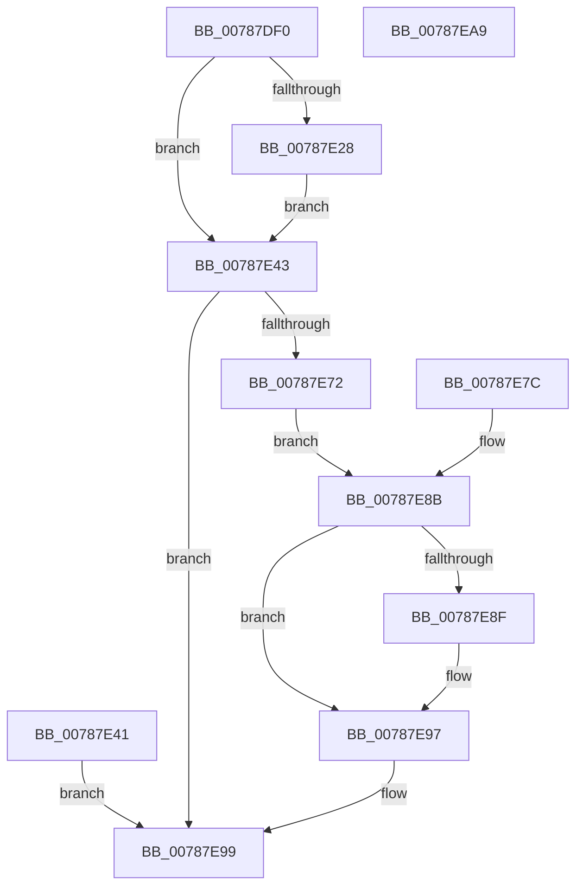

# NtOpenPartition

- RVA: `0x00787DF0`–`0x00787EAA` (길이 `186` bytes)
- VA: `0x0000000140787DF0`
- 실행 섹션: `PAGE`
- PDB 이름 있음: `예`; PDB Function 태그: `아니요`
- unwind 정보 RVA: `0x000CF4F4`
- 디코드: `48`개 명령, `186/186` bytes 표시
- 미해석 바이트: `0` (있으면 어셈블리에 `.byte`로 보존)

> 이 문서는 커널 이미지의 기계어와 PDB 기호를 분석해 생성했습니다. 4번과 5번은 함수 원형과 자료형을 바이너리 사용 방식에서 추정한 C 해석이며 원본 소스 복구 결과는 아닙니다.

## 1. Dependencies

- 직접 호출 지점: **2**; 고유 호출 대상: **2**
- 직접 호출자로 확인된 함수: **0**
- RIP 상대 이미지 참조: **1**

### Outgoing calls
- `0x00787E67` → [ObOpenObjectByName](../89/ObOpenObjectByName_function_00899F50.md) (function, `0x00899F50`)
- `0x00787E92` → [ObCloseHandle](../8A/ObCloseHandle_function_008A1870.md) (function, `0x008A1870`)

### Direct callers
- 이 함수 시작 RVA로 연결되는 직접 call은 확인되지 않았습니다. 간접 호출은 완전히 역산할 수 없습니다.

### Static image references
- `0x00787E5D` → RVA `0x00FC6EB8` (`ALMOSTRO`; read)

## 2. Other-region calls and transfers

- 다른 실행 섹션으로 향하는 call: **0**
- 별도 외부 분기/꼬리 이동을 확인하지 못했습니다.

## 3. Assembly (complete function range)

```asm
00787DF0  48 89 5C 24 08                  mov qword ptr [rsp + 8], rbx
00787DF5  48 89 74 24 10                  mov qword ptr [rsp + 0x10], rsi
00787DFA  57                              push rdi
00787DFB  48 83 EC 60                     sub rsp, 0x60
00787DFF  4D 8B D0                        mov r10, r8
00787E02  48 8B F1                        mov rsi, rcx
00787E05  48 83 64 24 48 00               and qword ptr [rsp + 0x48], 0
00787E0B  65 48 8B 04 25 88 01 00 00      mov rax, qword ptr gs:[0x188]
00787E14  40 8A B8 32 02 00 00            mov dil, byte ptr [rax + 0x232]
00787E1B  40 88 BC 24 88 00 00 00         mov byte ptr [rsp + 0x88], dil
00787E23  40 84 FF                        test dil, dil
00787E26  74 1B                           je 0x140787e43
00787E28  48 B9 00 00 FF FF FF 7F 00 00   movabs rcx, 0x7fffffff0000
00787E32  48 3B F1                        cmp rsi, rcx
00787E35  48 0F 42 CE                     cmovb rcx, rsi
00787E39  48 8B 01                        mov rax, qword ptr [rcx]
00787E3C  48 89 01                        mov qword ptr [rcx], rax
00787E3F  EB 02                           jmp 0x140787e43
00787E41  EB 56                           jmp 0x140787e99
00787E43  48 8D 44 24 48                  lea rax, [rsp + 0x48]
00787E48  48 89 44 24 30                  mov qword ptr [rsp + 0x30], rax
00787E4D  48 83 64 24 28 00               and qword ptr [rsp + 0x28], 0
00787E53  89 54 24 20                     mov dword ptr [rsp + 0x20], edx
00787E57  45 33 C9                        xor r9d, r9d
00787E5A  44 8A C7                        mov r8b, dil
00787E5D  48 8B 15 54 F0 83 00            mov rdx, qword ptr [rip + 0x83f054]
00787E64  49 8B CA                        mov rcx, r10
00787E67  E8 E4 20 11 00                  call 0x140899f50
00787E6C  8B D8                           mov ebx, eax
00787E6E  85 C0                           test eax, eax
00787E70  78 27                           js 0x140787e99
00787E72  48 8B 4C 24 48                  mov rcx, qword ptr [rsp + 0x48]
00787E77  48 89 0E                        mov qword ptr [rsi], rcx
00787E7A  EB 0F                           jmp 0x140787e8b
00787E7C  8B D8                           mov ebx, eax
00787E7E  48 8B 4C 24 48                  mov rcx, qword ptr [rsp + 0x48]
00787E83  40 8A BC 24 88 00 00 00         mov dil, byte ptr [rsp + 0x88]
00787E8B  85 DB                           test ebx, ebx
00787E8D  79 08                           jns 0x140787e97
00787E8F  40 8A D7                        mov dl, dil
00787E92  E8 D9 99 11 00                  call 0x1408a1870
00787E97  8B C3                           mov eax, ebx
00787E99  48 8B 5C 24 70                  mov rbx, qword ptr [rsp + 0x70]
00787E9E  48 8B 74 24 78                  mov rsi, qword ptr [rsp + 0x78]
00787EA3  48 83 C4 60                     add rsp, 0x60
00787EA7  5F                              pop rdi
00787EA8  C3                              ret
00787EA9  CC                              int3
```

## 4. C-style interpretation (structured pseudocode)

```c
__int64 __fastcall NtOpenPartition(__int64 a1, int a2, __int64 a3, int a4)
{
    __int64 result;
    __int64 v_rsp;
    unsigned __int64 v_stack_m20;
    unsigned __int64 v_stack_m38;
    unsigned __int64 v_stack_m40;
    unsigned int v_stack_m48;
    unsigned __int64 v_stack_p10;
    unsigned __int8 v_stack_p20;
    unsigned __int64 v_stack_p8;

    v_stack_p8 = v_rbx;
    v_stack_p10 = v_rsi;
    v_rsp = (v_rsp) - (96);
    v_stack_p20 = (unsigned __int8)(*(unsigned __int8 *)(*(unsigned __int64 *)(gs_base + (0 + 392)) + 562));
    if ((unsigned __int8)(*(unsigned __int8 *)(*(unsigned __int64 *)(gs_base + (0 + 392)) + 562)) == 0) goto loc_00787E43;
    if (a1 < a1) { a1 = a1; }
    *(unsigned __int64 *)(a1) = *(unsigned __int64 *)(a1);
    goto loc_00787E43;
loc_00787E43:
    v_stack_m38 = v_stack_m20;
    v_stack_m48 = a2;
    a4 = 0;
    result = ObOpenObjectByName(a3, *(unsigned __int64 *)(v_rip + 8646740), (unsigned __int8)(*(unsigned __int8 *)(*(unsigned __int64 *)(gs_base + (0 + 392)) + 562)), a4);
    if (sign_flag) goto loc_00787E99;
    *(unsigned __int64 *)(a1) = v_stack_m20;
    goto loc_00787E8B;
loc_00787E8B:
    if (sign_flag) {
        a2 = (unsigned __int8)(*(unsigned __int8 *)(*(unsigned __int64 *)(gs_base + (0 + 392)) + 562));
        result = ObCloseHandle(v_stack_m20, a2, (unsigned __int8)(*(unsigned __int8 *)(*(unsigned __int64 *)(gs_base + (0 + 392)) + 562)), a4);
    }
loc_00787E99:
    v_rsp = (v_rsp) + (96);
    return (unsigned int)((unsigned int)((unsigned int)((unsigned int)(result))));
}
```

## 5. (Beta) C Style

```c
int64_t NtOpenPartition(int64_t Arg1, int32_t Arg2, int64_t Arg3, int32_t Arg4)
{
    int64_t result;
    int64_t local_rsp;
    uint64_t v_stack_m20;
    uint64_t v_stack_m38;
    uint64_t v_stack_m40;
    uint32_t v_stack_m48;
    uint64_t v_stack_p10;
    uint8_t v_stack_p20;
    uint64_t v_stack_p8;

    v_stack_p8 = local_rbx;
    v_stack_p10 = local_rsi;
    local_rsp = (local_rsp) - (96);
    v_stack_p20 = (uint8_t)(*(uint8_t *)(*(uint64_t *)(gs_base + (0 + 0x188)) + 0x232));
    if ((uint8_t)(*(uint8_t *)(*(uint64_t *)(gs_base + (0 + 0x188)) + 0x232)) == 0) goto loc_00787E43;
    if (Arg1 < Arg1) { Arg1 = Arg1; }
    *(uint64_t *)(Arg1) = *(uint64_t *)(Arg1);
    goto loc_00787E43;
loc_00787E43:
    v_stack_m38 = v_stack_m20;
    v_stack_m48 = Arg2;
    Arg4 = 0;
    result = ObOpenObjectByName(Arg3, *(uint64_t *)(v_rip + 0x83F054), (uint8_t)(*(uint8_t *)(*(uint64_t *)(gs_base + (0 + 0x188)) + 0x232)), Arg4);
    if (sign_flag) goto loc_00787E99;
    *(uint64_t *)(Arg1) = v_stack_m20;
    goto loc_00787E8B;
loc_00787E8B:
    if (sign_flag) {
        Arg2 = (uint8_t)(*(uint8_t *)(*(uint64_t *)(gs_base + (0 + 0x188)) + 0x232));
        result = ObCloseHandle(v_stack_m20, Arg2, (uint8_t)(*(uint8_t *)(*(uint64_t *)(gs_base + (0 + 0x188)) + 0x232)), Arg4);
    }
loc_00787E99:
    local_rsp = (local_rsp) + (96);
    return (uint32_t)((uint32_t)((uint32_t)((uint32_t)(result))));
}
```

## 6. Execution-region graph

[열기: 2D/3D 그래프와 함수 탐색 컨트롤 패널](../../../control-panel.html?section=page&rva=0x00787DF0&view=graph)

- 2D 그래프는 위에서 아래로 흐르고, 3D 그래프는 빈 공간을 드래그해 회전합니다. Shift+드래그는 이동, 휠은 확대·축소, 함수 노드 선택은 대상 보고서 이동입니다.

### Static fallback


