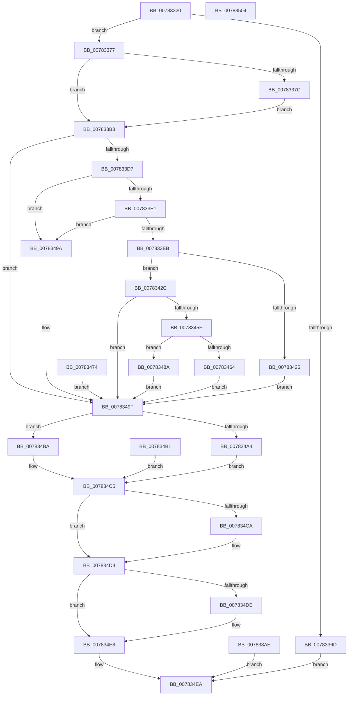

# NtQueryInformationCpuPartition

- RVA: `0x00783320`–`0x00783505` (길이 `485` bytes)
- VA: `0x0000000140783320`
- 실행 섹션: `PAGE`
- PDB 이름 있음: `예`; PDB Function 태그: `아니요`
- unwind 정보 RVA: `0x000CF0A4`
- 디코드: `128`개 명령, `485/485` bytes 표시
- 미해석 바이트: `0` (있으면 어셈블리에 `.byte`로 보존)

> 이 문서는 커널 이미지의 기계어와 PDB 기호를 분석해 생성했습니다. 4번과 5번은 함수 원형과 자료형을 바이너리 사용 방식에서 추정한 C 해석이며 원본 소스 복구 결과는 아닙니다.

## 1. Dependencies

- 직접 호출 지점: **9**; 고유 호출 대상: **8**
- 직접 호출자로 확인된 함수: **0**
- RIP 상대 이미지 참조: **0**

### Outgoing calls
- `0x007833A7` → [ProbeForWrite](../8E/ProbeForWrite_function_008E91C0.md) (function, `0x008E91C0`)
- `0x007833C8` → [PspReferenceCpuPartitionByHandle](PspReferenceCpuPartitionByHandle_function_007846F4.md) (function, `0x007846F4`)
- `0x007833F0` → [KeQueryMaximumGroupCount](../../text/48/KeQueryMaximumGroupCount_function_0048B760.md) (function, `0x0048B760`)
- `0x00783413` → [ExAllocatePool2](../../poolcode/B8/ExAllocatePool2_function_00B820F0.md) (function, `0x00B820F0`)
- `0x00783445` → [KeQueryCpuPartitionAffinity](../../text/5C/KeQueryCpuPartitionAffinity_function_005C0EF8.md) (function, `0x005C0EF8`)
- `0x0078346D` → [memcpy](../../text/6C/memcpy_function_006C6840.md) (function, `0x006C6840`)
- `0x00783493` → [memcpy](../../text/6C/memcpy_function_006C6840.md) (function, `0x006C6840`)
- `0x007834CF` → [ExFreePoolWithTag](../../poolcode/B8/ExFreePoolWithTag_function_00B82870.md) (function, `0x00B82870`)
- `0x007834E3` → [ObfDereferenceObjectWithTag](../../text/2F/ObfDereferenceObjectWithTag_function_002F78E0.md) (function, `0x002F78E0`)

### Direct callers
- 이 함수 시작 RVA로 연결되는 직접 call은 확인되지 않았습니다. 간접 호출은 완전히 역산할 수 없습니다.

### Static image references
- 디코드된 RIP-relative 메모리 참조가 없습니다.

## 2. Other-region calls and transfers

- 다른 실행 섹션으로 향하는 call: **7**
  - `0x007833F0` → [KeQueryMaximumGroupCount](../../text/48/KeQueryMaximumGroupCount_function_0048B760.md) (`PAGE` → `.text`)
  - `0x00783413` → [ExAllocatePool2](../../poolcode/B8/ExAllocatePool2_function_00B820F0.md) (`PAGE` → `POOLCODE`)
  - `0x00783445` → [KeQueryCpuPartitionAffinity](../../text/5C/KeQueryCpuPartitionAffinity_function_005C0EF8.md) (`PAGE` → `.text`)
  - `0x0078346D` → [memcpy](../../text/6C/memcpy_function_006C6840.md) (`PAGE` → `.text`)
  - `0x00783493` → [memcpy](../../text/6C/memcpy_function_006C6840.md) (`PAGE` → `.text`)
  - `0x007834CF` → [ExFreePoolWithTag](../../poolcode/B8/ExFreePoolWithTag_function_00B82870.md) (`PAGE` → `POOLCODE`)
  - `0x007834E3` → [ObfDereferenceObjectWithTag](../../text/2F/ObfDereferenceObjectWithTag_function_002F78E0.md) (`PAGE` → `.text`)
- 별도 외부 분기/꼬리 이동을 확인하지 못했습니다.

## 3. Assembly (complete function range)

```asm
00783320  48 89 5C 24 08                  mov qword ptr [rsp + 8], rbx
00783325  48 89 74 24 18                  mov qword ptr [rsp + 0x18], rsi
0078332A  57                              push rdi
0078332B  41 54                           push r12
0078332D  41 55                           push r13
0078332F  41 56                           push r14
00783331  41 57                           push r15
00783333  48 83 EC 50                     sub rsp, 0x50
00783337  45 8B E1                        mov r12d, r9d
0078333A  4D 8B E8                        mov r13, r8
0078333D  48 8B F1                        mov rsi, rcx
00783340  33 DB                           xor ebx, ebx
00783342  48 89 5C 24 40                  mov qword ptr [rsp + 0x40], rbx
00783347  8B FB                           mov edi, ebx
00783349  48 89 5C 24 38                  mov qword ptr [rsp + 0x38], rbx
0078334E  44 8B F3                        mov r14d, ebx
00783351  65 48 8B 04 25 88 01 00 00      mov rax, qword ptr gs:[0x188]
0078335A  44 8A B8 32 02 00 00            mov r15b, byte ptr [rax + 0x232]
00783361  44 88 BC 24 88 00 00 00         mov byte ptr [rsp + 0x88], r15b
00783369  85 D2                           test edx, edx
0078336B  74 0A                           je 0x140783377
0078336D  B8 03 00 00 C0                  mov eax, 0xc0000003
00783372  E9 73 01 00 00                  jmp 0x1407834ea
00783377  45 84 FF                        test r15b, r15b
0078337A  74 37                           je 0x1407833b3
0078337C  48 B9 00 00 FF FF FF 7F 00 00   movabs rcx, 0x7fffffff0000
00783386  48 39 8C 24 A0 00 00 00         cmp qword ptr [rsp + 0xa0], rcx
0078338E  48 0F 42 8C 24 A0 00 00 00      cmovb rcx, qword ptr [rsp + 0xa0]
00783397  8B 01                           mov eax, dword ptr [rcx]
00783399  89 01                           mov dword ptr [rcx], eax
0078339B  49 8B D4                        mov rdx, r12
0078339E  41 B8 08 00 00 00               mov r8d, 8
007833A4  49 8B CD                        mov rcx, r13
007833A7  E8 14 5E 16 00                  call 0x1408e91c0
007833AC  EB 05                           jmp 0x1407833b3
007833AE  E9 37 01 00 00                  jmp 0x1407834ea
007833B3  48 8D 44 24 40                  lea rax, [rsp + 0x40]
007833B8  48 89 44 24 20                  mov qword ptr [rsp + 0x20], rax
007833BD  45 8A C7                        mov r8b, r15b
007833C0  BA 01 00 00 00                  mov edx, 1
007833C5  48 8B CE                        mov rcx, rsi
007833C8  E8 27 13 00 00                  call 0x1407846f4
007833CD  8B F0                           mov esi, eax
007833CF  85 C0                           test eax, eax
007833D1  0F 88 C8 00 00 00               js 0x14078349f
007833D7  41 83 FC 10                     cmp r12d, 0x10
007833DB  0F 82 B9 00 00 00               jb 0x14078349a
007833E1  41 F6 C4 0F                     test r12b, 0xf
007833E5  0F 85 AF 00 00 00               jne 0x14078349a
007833EB  66 41 C1 EC 04                  shr r12w, 4
007833F0  E8 6B 83 D0 FF                  call 0x14048b760
007833F5  0F B7 F0                        movzx esi, ax
007833F8  66 44 3B E0                     cmp r12w, ax
007833FC  66 41 0F 42 F4                  cmovb si, r12w
00783401  0F B7 D6                        movzx edx, si
00783404  48 C1 E2 04                     shl rdx, 4
00783408  B9 01 01 00 00                  mov ecx, 0x101
0078340D  41 B8 50 73 70 50               mov r8d, 0x50707350
00783413  E8 D8 EC 3F 00                  call 0x140b820f0
00783418  48 8B F8                        mov rdi, rax
0078341B  48 89 44 24 38                  mov qword ptr [rsp + 0x38], rax
00783420  48 85 C0                        test rax, rax
00783423  75 07                           jne 0x14078342c
00783425  BE 9A 00 00 C0                  mov esi, 0xc000009a
0078342A  EB 73                           jmp 0x14078349f
0078342C  66 89 5C 24 30                  mov word ptr [rsp + 0x30], bx
00783431  4C 8D 4C 24 30                  lea r9, [rsp + 0x30]
00783436  44 0F B7 C6                     movzx r8d, si
0078343A  48 8B D7                        mov rdx, rdi
0078343D  48 8B 4C 24 40                  mov rcx, qword ptr [rsp + 0x40]
00783442  48 8B 09                        mov rcx, qword ptr [rcx]
00783445  E8 AE DA E3 FF                  call 0x1405c0ef8
0078344A  8B F0                           mov esi, eax
0078344C  44 0F B7 74 24 30               movzx r14d, word ptr [rsp + 0x30]
00783452  41 C1 E6 04                     shl r14d, 4
00783456  44 89 74 24 30                  mov dword ptr [rsp + 0x30], r14d
0078345B  85 C0                           test eax, eax
0078345D  78 40                           js 0x14078349f
0078345F  45 84 FF                        test r15b, r15b
00783462  74 26                           je 0x14078348a
00783464  45 8B C6                        mov r8d, r14d
00783467  48 8B D7                        mov rdx, rdi
0078346A  49 8B CD                        mov rcx, r13
0078346D  E8 CE 33 F4 FF                  call 0x1406c6840
00783472  EB 2B                           jmp 0x14078349f
00783474  8B F0                           mov esi, eax
00783476  48 8B 7C 24 38                  mov rdi, qword ptr [rsp + 0x38]
0078347B  44 8B 74 24 30                  mov r14d, dword ptr [rsp + 0x30]
00783480  44 8A BC 24 88 00 00 00         mov r15b, byte ptr [rsp + 0x88]
00783488  EB 15                           jmp 0x14078349f
0078348A  45 8B C6                        mov r8d, r14d
0078348D  48 8B D7                        mov rdx, rdi
00783490  49 8B CD                        mov rcx, r13
00783493  E8 A8 33 F4 FF                  call 0x1406c6840
00783498  EB 05                           jmp 0x14078349f
0078349A  BE 0D 00 00 C0                  mov esi, 0xc000000d
0078349F  45 84 FF                        test r15b, r15b
007834A2  74 16                           je 0x1407834ba
007834A4  48 8B 84 24 A0 00 00 00         mov rax, qword ptr [rsp + 0xa0]
007834AC  44 89 30                        mov dword ptr [rax], r14d
007834AF  EB 14                           jmp 0x1407834c5
007834B1  8B F0                           mov esi, eax
007834B3  48 8B 7C 24 38                  mov rdi, qword ptr [rsp + 0x38]
007834B8  EB 0B                           jmp 0x1407834c5
007834BA  48 8B 84 24 A0 00 00 00         mov rax, qword ptr [rsp + 0xa0]
007834C2  44 89 30                        mov dword ptr [rax], r14d
007834C5  48 85 FF                        test rdi, rdi
007834C8  74 0A                           je 0x1407834d4
007834CA  33 D2                           xor edx, edx
007834CC  48 8B CF                        mov rcx, rdi
007834CF  E8 9C F3 3F 00                  call 0x140b82870
007834D4  48 8B 4C 24 40                  mov rcx, qword ptr [rsp + 0x40]
007834D9  48 85 C9                        test rcx, rcx
007834DC  74 0A                           je 0x1407834e8
007834DE  BA 50 73 70 50                  mov edx, 0x50707350
007834E3  E8 F8 43 B7 FF                  call 0x1402f78e0
007834E8  8B C6                           mov eax, esi
007834EA  4C 8D 5C 24 50                  lea r11, [rsp + 0x50]
007834EF  49 8B 5B 30                     mov rbx, qword ptr [r11 + 0x30]
007834F3  49 8B 73 40                     mov rsi, qword ptr [r11 + 0x40]
007834F7  49 8B E3                        mov rsp, r11
007834FA  41 5F                           pop r15
007834FC  41 5E                           pop r14
007834FE  41 5D                           pop r13
00783500  41 5C                           pop r12
00783502  5F                              pop rdi
00783503  C3                              ret
00783504  CC                              int3
```

## 4. C-style interpretation (structured pseudocode)

```c
__int64 __fastcall NtQueryInformationCpuPartition(__int64 a1, int a2, __int64 a3, int a4, __int64 a5)
{
    __int64 result;
    __int64 v_r12;
    __int64 v_r14;
    __int64 v_rbx;
    __int64 v_rsi;
    __int64 v_rsp;
    unsigned __int64 v_stack_m28;
    unsigned __int64 v_stack_m38;
    unsigned __int64 v_stack_m40;
    unsigned __int16 v_stack_m48;
    unsigned __int64 v_stack_m58;
    unsigned __int8 v_stack_p10;
    unsigned __int64 v_stack_p18;
    unsigned __int64 v_stack_p8;

    v_stack_p8 = v_rbx;
    v_stack_p18 = v_rsi;
    v_rsp = (v_rsp) - (80);
    v_rbx = 0;
    v_stack_m38 = 0;
    v_stack_m40 = 0;
    v_stack_p10 = (unsigned __int8)(*(unsigned __int8 *)(*(unsigned __int64 *)(gs_base + (0 + 392)) + 562));
    if (a2 == 0) goto loc_00783377;
    goto loc_007834EA;
loc_00783377:
    if ((unsigned __int8)(*(unsigned __int8 *)(*(unsigned __int64 *)(gs_base + (0 + 392)) + 562)) == 0) goto loc_007833B3;
    if (a5 < a1) { a1 = a5; }
    *(unsigned int *)(a1) = (unsigned int)((unsigned int)(*(unsigned int *)(a1)));
    result = ProbeForWrite(a3, (unsigned int)(a4), 8, a4);
    goto loc_007833B3;
loc_007833B3:
    v_stack_m58 = v_stack_m38;
    result = PspReferenceCpuPartitionByHandle(a1, 1, (unsigned __int8)(*(unsigned __int8 *)(*(unsigned __int64 *)(gs_base + (0 + 392)) + 562)), a4);
    if (sign_flag) goto loc_0078349F;
    if (((unsigned int)((unsigned int)(a4))) < 16) goto loc_0078349A;
    if ((((unsigned __int8)((unsigned int)(a4))) & (15)) != 0) goto loc_0078349A;
    v_r12 = (unsigned __int16)(((unsigned int)(a4)) >> (4));
    result = KeQueryMaximumGroupCount(a1, 1, (unsigned __int8)(*(unsigned __int8 *)(*(unsigned __int64 *)(gs_base + (0 + 392)) + 562)), a4);
    v_rsi = (unsigned __int16)(result);
    if (((unsigned __int16)(v_r12)) < ((unsigned __int16)(result))) { v_rsi = (unsigned __int16)(v_r12); }
    a2 = ((unsigned __int16)(v_rsi)) << (4);
    result = ExAllocatePool2(257, a2, (unsigned int)(0x50707350ULL), a4);
    v_stack_m40 = result;
    if (result != 0) goto loc_0078342C;
    goto loc_0078349F;
loc_0078342C:
    v_stack_m48 = 0;
    result = KeQueryCpuPartitionAffinity(*(unsigned __int64 *)(v_stack_m38), result, (unsigned __int16)((unsigned int)(0xC000009AULL)), v_stack_m48);
    v_r14 = (unsigned int)((v_stack_m48) << (4));
    v_stack_m48 = (unsigned int)(v_r14);
    if (sign_flag) goto loc_0078349F;
    if ((unsigned __int8)(*(unsigned __int8 *)(*(unsigned __int64 *)(gs_base + (0 + 392)) + 562)) == 0) goto loc_0078348A;
    result = memcpy(a3, result, (unsigned int)((unsigned int)(v_r14)), v_stack_m48);
    goto loc_0078349F;
loc_0078348A:
    result = memcpy(a3, result, (unsigned int)((unsigned int)(v_r14)), v_stack_m48);
    goto loc_0078349F;
loc_0078349A:
loc_0078349F:
    if ((unsigned __int8)(*(unsigned __int8 *)(*(unsigned __int64 *)(gs_base + (0 + 392)) + 562)) == 0) goto loc_007834BA;
    *(unsigned int *)(a5) = (unsigned int)(v_r14);
    goto loc_007834C5;
loc_007834BA:
    *(unsigned int *)(a5) = (unsigned int)(v_r14);
loc_007834C5:
    result = a5;
    if (result != 0) {
        a2 = 0;
        a1 = result;
        result = ExFreePoolWithTag(a1, a2, (unsigned int)((unsigned int)(v_r14)), v_stack_m48);
    }
    if (v_stack_m38 != 0) {
        a2 = 0x50707350ULL;
        result = ObfDereferenceObjectWithTag(v_stack_m38, a2, (unsigned int)((unsigned int)(v_r14)), v_stack_m48);
    }
loc_007834EA:
    return (unsigned int)((unsigned int)((unsigned int)(0xC000000DULL)));
}
```

## 5. (Beta) C Style

```c
int64_t NtQueryInformationCpuPartition(int64_t Arg1, int32_t Arg2, int64_t Arg3, int32_t Arg4, void *Arg5)
{
    uint8_t *arg5 = (uint8_t *)Arg5;

    int64_t result;
    int64_t local_r12;
    int64_t local_r14;
    int64_t local_rbx;
    int64_t local_rsi;
    int64_t local_rsp;
    uint64_t v_stack_m28;
    uint64_t v_stack_m38;
    uint64_t v_stack_m40;
    uint16_t v_stack_m48;
    uint64_t v_stack_m58;
    uint8_t v_stack_p10;
    uint64_t v_stack_p18;
    uint64_t v_stack_p8;

    v_stack_p8 = local_rbx;
    v_stack_p18 = local_rsi;
    local_rsp = (local_rsp) - (80);
    local_rbx = 0;
    v_stack_m38 = 0;
    v_stack_m40 = 0;
    v_stack_p10 = (uint8_t)(*(uint8_t *)(*(uint64_t *)(gs_base + (0 + 0x188)) + 0x232));
    if (Arg2 == 0) goto loc_00783377;
    goto loc_007834EA;
loc_00783377:
    if ((uint8_t)(*(uint8_t *)(*(uint64_t *)(gs_base + (0 + 0x188)) + 0x232)) == 0) goto loc_007833B3;
    if (Arg5 < Arg1) { Arg1 = Arg5; }
    *(uint32_t *)(Arg1) = (uint32_t)((uint32_t)(*(uint32_t *)(Arg1)));
    result = ProbeForWrite(Arg3, (uint32_t)(Arg4), 8, Arg4);
    goto loc_007833B3;
loc_007833B3:
    v_stack_m58 = v_stack_m38;
    result = PspReferenceCpuPartitionByHandle(Arg1, 1, (uint8_t)(*(uint8_t *)(*(uint64_t *)(gs_base + (0 + 0x188)) + 0x232)), Arg4);
    if (sign_flag) goto loc_0078349F;
    if (((uint32_t)((uint32_t)(Arg4))) < 16) goto loc_0078349A;
    if ((((uint8_t)((uint32_t)(Arg4))) & (15)) != 0) goto loc_0078349A;
    local_r12 = (uint16_t)(((uint32_t)(Arg4)) >> (4));
    result = KeQueryMaximumGroupCount(Arg1, 1, (uint8_t)(*(uint8_t *)(*(uint64_t *)(gs_base + (0 + 0x188)) + 0x232)), Arg4);
    local_rsi = (uint16_t)(result);
    if (((uint16_t)(local_r12)) < ((uint16_t)(result))) { local_rsi = (uint16_t)(local_r12); }
    Arg2 = ((uint16_t)(local_rsi)) << (4);
    result = ExAllocatePool2(257, Arg2, (uint32_t)(0x50707350ULL), Arg4);
    v_stack_m40 = result;
    if (result != 0) goto loc_0078342C;
    goto loc_0078349F;
loc_0078342C:
    v_stack_m48 = 0;
    result = KeQueryCpuPartitionAffinity(*(uint64_t *)(v_stack_m38), result, (uint16_t)((uint32_t)(0xC000009AULL)), v_stack_m48);
    local_r14 = (uint32_t)((v_stack_m48) << (4));
    v_stack_m48 = (uint32_t)(local_r14);
    if (sign_flag) goto loc_0078349F;
    if ((uint8_t)(*(uint8_t *)(*(uint64_t *)(gs_base + (0 + 0x188)) + 0x232)) == 0) goto loc_0078348A;
    result = memcpy(Arg3, result, (uint32_t)((uint32_t)(local_r14)), v_stack_m48);
    goto loc_0078349F;
loc_0078348A:
    result = memcpy(Arg3, result, (uint32_t)((uint32_t)(local_r14)), v_stack_m48);
    goto loc_0078349F;
loc_0078349A:
loc_0078349F:
    if ((uint8_t)(*(uint8_t *)(*(uint64_t *)(gs_base + (0 + 0x188)) + 0x232)) == 0) goto loc_007834BA;
    *(uint32_t *)(arg5) = (uint32_t)(local_r14);
    goto loc_007834C5;
loc_007834BA:
    *(uint32_t *)(arg5) = (uint32_t)(local_r14);
loc_007834C5:
    result = Arg5;
    if (result != 0) {
        Arg2 = 0;
        Arg1 = result;
        result = ExFreePoolWithTag(Arg1, Arg2, (uint32_t)((uint32_t)(local_r14)), v_stack_m48);
    }
    if (v_stack_m38 != 0) {
        Arg2 = 0x50707350ULL;
        result = ObfDereferenceObjectWithTag(v_stack_m38, Arg2, (uint32_t)((uint32_t)(local_r14)), v_stack_m48);
    }
loc_007834EA:
    return (uint32_t)((uint32_t)((uint32_t)(0xC000000DULL)));
}
```

### 관측된 메모리 오프셋

구조체 형식이 확인되지 않은 접근은 인자 기준의 오프셋으로만 기록했습니다.

| 기준 인자 | 오프셋 표현 | 폭 (bit) | 접근 |
|---|---:|---:|---|
| `Arg5` | `+ 0x0` | `32` | `W` |

## 6. Execution-region graph

[열기: 2D/3D 그래프와 함수 탐색 컨트롤 패널](../../../control-panel.html?section=page&rva=0x00783320&view=graph)

- 2D 그래프는 위에서 아래로 흐르고, 3D 그래프는 빈 공간을 드래그해 회전합니다. Shift+드래그는 이동, 휠은 확대·축소, 함수 노드 선택은 대상 보고서 이동입니다.

### Static fallback


