# NtSetInformationCpuPartition

- RVA: `0x00783510`–`0x007837EF` (길이 `735` bytes)
- VA: `0x0000000140783510`
- 실행 섹션: `PAGE`
- PDB 이름 있음: `예`; PDB Function 태그: `아니요`
- unwind 정보 RVA: `0x000CF14C`
- 디코드: `200`개 명령, `735/735` bytes 표시
- 미해석 바이트: `0` (있으면 어셈블리에 `.byte`로 보존)

> 이 문서는 커널 이미지의 기계어와 PDB 기호를 분석해 생성했습니다. 4번과 5번은 함수 원형과 자료형을 바이너리 사용 방식에서 추정한 C 해석이며 원본 소스 복구 결과는 아닙니다.

## 1. Dependencies

- 직접 호출 지점: **14**; 고유 호출 대상: **10**
- 직접 호출자로 확인된 함수: **0**
- RIP 상대 이미지 참조: **0**

### Outgoing calls
- `0x0078357B` → [ExRaiseDatatypeMisalignment](../89/ExRaiseDatatypeMisalignment_function_00899FD0.md) (function, `0x00899FD0`)
- `0x007835F1` → [ExAllocatePool2](../../poolcode/B8/ExAllocatePool2_function_00B820F0.md) (function, `0x00B820F0`)
- `0x0078361B` → [memcpy](../../text/6C/memcpy_function_006C6840.md) (function, `0x006C6840`)
- `0x00783666` → [KeQueryActiveGroupCount](../../text/48/KeQueryActiveGroupCount_function_0048C600.md) (function, `0x0048C600`)
- `0x0078368E` → [ExAllocatePool2](../../poolcode/B8/ExAllocatePool2_function_00B820F0.md) (function, `0x00B820F0`)
- `0x007836B3` → [memset](../../text/6C/memset_function_006C6C40.md) (function, `0x006C6C40`)
- `0x007836D4` → [KeAddGroupAffinityEx](../../text/25/KeAddGroupAffinityEx_function_0025B6C0.md) (function, `0x0025B6C0`)
- `0x00783701` → [PspReferenceCpuPartitionByHandle](PspReferenceCpuPartitionByHandle_function_007846F4.md) (function, `0x007846F4`)
- `0x00783724` → [PspReferenceCpuPartitionByHandle](PspReferenceCpuPartitionByHandle_function_007846F4.md) (function, `0x007846F4`)
- `0x00783745` → [KeCpuPartitionMoveCpus](../../text/5C/KeCpuPartitionMoveCpus_function_005C0B70.md) (function, `0x005C0B70`)
- `0x0078376E` → [ObfDereferenceObjectWithTag](../../text/2F/ObfDereferenceObjectWithTag_function_002F78E0.md) (function, `0x002F78E0`)
- `0x00783782` → [ObfDereferenceObjectWithTag](../../text/2F/ObfDereferenceObjectWithTag_function_002F78E0.md) (function, `0x002F78E0`)
- `0x00783794` → [ExFreePoolWithTag](../../poolcode/B8/ExFreePoolWithTag_function_00B82870.md) (function, `0x00B82870`)
- `0x007837A6` → [ExFreePoolWithTag](../../poolcode/B8/ExFreePoolWithTag_function_00B82870.md) (function, `0x00B82870`)

### Direct callers
- 이 함수 시작 RVA로 연결되는 직접 call은 확인되지 않았습니다. 간접 호출은 완전히 역산할 수 없습니다.

### Static image references
- 디코드된 RIP-relative 메모리 참조가 없습니다.

## 2. Other-region calls and transfers

- 다른 실행 섹션으로 향하는 call: **11**
  - `0x007835F1` → [ExAllocatePool2](../../poolcode/B8/ExAllocatePool2_function_00B820F0.md) (`PAGE` → `POOLCODE`)
  - `0x0078361B` → [memcpy](../../text/6C/memcpy_function_006C6840.md) (`PAGE` → `.text`)
  - `0x00783666` → [KeQueryActiveGroupCount](../../text/48/KeQueryActiveGroupCount_function_0048C600.md) (`PAGE` → `.text`)
  - `0x0078368E` → [ExAllocatePool2](../../poolcode/B8/ExAllocatePool2_function_00B820F0.md) (`PAGE` → `POOLCODE`)
  - `0x007836B3` → [memset](../../text/6C/memset_function_006C6C40.md) (`PAGE` → `.text`)
  - `0x007836D4` → [KeAddGroupAffinityEx](../../text/25/KeAddGroupAffinityEx_function_0025B6C0.md) (`PAGE` → `.text`)
  - `0x00783745` → [KeCpuPartitionMoveCpus](../../text/5C/KeCpuPartitionMoveCpus_function_005C0B70.md) (`PAGE` → `.text`)
  - `0x0078376E` → [ObfDereferenceObjectWithTag](../../text/2F/ObfDereferenceObjectWithTag_function_002F78E0.md) (`PAGE` → `.text`)
  - `0x00783782` → [ObfDereferenceObjectWithTag](../../text/2F/ObfDereferenceObjectWithTag_function_002F78E0.md) (`PAGE` → `.text`)
  - `0x00783794` → [ExFreePoolWithTag](../../poolcode/B8/ExFreePoolWithTag_function_00B82870.md) (`PAGE` → `POOLCODE`)
  - `0x007837A6` → [ExFreePoolWithTag](../../poolcode/B8/ExFreePoolWithTag_function_00B82870.md) (`PAGE` → `POOLCODE`)
- 별도 외부 분기/꼬리 이동을 확인하지 못했습니다.

## 3. Assembly (complete function range)

```asm
00783510  48 8B C4                        mov rax, rsp
00783513  48 89 58 10                     mov qword ptr [rax + 0x10], rbx
00783517  48 89 70 18                     mov qword ptr [rax + 0x18], rsi
0078351B  48 89 78 20                     mov qword ptr [rax + 0x20], rdi
0078351F  48 89 48 08                     mov qword ptr [rax + 8], rcx
00783523  41 54                           push r12
00783525  41 55                           push r13
00783527  41 57                           push r15
00783529  48 83 EC 60                     sub rsp, 0x60
0078352D  41 8B D9                        mov ebx, r9d
00783530  4D 8B E0                        mov r12, r8
00783533  44 8B C2                        mov r8d, edx
00783536  33 FF                           xor edi, edi
00783538  48 89 78 C0                     mov qword ptr [rax - 0x40], rdi
0078353C  44 8B FF                        mov r15d, edi
0078353F  48 89 78 C8                     mov qword ptr [rax - 0x38], rdi
00783543  65 48 8B 04 25 88 01 00 00      mov rax, qword ptr gs:[0x188]
0078354C  44 8A A8 32 02 00 00            mov r13b, byte ptr [rax + 0x232]
00783553  44 88 6C 24 30                  mov byte ptr [rsp + 0x30], r13b
00783558  44 88 6C 24 31                  mov byte ptr [rsp + 0x31], r13b
0078355D  45 84 ED                        test r13b, r13b
00783560  74 60                           je 0x1407835c2
00783562  85 D2                           test edx, edx
00783564  74 0A                           je 0x140783570
00783566  B8 03 00 00 C0                  mov eax, 0xc0000003
0078356B  E9 63 02 00 00                  jmp 0x1407837d3
00783570  45 85 C9                        test r9d, r9d
00783573  74 27                           je 0x14078359c
00783575  41 F6 C4 07                     test r12b, 7
00783579  74 05                           je 0x140783580
0078357B  E8 50 6A 11 00                  call 0x140899fd0
00783580  49 8D 14 1C                     lea rdx, [r12 + rbx]
00783584  48 B9 00 00 FF FF FF 7F 00 00   movabs rcx, 0x7fffffff0000
0078358E  48 3B D1                        cmp rdx, rcx
00783591  77 05                           ja 0x140783598
00783593  49 3B D4                        cmp rdx, r12
00783596  73 0E                           jae 0x1407835a6
00783598  8A 01                           mov al, byte ptr [rcx]
0078359A  EB 0A                           jmp 0x1407835a6
0078359C  48 B9 00 00 FF FF FF 7F 00 00   movabs rcx, 0x7fffffff0000
007835A6  48 39 8C 24 B0 00 00 00         cmp qword ptr [rsp + 0xb0], rcx
007835AE  48 0F 42 8C 24 B0 00 00 00      cmovb rcx, qword ptr [rsp + 0xb0]
007835B7  8B 01                           mov eax, dword ptr [rcx]
007835B9  89 01                           mov dword ptr [rcx], eax
007835BB  EB 05                           jmp 0x1407835c2
007835BD  E9 11 02 00 00                  jmp 0x1407837d3
007835C2  45 85 C0                        test r8d, r8d
007835C5  74 0A                           je 0x1407835d1
007835C7  BB 03 00 00 C0                  mov ebx, 0xc0000003
007835CC  E9 DA 01 00 00                  jmp 0x1407837ab
007835D1  83 FB 20                        cmp ebx, 0x20
007835D4  0F 82 F4 01 00 00               jb 0x1407837ce
007835DA  F6 C3 0F                        test bl, 0xf
007835DD  0F 85 EB 01 00 00               jne 0x1407837ce
007835E3  41 B8 50 73 70 50               mov r8d, 0x50707350
007835E9  48 8B D3                        mov rdx, rbx
007835EC  B9 01 01 00 00                  mov ecx, 0x101
007835F1  E8 FA EA 3F 00                  call 0x140b820f0
007835F6  48 8B F0                        mov rsi, rax
007835F9  48 89 44 24 50                  mov qword ptr [rsp + 0x50], rax
007835FE  48 85 C0                        test rax, rax
00783601  75 0F                           jne 0x140783612
00783603  BB 9A 00 00 C0                  mov ebx, 0xc000009a
00783608  44 8A 6C 24 30                  mov r13b, byte ptr [rsp + 0x30]
0078360D  E9 4D 01 00 00                  jmp 0x14078375f
00783612  4C 8B C3                        mov r8, rbx
00783615  49 8B D4                        mov rdx, r12
00783618  48 8B CE                        mov rcx, rsi
0078361B  E8 20 32 F4 FF                  call 0x1406c6840
00783620  90                              nop
00783621  0F B7 4E 0C                     movzx ecx, word ptr [rsi + 0xc]
00783625  8D 43 F0                        lea eax, [rbx - 0x10]
00783628  C1 E8 04                        shr eax, 4
0078362B  3B C1                           cmp eax, ecx
0078362D  73 07                           jae 0x140783636
0078362F  BB 0D 00 00 C0                  mov ebx, 0xc000000d
00783634  EB D2                           jmp 0x140783608
00783636  39 7E 08                        cmp dword ptr [rsi + 8], edi
00783639  75 F4                           jne 0x14078362f
0078363B  0F B7 DF                        movzx ebx, di
0078363E  41 BC 01 00 00 00               mov r12d, 1
00783644  66 3B F9                        cmp di, cx
00783647  73 1D                           jae 0x140783666
00783649  48 8D 56 18                     lea rdx, [rsi + 0x18]
0078364D  4C 8B C1                        mov r8, rcx
00783650  0F B7 02                        movzx eax, word ptr [rdx]
00783653  66 3B C3                        cmp ax, bx
00783656  66 0F 46 C3                     cmovbe ax, bx
0078365A  0F B7 D8                        movzx ebx, ax
0078365D  48 8D 52 10                     lea rdx, [rdx + 0x10]
00783661  4D 2B C4                        sub r8, r12
00783664  75 EA                           jne 0x140783650
00783666  E8 95 8F D0 FF                  call 0x14048c600
0078366B  66 3B D8                        cmp bx, ax
0078366E  73 BF                           jae 0x14078362f
00783670  66 41 03 DC                     add bx, r12w
00783674  0F B7 DB                        movzx ebx, bx
00783677  4C 8D 2C DD 00 00 00 00         lea r13, [rbx*8]
0078367F  49 8D 55 08                     lea rdx, [r13 + 8]
00783683  B9 41 00 00 00                  mov ecx, 0x41
00783688  41 B8 50 73 70 50               mov r8d, 0x50707350
0078368E  E8 5D EA 3F 00                  call 0x140b820f0
00783693  4C 8B F8                        mov r15, rax
00783696  48 85 C0                        test rax, rax
00783699  0F 84 64 FF FF FF               je 0x140783603
0078369F  66 44 89 20                     mov word ptr [rax], r12w
007836A3  66 89 58 02                     mov word ptr [rax + 2], bx
007836A7  89 78 04                        mov dword ptr [rax + 4], edi
007836AA  48 8D 48 08                     lea rcx, [rax + 8]
007836AE  4D 8B C5                        mov r8, r13
007836B1  33 D2                           xor edx, edx
007836B3  E8 88 35 F4 FF                  call 0x1406c6c40
007836B8  0F B7 DF                        movzx ebx, di
007836BB  66 3B 7E 0C                     cmp di, word ptr [rsi + 0xc]
007836BF  73 22                           jae 0x1407836e3
007836C1  0F B7 D3                        movzx edx, bx
007836C4  48 03 D2                        add rdx, rdx
007836C7  4C 8B 44 D6 10                  mov r8, qword ptr [rsi + rdx*8 + 0x10]
007836CC  0F B7 54 D6 18                  movzx edx, word ptr [rsi + rdx*8 + 0x18]
007836D1  49 8B CF                        mov rcx, r15
007836D4  E8 E7 7F AD FF                  call 0x14025b6c0
007836D9  66 41 03 DC                     add bx, r12w
007836DD  66 3B 5E 0C                     cmp bx, word ptr [rsi + 0xc]
007836E1  72 DE                           jb 0x1407836c1
007836E3  48 8D 44 24 40                  lea rax, [rsp + 0x40]
007836E8  48 89 44 24 20                  mov qword ptr [rsp + 0x20], rax
007836ED  44 8A 6C 24 30                  mov r13b, byte ptr [rsp + 0x30]
007836F2  45 8A C5                        mov r8b, r13b
007836F5  41 BC 02 00 00 00               mov r12d, 2
007836FB  41 8B D4                        mov edx, r12d
007836FE  48 8B 0E                        mov rcx, qword ptr [rsi]
00783701  E8 EE 0F 00 00                  call 0x1407846f4
00783706  8B D8                           mov ebx, eax
00783708  85 C0                           test eax, eax
0078370A  78 53                           js 0x14078375f
0078370C  48 8D 44 24 38                  lea rax, [rsp + 0x38]
00783711  48 89 44 24 20                  mov qword ptr [rsp + 0x20], rax
00783716  45 8A C5                        mov r8b, r13b
00783719  41 8B D4                        mov edx, r12d
0078371C  48 8B 8C 24 80 00 00 00         mov rcx, qword ptr [rsp + 0x80]
00783724  E8 CB 0F 00 00                  call 0x1407846f4
00783729  8B D8                           mov ebx, eax
0078372B  85 C0                           test eax, eax
0078372D  78 30                           js 0x14078375f
0078372F  45 33 C9                        xor r9d, r9d
00783732  4D 8B C7                        mov r8, r15
00783735  48 8B 54 24 40                  mov rdx, qword ptr [rsp + 0x40]
0078373A  48 8B 12                        mov rdx, qword ptr [rdx]
0078373D  48 8B 4C 24 38                  mov rcx, qword ptr [rsp + 0x38]
00783742  48 8B 09                        mov rcx, qword ptr [rcx]
00783745  E8 26 D4 E3 FF                  call 0x1405c0b70
0078374A  8B D8                           mov ebx, eax
0078374C  EB 11                           jmp 0x14078375f
0078374E  8B D8                           mov ebx, eax
00783750  33 FF                           xor edi, edi
00783752  44 8B FF                        mov r15d, edi
00783755  48 8B 74 24 50                  mov rsi, qword ptr [rsp + 0x50]
0078375A  44 8A 6C 24 31                  mov r13b, byte ptr [rsp + 0x31]
0078375F  48 8B 4C 24 38                  mov rcx, qword ptr [rsp + 0x38]
00783764  48 85 C9                        test rcx, rcx
00783767  74 0A                           je 0x140783773
00783769  BA 50 73 70 50                  mov edx, 0x50707350
0078376E  E8 6D 41 B7 FF                  call 0x1402f78e0
00783773  48 8B 4C 24 40                  mov rcx, qword ptr [rsp + 0x40]
00783778  48 85 C9                        test rcx, rcx
0078377B  74 0A                           je 0x140783787
0078377D  BA 50 73 70 50                  mov edx, 0x50707350
00783782  E8 59 41 B7 FF                  call 0x1402f78e0
00783787  4D 85 FF                        test r15, r15
0078378A  74 0D                           je 0x140783799
0078378C  BA 50 73 70 50                  mov edx, 0x50707350
00783791  49 8B CF                        mov rcx, r15
00783794  E8 D7 F0 3F 00                  call 0x140b82870
00783799  48 85 F6                        test rsi, rsi
0078379C  74 0D                           je 0x1407837ab
0078379E  BA 50 73 70 50                  mov edx, 0x50707350
007837A3  48 8B CE                        mov rcx, rsi
007837A6  E8 C5 F0 3F 00                  call 0x140b82870
007837AB  45 84 ED                        test r13b, r13b
007837AE  74 10                           je 0x1407837c0
007837B0  48 8B 84 24 B0 00 00 00         mov rax, qword ptr [rsp + 0xb0]
007837B8  89 38                           mov dword ptr [rax], edi
007837BA  EB 0E                           jmp 0x1407837ca
007837BC  8B D8                           mov ebx, eax
007837BE  EB 0A                           jmp 0x1407837ca
007837C0  48 8B 84 24 B0 00 00 00         mov rax, qword ptr [rsp + 0xb0]
007837C8  89 38                           mov dword ptr [rax], edi
007837CA  8B C3                           mov eax, ebx
007837CC  EB 05                           jmp 0x1407837d3
007837CE  B8 04 00 00 C0                  mov eax, 0xc0000004
007837D3  4C 8D 5C 24 60                  lea r11, [rsp + 0x60]
007837D8  49 8B 5B 28                     mov rbx, qword ptr [r11 + 0x28]
007837DC  49 8B 73 30                     mov rsi, qword ptr [r11 + 0x30]
007837E0  49 8B 7B 38                     mov rdi, qword ptr [r11 + 0x38]
007837E4  49 8B E3                        mov rsp, r11
007837E7  41 5F                           pop r15
007837E9  41 5D                           pop r13
007837EB  41 5C                           pop r12
007837ED  C3                              ret
007837EE  CC                              int3
```

## 4. C-style interpretation (structured pseudocode)

```c
__int64 __fastcall NtSetInformationCpuPartition(__int64 a1, int a2, __int64 a3, int a4, __int64 a5, __int64 a6, __int64 a7)
{
    __int64 result;
    __int64 v_rbx;
    __int64 v_rdi;
    __int64 v_rsp;
    unsigned __int64 v_stack_m18;
    unsigned __int64 v_stack_m28;
    unsigned __int64 v_stack_m38;
    unsigned __int64 v_stack_m40;
    unsigned __int8 v_stack_m47;
    unsigned __int8 v_stack_m48;
    unsigned __int64 v_stack_m58;
    unsigned __int64 v_stack_p8;

    *(unsigned __int64 *)(v_rsp + 16) = v_rbx;
    *(unsigned __int64 *)(v_rsp + 24) = v_rsi;
    *(unsigned __int64 *)(v_rsp + 32) = v_rdi;
    *(unsigned __int64 *)(v_rsp + 8) = a1;
    v_rsp = (v_rsp) - (96);
    v_rdi = 0;
    *(unsigned __int64 *)(v_rsp - 64) = 0;
    *(unsigned __int64 *)(v_rsp - 56) = 0;
    v_stack_m48 = (unsigned __int8)(*(unsigned __int8 *)(*(unsigned __int64 *)(gs_base + (0 + 392)) + 562));
    v_stack_m47 = (unsigned __int8)(*(unsigned __int8 *)(*(unsigned __int64 *)(gs_base + (0 + 392)) + 562));
    if ((unsigned __int8)(*(unsigned __int8 *)(*(unsigned __int64 *)(gs_base + (0 + 392)) + 562)) == 0) goto loc_007835C2;
    if (a2 == 0) goto loc_00783570;
    goto loc_007837D3;
loc_00783570:
    if (a4 == 0) goto loc_0078359C;
    result = (unsigned int)(0xC0000003ULL);
    if ((((unsigned __int8)(a3)) & (7)) != 0) {
        result = ExRaiseDatatypeMisalignment(a1, a2, (unsigned int)(a2), a4);
    }
    if ((a3 + (unsigned int)(a4) * 1) > a1) goto loc_00783598;
    if ((a3 + (unsigned int)(a4) * 1) >= a3) goto loc_007835A6;
loc_00783598:
    goto loc_007835A6;
loc_0078359C:
loc_007835A6:
    if (a7 < a1) { a1 = a7; }
    *(unsigned int *)(a1) = (unsigned int)((unsigned int)(*(unsigned int *)(a1)));
    goto loc_007835C2;
loc_007835C2:
    if ((unsigned int)((unsigned int)(a2)) == 0) goto loc_007835D1;
    goto loc_007837AB;
loc_007835D1:
    if (((unsigned int)((unsigned int)(0xC0000003ULL))) < 32) goto loc_007837CE;
    if ((((unsigned __int8)((unsigned int)(0xC0000003ULL))) & (15)) != 0) goto loc_007837CE;
    result = ExAllocatePool2(257, (unsigned int)(0xC0000003ULL), (unsigned int)(0x50707350ULL), a4);
    v_stack_m28 = result;
    if (result != 0) goto loc_00783612;
loc_00783603:
loc_00783608:
    goto loc_0078375F;
loc_00783612:
    result = memcpy(result, a3, (unsigned int)(0xC000009AULL), a4);
    result = (unsigned int)(((unsigned int)(0xC000009AULL) - 16) >> (4));
    if (((unsigned int)(result)) >= ((unsigned int)(*(unsigned __int16 *)(result + 12)))) goto loc_00783636;
loc_0078362F:
    goto loc_00783608;
loc_00783636:
    if ((*(unsigned int *)(result + 8)) != 0) goto loc_0078362F;
    if (0 >= ((unsigned __int16)(*(unsigned __int16 *)(result + 12)))) goto loc_00783666;
loc_00783650:
    result = *(unsigned __int16 *)(result + 24);
    if (((unsigned __int16)(*(unsigned __int16 *)(result + 24))) <= 0) { result = 0; }
    a3 = (*(unsigned __int16 *)(result + 12)) - (1);
    if (condition_is_not_equal) goto loc_00783650;
loc_00783666:
    result = KeQueryActiveGroupCount(*(unsigned __int16 *)(result + 12), result + 24 + 16, a3, a4);
    if (((unsigned __int16)((unsigned __int16)(result))) >= ((unsigned __int16)(result))) goto loc_0078362F;
    v_rbx = (unsigned __int16)(((unsigned __int16)(result)) + (1));
    result = ExAllocatePool2(65, (unsigned __int16)(v_rbx) * 8 + 8, (unsigned int)(0x50707350ULL), a4);
    if (result == 0) goto loc_00783603;
    *(unsigned __int16 *)(result) = 1;
    *(unsigned __int16 *)(result + 2) = (unsigned __int16)((unsigned __int16)(v_rbx));
    *(unsigned int *)(result + 4) = 0;
    a2 = 0;
    result = memset(result + 8, a2, (unsigned __int16)(v_rbx) * 8, a4);
    if (0 >= (*(unsigned __int16 *)(result + 12))) goto loc_007836E3;
loc_007836C1:
    a2 = (0) + (0);
    result = KeAddGroupAffinityEx(result, *(unsigned __int16 *)(result + a2 * 8 + 24), *(unsigned __int64 *)(result + a2 * 8 + 16), a4);
    v_rbx = (unsigned __int16)((0) + (1));
    if (((unsigned __int16)(v_rbx)) < (*(unsigned __int16 *)(result + 12))) goto loc_007836C1;
loc_007836E3:
    v_stack_m58 = v_stack_m38;
    result = PspReferenceCpuPartitionByHandle(*(unsigned __int64 *)(result), 2, (unsigned __int8)(v_stack_m48), a4);
    if (sign_flag) goto loc_0078375F;
    v_stack_m58 = v_stack_m40;
    result = PspReferenceCpuPartitionByHandle(v_stack_p8, 2, (unsigned __int8)(v_stack_m48), a4);
    if (sign_flag) goto loc_0078375F;
    a4 = 0;
    result = KeCpuPartitionMoveCpus(*(unsigned __int64 *)(v_stack_m40), *(unsigned __int64 *)(v_stack_m38), result, a4);
    goto loc_0078375F;
loc_0078375F:
    if (v_stack_m40 != 0) {
        a2 = 0x50707350ULL;
        result = ObfDereferenceObjectWithTag(v_stack_m40, a2, result, a4);
    }
    if (v_stack_m38 != 0) {
        a2 = 0x50707350ULL;
        result = ObfDereferenceObjectWithTag(v_stack_m38, a2, result, a4);
    }
    if (result != 0) {
        a2 = 0x50707350ULL;
        a1 = result;
        result = ExFreePoolWithTag(a1, a2, result, a4);
    }
    if (result != 0) {
        a2 = 0x50707350ULL;
        a1 = result;
        result = ExFreePoolWithTag(a1, a2, result, a4);
    }
    if ((unsigned __int8)(v_stack_m48) == 0) goto loc_007837C0;
    *(unsigned int *)(a7) = 0;
    goto loc_007837CA;
loc_007837C0:
    *(unsigned int *)(a7) = 0;
loc_007837CA:
    goto loc_007837D3;
loc_007837CE:
loc_007837D3:
    return (unsigned int)(0xC0000004ULL);
}
```

## 5. (Beta) C Style

```c
int64_t NtSetInformationCpuPartition(int64_t Arg1, int32_t Arg2, int64_t Arg3, int32_t Arg4, uint64_t Arg5, uint64_t Arg6, void *Arg7)
{
    uint8_t *arg7 = (uint8_t *)Arg7;

    int64_t result;
    int64_t local_rbx;
    int64_t local_rdi;
    int64_t local_rsp;
    uint64_t v_stack_m18;
    uint64_t v_stack_m28;
    uint64_t v_stack_m38;
    uint64_t v_stack_m40;
    uint8_t v_stack_m47;
    uint8_t v_stack_m48;
    uint64_t v_stack_m58;
    uint64_t v_stack_p8;

    *(uint64_t *)(local_rsp + 0x10) = local_rbx;
    *(uint64_t *)(local_rsp + 0x18) = local_rsi;
    *(uint64_t *)(local_rsp + 0x20) = local_rdi;
    *(uint64_t *)(local_rsp + 0x8) = Arg1;
    local_rsp = (local_rsp) - (96);
    local_rdi = 0;
    *(uint64_t *)(local_rsp - 0x40) = 0;
    *(uint64_t *)(local_rsp - 0x38) = 0;
    v_stack_m48 = (uint8_t)(*(uint8_t *)(*(uint64_t *)(gs_base + (0 + 0x188)) + 0x232));
    v_stack_m47 = (uint8_t)(*(uint8_t *)(*(uint64_t *)(gs_base + (0 + 0x188)) + 0x232));
    if ((uint8_t)(*(uint8_t *)(*(uint64_t *)(gs_base + (0 + 0x188)) + 0x232)) == 0) goto loc_007835C2;
    if (Arg2 == 0) goto loc_00783570;
    goto loc_007837D3;
loc_00783570:
    if (Arg4 == 0) goto loc_0078359C;
    result = (uint32_t)(0xC0000003ULL);
    if ((((uint8_t)(Arg3)) & (7)) != 0) {
        result = ExRaiseDatatypeMisalignment(Arg1, Arg2, (uint32_t)(Arg2), Arg4);
    }
    if ((Arg3 + (uint32_t)(Arg4) * 1) > Arg1) goto loc_00783598;
    if ((Arg3 + (uint32_t)(Arg4) * 1) >= Arg3) goto loc_007835A6;
loc_00783598:
    goto loc_007835A6;
loc_0078359C:
loc_007835A6:
    if (Arg7 < Arg1) { Arg1 = Arg7; }
    *(uint32_t *)(Arg1) = (uint32_t)((uint32_t)(*(uint32_t *)(Arg1)));
    goto loc_007835C2;
loc_007835C2:
    if ((uint32_t)((uint32_t)(Arg2)) == 0) goto loc_007835D1;
    goto loc_007837AB;
loc_007835D1:
    if (((uint32_t)((uint32_t)(0xC0000003ULL))) < 32) goto loc_007837CE;
    if ((((uint8_t)((uint32_t)(0xC0000003ULL))) & (15)) != 0) goto loc_007837CE;
    result = ExAllocatePool2(257, (uint32_t)(0xC0000003ULL), (uint32_t)(0x50707350ULL), Arg4);
    v_stack_m28 = result;
    if (result != 0) goto loc_00783612;
loc_00783603:
loc_00783608:
    goto loc_0078375F;
loc_00783612:
    result = memcpy(result, Arg3, (uint32_t)(0xC000009AULL), Arg4);
    result = (uint32_t)(((uint32_t)(0xC000009AULL) - 16) >> (4));
    if (((uint32_t)(result)) >= ((uint32_t)(*(uint16_t *)(result + 0xC)))) goto loc_00783636;
loc_0078362F:
    goto loc_00783608;
loc_00783636:
    if ((*(uint32_t *)(result + 0x8)) != 0) goto loc_0078362F;
    if (0 >= ((uint16_t)(*(uint16_t *)(result + 0xC)))) goto loc_00783666;
loc_00783650:
    result = *(uint16_t *)(result + 0x18);
    if (((uint16_t)(*(uint16_t *)(result + 0x18))) <= 0) { result = 0; }
    Arg3 = (*(uint16_t *)(result + 0xC)) - (1);
    if (condition_is_not_equal) goto loc_00783650;
loc_00783666:
    result = KeQueryActiveGroupCount(*(uint16_t *)(result + 0xC), result + 24 + 16, Arg3, Arg4);
    if (((uint16_t)((uint16_t)(result))) >= ((uint16_t)(result))) goto loc_0078362F;
    local_rbx = (uint16_t)(((uint16_t)(result)) + (1));
    result = ExAllocatePool2(65, (uint16_t)(local_rbx) * 8 + 8, (uint32_t)(0x50707350ULL), Arg4);
    if (result == 0) goto loc_00783603;
    *(uint16_t *)(result) = 1;
    *(uint16_t *)(result + 0x2) = (uint16_t)((uint16_t)(local_rbx));
    *(uint32_t *)(result + 0x4) = 0;
    Arg2 = 0;
    result = memset(result + 8, Arg2, (uint16_t)(local_rbx) * 8, Arg4);
    if (0 >= (*(uint16_t *)(result + 0xC))) goto loc_007836E3;
loc_007836C1:
    Arg2 = (0) + (0);
    result = KeAddGroupAffinityEx(result, *(uint16_t *)(result + Arg2 * 8 + 0x18), *(uint64_t *)(result + Arg2 * 8 + 0x10), Arg4);
    local_rbx = (uint16_t)((0) + (1));
    if (((uint16_t)(local_rbx)) < (*(uint16_t *)(result + 0xC))) goto loc_007836C1;
loc_007836E3:
    v_stack_m58 = v_stack_m38;
    result = PspReferenceCpuPartitionByHandle(*(uint64_t *)(result), 2, (uint8_t)(v_stack_m48), Arg4);
    if (sign_flag) goto loc_0078375F;
    v_stack_m58 = v_stack_m40;
    result = PspReferenceCpuPartitionByHandle(v_stack_p8, 2, (uint8_t)(v_stack_m48), Arg4);
    if (sign_flag) goto loc_0078375F;
    Arg4 = 0;
    result = KeCpuPartitionMoveCpus(*(uint64_t *)(v_stack_m40), *(uint64_t *)(v_stack_m38), result, Arg4);
    goto loc_0078375F;
loc_0078375F:
    if (v_stack_m40 != 0) {
        Arg2 = 0x50707350ULL;
        result = ObfDereferenceObjectWithTag(v_stack_m40, Arg2, result, Arg4);
    }
    if (v_stack_m38 != 0) {
        Arg2 = 0x50707350ULL;
        result = ObfDereferenceObjectWithTag(v_stack_m38, Arg2, result, Arg4);
    }
    if (result != 0) {
        Arg2 = 0x50707350ULL;
        Arg1 = result;
        result = ExFreePoolWithTag(Arg1, Arg2, result, Arg4);
    }
    if (result != 0) {
        Arg2 = 0x50707350ULL;
        Arg1 = result;
        result = ExFreePoolWithTag(Arg1, Arg2, result, Arg4);
    }
    if ((uint8_t)(v_stack_m48) == 0) goto loc_007837C0;
    *(uint32_t *)(arg7) = 0;
    goto loc_007837CA;
loc_007837C0:
    *(uint32_t *)(arg7) = 0;
loc_007837CA:
    goto loc_007837D3;
loc_007837CE:
loc_007837D3:
    return (uint32_t)(0xC0000004ULL);
}
```

### 관측된 메모리 오프셋

구조체 형식이 확인되지 않은 접근은 인자 기준의 오프셋으로만 기록했습니다.

| 기준 인자 | 오프셋 표현 | 폭 (bit) | 접근 |
|---|---:|---:|---|
| `Arg7` | `+ 0x0` | `32` | `W` |

## 6. Execution-region graph

[열기: 2D/3D 그래프와 함수 탐색 컨트롤 패널](../../../control-panel.html?section=page&rva=0x00783510&view=graph)

- 2D 그래프는 위에서 아래로 흐르고, 3D 그래프는 빈 공간을 드래그해 회전합니다. Shift+드래그는 이동, 휠은 확대·축소, 함수 노드 선택은 대상 보고서 이동입니다.

### Static fallback

```mermaid
flowchart TD
  bb_00783510[BB_00783510]
  bb_00783562[BB_00783562]
  bb_00783566[BB_00783566]
  bb_00783570[BB_00783570]
  bb_00783575[BB_00783575]
  bb_0078357B[BB_0078357B]
  bb_00783580[BB_00783580]
  bb_00783593[BB_00783593]
  bb_00783598[BB_00783598]
  bb_0078359C[BB_0078359C]
  bb_007835A6[BB_007835A6]
  bb_007835BD[BB_007835BD]
  bb_007835C2[BB_007835C2]
  bb_007835C7[BB_007835C7]
  bb_007835D1[BB_007835D1]
  bb_007835DA[BB_007835DA]
  bb_007835E3[BB_007835E3]
  bb_00783603[BB_00783603]
  bb_00783608[BB_00783608]
  bb_00783612[BB_00783612]
  bb_0078362F[BB_0078362F]
  bb_00783636[BB_00783636]
  bb_0078363B[BB_0078363B]
  bb_00783649[BB_00783649]
  bb_00783650[BB_00783650]
  bb_00783666[BB_00783666]
  bb_00783670[BB_00783670]
  bb_0078369F[BB_0078369F]
  bb_007836C1[BB_007836C1]
  bb_007836E3[BB_007836E3]
  bb_0078370C[BB_0078370C]
  bb_0078372F[BB_0078372F]
  bb_0078374E[BB_0078374E]
  bb_0078375F[BB_0078375F]
  bb_00783769[BB_00783769]
  bb_00783773[BB_00783773]
  bb_0078377D[BB_0078377D]
  bb_00783787[BB_00783787]
  bb_0078378C[BB_0078378C]
  bb_00783799[BB_00783799]
  bb_0078379E[BB_0078379E]
  bb_007837AB[BB_007837AB]
  bb_007837B0[BB_007837B0]
  bb_007837BC[BB_007837BC]
  bb_007837C0[BB_007837C0]
  bb_007837CA[BB_007837CA]
  bb_007837CE[BB_007837CE]
  bb_007837D3[BB_007837D3]
  bb_007837EE[BB_007837EE]
  bb_00783510 -->|branch| bb_007835C2
  bb_00783510 -->|fallthrough| bb_00783562
  bb_00783562 -->|branch| bb_00783570
  bb_00783562 -->|fallthrough| bb_00783566
  bb_00783566 -->|branch| bb_007837D3
  bb_00783570 -->|branch| bb_0078359C
  bb_00783570 -->|fallthrough| bb_00783575
  bb_00783575 -->|branch| bb_00783580
  bb_00783575 -->|fallthrough| bb_0078357B
  bb_0078357B -->|flow| bb_00783580
  bb_00783580 -->|branch| bb_00783598
  bb_00783580 -->|fallthrough| bb_00783593
  bb_00783593 -->|branch| bb_007835A6
  bb_00783593 -->|fallthrough| bb_00783598
  bb_00783598 -->|branch| bb_007835A6
  bb_0078359C -->|flow| bb_007835A6
  bb_007835A6 -->|branch| bb_007835C2
  bb_007835BD -->|branch| bb_007837D3
  bb_007835C2 -->|branch| bb_007835D1
  bb_007835C2 -->|fallthrough| bb_007835C7
  bb_007835C7 -->|branch| bb_007837AB
  bb_007835D1 -->|branch| bb_007837CE
  bb_007835D1 -->|fallthrough| bb_007835DA
  bb_007835DA -->|branch| bb_007837CE
  bb_007835DA -->|fallthrough| bb_007835E3
  bb_007835E3 -->|branch| bb_00783612
  bb_007835E3 -->|fallthrough| bb_00783603
  bb_00783603 -->|flow| bb_00783608
  bb_00783608 -->|branch| bb_0078375F
  bb_00783612 -->|branch| bb_00783636
  bb_00783612 -->|fallthrough| bb_0078362F
  bb_0078362F -->|branch| bb_00783608
  bb_00783636 -->|branch| bb_0078362F
  bb_00783636 -->|fallthrough| bb_0078363B
  bb_0078363B -->|branch| bb_00783666
  bb_0078363B -->|fallthrough| bb_00783649
  bb_00783649 -->|flow| bb_00783650
  bb_00783650 -->|branch| bb_00783650
  bb_00783650 -->|fallthrough| bb_00783666
  bb_00783666 -->|branch| bb_0078362F
  bb_00783666 -->|fallthrough| bb_00783670
  bb_00783670 -->|branch| bb_00783603
  bb_00783670 -->|fallthrough| bb_0078369F
  bb_0078369F -->|branch| bb_007836E3
  bb_0078369F -->|fallthrough| bb_007836C1
  bb_007836C1 -->|branch| bb_007836C1
  bb_007836C1 -->|fallthrough| bb_007836E3
  bb_007836E3 -->|branch| bb_0078375F
  bb_007836E3 -->|fallthrough| bb_0078370C
  bb_0078370C -->|branch| bb_0078375F
  bb_0078370C -->|fallthrough| bb_0078372F
  bb_0078372F -->|branch| bb_0078375F
  bb_0078374E -->|flow| bb_0078375F
  bb_0078375F -->|branch| bb_00783773
  bb_0078375F -->|fallthrough| bb_00783769
  bb_00783769 -->|flow| bb_00783773
  bb_00783773 -->|branch| bb_00783787
  bb_00783773 -->|fallthrough| bb_0078377D
  bb_0078377D -->|flow| bb_00783787
  bb_00783787 -->|branch| bb_00783799
  bb_00783787 -->|fallthrough| bb_0078378C
  bb_0078378C -->|flow| bb_00783799
  bb_00783799 -->|branch| bb_007837AB
  bb_00783799 -->|fallthrough| bb_0078379E
  bb_0078379E -->|flow| bb_007837AB
  bb_007837AB -->|branch| bb_007837C0
  bb_007837AB -->|fallthrough| bb_007837B0
  bb_007837B0 -->|branch| bb_007837CA
  bb_007837BC -->|branch| bb_007837CA
  bb_007837C0 -->|flow| bb_007837CA
  bb_007837CA -->|branch| bb_007837D3
  bb_007837CE -->|flow| bb_007837D3
```


