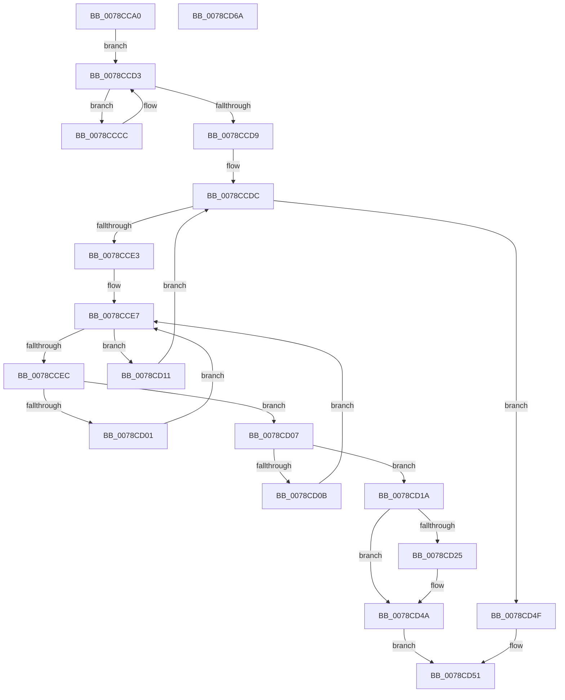

# PfxFindPrefix

- RVA: `0x0078CCA0`–`0x0078CD6B` (길이 `203` bytes)
- VA: `0x000000014078CCA0`
- 실행 섹션: `PAGE`
- PDB 이름 있음: `예`; PDB Function 태그: `아니요`
- unwind 정보 RVA: `0x00060300`
- 디코드: `62`개 명령, `203/203` bytes 표시
- 미해석 바이트: `0` (있으면 어셈블리에 `.byte`로 보존)

> 이 문서는 커널 이미지의 기계어와 PDB 기호를 분석해 생성했습니다. 4번과 5번은 함수 원형과 자료형을 바이너리 사용 방식에서 추정한 C 해석이며 원본 소스 복구 결과는 아닙니다.

## 1. Dependencies

- 직접 호출 지점: **3**; 고유 호출 대상: **3**
- 직접 호출자로 확인된 함수: **0**
- RIP 상대 이미지 참조: **0**

### Outgoing calls
- `0x0078CCC1` → [ComputeNameLength](ComputeNameLength_function_0078CBC8.md) (function, `0x0078CBC8`)
- `0x0078CCF7` → [CompareNamesCaseSensitive](CompareNamesCaseSensitive_function_0078CA1C.md) (function, `0x0078CA1C`)
- `0x0078CD33` → [RtlSplay](../../text/38/RtlSplay_function_0038F1E0.md) (function, `0x0038F1E0`)

### Direct callers
- 이 함수 시작 RVA로 연결되는 직접 call은 확인되지 않았습니다. 간접 호출은 완전히 역산할 수 없습니다.

### Static image references
- 디코드된 RIP-relative 메모리 참조가 없습니다.

## 2. Other-region calls and transfers

- 다른 실행 섹션으로 향하는 call: **1**
  - `0x0078CD33` → [RtlSplay](../../text/38/RtlSplay_function_0038F1E0.md) (`PAGE` → `.text`)
- 별도 외부 분기/꼬리 이동을 확인하지 못했습니다.

## 3. Assembly (complete function range)

```asm
0078CCA0  48 89 5C 24 08                  mov qword ptr [rsp + 8], rbx
0078CCA5  48 89 6C 24 10                  mov qword ptr [rsp + 0x10], rbp
0078CCAA  48 89 74 24 18                  mov qword ptr [rsp + 0x18], rsi
0078CCAF  57                              push rdi
0078CCB0  41 56                           push r14
0078CCB2  41 57                           push r15
0078CCB4  48 83 EC 20                     sub rsp, 0x20
0078CCB8  48 8B E9                        mov rbp, rcx
0078CCBB  48 8B DA                        mov rbx, rdx
0078CCBE  48 8B CA                        mov rcx, rdx
0078CCC1  E8 02 FF FF FF                  call 0x14078cbc8
0078CCC6  48 8B 7D 08                     mov rdi, qword ptr [rbp + 8]
0078CCCA  EB 07                           jmp 0x14078ccd3
0078CCCC  48 8B EF                        mov rbp, rdi
0078CCCF  48 8B 7F 08                     mov rdi, qword ptr [rdi + 8]
0078CCD3  66 39 47 02                     cmp word ptr [rdi + 2], ax
0078CCD7  7F F3                           jg 0x14078cccc
0078CCD9  45 33 FF                        xor r15d, r15d
0078CCDC  66 44 39 7F 02                  cmp word ptr [rdi + 2], r15w
0078CCE1  7E 6C                           jle 0x14078cd4f
0078CCE3  48 8D 77 10                     lea rsi, [rdi + 0x10]
0078CCE7  48 85 F6                        test rsi, rsi
0078CCEA  74 25                           je 0x14078cd11
0078CCEC  4C 8D 76 F0                     lea r14, [rsi - 0x10]
0078CCF0  48 8B D3                        mov rdx, rbx
0078CCF3  49 8B 4E 28                     mov rcx, qword ptr [r14 + 0x28]
0078CCF7  E8 20 FD FF FF                  call 0x14078ca1c
0078CCFC  83 F8 03                        cmp eax, 3
0078CCFF  75 06                           jne 0x14078cd07
0078CD01  48 8B 76 08                     mov rsi, qword ptr [rsi + 8]
0078CD05  EB E0                           jmp 0x14078cce7
0078CD07  85 C0                           test eax, eax
0078CD09  75 0F                           jne 0x14078cd1a
0078CD0B  48 8B 76 10                     mov rsi, qword ptr [rsi + 0x10]
0078CD0F  EB D6                           jmp 0x14078cce7
0078CD11  48 8B EF                        mov rbp, rdi
0078CD14  48 8B 7F 08                     mov rdi, qword ptr [rdi + 8]
0078CD18  EB C2                           jmp 0x14078ccdc
0078CD1A  B8 02 02 00 00                  mov eax, 0x202
0078CD1F  66 41 39 06                     cmp word ptr [r14], ax
0078CD23  75 25                           jne 0x14078cd4a
0078CD25  48 8B 5F 08                     mov rbx, qword ptr [rdi + 8]
0078CD29  48 8B CE                        mov rcx, rsi
0078CD2C  4C 89 7F 08                     mov qword ptr [rdi + 8], r15
0078CD30  66 89 07                        mov word ptr [rdi], ax
0078CD33  E8 A8 24 C0 FF                  call 0x14038f1e0
0078CD38  4C 8D 70 F0                     lea r14, [rax - 0x10]
0078CD3C  66 41 C7 06 01 02               mov word ptr [r14], 0x201
0078CD42  4C 89 75 08                     mov qword ptr [rbp + 8], r14
0078CD46  49 89 5E 08                     mov qword ptr [r14 + 8], rbx
0078CD4A  49 8B C6                        mov rax, r14
0078CD4D  EB 02                           jmp 0x14078cd51
0078CD4F  33 C0                           xor eax, eax
0078CD51  48 8B 5C 24 40                  mov rbx, qword ptr [rsp + 0x40]
0078CD56  48 8B 6C 24 48                  mov rbp, qword ptr [rsp + 0x48]
0078CD5B  48 8B 74 24 50                  mov rsi, qword ptr [rsp + 0x50]
0078CD60  48 83 C4 20                     add rsp, 0x20
0078CD64  41 5F                           pop r15
0078CD66  41 5E                           pop r14
0078CD68  5F                              pop rdi
0078CD69  C3                              ret
0078CD6A  CC                              int3
```

## 4. C-style interpretation (structured pseudocode)

```c
__int64 __fastcall PfxFindPrefix(__int64 a1, __int64 a2)
{
    __int64 result;
    __int64 v_r14;
    __int64 v_r15;
    __int64 v_rbx;
    __int64 v_rsp;
    unsigned __int64 v_stack_p10;
    unsigned __int64 v_stack_p18;
    unsigned __int64 v_stack_p8;

    v_stack_p8 = v_rbx;
    v_stack_p10 = v_rbp;
    v_stack_p18 = v_rsi;
    v_rsp = (v_rsp) - (32);
    result = ComputeNameLength(a2, a2, a3, a4);
    goto loc_0078CCD3;
loc_0078CCCC:
loc_0078CCD3:
    if ((*(unsigned __int16 *)(*(unsigned __int64 *)(*(unsigned __int64 *)(a1 + 8) + 8) + 2)) > ((unsigned __int16)(result))) goto loc_0078CCCC;
    v_r15 = 0;
loc_0078CCDC:
    if ((*(unsigned __int16 *)(*(unsigned __int64 *)(*(unsigned __int64 *)(a1 + 8) + 8) + 2)) <= 0) goto loc_0078CD4F;
loc_0078CCE7:
    if (*(unsigned __int64 *)(*(unsigned __int64 *)(a1 + 8) + 8) + 16 == 0) goto loc_0078CD11;
    result = CompareNamesCaseSensitive(*(unsigned __int64 *)(*(unsigned __int64 *)(*(unsigned __int64 *)(a1 + 8) + 8) + 16 - 16 + 40), a2, a3, a4);
    if (((unsigned int)(result)) != 3) goto loc_0078CD07;
    goto loc_0078CCE7;
loc_0078CD07:
    if ((unsigned int)(result) != 0) goto loc_0078CD1A;
    goto loc_0078CCE7;
loc_0078CD11:
    goto loc_0078CCDC;
loc_0078CD1A:
    result = 514;
    v_rbx = a2;
    v_r14 = *(unsigned __int64 *)(*(unsigned __int64 *)(a1 + 8) + 8) + 16 - 16;
    if ((*(unsigned __int16 *)(*(unsigned __int64 *)(*(unsigned __int64 *)(a1 + 8) + 8) + 16 - 16)) == 514) {
        v_rbx = *(unsigned __int64 *)(*(unsigned __int64 *)(*(unsigned __int64 *)(*(unsigned __int64 *)(a1 + 8) + 8) + 8) + 8);
        a1 = *(unsigned __int64 *)(*(unsigned __int64 *)(*(unsigned __int64 *)(*(unsigned __int64 *)(a1 + 8) + 8) + 16 + 8) + 16);
        *(unsigned __int64 *)(*(unsigned __int64 *)(*(unsigned __int64 *)(*(unsigned __int64 *)(a1 + 8) + 8) + 8) + 8) = 0;
        *(unsigned __int16 *)(*(unsigned __int64 *)(*(unsigned __int64 *)(*(unsigned __int64 *)(a1 + 8) + 8) + 8)) = 514;
        result = RtlSplay(a1, a2, a3, a4);
        v_r14 = result - 16;
        *(unsigned __int16 *)(v_r14) = 513;
        *(unsigned __int64 *)(*(unsigned __int64 *)(*(unsigned __int64 *)(a1 + 8) + 8) + 8) = v_r14;
        *(unsigned __int64 *)(v_r14 + 8) = v_rbx;
    }
    goto loc_0078CD51;
loc_0078CD4F:
    result = 0;
loc_0078CD51:
    v_rsp = (v_rsp) + (32);
    return result;
}
```

## 5. (Beta) C Style

```c
int64_t PfxFindPrefix(void *Arg1, int64_t Arg2)
{
    uint8_t *arg1 = (uint8_t *)Arg1;

    int64_t result;
    int64_t local_r14;
    int64_t local_r15;
    int64_t local_rbx;
    int64_t local_rsp;
    uint64_t v_stack_p10;
    uint64_t v_stack_p18;
    uint64_t v_stack_p8;

    v_stack_p8 = local_rbx;
    v_stack_p10 = local_rbp;
    v_stack_p18 = local_rsi;
    local_rsp = (local_rsp) - (32);
    result = ComputeNameLength(Arg2, Arg2, a3, a4);
    goto loc_0078CCD3;
loc_0078CCCC:
loc_0078CCD3:
    if ((*(uint16_t *)(*(uint64_t *)(*(uint64_t *)(arg1 + 0x8) + 0x8) + 0x2)) > ((uint16_t)(result))) goto loc_0078CCCC;
    local_r15 = 0;
loc_0078CCDC:
    if ((*(uint16_t *)(*(uint64_t *)(*(uint64_t *)(arg1 + 0x8) + 0x8) + 0x2)) <= 0) goto loc_0078CD4F;
loc_0078CCE7:
    if (*(uint64_t *)(*(uint64_t *)(arg1 + 0x8) + 0x8) + 16 == 0) goto loc_0078CD11;
    result = CompareNamesCaseSensitive(*(uint64_t *)(*(uint64_t *)(*(uint64_t *)(arg1 + 0x8) + 0x8) + 0x10 - 0x10 + 0x28), Arg2, a3, a4);
    if (((uint32_t)(result)) != 3) goto loc_0078CD07;
    goto loc_0078CCE7;
loc_0078CD07:
    if ((uint32_t)(result) != 0) goto loc_0078CD1A;
    goto loc_0078CCE7;
loc_0078CD11:
    goto loc_0078CCDC;
loc_0078CD1A:
    result = 514;
    local_rbx = Arg2;
    local_r14 = *(uint64_t *)(*(uint64_t *)(arg1 + 0x8) + 0x8) + 16 - 16;
    if ((*(uint16_t *)(*(uint64_t *)(*(uint64_t *)(arg1 + 0x8) + 0x8) + 0x10 - 0x10)) == 514) {
        local_rbx = *(uint64_t *)(*(uint64_t *)(*(uint64_t *)(*(uint64_t *)(arg1 + 0x8) + 0x8) + 0x8) + 0x8);
        Arg1 = *(uint64_t *)(*(uint64_t *)(*(uint64_t *)(*(uint64_t *)(arg1 + 0x8) + 0x8) + 0x10 + 0x8) + 0x10);
        *(uint64_t *)(*(uint64_t *)(*(uint64_t *)(*(uint64_t *)(arg1 + 0x8) + 0x8) + 0x8) + 0x8) = 0;
        *(uint16_t *)(*(uint64_t *)(*(uint64_t *)(*(uint64_t *)(arg1 + 0x8) + 0x8) + 0x8)) = 514;
        result = RtlSplay(Arg1, Arg2, a3, a4);
        local_r14 = result - 16;
        *(uint16_t *)(local_r14) = 513;
        *(uint64_t *)(*(uint64_t *)(*(uint64_t *)(arg1 + 0x8) + 0x8) + 0x8) = local_r14;
        *(uint64_t *)(local_r14 + 0x8) = local_rbx;
    }
    goto loc_0078CD51;
loc_0078CD4F:
    result = 0;
loc_0078CD51:
    local_rsp = (local_rsp) + (32);
    return result;
}
```

### 관측된 메모리 오프셋

구조체 형식이 확인되지 않은 접근은 인자 기준의 오프셋으로만 기록했습니다.

| 기준 인자 | 오프셋 표현 | 폭 (bit) | 접근 |
|---|---:|---:|---|
| `Arg1` | `+ 0x8` | `64` | `R` |

## 6. Execution-region graph

[열기: 2D/3D 그래프와 함수 탐색 컨트롤 패널](../../../control-panel.html?section=page&rva=0x0078CCA0&view=graph)

- 2D 그래프는 위에서 아래로 흐르고, 3D 그래프는 빈 공간을 드래그해 회전합니다. Shift+드래그는 이동, 휠은 확대·축소, 함수 노드 선택은 대상 보고서 이동입니다.

### Static fallback


