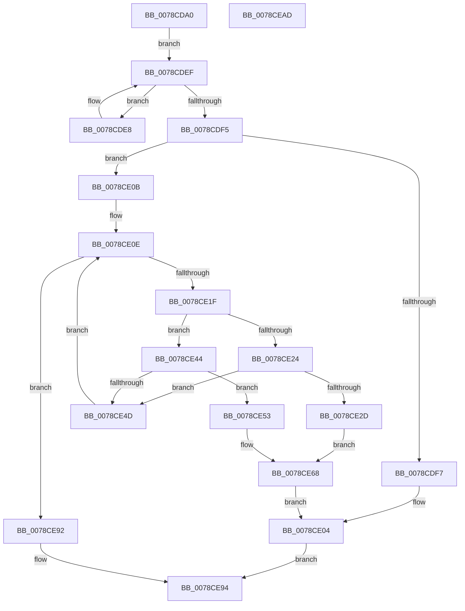

# PfxInsertPrefix

- RVA: `0x0078CDA0`–`0x0078CEAE` (길이 `270` bytes)
- VA: `0x000000014078CDA0`
- 실행 섹션: `PAGE`
- PDB 이름 있음: `예`; PDB Function 태그: `아니요`
- unwind 정보 RVA: `0x00060300`
- 디코드: `77`개 명령, `270/270` bytes 표시
- 미해석 바이트: `0` (있으면 어셈블리에 `.byte`로 보존)

> 이 문서는 커널 이미지의 기계어와 PDB 기호를 분석해 생성했습니다. 4번과 5번은 함수 원형과 자료형을 바이너리 사용 방식에서 추정한 C 해석이며 원본 소스 복구 결과는 아닙니다.

## 1. Dependencies

- 직접 호출 지점: **3**; 고유 호출 대상: **3**
- 직접 호출자로 확인된 함수: **0**
- RIP 상대 이미지 참조: **0**

### Outgoing calls
- `0x0078CDC4` → [ComputeNameLength](ComputeNameLength_function_0078CBC8.md) (function, `0x0078CBC8`)
- `0x0078CE15` → [CompareNamesCaseSensitive](CompareNamesCaseSensitive_function_0078CA1C.md) (function, `0x0078CA1C`)
- `0x0078CE77` → [RtlSplay](../../text/38/RtlSplay_function_0038F1E0.md) (function, `0x0038F1E0`)

### Direct callers
- 이 함수 시작 RVA로 연결되는 직접 call은 확인되지 않았습니다. 간접 호출은 완전히 역산할 수 없습니다.

### Static image references
- 디코드된 RIP-relative 메모리 참조가 없습니다.

## 2. Other-region calls and transfers

- 다른 실행 섹션으로 향하는 call: **1**
  - `0x0078CE77` → [RtlSplay](../../text/38/RtlSplay_function_0038F1E0.md) (`PAGE` → `.text`)
- 별도 외부 분기/꼬리 이동을 확인하지 못했습니다.

## 3. Assembly (complete function range)

```asm
0078CDA0  48 89 5C 24 08                  mov qword ptr [rsp + 8], rbx
0078CDA5  48 89 6C 24 10                  mov qword ptr [rsp + 0x10], rbp
0078CDAA  48 89 74 24 18                  mov qword ptr [rsp + 0x18], rsi
0078CDAF  57                              push rdi
0078CDB0  41 56                           push r14
0078CDB2  41 57                           push r15
0078CDB4  48 83 EC 20                     sub rsp, 0x20
0078CDB8  48 8B E9                        mov rbp, rcx
0078CDBB  49 8B D8                        mov rbx, r8
0078CDBE  48 8B CA                        mov rcx, rdx
0078CDC1  4C 8B FA                        mov r15, rdx
0078CDC4  E8 FF FD FF FF                  call 0x14078cbc8
0078CDC9  66 89 43 02                     mov word ptr [rbx + 2], ax
0078CDCD  4C 8D 73 10                     lea r14, [rbx + 0x10]
0078CDD1  4C 89 7B 28                     mov qword ptr [rbx + 0x28], r15
0078CDD5  49 83 66 08 00                  and qword ptr [r14 + 8], 0
0078CDDA  49 83 66 10 00                  and qword ptr [r14 + 0x10], 0
0078CDDF  4D 89 36                        mov qword ptr [r14], r14
0078CDE2  48 8B 7D 08                     mov rdi, qword ptr [rbp + 8]
0078CDE6  EB 07                           jmp 0x14078cdef
0078CDE8  48 8B EF                        mov rbp, rdi
0078CDEB  48 8B 7F 08                     mov rdi, qword ptr [rdi + 8]
0078CDEF  66 39 47 02                     cmp word ptr [rdi + 2], ax
0078CDF3  7F F3                           jg 0x14078cde8
0078CDF5  74 14                           je 0x14078ce0b
0078CDF7  48 89 5D 08                     mov qword ptr [rbp + 8], rbx
0078CDFB  48 89 7B 08                     mov qword ptr [rbx + 8], rdi
0078CDFF  66 C7 03 01 02                  mov word ptr [rbx], 0x201
0078CE04  B0 01                           mov al, 1
0078CE06  E9 89 00 00 00                  jmp 0x14078ce94
0078CE0B  48 8B F7                        mov rsi, rdi
0078CE0E  48 8B 4E 28                     mov rcx, qword ptr [rsi + 0x28]
0078CE12  49 8B D7                        mov rdx, r15
0078CE15  E8 02 FC FF FF                  call 0x14078ca1c
0078CE1A  83 F8 02                        cmp eax, 2
0078CE1D  74 73                           je 0x14078ce92
0078CE1F  83 F8 03                        cmp eax, 3
0078CE22  75 20                           jne 0x14078ce44
0078CE24  48 8B 46 18                     mov rax, qword ptr [rsi + 0x18]
0078CE28  48 85 C0                        test rax, rax
0078CE2B  75 20                           jne 0x14078ce4d
0078CE2D  48 83 63 08 00                  and qword ptr [rbx + 8], 0
0078CE32  48 8D 4E 10                     lea rcx, [rsi + 0x10]
0078CE36  B8 02 02 00 00                  mov eax, 0x202
0078CE3B  66 89 03                        mov word ptr [rbx], ax
0078CE3E  4C 89 71 08                     mov qword ptr [rcx + 8], r14
0078CE42  EB 24                           jmp 0x14078ce68
0078CE44  48 8B 46 20                     mov rax, qword ptr [rsi + 0x20]
0078CE48  48 85 C0                        test rax, rax
0078CE4B  74 06                           je 0x14078ce53
0078CE4D  48 8D 70 F0                     lea rsi, [rax - 0x10]
0078CE51  EB BB                           jmp 0x14078ce0e
0078CE53  48 83 63 08 00                  and qword ptr [rbx + 8], 0
0078CE58  48 8D 4E 10                     lea rcx, [rsi + 0x10]
0078CE5C  B8 02 02 00 00                  mov eax, 0x202
0078CE61  66 89 03                        mov word ptr [rbx], ax
0078CE64  4C 89 71 10                     mov qword ptr [rcx + 0x10], r14
0078CE68  49 89 0E                        mov qword ptr [r14], rcx
0078CE6B  48 8B 5F 08                     mov rbx, qword ptr [rdi + 8]
0078CE6F  48 83 67 08 00                  and qword ptr [rdi + 8], 0
0078CE74  66 89 07                        mov word ptr [rdi], ax
0078CE77  E8 64 23 C0 FF                  call 0x14038f1e0
0078CE7C  48 83 E8 10                     sub rax, 0x10
0078CE80  66 C7 00 01 02                  mov word ptr [rax], 0x201
0078CE85  48 89 45 08                     mov qword ptr [rbp + 8], rax
0078CE89  48 89 58 08                     mov qword ptr [rax + 8], rbx
0078CE8D  E9 72 FF FF FF                  jmp 0x14078ce04
0078CE92  32 C0                           xor al, al
0078CE94  48 8B 5C 24 40                  mov rbx, qword ptr [rsp + 0x40]
0078CE99  48 8B 6C 24 48                  mov rbp, qword ptr [rsp + 0x48]
0078CE9E  48 8B 74 24 50                  mov rsi, qword ptr [rsp + 0x50]
0078CEA3  48 83 C4 20                     add rsp, 0x20
0078CEA7  41 5F                           pop r15
0078CEA9  41 5E                           pop r14
0078CEAB  5F                              pop rdi
0078CEAC  C3                              ret
0078CEAD  CC                              int3
```

## 4. C-style interpretation (structured pseudocode)

```c
__int64 __fastcall PfxInsertPrefix(__int64 a1, __int64 a2, __int64 a3)
{
    __int64 result;
    __int64 v_rsp;
    unsigned __int64 v_stack_p10;
    unsigned __int64 v_stack_p18;
    unsigned __int64 v_stack_p8;

    v_stack_p8 = v_rbx;
    v_stack_p10 = v_rbp;
    v_stack_p18 = v_rsi;
    v_rsp = (v_rsp) - (32);
    result = ComputeNameLength(a2, a2, a3, a4);
    *(unsigned __int16 *)(a3 + 2) = (unsigned __int16)(result);
    *(unsigned __int64 *)(a3 + 40) = a2;
    *(unsigned __int64 *)(a3 + 16) = a3 + 16;
    goto loc_0078CDEF;
loc_0078CDE8:
loc_0078CDEF:
    if ((*(unsigned __int16 *)(*(unsigned __int64 *)(*(unsigned __int64 *)(a1 + 8) + 8) + 2)) > ((unsigned __int16)(result))) goto loc_0078CDE8;
    if ((*(unsigned __int16 *)(*(unsigned __int64 *)(*(unsigned __int64 *)(a1 + 8) + 8) + 2)) == ((unsigned __int16)(result))) goto loc_0078CE0B;
    *(unsigned __int64 *)(*(unsigned __int64 *)(a1 + 8) + 8) = a3;
    *(unsigned __int64 *)(a3 + 8) = *(unsigned __int64 *)(*(unsigned __int64 *)(a1 + 8) + 8);
    *(unsigned __int16 *)(a3) = 513;
loc_0078CE04:
    goto loc_0078CE94;
loc_0078CE0B:
loc_0078CE0E:
    result = CompareNamesCaseSensitive(*(unsigned __int64 *)(*(unsigned __int64 *)(*(unsigned __int64 *)(a1 + 8) + 8) + 40), a2, a3, a4);
    if (((unsigned int)(result)) == 2) goto loc_0078CE92;
    if (((unsigned int)(result)) != 3) goto loc_0078CE44;
    if (*(unsigned __int64 *)(*(unsigned __int64 *)(*(unsigned __int64 *)(a1 + 8) + 8) + 24) != 0) goto loc_0078CE4D;
    *(unsigned __int16 *)(a3) = 514;
    *(unsigned __int64 *)(*(unsigned __int64 *)(*(unsigned __int64 *)(a1 + 8) + 8) + 16 + 8) = a3 + 16;
    goto loc_0078CE68;
loc_0078CE44:
    if (*(unsigned __int64 *)(*(unsigned __int64 *)(*(unsigned __int64 *)(a1 + 8) + 8) + 32) == 0) goto loc_0078CE53;
loc_0078CE4D:
    goto loc_0078CE0E;
loc_0078CE53:
    *(unsigned __int16 *)(a3) = 514;
    *(unsigned __int64 *)(*(unsigned __int64 *)(*(unsigned __int64 *)(*(unsigned __int64 *)(a1 + 8) + 8) + 32) - 16 + 16 + 16) = a3 + 16;
loc_0078CE68:
    *(unsigned __int64 *)(a3 + 16) = *(unsigned __int64 *)(*(unsigned __int64 *)(*(unsigned __int64 *)(a1 + 8) + 8) + 32) - 16 + 16;
    *(unsigned __int16 *)(*(unsigned __int64 *)(*(unsigned __int64 *)(a1 + 8) + 8)) = 514;
    result = RtlSplay(*(unsigned __int64 *)(*(unsigned __int64 *)(*(unsigned __int64 *)(a1 + 8) + 8) + 32) - 16 + 16, a2, a3, a4);
    result = (result) - (16);
    *(unsigned __int16 *)(result) = 513;
    *(unsigned __int64 *)(*(unsigned __int64 *)(a1 + 8) + 8) = result;
    *(unsigned __int64 *)(result + 8) = *(unsigned __int64 *)(*(unsigned __int64 *)(*(unsigned __int64 *)(a1 + 8) + 8) + 8);
    goto loc_0078CE04;
loc_0078CE92:
    result = 0;
loc_0078CE94:
    v_rsp = (v_rsp) + (32);
    return result;
}
```

## 5. (Beta) C Style

```c
int64_t PfxInsertPrefix(void *Arg1, int64_t Arg2, void *Arg3)
{
    uint8_t *arg1 = (uint8_t *)Arg1;
    uint8_t *arg3 = (uint8_t *)Arg3;

    int64_t result;
    int64_t local_rsp;
    uint64_t v_stack_p10;
    uint64_t v_stack_p18;
    uint64_t v_stack_p8;

    v_stack_p8 = local_rbx;
    v_stack_p10 = local_rbp;
    v_stack_p18 = local_rsi;
    local_rsp = (local_rsp) - (32);
    result = ComputeNameLength(Arg2, Arg2, Arg3, a4);
    *(uint16_t *)(arg3 + 0x2) = (uint16_t)(result);
    *(uint64_t *)(arg3 + 0x28) = Arg2;
    *(void **)(arg3 + 0x10) = Arg3 + 16;
    goto loc_0078CDEF;
loc_0078CDE8:
loc_0078CDEF:
    if ((*(uint16_t *)(*(uint64_t *)(*(uint64_t *)(arg1 + 0x8) + 0x8) + 0x2)) > ((uint16_t)(result))) goto loc_0078CDE8;
    if ((*(uint16_t *)(*(uint64_t *)(*(uint64_t *)(arg1 + 0x8) + 0x8) + 0x2)) == ((uint16_t)(result))) goto loc_0078CE0B;
    *(void **)(*(uint64_t *)(arg1 + 0x8) + 0x8) = Arg3;
    *(uint64_t *)(arg3 + 0x8) = *(uint64_t *)(*(uint64_t *)(arg1 + 0x8) + 0x8);
    *(uint16_t *)(arg3) = 513;
loc_0078CE04:
    goto loc_0078CE94;
loc_0078CE0B:
loc_0078CE0E:
    result = CompareNamesCaseSensitive(*(uint64_t *)(*(uint64_t *)(*(uint64_t *)(arg1 + 0x8) + 0x8) + 0x28), Arg2, Arg3, a4);
    if (((uint32_t)(result)) == 2) goto loc_0078CE92;
    if (((uint32_t)(result)) != 3) goto loc_0078CE44;
    if (*(uint64_t *)(*(uint64_t *)(*(uint64_t *)(arg1 + 0x8) + 0x8) + 0x18) != 0) goto loc_0078CE4D;
    *(uint16_t *)(arg3) = 514;
    *(void **)(*(uint64_t *)(*(uint64_t *)(arg1 + 0x8) + 0x8) + 0x10 + 0x8) = Arg3 + 16;
    goto loc_0078CE68;
loc_0078CE44:
    if (*(uint64_t *)(*(uint64_t *)(*(uint64_t *)(arg1 + 0x8) + 0x8) + 0x20) == 0) goto loc_0078CE53;
loc_0078CE4D:
    goto loc_0078CE0E;
loc_0078CE53:
    *(uint16_t *)(arg3) = 514;
    *(void **)(*(uint64_t *)(*(uint64_t *)(*(uint64_t *)(arg1 + 0x8) + 0x8) + 0x20) - 0x10 + 0x10 + 0x10) = Arg3 + 16;
loc_0078CE68:
    *(uint64_t *)(arg3 + 0x10) = *(uint64_t *)(*(uint64_t *)(*(uint64_t *)(arg1 + 0x8) + 0x8) + 0x20) - 16 + 16;
    *(uint16_t *)(*(uint64_t *)(*(uint64_t *)(arg1 + 0x8) + 0x8)) = 514;
    result = RtlSplay(*(uint64_t *)(*(uint64_t *)(*(uint64_t *)(arg1 + 0x8) + 0x8) + 0x20) - 16 + 16, Arg2, Arg3, a4);
    result = (result) - (16);
    *(uint16_t *)(result) = 513;
    *(uint64_t *)(*(uint64_t *)(arg1 + 0x8) + 0x8) = result;
    *(uint64_t *)(result + 0x8) = *(uint64_t *)(*(uint64_t *)(*(uint64_t *)(arg1 + 0x8) + 0x8) + 0x8);
    goto loc_0078CE04;
loc_0078CE92:
    result = 0;
loc_0078CE94:
    local_rsp = (local_rsp) + (32);
    return result;
}
```

### 관측된 메모리 오프셋

구조체 형식이 확인되지 않은 접근은 인자 기준의 오프셋으로만 기록했습니다.

| 기준 인자 | 오프셋 표현 | 폭 (bit) | 접근 |
|---|---:|---:|---|
| `Arg1` | `+ 0x8` | `64` | `R` |
| `Arg3` | `+ 0x0` | `16` | `W` |
| `Arg3` | `+ 0x0` | `64` | `W` |
| `Arg3` | `+ 0x2` | `16` | `W` |
| `Arg3` | `+ 0x8` | `64` | `R/W` |
| `Arg3` | `+ 0x8` | `64` | `W` |
| `Arg3` | `+ 0x10` | `64` | `R` |
| `Arg3` | `+ 0x10` | `64` | `R/W` |
| `Arg3` | `+ 0x28` | `64` | `W` |

## 6. Execution-region graph

[열기: 2D/3D 그래프와 함수 탐색 컨트롤 패널](../../../control-panel.html?section=page&rva=0x0078CDA0&view=graph)

- 2D 그래프는 위에서 아래로 흐르고, 3D 그래프는 빈 공간을 드래그해 회전합니다. Shift+드래그는 이동, 휠은 확대·축소, 함수 노드 선택은 대상 보고서 이동입니다.

### Static fallback


