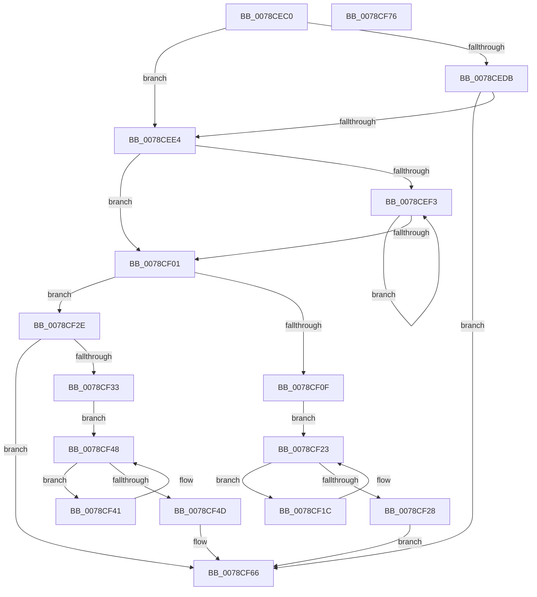

# PfxRemovePrefix

- RVA: `0x0078CEC0`–`0x0078CF77` (길이 `183` bytes)
- VA: `0x000000014078CEC0`
- 실행 섹션: `PAGE`
- PDB 이름 있음: `예`; PDB Function 태그: `아니요`
- unwind 정보 RVA: `0x00060BC4`
- 디코드: `56`개 명령, `183/183` bytes 표시
- 미해석 바이트: `0` (있으면 어셈블리에 `.byte`로 보존)

> 이 문서는 커널 이미지의 기계어와 PDB 기호를 분석해 생성했습니다. 4번과 5번은 함수 원형과 자료형을 바이너리 사용 방식에서 추정한 C 해석이며 원본 소스 복구 결과는 아닙니다.

## 1. Dependencies

- 직접 호출 지점: **1**; 고유 호출 대상: **1**
- 직접 호출자로 확인된 함수: **0**
- RIP 상대 이미지 참조: **0**

### Outgoing calls
- `0x0078CF05` → [RtlDelete](../../text/38/RtlDelete_function_0038D8B0.md) (function, `0x0038D8B0`)

### Direct callers
- 이 함수 시작 RVA로 연결되는 직접 call은 확인되지 않았습니다. 간접 호출은 완전히 역산할 수 없습니다.

### Static image references
- 디코드된 RIP-relative 메모리 참조가 없습니다.

## 2. Other-region calls and transfers

- 다른 실행 섹션으로 향하는 call: **1**
  - `0x0078CF05` → [RtlDelete](../../text/38/RtlDelete_function_0038D8B0.md) (`PAGE` → `.text`)
- 별도 외부 분기/꼬리 이동을 확인하지 못했습니다.

## 3. Assembly (complete function range)

```asm
0078CEC0  48 89 5C 24 08                  mov qword ptr [rsp + 8], rbx
0078CEC5  48 89 74 24 10                  mov qword ptr [rsp + 0x10], rsi
0078CECA  57                              push rdi
0078CECB  48 83 EC 20                     sub rsp, 0x20
0078CECF  0F BF 0A                        movsx ecx, word ptr [rdx]
0078CED2  BE 01 02 00 00                  mov esi, 0x201
0078CED7  2B CE                           sub ecx, esi
0078CED9  74 09                           je 0x14078cee4
0078CEDB  83 F9 01                        cmp ecx, 1
0078CEDE  0F 85 82 00 00 00               jne 0x14078cf66
0078CEE4  48 8D 4A 10                     lea rcx, [rdx + 0x10]
0078CEE8  48 8B 11                        mov rdx, qword ptr [rcx]
0078CEEB  48 8B F9                        mov rdi, rcx
0078CEEE  48 3B D1                        cmp rdx, rcx
0078CEF1  74 0E                           je 0x14078cf01
0078CEF3  48 8B 02                        mov rax, qword ptr [rdx]
0078CEF6  48 8B FA                        mov rdi, rdx
0078CEF9  48 8B D0                        mov rdx, rax
0078CEFC  48 3B C7                        cmp rax, rdi
0078CEFF  75 F2                           jne 0x14078cef3
0078CF01  48 8D 5F F0                     lea rbx, [rdi - 0x10]
0078CF05  E8 A6 09 C0 FF                  call 0x14038d8b0
0078CF0A  48 85 C0                        test rax, rax
0078CF0D  75 1F                           jne 0x14078cf2e
0078CF0F  48 8B 53 08                     mov rdx, qword ptr [rbx + 8]
0078CF13  48 8B C2                        mov rax, rdx
0078CF16  48 8B 4A 08                     mov rcx, qword ptr [rdx + 8]
0078CF1A  EB 07                           jmp 0x14078cf23
0078CF1C  48 8B C1                        mov rax, rcx
0078CF1F  48 8B 49 08                     mov rcx, qword ptr [rcx + 8]
0078CF23  48 3B CB                        cmp rcx, rbx
0078CF26  75 F4                           jne 0x14078cf1c
0078CF28  48 89 50 08                     mov qword ptr [rax + 8], rdx
0078CF2C  EB 38                           jmp 0x14078cf66
0078CF2E  48 3B F8                        cmp rdi, rax
0078CF31  74 33                           je 0x14078cf66
0078CF33  48 8D 50 F0                     lea rdx, [rax - 0x10]
0078CF37  48 8B 43 08                     mov rax, qword ptr [rbx + 8]
0078CF3B  48 8B 48 08                     mov rcx, qword ptr [rax + 8]
0078CF3F  EB 07                           jmp 0x14078cf48
0078CF41  48 8B C1                        mov rax, rcx
0078CF44  48 8B 49 08                     mov rcx, qword ptr [rcx + 8]
0078CF48  48 3B CB                        cmp rcx, rbx
0078CF4B  75 F4                           jne 0x14078cf41
0078CF4D  66 89 32                        mov word ptr [rdx], si
0078CF50  48 89 50 08                     mov qword ptr [rax + 8], rdx
0078CF54  48 8B 43 08                     mov rax, qword ptr [rbx + 8]
0078CF58  48 89 42 08                     mov qword ptr [rdx + 8], rax
0078CF5C  48 83 63 08 00                  and qword ptr [rbx + 8], 0
0078CF61  66 C7 03 02 02                  mov word ptr [rbx], 0x202
0078CF66  48 8B 5C 24 30                  mov rbx, qword ptr [rsp + 0x30]
0078CF6B  48 8B 74 24 38                  mov rsi, qword ptr [rsp + 0x38]
0078CF70  48 83 C4 20                     add rsp, 0x20
0078CF74  5F                              pop rdi
0078CF75  C3                              ret
0078CF76  CC                              int3
```

## 4. C-style interpretation (structured pseudocode)

```c
__int64 __fastcall PfxRemovePrefix(__int64 a1, __int64 a2)
{
    __int64 result;
    __int64 v_rsp;
    unsigned __int64 v_stack_p10;
    unsigned __int64 v_stack_p8;

    v_stack_p8 = v_rbx;
    v_stack_p10 = v_rsi;
    v_rsp = (v_rsp) - (32);
    a1 = (unsigned int)(((__int16)(*(unsigned __int16 *)(a2))) - (513));
    if (condition_is_equal) goto loc_0078CEE4;
    if (((unsigned int)(a1)) != 1) goto loc_0078CF66;
loc_0078CEE4:
    if ((*(unsigned __int64 *)(a2 + 16)) == (a2 + 16)) goto loc_0078CF01;
loc_0078CEF3:
    if ((*(unsigned __int64 *)(*(unsigned __int64 *)(a2 + 16))) != (*(unsigned __int64 *)(a2 + 16))) goto loc_0078CEF3;
loc_0078CF01:
    result = RtlDelete(a2 + 16, *(unsigned __int64 *)(*(unsigned __int64 *)(a2 + 16)), a3, a4);
    if (result != 0) goto loc_0078CF2E;
    goto loc_0078CF23;
loc_0078CF1C:
loc_0078CF23:
    if ((*(unsigned __int64 *)(*(unsigned __int64 *)(*(unsigned __int64 *)(*(unsigned __int64 *)(a2 + 16) - 16 + 8) + 8) + 8)) != (*(unsigned __int64 *)(a2 + 16) - 16)) goto loc_0078CF1C;
    *(unsigned __int64 *)(*(unsigned __int64 *)(*(unsigned __int64 *)(*(unsigned __int64 *)(a2 + 16) - 16 + 8) + 8) + 8) = *(unsigned __int64 *)(*(unsigned __int64 *)(a2 + 16) - 16 + 8);
    goto loc_0078CF66;
loc_0078CF2E:
    if ((*(unsigned __int64 *)(a2 + 16)) == (*(unsigned __int64 *)(*(unsigned __int64 *)(*(unsigned __int64 *)(a2 + 16) - 16 + 8) + 8))) goto loc_0078CF66;
    goto loc_0078CF48;
loc_0078CF41:
loc_0078CF48:
    if ((*(unsigned __int64 *)(*(unsigned __int64 *)(*(unsigned __int64 *)(*(unsigned __int64 *)(a2 + 16) - 16 + 8) + 8) + 8)) != (*(unsigned __int64 *)(a2 + 16) - 16)) goto loc_0078CF41;
    *(unsigned __int16 *)(*(unsigned __int64 *)(*(unsigned __int64 *)(*(unsigned __int64 *)(a2 + 16) - 16 + 8) + 8) - 16) = 513;
    *(unsigned __int64 *)(*(unsigned __int64 *)(*(unsigned __int64 *)(*(unsigned __int64 *)(a2 + 16) - 16 + 8) + 8) + 8) = *(unsigned __int64 *)(*(unsigned __int64 *)(*(unsigned __int64 *)(a2 + 16) - 16 + 8) + 8) - 16;
    *(unsigned __int64 *)(*(unsigned __int64 *)(*(unsigned __int64 *)(*(unsigned __int64 *)(a2 + 16) - 16 + 8) + 8) - 16 + 8) = *(unsigned __int64 *)(*(unsigned __int64 *)(a2 + 16) - 16 + 8);
    *(unsigned __int16 *)(*(unsigned __int64 *)(a2 + 16) - 16) = 514;
loc_0078CF66:
    v_rsp = (v_rsp) + (32);
    return *(unsigned __int64 *)(*(unsigned __int64 *)(a2 + 16) - 16 + 8);
}
```

## 5. (Beta) C Style

```c
int64_t PfxRemovePrefix(int64_t Arg1, void *Arg2)
{
    uint8_t *arg2 = (uint8_t *)Arg2;

    int64_t result;
    int64_t local_rsp;
    uint64_t v_stack_p10;
    uint64_t v_stack_p8;

    v_stack_p8 = local_rbx;
    v_stack_p10 = local_rsi;
    local_rsp = (local_rsp) - (32);
    Arg1 = (uint32_t)(((int16_t)(*(uint16_t *)(arg2))) - (513));
    if (condition_is_equal) goto loc_0078CEE4;
    if (((uint32_t)(Arg1)) != 1) goto loc_0078CF66;
loc_0078CEE4:
    if ((*(uint64_t *)(arg2 + 0x10)) == (Arg2 + 16)) goto loc_0078CF01;
loc_0078CEF3:
    if ((*(uint64_t *)(*(uint64_t *)(arg2 + 0x10))) != (*(uint64_t *)(arg2 + 0x10))) goto loc_0078CEF3;
loc_0078CF01:
    result = RtlDelete(Arg2 + 16, *(uint64_t *)(*(uint64_t *)(arg2 + 0x10)), a3, a4);
    if (result != 0) goto loc_0078CF2E;
    goto loc_0078CF23;
loc_0078CF1C:
loc_0078CF23:
    if ((*(uint64_t *)(*(uint64_t *)(*(uint64_t *)(*(uint64_t *)(arg2 + 0x10) - 0x10 + 0x8) + 0x8) + 0x8)) != (*(uint64_t *)(arg2 + 0x10) - 16)) goto loc_0078CF1C;
    *(uint64_t *)(*(uint64_t *)(*(uint64_t *)(*(uint64_t *)(arg2 + 0x10) - 0x10 + 0x8) + 0x8) + 0x8) = *(uint64_t *)(*(uint64_t *)(arg2 + 0x10) - 0x10 + 0x8);
    goto loc_0078CF66;
loc_0078CF2E:
    if ((*(uint64_t *)(arg2 + 0x10)) == (*(uint64_t *)(*(uint64_t *)(*(uint64_t *)(arg2 + 0x10) - 0x10 + 0x8) + 0x8))) goto loc_0078CF66;
    goto loc_0078CF48;
loc_0078CF41:
loc_0078CF48:
    if ((*(uint64_t *)(*(uint64_t *)(*(uint64_t *)(*(uint64_t *)(arg2 + 0x10) - 0x10 + 0x8) + 0x8) + 0x8)) != (*(uint64_t *)(arg2 + 0x10) - 16)) goto loc_0078CF41;
    *(uint16_t *)(*(uint64_t *)(*(uint64_t *)(*(uint64_t *)(arg2 + 0x10) - 0x10 + 0x8) + 0x8) - 0x10) = 513;
    *(uint64_t *)(*(uint64_t *)(*(uint64_t *)(*(uint64_t *)(arg2 + 0x10) - 0x10 + 0x8) + 0x8) + 0x8) = *(uint64_t *)(*(uint64_t *)(*(uint64_t *)(arg2 + 0x10) - 0x10 + 0x8) + 0x8) - 16;
    *(uint64_t *)(*(uint64_t *)(*(uint64_t *)(*(uint64_t *)(arg2 + 0x10) - 0x10 + 0x8) + 0x8) - 0x10 + 0x8) = *(uint64_t *)(*(uint64_t *)(arg2 + 0x10) - 0x10 + 0x8);
    *(uint16_t *)(*(uint64_t *)(arg2 + 0x10) - 0x10) = 514;
loc_0078CF66:
    local_rsp = (local_rsp) + (32);
    return *(uint64_t *)(*(uint64_t *)(arg2 + 0x10) - 0x10 + 0x8);
}
```

### 관측된 메모리 오프셋

구조체 형식이 확인되지 않은 접근은 인자 기준의 오프셋으로만 기록했습니다.

| 기준 인자 | 오프셋 표현 | 폭 (bit) | 접근 |
|---|---:|---:|---|
| `Arg2` | `+ 0x0` | `16` | `R` |
| `Arg2` | `+ 0x0` | `64` | `R` |
| `Arg2` | `+ 0x10` | `64` | `R` |

## 6. Execution-region graph

[열기: 2D/3D 그래프와 함수 탐색 컨트롤 패널](../../../control-panel.html?section=page&rva=0x0078CEC0&view=graph)

- 2D 그래프는 위에서 아래로 흐르고, 3D 그래프는 빈 공간을 드래그해 회전합니다. Shift+드래그는 이동, 휠은 확대·축소, 함수 노드 선택은 대상 보고서 이동입니다.

### Static fallback


