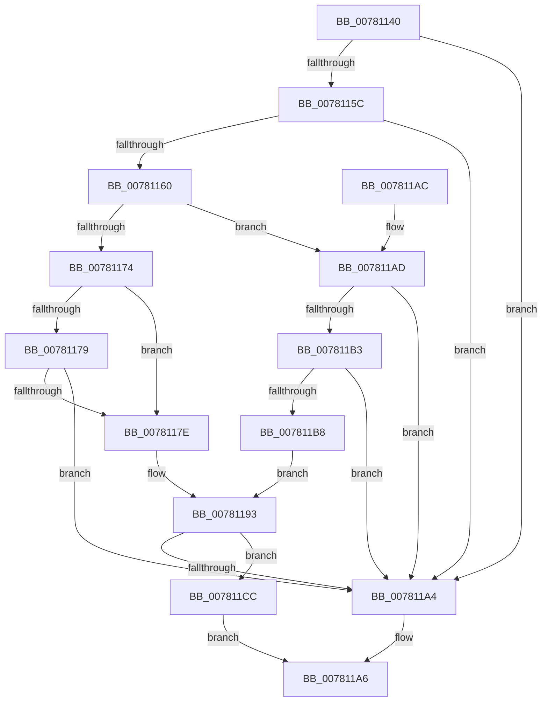

# PsBlockNonCetBinaries

- RVA: `0x00781140`–`0x007811D3` (길이 `147` bytes)
- VA: `0x0000000140781140`
- 실행 섹션: `PAGE`
- PDB 이름 있음: `예`; PDB Function 태그: `아니요`
- unwind 정보 RVA: `0x000CE31C`
- 디코드: `48`개 명령, `147/147` bytes 표시
- 미해석 바이트: `0` (있으면 어셈블리에 `.byte`로 보존)

> 이 문서는 커널 이미지의 기계어와 PDB 기호를 분석해 생성했습니다. 4번과 5번은 함수 원형과 자료형을 바이너리 사용 방식에서 추정한 C 해석이며 원본 소스 복구 결과는 아닙니다.

## 1. Dependencies

- 직접 호출 지점: **1**; 고유 호출 대상: **1**
- 직접 호출자로 확인된 함수: **1**
- RIP 상대 이미지 참조: **0**

### Outgoing calls
- `0x0078119B` → [EtwTimLogBlockNonCetBinaries](../7B/EtwTimLogBlockNonCetBinaries_function_007BA5B8.md) (function, `0x007BA5B8`)

### Direct callers
- [sub_00B1B1BE](../B1/Unknown_function_00B1B1BE.md) at `0x00B1B1E1`

### Static image references
- 디코드된 RIP-relative 메모리 참조가 없습니다.

## 2. Other-region calls and transfers

- 다른 실행 섹션으로 향하는 call: **0**
- 별도 외부 분기/꼬리 이동을 확인하지 못했습니다.

## 3. Assembly (complete function range)

```asm
00781140  40 53                           push rbx
00781142  48 83 EC 30                     sub rsp, 0x30
00781146  8B 81 FC 05 00 00               mov eax, dword ptr [rcx + 0x5fc]
0078114C  4D 8B D9                        mov r11, r9
0078114F  44 0F B6 D2                     movzx r10d, dl
00781153  48 8B D1                        mov rdx, rcx
00781156  0F BA E0 0C                     bt eax, 0xc
0078115A  72 48                           jb 0x1407811a4
0078115C  A8 01                           test al, 1
0078115E  75 44                           jne 0x1407811a4
00781160  8B 81 54 07 00 00               mov eax, dword ptr [rcx + 0x754]
00781166  8B D8                           mov ebx, eax
00781168  81 E3 00 00 80 00               and ebx, 0x800000
0078116E  0F BA E0 16                     bt eax, 0x16
00781172  73 39                           jae 0x1407811ad
00781174  45 84 D2                        test r10b, r10b
00781177  74 05                           je 0x14078117e
00781179  45 84 C0                        test r8b, r8b
0078117C  75 26                           jne 0x1407811a4
0078117E  8B C3                           mov eax, ebx
00781180  45 0F B6 C8                     movzx r9d, r8b
00781184  F7 D8                           neg eax
00781186  C7 44 24 28 01 00 00 00         mov dword ptr [rsp + 0x28], 1
0078118E  45 8B C2                        mov r8d, r10d
00781191  1B C9                           sbb ecx, ecx
00781193  83 C1 02                        add ecx, 2
00781196  4C 89 5C 24 20                  mov qword ptr [rsp + 0x20], r11
0078119B  E8 18 94 03 00                  call 0x1407ba5b8
007811A0  85 DB                           test ebx, ebx
007811A2  74 28                           je 0x1407811cc
007811A4  33 C0                           xor eax, eax
007811A6  48 83 C4 30                     add rsp, 0x30
007811AA  5B                              pop rbx
007811AB  C3                              ret
007811AC  CC                              int3
007811AD  0F BA E0 15                     bt eax, 0x15
007811B1  73 F1                           jae 0x1407811a4
007811B3  45 84 D2                        test r10b, r10b
007811B6  75 EC                           jne 0x1407811a4
007811B8  8B C3                           mov eax, ebx
007811BA  45 0F B6 C8                     movzx r9d, r8b
007811BE  F7 D8                           neg eax
007811C0  1B C9                           sbb ecx, ecx
007811C2  83 64 24 28 00                  and dword ptr [rsp + 0x28], 0
007811C7  45 33 C0                        xor r8d, r8d
007811CA  EB C7                           jmp 0x140781193
007811CC  B8 22 00 00 C0                  mov eax, 0xc0000022
007811D1  EB D3                           jmp 0x1407811a6
```

## 4. C-style interpretation (structured pseudocode)

```c
__int64 __fastcall PsBlockNonCetBinaries(__int64 a1, unsigned __int8 a2, unsigned __int8 a3, __int64 a4)
{
    __int64 result;
    __int64 v_rbx;
    __int64 v_rsp;
    unsigned int v_stack_m10;
    unsigned __int64 v_stack_m18;
    unsigned int v_stack_p28;

    v_rsp = (v_rsp) - (48);
    if (condition_is_below) goto loc_007811A4;
    if ((((unsigned __int8)((unsigned int)(*(unsigned int *)(a1 + 1532)))) & (1)) != 0) goto loc_007811A4;
    v_rbx = (unsigned int)(((unsigned int)((unsigned int)((unsigned int)(*(unsigned int *)(a1 + 1876))))) & (0x800000ULL));
    if (condition_is_above_or_equal) goto loc_007811AD;
    if (a2 == 0) goto loc_0078117E;
    if (a3 != 0) goto loc_007811A4;
loc_0078117E:
    result = (unsigned int)(-((unsigned int)((unsigned int)(v_rbx))));
    v_stack_m10 = 1;
loc_00781193:
    a1 = (unsigned int)((a1) + (2));
    v_stack_m18 = a4;
    result = EtwTimLogBlockNonCetBinaries(a1, a1, (unsigned int)(a2), a3);
    if ((unsigned int)(v_rbx) == 0) goto loc_007811CC;
loc_007811A4:
    result = 0;
loc_007811A6:
    v_rsp = (v_rsp) + (48);
    return result;
loc_007811AD:
    if (condition_is_above_or_equal) goto loc_007811A4;
    if (a2 != 0) goto loc_007811A4;
    result = (unsigned int)(-((unsigned int)((unsigned int)(v_rbx))));
    a3 = 0;
    goto loc_00781193;
loc_007811CC:
    goto loc_007811A6;
}
```

## 5. (Beta) C Style

```c
int64_t PsBlockNonCetBinaries(void *Arg1, uint8_t Arg2, uint8_t Arg3, int64_t Arg4)
{
    uint8_t *arg1 = (uint8_t *)Arg1;

    int64_t result;
    int64_t local_rbx;
    int64_t local_rsp;
    uint32_t v_stack_m10;
    uint64_t v_stack_m18;
    uint32_t v_stack_p28;

    local_rsp = (local_rsp) - (48);
    if (condition_is_below) goto loc_007811A4;
    if ((((uint8_t)((uint32_t)(*(uint32_t *)(arg1 + 0x5FC)))) & (1)) != 0) goto loc_007811A4;
    local_rbx = (uint32_t)(((uint32_t)((uint32_t)((uint32_t)(*(uint32_t *)(arg1 + 0x754))))) & (0x800000ULL));
    if (condition_is_above_or_equal) goto loc_007811AD;
    if (Arg2 == 0) goto loc_0078117E;
    if (Arg3 != 0) goto loc_007811A4;
loc_0078117E:
    result = (uint32_t)(-((uint32_t)((uint32_t)(local_rbx))));
    v_stack_m10 = 1;
loc_00781193:
    Arg1 = (uint32_t)((Arg1) + (2));
    v_stack_m18 = Arg4;
    result = EtwTimLogBlockNonCetBinaries(Arg1, Arg1, (uint32_t)(Arg2), Arg3);
    if ((uint32_t)(local_rbx) == 0) goto loc_007811CC;
loc_007811A4:
    result = 0;
loc_007811A6:
    local_rsp = (local_rsp) + (48);
    return result;
loc_007811AD:
    if (condition_is_above_or_equal) goto loc_007811A4;
    if (Arg2 != 0) goto loc_007811A4;
    result = (uint32_t)(-((uint32_t)((uint32_t)(local_rbx))));
    Arg3 = 0;
    goto loc_00781193;
loc_007811CC:
    goto loc_007811A6;
}
```

### 관측된 메모리 오프셋

구조체 형식이 확인되지 않은 접근은 인자 기준의 오프셋으로만 기록했습니다.

| 기준 인자 | 오프셋 표현 | 폭 (bit) | 접근 |
|---|---:|---:|---|
| `Arg1` | `+ 0x5FC` | `32` | `R` |
| `Arg1` | `+ 0x754` | `32` | `R` |

## 6. Execution-region graph

[열기: 2D/3D 그래프와 함수 탐색 컨트롤 패널](../../../control-panel.html?section=page&rva=0x00781140&view=graph)

- 2D 그래프는 위에서 아래로 흐르고, 3D 그래프는 빈 공간을 드래그해 회전합니다. Shift+드래그는 이동, 휠은 확대·축소, 함수 노드 선택은 대상 보고서 이동입니다.

### Static fallback


