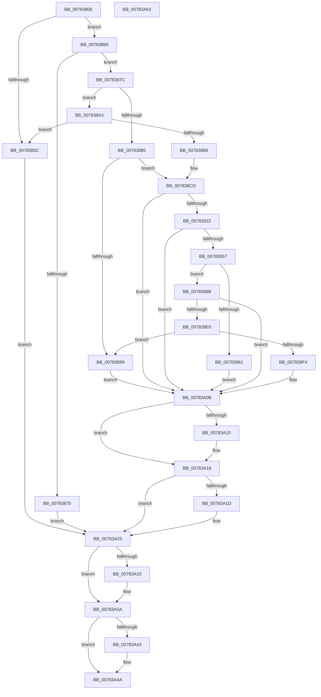

# PsCheckProcessFileSigningLevel

- RVA: `0x00783800`–`0x00783A64` (길이 `612` bytes)
- VA: `0x0000000140783800`
- 실행 섹션: `PAGE`
- PDB 이름 있음: `예`; PDB Function 태그: `아니요`
- unwind 정보 RVA: `0x000CEEA4`
- 디코드: `156`개 명령, `612/612` bytes 표시
- 미해석 바이트: `0` (있으면 어셈블리에 `.byte`로 보존)

> 이 문서는 커널 이미지의 기계어와 PDB 기호를 분석해 생성했습니다. 4번과 5번은 함수 원형과 자료형을 바이너리 사용 방식에서 추정한 C 해석이며 원본 소스 복구 결과는 아닙니다.

## 1. Dependencies

- 직접 호출 지점: **15**; 고유 호출 대상: **11**
- 직접 호출자로 확인된 함수: **0**
- RIP 상대 이미지 참조: **1**

### Outgoing calls
- `0x00783853` → [PsQuerySectionSignatureInformation](../A2/PsQuerySectionSignatureInformation_function_00A2FB40.md) (function, `0x00A2FB40`)
- `0x0078386C` → [SeCompareSigningLevels](../A1/SeCompareSigningLevels_function_00A13760.md) (function, `0x00A13760`)
- `0x0078388C` → [PsReferenceProcessFilePointer](../8D/PsReferenceProcessFilePointer_function_008D6870.md) (function, `0x008D6870`)
- `0x007838AD` → [ExAcquireRundownProtection](../../text/21/ExAcquireRundownProtection_function_00216620.md) (function, `0x00216620`)
- `0x007838C0` → [ObfReferenceObject](../../text/20/ObfReferenceObject_function_0020FA20.md) (function, `0x0020FA20`)
- `0x007838C8` → [ExReleaseRundownProtection](../../text/34/ExReleaseRundownProtection_function_00349E80.md) (function, `0x00349E80`)
- `0x00783913` → [ZwOpenFile](../../text/6A/ZwOpenFile_function_006AD730.md) (function, `0x006AD730`)
- `0x00783944` → [ObReferenceObjectByHandle](../86/ObReferenceObjectByHandle_function_00868DB0.md) (function, `0x00868DB0`)
- `0x007839D5` → [ZwCreateSectionEx](../../text/6A/ZwCreateSectionEx_function_006AE990.md) (function, `0x006AE990`)
- `0x007839E7` → [PsQuerySectionSignatureInformation](../A2/PsQuerySectionSignatureInformation_function_00A2FB40.md) (function, `0x00A2FB40`)
- `0x007839FA` → [SeCompareSigningLevels](../A1/SeCompareSigningLevels_function_00A13760.md) (function, `0x00A13760`)
- `0x00783A13` → [ObfDereferenceObject](../../text/2F/ObfDereferenceObject_function_002F9350.md) (function, `0x002F9350`)
- `0x00783A20` → [ObfDereferenceObject](../../text/2F/ObfDereferenceObject_function_002F9350.md) (function, `0x002F9350`)
- `0x00783A35` → [ObCloseHandle](../8A/ObCloseHandle_function_008A1870.md) (function, `0x008A1870`)
- `0x00783A45` → [ObCloseHandle](../8A/ObCloseHandle_function_008A1870.md) (function, `0x008A1870`)

### Direct callers
- 이 함수 시작 RVA로 연결되는 직접 call은 확인되지 않았습니다. 간접 호출은 완전히 역산할 수 없습니다.

### Static image references
- `0x00783922` → RVA `0x00FC6AE0` (`ALMOSTRO`; read)

## 2. Other-region calls and transfers

- 다른 실행 섹션으로 향하는 call: **7**
  - `0x007838AD` → [ExAcquireRundownProtection](../../text/21/ExAcquireRundownProtection_function_00216620.md) (`PAGE` → `.text`)
  - `0x007838C0` → [ObfReferenceObject](../../text/20/ObfReferenceObject_function_0020FA20.md) (`PAGE` → `.text`)
  - `0x007838C8` → [ExReleaseRundownProtection](../../text/34/ExReleaseRundownProtection_function_00349E80.md) (`PAGE` → `.text`)
  - `0x00783913` → [ZwOpenFile](../../text/6A/ZwOpenFile_function_006AD730.md) (`PAGE` → `.text`)
  - `0x007839D5` → [ZwCreateSectionEx](../../text/6A/ZwCreateSectionEx_function_006AE990.md) (`PAGE` → `.text`)
  - `0x00783A13` → [ObfDereferenceObject](../../text/2F/ObfDereferenceObject_function_002F9350.md) (`PAGE` → `.text`)
  - `0x00783A20` → [ObfDereferenceObject](../../text/2F/ObfDereferenceObject_function_002F9350.md) (`PAGE` → `.text`)
- 별도 외부 분기/꼬리 이동을 확인하지 못했습니다.

## 3. Assembly (complete function range)

```asm
00783800  48 89 5C 24 08                  mov qword ptr [rsp + 8], rbx
00783805  55                              push rbp
00783806  56                              push rsi
00783807  57                              push rdi
00783808  41 56                           push r14
0078380A  41 57                           push r15
0078380C  48 8D 6C 24 C9                  lea rbp, [rsp - 0x37]
00783811  48 81 EC B0 00 00 00            sub rsp, 0xb0
00783818  48 83 4D 7F FF                  or qword ptr [rbp + 0x7f], 0xffffffffffffffff
0078381D  0F 57 C0                        xorps xmm0, xmm0
00783820  33 C0                           xor eax, eax
00783822  44 0F B6 FA                     movzx r15d, dl
00783826  48 21 45 DF                     and qword ptr [rbp - 0x21], rax
0078382A  48 8D 55 77                     lea rdx, [rbp + 0x77]
0078382E  48 21 45 D7                     and qword ptr [rbp - 0x29], rax
00783832  48 8B F1                        mov rsi, rcx
00783835  0F 11 45 F7                     movups xmmword ptr [rbp - 9], xmm0
00783839  48 89 45 27                     mov qword ptr [rbp + 0x27], rax
0078383D  45 33 F6                        xor r14d, r14d
00783840  0F 11 45 07                     movups xmmword ptr [rbp + 7], xmm0
00783844  89 45 2F                        mov dword ptr [rbp + 0x2f], eax
00783847  0F 11 45 17                     movups xmmword ptr [rbp + 0x17], xmm0
0078384B  C6 45 77 00                     mov byte ptr [rbp + 0x77], 0
0078384F  0F 11 45 E7                     movups xmmword ptr [rbp - 0x19], xmm0
00783853  E8 E8 C2 2A 00                  call 0x140a2fb40
00783858  85 C0                           test eax, eax
0078385A  79 0A                           jns 0x140783866
0078385C  BB 0A 01 00 C0                  mov ebx, 0xc000010a
00783861  E9 BF 01 00 00                  jmp 0x140783a25
00783866  8A 4D 77                        mov cl, byte ptr [rbp + 0x77]
00783869  41 8A D7                        mov dl, r15b
0078386C  E8 EF FE 28 00                  call 0x140a13760
00783871  85 C0                           test eax, eax
00783873  74 07                           je 0x14078387c
00783875  33 DB                           xor ebx, ebx
00783877  E9 A9 01 00 00                  jmp 0x140783a25
0078387C  4C 39 B6 30 03 00 00            cmp qword ptr [rsi + 0x330], r14
00783883  75 1E                           jne 0x1407838a3
00783885  48 8D 55 D7                     lea rdx, [rbp - 0x29]
00783889  48 8B CE                        mov rcx, rsi
0078388C  E8 DF 2F 15 00                  call 0x1408d6870
00783891  48 8B 7D D7                     mov rdi, qword ptr [rbp - 0x29]
00783895  85 C0                           test eax, eax
00783897  79 34                           jns 0x1407838cd
00783899  BB 0A 01 00 C0                  mov ebx, 0xc000010a
0078389E  E9 68 01 00 00                  jmp 0x140783a0b
007838A3  48 8D 9E E8 01 00 00            lea rbx, [rsi + 0x1e8]
007838AA  48 8B CB                        mov rcx, rbx
007838AD  E8 6E 2D A9 FF                  call 0x140216620
007838B2  84 C0                           test al, al
007838B4  74 A6                           je 0x14078385c
007838B6  48 8B BE 30 03 00 00            mov rdi, qword ptr [rsi + 0x330]
007838BD  48 8B CF                        mov rcx, rdi
007838C0  E8 5B C1 A8 FF                  call 0x14020fa20
007838C5  48 8B CB                        mov rcx, rbx
007838C8  E8 B3 65 BC FF                  call 0x140349e80
007838CD  48 8B 86 50 03 00 00            mov rax, qword ptr [rsi + 0x350]
007838D4  4C 8D 4D F7                     lea r9, [rbp - 9]
007838D8  4C 21 75 0F                     and qword ptr [rbp + 0xf], r14
007838DC  4C 8D 45 07                     lea r8, [rbp + 7]
007838E0  0F 57 C0                        xorps xmm0, xmm0
007838E3  C7 44 24 28 60 00 00 00         mov dword ptr [rsp + 0x28], 0x60
007838EB  BA 00 00 10 80                  mov edx, 0x80100000
007838F0  48 89 45 17                     mov qword ptr [rbp + 0x17], rax
007838F4  48 8D 4D 7F                     lea rcx, [rbp + 0x7f]
007838F8  C7 45 07 30 00 00 00            mov dword ptr [rbp + 7], 0x30
007838FF  F3 0F 7F 45 27                  movdqu xmmword ptr [rbp + 0x27], xmm0
00783904  C7 45 1F 40 02 00 00            mov dword ptr [rbp + 0x1f], 0x240
0078390B  C7 44 24 20 05 00 00 00         mov dword ptr [rsp + 0x20], 5
00783913  E8 18 9E F2 FF                  call 0x1406ad730
00783918  8B D8                           mov ebx, eax
0078391A  85 C0                           test eax, eax
0078391C  0F 88 E9 00 00 00               js 0x140783a0b
00783922  4C 8B 05 B7 31 84 00            mov r8, qword ptr [rip + 0x8431b7]
00783929  48 8D 45 D7                     lea rax, [rbp - 0x29]
0078392D  4C 21 74 24 28                  and qword ptr [rsp + 0x28], r14
00783932  45 33 C9                        xor r9d, r9d
00783935  48 8B 4D 7F                     mov rcx, qword ptr [rbp + 0x7f]
00783939  33 D2                           xor edx, edx
0078393B  4C 21 75 D7                     and qword ptr [rbp - 0x29], r14
0078393F  48 89 44 24 20                  mov qword ptr [rsp + 0x20], rax
00783944  E8 67 54 0E 00                  call 0x140868db0
00783949  4C 8B 75 D7                     mov r14, qword ptr [rbp - 0x29]
0078394D  8B D8                           mov ebx, eax
0078394F  85 C0                           test eax, eax
00783951  0F 88 B4 00 00 00               js 0x140783a0b
00783957  49 8B 46 18                     mov rax, qword ptr [r14 + 0x18]
0078395B  48 39 47 18                     cmp qword ptr [rdi + 0x18], rax
0078395F  74 0A                           je 0x14078396b
00783961  BB 25 02 00 C0                  mov ebx, 0xc0000225
00783966  E9 A0 00 00 00                  jmp 0x140783a0b
0078396B  48 83 65 0F 00                  and qword ptr [rbp + 0xf], 0
00783970  48 8D 45 E7                     lea rax, [rbp - 0x19]
00783974  48 83 65 17 00                  and qword ptr [rbp + 0x17], 0
00783979  4C 8D 45 07                     lea r8, [rbp + 7]
0078397D  83 65 F3 00                     and dword ptr [rbp - 0xd], 0
00783981  48 8D 4D DF                     lea rcx, [rbp - 0x21]
00783985  C7 44 24 40 01 00 00 00         mov dword ptr [rsp + 0x40], 1
0078398D  0F 57 C0                        xorps xmm0, xmm0
00783990  48 89 44 24 38                  mov qword ptr [rsp + 0x38], rax
00783995  45 33 C9                        xor r9d, r9d
00783998  48 8B 45 7F                     mov rax, qword ptr [rbp + 0x7f]
0078399C  BA 1F 00 0F 00                  mov edx, 0xf001f
007839A1  48 89 44 24 30                  mov qword ptr [rsp + 0x30], rax
007839A6  C7 44 24 28 00 00 00 01         mov dword ptr [rsp + 0x28], 0x1000000
007839AE  C7 44 24 20 20 00 00 00         mov dword ptr [rsp + 0x20], 0x20
007839B6  C7 45 07 30 00 00 00            mov dword ptr [rbp + 7], 0x30
007839BD  C7 45 1F 40 02 00 00            mov dword ptr [rbp + 0x1f], 0x240
007839C4  F3 0F 7F 45 27                  movdqu xmmword ptr [rbp + 0x27], xmm0
007839C9  48 C7 45 E7 03 00 00 00         mov qword ptr [rbp - 0x19], 3
007839D1  44 89 7D EF                     mov dword ptr [rbp - 0x11], r15d
007839D5  E8 B6 AF F2 FF                  call 0x1406ae990
007839DA  8B D8                           mov ebx, eax
007839DC  85 C0                           test eax, eax
007839DE  78 2B                           js 0x140783a0b
007839E0  48 8D 55 77                     lea rdx, [rbp + 0x77]
007839E4  48 8B CE                        mov rcx, rsi
007839E7  E8 54 C1 2A 00                  call 0x140a2fb40
007839EC  85 C0                           test eax, eax
007839EE  0F 88 A5 FE FF FF               js 0x140783899
007839F4  8A 4D 77                        mov cl, byte ptr [rbp + 0x77]
007839F7  41 8A D7                        mov dl, r15b
007839FA  E8 61 FD 28 00                  call 0x140a13760
007839FF  F7 D8                           neg eax
00783A01  1B DB                           sbb ebx, ebx
00783A03  F7 D3                           not ebx
00783A05  81 E3 28 04 00 C0               and ebx, 0xc0000428
00783A0B  48 85 FF                        test rdi, rdi
00783A0E  74 08                           je 0x140783a18
00783A10  48 8B CF                        mov rcx, rdi
00783A13  E8 38 59 B7 FF                  call 0x1402f9350
00783A18  4D 85 F6                        test r14, r14
00783A1B  74 08                           je 0x140783a25
00783A1D  49 8B CE                        mov rcx, r14
00783A20  E8 2B 59 B7 FF                  call 0x1402f9350
00783A25  48 8B 4D 7F                     mov rcx, qword ptr [rbp + 0x7f]
00783A29  48 8D 41 FF                     lea rax, [rcx - 1]
00783A2D  48 83 F8 FD                     cmp rax, -3
00783A31  77 07                           ja 0x140783a3a
00783A33  33 D2                           xor edx, edx
00783A35  E8 36 DE 11 00                  call 0x1408a1870
00783A3A  48 8B 4D DF                     mov rcx, qword ptr [rbp - 0x21]
00783A3E  48 85 C9                        test rcx, rcx
00783A41  74 07                           je 0x140783a4a
00783A43  33 D2                           xor edx, edx
00783A45  E8 26 DE 11 00                  call 0x1408a1870
00783A4A  8B C3                           mov eax, ebx
00783A4C  48 8B 9C 24 E0 00 00 00         mov rbx, qword ptr [rsp + 0xe0]
00783A54  48 81 C4 B0 00 00 00            add rsp, 0xb0
00783A5B  41 5F                           pop r15
00783A5D  41 5E                           pop r14
00783A5F  5F                              pop rdi
00783A60  5E                              pop rsi
00783A61  5D                              pop rbp
00783A62  C3                              ret
00783A63  CC                              int3
```

## 4. C-style interpretation (structured pseudocode)

```c
__int64 __fastcall PsCheckProcessFileSigningLevel(__int64 a1, unsigned __int8 a2)
{
    __int64 result;
    __int64 v_r14;
    __int64 v_rbx;
    __int64 v_rsp;
    unsigned int v_stack_m30;
    unsigned __int64 v_stack_m38;
    unsigned int v_stack_m40;
    unsigned __int64 v_stack_m48;
    unsigned __int64 v_stack_m50;
    unsigned __int64 v_stack_m58;
    unsigned __int64 v_stack_m5F;
    unsigned __int64 v_stack_m68;
    unsigned int v_stack_m6C;
    unsigned int v_stack_m70;
    unsigned __int64 v_stack_m78;
    unsigned __int64 v_stack_m80;
    unsigned __int64 v_stack_m88;
    unsigned int v_stack_m98;
    unsigned __int64 v_stack_mA0;
    unsigned __int64 v_stack_mA8;
    unsigned int v_stack_mB0;
    unsigned int v_stack_mB8;
    unsigned __int64 v_stack_p18;
    unsigned __int64 v_stack_p20;
    unsigned __int64 v_stack_p8;

    v_stack_p8 = v_rbx;
    v_rsp = (v_rsp) - (176);
    result = 0;
    v_stack_m68 = v_xmm0;
    v_stack_m38 = 0;
    v_r14 = 0;
    v_stack_m58 = v_xmm0;
    v_stack_m30 = 0;
    v_stack_m48 = v_xmm0;
    v_stack_p18 = 0;
    v_stack_m78 = v_xmm0;
    result = PsQuerySectionSignatureInformation(a1, v_stack_p18, a3, a4);
    if (!sign_flag) goto loc_00783866;
loc_0078385C:
    goto loc_00783A25;
loc_00783866:
    result = SeCompareSigningLevels(v_stack_p18, a2, a3, a4);
    if ((unsigned int)(result) == 0) goto loc_0078387C;
    v_rbx = 0;
    goto loc_00783A25;
loc_0078387C:
    if ((*(unsigned __int64 *)(a1 + 816)) != 0) goto loc_007838A3;
    result = PsReferenceProcessFilePointer(a1, v_stack_m88, a3, a4);
    if (!sign_flag) goto loc_007838CD;
loc_00783899:
    goto loc_00783A0B;
loc_007838A3:
    result = ExAcquireRundownProtection(a1 + 488, v_stack_m88, a3, a4);
    if ((unsigned __int8)(result) == 0) goto loc_0078385C;
    result = ObfReferenceObject(*(unsigned __int64 *)(a1 + 816), v_stack_m88, a3, a4);
    result = ExReleaseRundownProtection(a1 + 488, v_stack_m88, a3, a4);
loc_007838CD:
    v_stack_mB0 = 96;
    v_stack_m48 = *(unsigned __int64 *)(a1 + 848);
    v_stack_m58 = 48;
    v_stack_m38 = v_xmm0;
    v_stack_m40 = 576;
    v_stack_mB8 = 5;
    result = ZwOpenFile(v_stack_p20, (unsigned int)(0x80100000ULL), v_stack_m58, v_stack_m68);
    if (sign_flag) goto loc_00783A0B;
    a4 = 0;
    a2 = 0;
    v_stack_mB8 = v_stack_m88;
    result = ObReferenceObjectByHandle(v_stack_p20, a2, *(unsigned __int64 *)(v_rip + 8663479), a4);
    if (sign_flag) goto loc_00783A0B;
    if ((*(unsigned __int64 *)(*(unsigned __int64 *)(a1 + 816) + 24)) == (*(unsigned __int64 *)(v_stack_m88 + 24))) goto loc_0078396B;
    goto loc_00783A0B;
loc_0078396B:
    v_stack_m98 = 1;
    v_stack_mA0 = v_stack_m78;
    a4 = 0;
    v_stack_mA8 = v_stack_p20;
    v_stack_mB0 = 0x1000000ULL;
    v_stack_mB8 = 32;
    v_stack_m58 = 48;
    v_stack_m40 = 576;
    v_stack_m38 = v_xmm0;
    v_stack_m78 = 3;
    v_stack_m70 = 0;
    result = ZwCreateSectionEx(v_stack_m80, (unsigned int)(0xF001FULL), v_stack_m58, a4);
    if (sign_flag) goto loc_00783A0B;
    result = PsQuerySectionSignatureInformation(a1, v_stack_p18, v_stack_m58, a4);
    if (sign_flag) goto loc_00783899;
    result = SeCompareSigningLevels(v_stack_p18, 0, v_stack_m58, a4);
    result = (unsigned int)(-(result));
    v_rbx = (unsigned int)(~((unsigned int)((unsigned int)(result))));
    v_rbx = (unsigned int)((v_rbx) & (0xC0000428ULL));
loc_00783A0B:
    if (*(unsigned __int64 *)(a1 + 816) != 0) {
        a1 = *(unsigned __int64 *)(a1 + 816);
        result = ObfDereferenceObject(a1, 0, v_stack_m58, a4);
    }
    if (v_stack_m88 != 0) {
        a1 = v_stack_m88;
        result = ObfDereferenceObject(a1, 0, v_stack_m58, a4);
    }
    result = v_stack_p20 - 1;
    if ((v_stack_p20 - 1) <= -3) {
        a2 = 0;
        result = ObCloseHandle(v_stack_p20, a2, v_stack_m58, a4);
    }
    if (v_stack_m80 != 0) {
        a2 = 0;
        result = ObCloseHandle(v_stack_m80, a2, v_stack_m58, a4);
    }
    v_rsp = (v_rsp) + (176);
    return (unsigned int)((unsigned int)(v_rbx));
}
```

## 5. (Beta) C Style

```c
int64_t PsCheckProcessFileSigningLevel(void *Arg1, uint8_t Arg2)
{
    uint8_t *arg1 = (uint8_t *)Arg1;

    int64_t result;
    int64_t local_r14;
    int64_t local_rbx;
    int64_t local_rsp;
    uint32_t v_stack_m30;
    uint64_t v_stack_m38;
    uint32_t v_stack_m40;
    uint64_t v_stack_m48;
    uint64_t v_stack_m50;
    uint64_t v_stack_m58;
    uint64_t v_stack_m5F;
    uint64_t v_stack_m68;
    uint32_t v_stack_m6C;
    uint32_t v_stack_m70;
    uint64_t v_stack_m78;
    uint64_t v_stack_m80;
    uint64_t v_stack_m88;
    uint32_t v_stack_m98;
    uint64_t v_stack_mA0;
    uint64_t v_stack_mA8;
    uint32_t v_stack_mB0;
    uint32_t v_stack_mB8;
    uint64_t v_stack_p18;
    uint64_t v_stack_p20;
    uint64_t v_stack_p8;

    v_stack_p8 = local_rbx;
    local_rsp = (local_rsp) - (176);
    result = 0;
    v_stack_m68 = v_xmm0;
    v_stack_m38 = 0;
    local_r14 = 0;
    v_stack_m58 = v_xmm0;
    v_stack_m30 = 0;
    v_stack_m48 = v_xmm0;
    v_stack_p18 = 0;
    v_stack_m78 = v_xmm0;
    result = PsQuerySectionSignatureInformation(Arg1, v_stack_p18, a3, a4);
    if (!sign_flag) goto loc_00783866;
loc_0078385C:
    goto loc_00783A25;
loc_00783866:
    result = SeCompareSigningLevels(v_stack_p18, Arg2, a3, a4);
    if ((uint32_t)(result) == 0) goto loc_0078387C;
    local_rbx = 0;
    goto loc_00783A25;
loc_0078387C:
    if ((*(uint64_t *)(arg1 + 0x330)) != 0) goto loc_007838A3;
    result = PsReferenceProcessFilePointer(Arg1, v_stack_m88, a3, a4);
    if (!sign_flag) goto loc_007838CD;
loc_00783899:
    goto loc_00783A0B;
loc_007838A3:
    result = ExAcquireRundownProtection(Arg1 + 488, v_stack_m88, a3, a4);
    if ((uint8_t)(result) == 0) goto loc_0078385C;
    result = ObfReferenceObject(*(uint64_t *)(arg1 + 0x330), v_stack_m88, a3, a4);
    result = ExReleaseRundownProtection(Arg1 + 488, v_stack_m88, a3, a4);
loc_007838CD:
    v_stack_mB0 = 96;
    v_stack_m48 = *(uint64_t *)(arg1 + 0x350);
    v_stack_m58 = 48;
    v_stack_m38 = v_xmm0;
    v_stack_m40 = 576;
    v_stack_mB8 = 5;
    result = ZwOpenFile(v_stack_p20, (uint32_t)(0x80100000ULL), v_stack_m58, v_stack_m68);
    if (sign_flag) goto loc_00783A0B;
    a4 = 0;
    Arg2 = 0;
    v_stack_mB8 = v_stack_m88;
    result = ObReferenceObjectByHandle(v_stack_p20, Arg2, *(uint64_t *)(v_rip + 0x8431B7), a4);
    if (sign_flag) goto loc_00783A0B;
    if ((*(uint64_t *)(*(uint64_t *)(arg1 + 0x330) + 0x18)) == (*(uint64_t *)(v_stack_m88 + 0x18))) goto loc_0078396B;
    goto loc_00783A0B;
loc_0078396B:
    v_stack_m98 = 1;
    v_stack_mA0 = v_stack_m78;
    a4 = 0;
    v_stack_mA8 = v_stack_p20;
    v_stack_mB0 = 0x1000000ULL;
    v_stack_mB8 = 32;
    v_stack_m58 = 48;
    v_stack_m40 = 576;
    v_stack_m38 = v_xmm0;
    v_stack_m78 = 3;
    v_stack_m70 = 0;
    result = ZwCreateSectionEx(v_stack_m80, (uint32_t)(0xF001FULL), v_stack_m58, a4);
    if (sign_flag) goto loc_00783A0B;
    result = PsQuerySectionSignatureInformation(Arg1, v_stack_p18, v_stack_m58, a4);
    if (sign_flag) goto loc_00783899;
    result = SeCompareSigningLevels(v_stack_p18, 0, v_stack_m58, a4);
    result = (uint32_t)(-(result));
    local_rbx = (uint32_t)(~((uint32_t)((uint32_t)(result))));
    local_rbx = (uint32_t)((local_rbx) & (0xC0000428ULL));
loc_00783A0B:
    if (*(uint64_t *)(arg1 + 0x330) != 0) {
        Arg1 = *(uint64_t *)(arg1 + 0x330);
        result = ObfDereferenceObject(Arg1, 0, v_stack_m58, a4);
    }
    if (v_stack_m88 != 0) {
        Arg1 = v_stack_m88;
        result = ObfDereferenceObject(Arg1, 0, v_stack_m58, a4);
    }
    result = v_stack_p20 - 1;
    if ((v_stack_p20 - 1) <= -3) {
        Arg2 = 0;
        result = ObCloseHandle(v_stack_p20, Arg2, v_stack_m58, a4);
    }
    if (v_stack_m80 != 0) {
        Arg2 = 0;
        result = ObCloseHandle(v_stack_m80, Arg2, v_stack_m58, a4);
    }
    local_rsp = (local_rsp) + (176);
    return (uint32_t)((uint32_t)(local_rbx));
}
```

### 관측된 메모리 오프셋

구조체 형식이 확인되지 않은 접근은 인자 기준의 오프셋으로만 기록했습니다.

| 기준 인자 | 오프셋 표현 | 폭 (bit) | 접근 |
|---|---:|---:|---|
| `Arg1` | `+ 0x1E8` | `64` | `R` |
| `Arg1` | `+ 0x330` | `64` | `R` |
| `Arg1` | `+ 0x350` | `64` | `R` |

## 6. Execution-region graph

[열기: 2D/3D 그래프와 함수 탐색 컨트롤 패널](../../../control-panel.html?section=page&rva=0x00783800&view=graph)

- 2D 그래프는 위에서 아래로 흐르고, 3D 그래프는 빈 공간을 드래그해 회전합니다. Shift+드래그는 이동, 휠은 확대·축소, 함수 노드 선택은 대상 보고서 이동입니다.

### Static fallback


