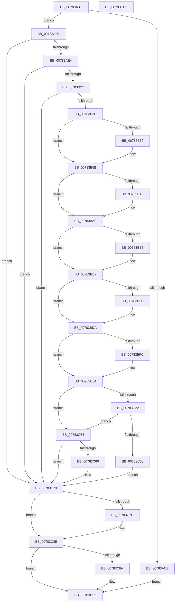

# PsCreateCpuPartition

- RVA: `0x00783A8C`–`0x00783CB4` (길이 `552` bytes)
- VA: `0x0000000140783A8C`
- 실행 섹션: `PAGE`
- PDB 이름 있음: `예`; PDB Function 태그: `아니요`
- unwind 정보 RVA: `0x000BAC3C`
- 디코드: `143`개 명령, `552/552` bytes 표시
- 미해석 바이트: `0` (있으면 어셈블리에 `.byte`로 보존)

> 이 문서는 커널 이미지의 기계어와 PDB 기호를 분석해 생성했습니다. 4번과 5번은 함수 원형과 자료형을 바이너리 사용 방식에서 추정한 C 해석이며 원본 소스 복구 결과는 아닙니다.

## 1. Dependencies

- 직접 호출 지점: **12**; 고유 호출 대상: **12**
- 직접 호출자로 확인된 함수: **3**
- RIP 상대 이미지 참조: **7**

### Outgoing calls
- `0x00783AD5` → [PspCheckCpuPartitionCreateAccess](PspCheckCpuPartitionCreateAccess_function_00784130.md) (function, `0x00784130`)
- `0x00783B13` → [ObCreateObjectEx](../89/ObCreateObjectEx_function_0089B1E0.md) (function, `0x0089B1E0`)
- `0x00783B2F` → [KeCreateCpuPartition](../../text/5C/KeCreateCpuPartition_function_005C0E0C.md) (function, `0x005C0E0C`)
- `0x00783B62` → [ObfReferenceObjectWithTag](../../text/21/ObfReferenceObjectWithTag_function_00210710.md) (function, `0x00210710`)
- `0x00783B8F` → [KeAbPreAcquire](../../text/21/KeAbPreAcquire_function_00210230.md) (function, `0x00210230`)
- `0x00783BA9` → [ExfAcquirePushLockExclusiveEx](../../text/20/ExfAcquirePushLockExclusiveEx_function_0020FC90.md) (function, `0x0020FC90`)
- `0x00783BFF` → [ExfTryToWakePushLock](../../text/26/ExfTryToWakePushLock_function_00265DD0.md) (function, `0x00265DD0`)
- `0x00783C07` → [KeAbPostRelease](../../text/2E/KeAbPostRelease_function_002E1600.md) (function, `0x002E1600`)
- `0x00783C0C` → [KeLeaveCriticalRegion](../../text/25/KeLeaveCriticalRegion_function_0025D8B0.md) (function, `0x0025D8B0`)
- `0x00783C45` → [ObInsertObjectEx](../8B/ObInsertObjectEx_function_008B97A0.md) (function, `0x008B97A0`)
- `0x00783C80` → [ObCloseHandle](../8A/ObCloseHandle_function_008A1870.md) (function, `0x008A1870`)
- `0x00783C8D` → [ObfDereferenceObject](../../text/2F/ObfDereferenceObject_function_002F9350.md) (function, `0x002F9350`)

### Direct callers
- [NtCreateCpuPartition](NtCreateCpuPartition_function_00782E30.md) at `0x00782FA0`
- [PsInitializeBootCpuPartitions](../../init/C4/PsInitializeBootCpuPartitions_function_00C44D94.md) at `0x00C450EC`
- [PspInitializeCpuPartitionsPhase0](../../init/C4/PspInitializeCpuPartitionsPhase0_function_00C45A2C.md) at `0x00C45ACC`

### Static image references
- `0x00783AEE` → RVA `0x00FC6DF0` (`ALMOSTRO`; read)
- `0x00783B46` → RVA `0x00FC6D78` (`ALMOSTRO`; read)
- `0x00783B74` → RVA `0x00FD9DC8` (`PAGEDATA`; read)
- `0x00783BB7` → RVA `0x00FDA400` (`PAGEDATA`; read)
- `0x00783BBE` → RVA `0x00FDA3F8` (`PAGEDATA`; read)
- `0x00783BE4` → RVA `0x00FDA400` (`PAGEDATA`; write)
- `0x00783BEB` → RVA `0x00FD9DC8` (`PAGEDATA`; read/write)

## 2. Other-region calls and transfers

- 다른 실행 섹션으로 향하는 call: **8**
  - `0x00783B2F` → [KeCreateCpuPartition](../../text/5C/KeCreateCpuPartition_function_005C0E0C.md) (`PAGE` → `.text`)
  - `0x00783B62` → [ObfReferenceObjectWithTag](../../text/21/ObfReferenceObjectWithTag_function_00210710.md) (`PAGE` → `.text`)
  - `0x00783B8F` → [KeAbPreAcquire](../../text/21/KeAbPreAcquire_function_00210230.md) (`PAGE` → `.text`)
  - `0x00783BA9` → [ExfAcquirePushLockExclusiveEx](../../text/20/ExfAcquirePushLockExclusiveEx_function_0020FC90.md) (`PAGE` → `.text`)
  - `0x00783BFF` → [ExfTryToWakePushLock](../../text/26/ExfTryToWakePushLock_function_00265DD0.md) (`PAGE` → `.text`)
  - `0x00783C07` → [KeAbPostRelease](../../text/2E/KeAbPostRelease_function_002E1600.md) (`PAGE` → `.text`)
  - `0x00783C0C` → [KeLeaveCriticalRegion](../../text/25/KeLeaveCriticalRegion_function_0025D8B0.md) (`PAGE` → `.text`)
  - `0x00783C8D` → [ObfDereferenceObject](../../text/2F/ObfDereferenceObject_function_002F9350.md) (`PAGE` → `.text`)
- 별도 외부 분기/꼬리 이동을 확인하지 못했습니다.

## 3. Assembly (complete function range)

```asm
00783A8C  48 8B C4                        mov rax, rsp
00783A8F  48 89 58 08                     mov qword ptr [rax + 8], rbx
00783A93  48 89 68 10                     mov qword ptr [rax + 0x10], rbp
00783A97  48 89 70 18                     mov qword ptr [rax + 0x18], rsi
00783A9B  48 89 78 20                     mov qword ptr [rax + 0x20], rdi
00783A9F  41 55                           push r13
00783AA1  41 56                           push r14
00783AA3  41 57                           push r15
00783AA5  48 83 EC 60                     sub rsp, 0x60
00783AA9  33 FF                           xor edi, edi
00783AAB  41 8B D9                        mov ebx, r9d
00783AAE  48 21 78 E0                     and qword ptr [rax - 0x20], rdi
00783AB2  41 8A E8                        mov bpl, r8b
00783AB5  48 89 78 D8                     mov qword ptr [rax - 0x28], rdi
00783AB9  44 8B FA                        mov r15d, edx
00783ABC  4C 8B F1                        mov r14, rcx
00783ABF  41 F7 C1 FE FF FF FF            test r9d, 0xfffffffe
00783AC6  74 0A                           je 0x140783ad2
00783AC8  BE 0D 00 00 C0                  mov esi, 0xc000000d
00783ACD  E9 C0 01 00 00                  jmp 0x140783c92
00783AD2  40 8A CD                        mov cl, bpl
00783AD5  E8 56 06 00 00                  call 0x140784130
00783ADA  8B F0                           mov esi, eax
00783ADC  85 C0                           test eax, eax
00783ADE  0F 88 8F 01 00 00               js 0x140783c73
00783AE4  48 21 7C 24 48                  and qword ptr [rsp + 0x48], rdi
00783AE9  48 8D 44 24 50                  lea rax, [rsp + 0x50]
00783AEE  48 8B 15 FB 32 84 00            mov rdx, qword ptr [rip + 0x8432fb]
00783AF5  44 8A CD                        mov r9b, bpl
00783AF8  48 89 44 24 40                  mov qword ptr [rsp + 0x40], rax
00783AFD  4D 8B C6                        mov r8, r14
00783B00  21 7C 24 38                     and dword ptr [rsp + 0x38], edi
00783B04  40 8A CD                        mov cl, bpl
00783B07  21 7C 24 30                     and dword ptr [rsp + 0x30], edi
00783B0B  C7 44 24 28 20 00 00 00         mov dword ptr [rsp + 0x28], 0x20
00783B13  E8 C8 76 11 00                  call 0x14089b1e0
00783B18  48 8B 7C 24 50                  mov rdi, qword ptr [rsp + 0x50]
00783B1D  8B F0                           mov esi, eax
00783B1F  85 C0                           test eax, eax
00783B21  0F 88 4C 01 00 00               js 0x140783c73
00783B27  83 E3 01                        and ebx, 1
00783B2A  48 8B CF                        mov rcx, rdi
00783B2D  8B D3                           mov edx, ebx
00783B2F  E8 D8 D2 E3 FF                  call 0x1405c0e0c
00783B34  8B F0                           mov esi, eax
00783B36  85 C0                           test eax, eax
00783B38  0F 88 35 01 00 00               js 0x140783c73
00783B3E  4C 8B B4 24 A8 00 00 00         mov r14, qword ptr [rsp + 0xa8]
00783B46  48 8D 05 2B 32 84 00            lea rax, [rip + 0x84322b]
00783B4D  4C 3B F0                        cmp r14, rax
00783B50  74 19                           je 0x140783b6b
00783B52  48 8B 9C 24 A0 00 00 00         mov rbx, qword ptr [rsp + 0xa0]
00783B5A  BA 50 73 70 50                  mov edx, 0x50707350
00783B5F  48 8B CB                        mov rcx, rbx
00783B62  E8 A9 CB A8 FF                  call 0x140210710
00783B67  48 89 5F 08                     mov qword ptr [rdi + 8], rbx
00783B6B  65 48 8B 04 25 88 01 00 00      mov rax, qword ptr gs:[0x188]
00783B74  4C 8D 2D 4D 62 85 00            lea r13, [rip + 0x85624d]
00783B7B  48 83 CB FF                     or rbx, 0xffffffffffffffff
00783B7F  45 33 C0                        xor r8d, r8d
00783B82  33 D2                           xor edx, edx
00783B84  49 8B CD                        mov rcx, r13
00783B87  66 01 98 E4 01 00 00            add word ptr [rax + 0x1e4], bx
00783B8E  90                              nop
00783B8F  E8 9C C6 A8 FF                  call 0x140210230
00783B94  F0 49 0F BA 6D 00 00            lock bts qword ptr [r13], 0
00783B9B  48 8B F8                        mov rdi, rax
00783B9E  73 0E                           jae 0x140783bae
00783BA0  4D 8B C5                        mov r8, r13
00783BA3  48 8B D0                        mov rdx, rax
00783BA6  49 8B CD                        mov rcx, r13
00783BA9  E8 E2 C0 A8 FF                  call 0x14020fc90
00783BAE  48 85 FF                        test rdi, rdi
00783BB1  74 04                           je 0x140783bb7
00783BB3  C6 47 0A 01                     mov byte ptr [rdi + 0xa], 1
00783BB7  48 8B 0D 42 68 85 00            mov rcx, qword ptr [rip + 0x856842]
00783BBE  48 8D 15 33 68 85 00            lea rdx, [rip + 0x856833]
00783BC5  48 8B 44 24 50                  mov rax, qword ptr [rsp + 0x50]
00783BCA  48 83 C0 10                     add rax, 0x10
00783BCE  48 39 11                        cmp qword ptr [rcx], rdx
00783BD1  74 07                           je 0x140783bda
00783BD3  B9 03 00 00 00                  mov ecx, 3
00783BD8  CD 29                           int 0x29
00783BDA  48 89 10                        mov qword ptr [rax], rdx
00783BDD  48 89 48 08                     mov qword ptr [rax + 8], rcx
00783BE1  48 89 01                        mov qword ptr [rcx], rax
00783BE4  48 89 05 15 68 85 00            mov qword ptr [rip + 0x856815], rax
00783BEB  F0 48 0F C1 1D D4 61 85 00      lock xadd qword ptr [rip + 0x8561d4], rbx
00783BF4  80 E3 06                        and bl, 6
00783BF7  80 FB 02                        cmp bl, 2
00783BFA  75 08                           jne 0x140783c04
00783BFC  49 8B CD                        mov rcx, r13
00783BFF  E8 CC 21 AE FF                  call 0x140265dd0
00783C04  49 8B CD                        mov rcx, r13
00783C07  E8 F4 D9 B5 FF                  call 0x1402e1600
00783C0C  E8 9F 9C AD FF                  call 0x14025d8b0
00783C11  48 8B 5C 24 50                  mov rbx, qword ptr [rsp + 0x50]
00783C16  48 8D 05 5B 31 84 00            lea rax, [rip + 0x84315b]
00783C1D  4C 3B F0                        cmp r14, rax
00783C20  74 32                           je 0x140783c54
00783C22  48 8D 44 24 58                  lea rax, [rsp + 0x58]
00783C27  41 B9 01 00 00 00               mov r9d, 1
00783C2D  48 89 44 24 30                  mov qword ptr [rsp + 0x30], rax
00783C32  45 8B C7                        mov r8d, r15d
00783C35  48 83 64 24 28 00               and qword ptr [rsp + 0x28], 0
00783C3B  33 D2                           xor edx, edx
00783C3D  83 64 24 20 00                  and dword ptr [rsp + 0x20], 0
00783C42  48 8B CB                        mov rcx, rbx
00783C45  E8 56 5B 13 00                  call 0x1408b97a0
00783C4A  8B F0                           mov esi, eax
00783C4C  85 C0                           test eax, eax
00783C4E  79 04                           jns 0x140783c54
00783C50  33 FF                           xor edi, edi
00783C52  EB 1F                           jmp 0x140783c73
00783C54  48 8B 8C 24 B0 00 00 00         mov rcx, qword ptr [rsp + 0xb0]
00783C5C  33 FF                           xor edi, edi
00783C5E  49 89 1E                        mov qword ptr [r14], rbx
00783C61  48 85 C9                        test rcx, rcx
00783C64  74 0D                           je 0x140783c73
00783C66  48 8B 44 24 58                  mov rax, qword ptr [rsp + 0x58]
00783C6B  48 21 7C 24 58                  and qword ptr [rsp + 0x58], rdi
00783C70  48 89 01                        mov qword ptr [rcx], rax
00783C73  48 8B 4C 24 58                  mov rcx, qword ptr [rsp + 0x58]
00783C78  48 85 C9                        test rcx, rcx
00783C7B  74 08                           je 0x140783c85
00783C7D  40 8A D5                        mov dl, bpl
00783C80  E8 EB DB 11 00                  call 0x1408a1870
00783C85  48 85 FF                        test rdi, rdi
00783C88  74 08                           je 0x140783c92
00783C8A  48 8B CF                        mov rcx, rdi
00783C8D  E8 BE 56 B7 FF                  call 0x1402f9350
00783C92  4C 8D 5C 24 60                  lea r11, [rsp + 0x60]
00783C97  8B C6                           mov eax, esi
00783C99  49 8B 5B 20                     mov rbx, qword ptr [r11 + 0x20]
00783C9D  49 8B 6B 28                     mov rbp, qword ptr [r11 + 0x28]
00783CA1  49 8B 73 30                     mov rsi, qword ptr [r11 + 0x30]
00783CA5  49 8B 7B 38                     mov rdi, qword ptr [r11 + 0x38]
00783CA9  49 8B E3                        mov rsp, r11
00783CAC  41 5F                           pop r15
00783CAE  41 5E                           pop r14
00783CB0  41 5D                           pop r13
00783CB2  C3                              ret
00783CB3  CC                              int3
```

## 4. C-style interpretation (structured pseudocode)

```c
__int64 __fastcall PsCreateCpuPartition(__int64 a1, int a2, unsigned __int8 a3, int a4, __int64 a5, __int64 a6, __int64 a7)
{
    __int64 result;
    __int64 v_rbx;
    __int64 v_rdi;
    __int64 v_rsp;
    unsigned __int64 v_stack_m18;
    unsigned __int64 v_stack_m20;
    unsigned __int64 v_stack_m28;
    unsigned __int64 v_stack_m30;
    unsigned __int64 v_stack_m38;
    unsigned int v_stack_m40;
    unsigned int v_stack_m48;
    unsigned int v_stack_m50;
    unsigned int v_stack_m58;

    *(unsigned __int64 *)(v_rsp + 8) = v_rbx;
    *(unsigned __int64 *)(v_rsp + 16) = v_rbp;
    *(unsigned __int64 *)(v_rsp + 24) = v_rsi;
    *(unsigned __int64 *)(v_rsp + 32) = v_rdi;
    v_rsp = (v_rsp) - (96);
    v_rdi = 0;
    *(unsigned __int64 *)(v_rsp - 40) = 0;
    if (((a4) & (0xFFFFFFFEULL)) == 0) goto loc_00783AD2;
    goto loc_00783C92;
loc_00783AD2:
    result = PspCheckCpuPartitionCreateAccess(a3, a2, a3, a4);
    if (sign_flag) goto loc_00783C73;
    v_stack_m38 = v_stack_m28;
    v_stack_m50 = 32;
    result = ObCreateObjectEx(a3, *(unsigned __int64 *)(v_rip + 8663803), a1, a3);
    if (sign_flag) goto loc_00783C73;
    v_rbx = (unsigned int)(((unsigned int)(a4)) & (1));
    result = KeCreateCpuPartition(v_stack_m28, (unsigned int)((unsigned int)(v_rbx)), a1, a3);
    if (sign_flag) goto loc_00783C73;
    result = v_rip + 8663595;
    if (a6 != (v_rip + 8663595)) {
        v_rbx = a5;
        a2 = 0x50707350ULL;
        a1 = v_rbx;
        result = ObfReferenceObjectWithTag(a1, a2, a1, a3);
        *(unsigned __int64 *)(v_stack_m28 + 8) = v_rbx;
    }
    v_rbx = (v_rbx) | (-1);
    a3 = 0;
    a2 = 0;
    result = KeAbPreAcquire(v_rip + 8741453, a2, a3, a3);
    if (!(condition_is_above_or_equal)) {
        a3 = v_rip + 8741453;
        a2 = result;
        a1 = v_rip + 8741453;
        result = ExfAcquirePushLockExclusiveEx(a1, a2, a3, a3);
    }
    if (result != 0) {
        *(unsigned __int8 *)(result + 10) = 1;
    }
    result = (v_stack_m28) + (16);
    if ((*(unsigned __int64 *)(*(unsigned __int64 *)(v_rip + 8742978))) != (v_rip + 8742963)) {
        a1 = 3;
    }
    *(unsigned __int64 *)(result) = v_rip + 8742963;
    *(unsigned __int64 *)(result + 8) = a1;
    *(unsigned __int64 *)(a1) = result;
    *(unsigned __int64 *)(v_rip + 8742933) = result;
    v_rbx = (unsigned __int8)((v_rbx) & (6));
    if (((unsigned __int8)(v_rbx)) == 2) {
        a1 = v_rip + 8741453;
        result = ExfTryToWakePushLock(a1, v_rip + 8742963, a3, a3);
    }
    result = KeAbPostRelease(v_rip + 8741453, v_rip + 8742963, a3, a3);
    result = KeLeaveCriticalRegion(v_rip + 8741453, v_rip + 8742963, a3, a3);
    if (a6 == (v_rip + 8663387)) goto loc_00783C54;
    v_stack_m48 = v_stack_m20;
    a2 = 0;
    result = ObInsertObjectEx(v_stack_m28, a2, (unsigned int)((unsigned int)((unsigned int)(a2))), 1);
    if (!sign_flag) goto loc_00783C54;
    v_rdi = 0;
    goto loc_00783C73;
loc_00783C54:
    v_rdi = 0;
    *(unsigned __int64 *)(a6) = v_stack_m28;
    if (a7 != 0) {
        result = v_stack_m20;
        *(unsigned __int64 *)(a7) = result;
    }
    if (v_stack_m20 != 0) {
        a2 = a3;
        result = ObCloseHandle(v_stack_m20, a2, (unsigned int)((unsigned int)((unsigned int)(a2))), 1);
    }
    if (0 != 0) {
        a1 = 0;
        result = ObfDereferenceObject(a1, a2, (unsigned int)((unsigned int)((unsigned int)(a2))), 1);
    }
    return (unsigned int)((unsigned int)((unsigned int)((unsigned int)(result))));
}
```

## 5. (Beta) C Style

```c
int64_t PsCreateCpuPartition(int64_t Arg1, int32_t Arg2, uint8_t Arg3, int32_t Arg4, int64_t Arg5, int64_t Arg6, int64_t Arg7)
{
    int64_t result;
    int64_t local_rbx;
    int64_t local_rdi;
    int64_t local_rsp;
    uint64_t v_stack_m18;
    uint64_t v_stack_m20;
    uint64_t v_stack_m28;
    uint64_t v_stack_m30;
    uint64_t v_stack_m38;
    uint32_t v_stack_m40;
    uint32_t v_stack_m48;
    uint32_t v_stack_m50;
    uint32_t v_stack_m58;

    *(uint64_t *)(local_rsp + 0x8) = local_rbx;
    *(uint64_t *)(local_rsp + 0x10) = local_rbp;
    *(uint64_t *)(local_rsp + 0x18) = local_rsi;
    *(uint64_t *)(local_rsp + 0x20) = local_rdi;
    local_rsp = (local_rsp) - (96);
    local_rdi = 0;
    *(uint64_t *)(local_rsp - 0x28) = 0;
    if (((Arg4) & (0xFFFFFFFEULL)) == 0) goto loc_00783AD2;
    goto loc_00783C92;
loc_00783AD2:
    result = PspCheckCpuPartitionCreateAccess(Arg3, Arg2, Arg3, Arg4);
    if (sign_flag) goto loc_00783C73;
    v_stack_m38 = v_stack_m28;
    v_stack_m50 = 32;
    result = ObCreateObjectEx(Arg3, *(uint64_t *)(v_rip + 0x8432FB), Arg1, Arg3);
    if (sign_flag) goto loc_00783C73;
    local_rbx = (uint32_t)(((uint32_t)(Arg4)) & (1));
    result = KeCreateCpuPartition(v_stack_m28, (uint32_t)((uint32_t)(local_rbx)), Arg1, Arg3);
    if (sign_flag) goto loc_00783C73;
    result = v_rip + 8663595;
    if (Arg6 != (v_rip + 8663595)) {
        local_rbx = Arg5;
        Arg2 = 0x50707350ULL;
        Arg1 = local_rbx;
        result = ObfReferenceObjectWithTag(Arg1, Arg2, Arg1, Arg3);
        *(uint64_t *)(v_stack_m28 + 0x8) = local_rbx;
    }
    local_rbx = (local_rbx) | (-1);
    Arg3 = 0;
    Arg2 = 0;
    result = KeAbPreAcquire(v_rip + 8741453, Arg2, Arg3, Arg3);
    if (!(condition_is_above_or_equal)) {
        Arg3 = v_rip + 8741453;
        Arg2 = result;
        Arg1 = v_rip + 8741453;
        result = ExfAcquirePushLockExclusiveEx(Arg1, Arg2, Arg3, Arg3);
    }
    if (result != 0) {
        *(uint8_t *)(result + 0xA) = 1;
    }
    result = (v_stack_m28) + (16);
    if ((*(uint64_t *)(*(uint64_t *)(v_rip + 0x856842))) != (v_rip + 8742963)) {
        Arg1 = 3;
    }
    *(uint64_t *)(result) = v_rip + 8742963;
    *(uint64_t *)(result + 0x8) = Arg1;
    *(uint64_t *)(Arg1) = result;
    *(uint64_t *)(v_rip + 0x856815) = result;
    local_rbx = (uint8_t)((local_rbx) & (6));
    if (((uint8_t)(local_rbx)) == 2) {
        Arg1 = v_rip + 8741453;
        result = ExfTryToWakePushLock(Arg1, v_rip + 8742963, Arg3, Arg3);
    }
    result = KeAbPostRelease(v_rip + 8741453, v_rip + 8742963, Arg3, Arg3);
    result = KeLeaveCriticalRegion(v_rip + 8741453, v_rip + 8742963, Arg3, Arg3);
    if (Arg6 == (v_rip + 8663387)) goto loc_00783C54;
    v_stack_m48 = v_stack_m20;
    Arg2 = 0;
    result = ObInsertObjectEx(v_stack_m28, Arg2, (uint32_t)((uint32_t)((uint32_t)(Arg2))), 1);
    if (!sign_flag) goto loc_00783C54;
    local_rdi = 0;
    goto loc_00783C73;
loc_00783C54:
    local_rdi = 0;
    *(uint64_t *)(Arg6) = v_stack_m28;
    if (Arg7 != 0) {
        result = v_stack_m20;
        *(uint64_t *)(Arg7) = result;
    }
    if (v_stack_m20 != 0) {
        Arg2 = Arg3;
        result = ObCloseHandle(v_stack_m20, Arg2, (uint32_t)((uint32_t)((uint32_t)(Arg2))), 1);
    }
    if (0 != 0) {
        Arg1 = 0;
        result = ObfDereferenceObject(Arg1, Arg2, (uint32_t)((uint32_t)((uint32_t)(Arg2))), 1);
    }
    return (uint32_t)((uint32_t)((uint32_t)((uint32_t)(result))));
}
```

## 6. Execution-region graph

[열기: 2D/3D 그래프와 함수 탐색 컨트롤 패널](../../../control-panel.html?section=page&rva=0x00783A8C&view=graph)

- 2D 그래프는 위에서 아래로 흐르고, 3D 그래프는 빈 공간을 드래그해 회전합니다. Shift+드래그는 이동, 휠은 확대·축소, 함수 노드 선택은 대상 보고서 이동입니다.

### Static fallback


