# PsCreateMinimalProcess

- RVA: `0x00786D14`–`0x00787108` (길이 `1,012` bytes)
- VA: `0x0000000140786D14`
- 실행 섹션: `PAGE`
- PDB 이름 있음: `예`; PDB Function 태그: `아니요`
- unwind 정보 RVA: `0x000CF328`
- 디코드: `252`개 명령, `1,012/1,012` bytes 표시
- 미해석 바이트: `0` (있으면 어셈블리에 `.byte`로 보존)

> 이 문서는 커널 이미지의 기계어와 PDB 기호를 분석해 생성했습니다. 4번과 5번은 함수 원형과 자료형을 바이너리 사용 방식에서 추정한 C 해석이며 원본 소스 복구 결과는 아닙니다.

## 1. Dependencies

- 직접 호출 지점: **25**; 고유 호출 대상: **23**
- 직접 호출자로 확인된 함수: **7**
- RIP 상대 이미지 참조: **2**

### Outgoing calls
- `0x00786DC1` → [memset](../../text/6C/memset_function_006C6C40.md) (function, `0x006C6C40`)
- `0x00786DE3` → [memset](../../text/6C/memset_function_006C6C40.md) (function, `0x006C6C40`)
- `0x00786DFC` → [PsReferencePrimaryTokenWithTag](../../text/20/PsReferencePrimaryTokenWithTag_function_0020FF80.md) (function, `0x0020FF80`)
- `0x00786E5F` → [PspBuildCreateProcessContext](../9E/PspBuildCreateProcessContext_function_009ED6E0.md) (function, `0x009ED6E0`)
- `0x00786E8B` → [PspGetMemoryPartitionContext](../87/PspGetMemoryPartitionContext_function_0087D808.md) (function, `0x0087D808`)
- `0x00786F00` → [PspAllocateProcess](../A1/PspAllocateProcess_function_00A13B3C.md) (function, `0x00A13B3C`)
- `0x00786F45` → [KeKvaShadowingActive](../../text/4B/KeKvaShadowingActive_function_004B2CA8.md) (function, `0x004B2CA8`)
- `0x00786F71` → [KiStackAttachProcess](../../text/21/KiStackAttachProcess_function_00216820.md) (function, `0x00216820`)
- `0x00786F7A` → [MmSynchronizeAddressPolicy](../AA/MmSynchronizeAddressPolicy_function_00AA0484.md) (function, `0x00AA0484`)
- `0x00786F88` → [KiUnstackDetachProcess](../../text/21/KiUnstackDetachProcess_function_00217D30.md) (function, `0x00217D30`)
- `0x00786FA8` → [PspSetMinimalProcessName](PspSetMinimalProcessName_function_00787674.md) (function, `0x00787674`)
- `0x00786FBD` → [memset](../../text/6C/memset_function_006C6C40.md) (function, `0x006C6C40`)
- `0x00786FFC` → [PspInsertProcess](../94/PspInsertProcess_function_009472CC.md) (function, `0x009472CC`)
- `0x0078700F` → [PspRundownSingleProcess](../90/PspRundownSingleProcess_function_00906D50.md) (function, `0x00906D50`)
- `0x00787028` → [PsAssignProcessToJobObject](../A2/PsAssignProcessToJobObject_function_00A23190.md) (function, `0x00A23190`)
- `0x00787037` → [DbgkCreateMinimalProcess](../71/DbgkCreateMinimalProcess_function_007108F8.md) (function, `0x007108F8`)
- `0x00787056` → [PspCreateObjectHandle](../A1/PspCreateObjectHandle_function_00A1E51C.md) (function, `0x00A1E51C`)
- `0x0078707F` → [SeDeleteAccessState](../8C/SeDeleteAccessState_function_008C5F70.md) (function, `0x008C5F70`)
- `0x0078709D` → [PsTerminateMinimalProcess](PsTerminateMinimalProcess_function_007861A8.md) (function, `0x007861A8`)
- `0x007870A8` → [PsTerminateProcess](../90/PsTerminateProcess_function_00904C64.md) (function, `0x00904C64`)
- `0x007870B6` → [ObfDereferenceObjectWithTag](../../text/2F/ObfDereferenceObjectWithTag_function_002F78E0.md) (function, `0x002F78E0`)
- `0x007870C3` → [PspDeleteMemoryPartitionContext](../A8/PspDeleteMemoryPartitionContext_function_00A85D50.md) (function, `0x00A85D50`)
- `0x007870CF` → [PspDeleteCreateProcessContext](../9E/PspDeleteCreateProcessContext_function_009EF4C4.md) (function, `0x009EF4C4`)
- `0x007870DD` → [ObfDereferenceObject](../../text/2F/ObfDereferenceObject_function_002F9350.md) (function, `0x002F9350`)
- `0x007870EE` → [_security_check_cookie](../../text/6A/_security_check_cookie_function_006AC640.md) (function, `0x006AC640`)

### Direct callers
- [SmFirstTimeInit](../../text/4E/SmFirstTimeInit_function_004EA944.md) at `0x004EAAB3`
- [PspCreatePicoProcess](PspCreatePicoProcess_function_007873B0.md) at `0x00787510`
- [PspCreatePartitionSystemProcess](PspCreatePartitionSystemProcess_function_007882F8.md) at `0x0078836F`
- [VmCreateMemoryProcess](../7A/VmCreateMemoryProcess_function_007ACFA0.md) at `0x007AD08C`
- [CmpInitializeRegistryProcess](../7E/CmpInitializeRegistryProcess_function_007E8180.md) at `0x007E8205`
- [PspCreateProcess](../A1/PspCreateProcess_function_00A12758.md) at `0x00A12B7C`
- [PspCreateSecureSystemProcess](../../init/C4/PspCreateSecureSystemProcess_function_00C452E4.md) at `0x00C4533B`

### Static image references
- `0x00786D30` → RVA `0x00E0A740` (`.data`; read)
- `0x0078703C` → RVA `0x00FC6A98` (`ALMOSTRO`; read)

## 2. Other-region calls and transfers

- 다른 실행 섹션으로 향하는 call: **10**
  - `0x00786DC1` → [memset](../../text/6C/memset_function_006C6C40.md) (`PAGE` → `.text`)
  - `0x00786DE3` → [memset](../../text/6C/memset_function_006C6C40.md) (`PAGE` → `.text`)
  - `0x00786DFC` → [PsReferencePrimaryTokenWithTag](../../text/20/PsReferencePrimaryTokenWithTag_function_0020FF80.md) (`PAGE` → `.text`)
  - `0x00786F45` → [KeKvaShadowingActive](../../text/4B/KeKvaShadowingActive_function_004B2CA8.md) (`PAGE` → `.text`)
  - `0x00786F71` → [KiStackAttachProcess](../../text/21/KiStackAttachProcess_function_00216820.md) (`PAGE` → `.text`)
  - `0x00786F88` → [KiUnstackDetachProcess](../../text/21/KiUnstackDetachProcess_function_00217D30.md) (`PAGE` → `.text`)
  - `0x00786FBD` → [memset](../../text/6C/memset_function_006C6C40.md) (`PAGE` → `.text`)
  - `0x007870B6` → [ObfDereferenceObjectWithTag](../../text/2F/ObfDereferenceObjectWithTag_function_002F78E0.md) (`PAGE` → `.text`)
  - `0x007870DD` → [ObfDereferenceObject](../../text/2F/ObfDereferenceObject_function_002F9350.md) (`PAGE` → `.text`)
  - `0x007870EE` → [_security_check_cookie](../../text/6A/_security_check_cookie_function_006AC640.md) (`PAGE` → `.text`)
- 별도 외부 분기/꼬리 이동을 확인하지 못했습니다.

## 3. Assembly (complete function range)

```asm
00786D14  40 55                           push rbp
00786D16  53                              push rbx
00786D17  56                              push rsi
00786D18  57                              push rdi
00786D19  41 54                           push r12
00786D1B  41 55                           push r13
00786D1D  41 56                           push r14
00786D1F  41 57                           push r15
00786D21  48 8D AC 24 D8 FB FF FF         lea rbp, [rsp - 0x428]
00786D29  48 81 EC 28 05 00 00            sub rsp, 0x528
00786D30  48 8B 05 09 3A 68 00            mov rax, qword ptr [rip + 0x683a09]
00786D37  48 33 C4                        xor rax, rsp
00786D3A  48 89 85 18 04 00 00            mov qword ptr [rbp + 0x418], rax
00786D41  48 8B 85 B8 04 00 00            mov rax, qword ptr [rbp + 0x4b8]
00786D48  0F 57 C9                        xorps xmm1, xmm1
00786D4B  4C 8B BD B0 04 00 00            mov r15, qword ptr [rbp + 0x4b0]
00786D52  0F 57 C0                        xorps xmm0, xmm0
00786D55  48 8B B5 90 04 00 00            mov rsi, qword ptr [rbp + 0x490]
00786D5C  4C 8B E9                        mov r13, rcx
00786D5F  48 89 45 A8                     mov qword ptr [rbp - 0x58], rax
00786D63  48 8D 4D D0                     lea rcx, [rbp - 0x30]
00786D67  48 8B 85 C8 04 00 00            mov rax, qword ptr [rbp + 0x4c8]
00786D6E  45 33 E4                        xor r12d, r12d
00786D71  48 89 45 C0                     mov qword ptr [rbp - 0x40], rax
00786D75  41 8A F9                        mov dil, r9b
00786D78  33 C0                           xor eax, eax
00786D7A  4C 89 45 B8                     mov qword ptr [rbp - 0x48], r8
00786D7E  48 89 55 B0                     mov qword ptr [rbp - 0x50], rdx
00786D82  41 B8 90 01 00 00               mov r8d, 0x190
00786D88  33 D2                           xor edx, edx
00786D8A  48 89 85 80 01 00 00            mov qword ptr [rbp + 0x180], rax
00786D91  48 89 75 A0                     mov qword ptr [rbp - 0x60], rsi
00786D95  4C 89 7D 98                     mov qword ptr [rbp - 0x68], r15
00786D99  66 44 89 65 88                  mov word ptr [rbp - 0x78], r12w
00786D9E  0F 11 85 60 01 00 00            movups xmmword ptr [rbp + 0x160], xmm0
00786DA5  0F 11 85 70 01 00 00            movups xmmword ptr [rbp + 0x170], xmm0
00786DAC  0F 11 8D 88 01 00 00            movups xmmword ptr [rbp + 0x188], xmm1
00786DB3  0F 11 8D 98 01 00 00            movups xmmword ptr [rbp + 0x198], xmm1
00786DBA  0F 11 8D A8 01 00 00            movups xmmword ptr [rbp + 0x1a8], xmm1
00786DC1  E8 7A FE F3 FF                  call 0x1406c6c40
00786DC6  33 D2                           xor edx, edx
00786DC8  4C 89 65 90                     mov qword ptr [rbp - 0x70], r12
00786DCC  41 B8 60 02 00 00               mov r8d, 0x260
00786DD2  4C 89 65 80                     mov qword ptr [rbp - 0x80], r12
00786DD6  48 8D 8D B8 01 00 00            lea rcx, [rbp + 0x1b8]
00786DDD  41 8B DC                        mov ebx, r12d
00786DE0  45 8B F4                        mov r14d, r12d
00786DE3  E8 58 FE F3 FF                  call 0x1406c6c40
00786DE8  48 85 F6                        test rsi, rsi
00786DEB  74 07                           je 0x140786df4
00786DED  41 8D 5C 24 01                  lea ebx, [r12 + 1]
00786DF2  EB 11                           jmp 0x140786e05
00786DF4  BA 44 66 6C 74                  mov edx, 0x746c6644
00786DF9  49 8B CD                        mov rcx, r13
00786DFC  E8 7F 91 A8 FF                  call 0x14020ff80
00786E01  48 89 45 A0                     mov qword ptr [rbp - 0x60], rax
00786E05  44 8B A5 98 04 00 00            mov r12d, dword ptr [rbp + 0x498]
00786E0C  48 8B 8D C0 04 00 00            mov rcx, qword ptr [rbp + 0x4c0]
00786E13  41 0F BA EC 0B                  bts r12d, 0xb
00786E18  48 85 C9                        test rcx, rcx
00786E1B  74 51                           je 0x140786e6e
00786E1D  4C 21 B5 80 01 00 00            and qword ptr [rbp + 0x180], r14
00786E24  4C 8D 8D B8 01 00 00            lea r9, [rbp + 0x1b8]
00786E2B  48 89 8D 78 01 00 00            mov qword ptr [rbp + 0x178], rcx
00786E32  45 33 C0                        xor r8d, r8d
00786E35  48 8D 8D 60 01 00 00            lea rcx, [rbp + 0x160]
00786E3C  48 C7 85 68 01 00 00 0D 00 02 00  mov qword ptr [rbp + 0x168], 0x2000d
00786E47  33 D2                           xor edx, edx
00786E49  48 C7 85 70 01 00 00 02 00 00 00  mov qword ptr [rbp + 0x170], 2
00786E54  48 C7 85 60 01 00 00 28 00 00 00  mov qword ptr [rbp + 0x160], 0x28
00786E5F  E8 7C 68 26 00                  call 0x1409ed6e0
00786E64  8B F0                           mov esi, eax
00786E66  85 C0                           test eax, eax
00786E68  0F 88 06 02 00 00               js 0x140787074
00786E6E  45 33 C9                        xor r9d, r9d
00786E71  48 8D 45 90                     lea rax, [rbp - 0x70]
00786E75  4D 85 FF                        test r15, r15
00786E78  48 89 44 24 20                  mov qword ptr [rsp + 0x20], rax
00786E7D  4C 8D 45 98                     lea r8, [rbp - 0x68]
00786E81  41 8B D4                        mov edx, r12d
00786E84  41 0F 95 C1                     setne r9b
00786E88  49 8B CD                        mov rcx, r13
00786E8B  E8 78 69 0F 00                  call 0x14087d808
00786E90  4C 8B 75 90                     mov r14, qword ptr [rbp - 0x70]
00786E94  33 D2                           xor edx, edx
00786E96  8B F0                           mov esi, eax
00786E98  85 C0                           test eax, eax
00786E9A  0F 88 D4 01 00 00               js 0x140787074
00786EA0  48 8B 45 A8                     mov rax, qword ptr [rbp - 0x58]
00786EA4  48 8D 4D 80                     lea rcx, [rbp - 0x80]
00786EA8  48 89 4C 24 70                  mov qword ptr [rsp + 0x70], rcx
00786EAD  4D 85 F6                        test r14, r14
00786EB0  48 8D 4D 88                     lea rcx, [rbp - 0x78]
00786EB4  44 8A CF                        mov r9b, dil
00786EB7  48 89 4C 24 68                  mov qword ptr [rsp + 0x68], rcx
00786EBC  49 0F 45 C6                     cmovne rax, r14
00786EC0  48 89 44 24 60                  mov qword ptr [rsp + 0x60], rax
00786EC5  45 33 C0                        xor r8d, r8d
00786EC8  89 5C 24 58                     mov dword ptr [rsp + 0x58], ebx
00786ECC  48 8D 85 B8 01 00 00            lea rax, [rbp + 0x1b8]
00786ED3  48 89 44 24 50                  mov qword ptr [rsp + 0x50], rax
00786ED8  49 8B CD                        mov rcx, r13
00786EDB  8B 85 A0 04 00 00               mov eax, dword ptr [rbp + 0x4a0]
00786EE1  89 44 24 48                     mov dword ptr [rsp + 0x48], eax
00786EE5  48 8B 45 A0                     mov rax, qword ptr [rbp - 0x60]
00786EE9  44 89 64 24 40                  mov dword ptr [rsp + 0x40], r12d
00786EEE  48 89 44 24 38                  mov qword ptr [rsp + 0x38], rax
00786EF3  48 89 54 24 30                  mov qword ptr [rsp + 0x30], rdx
00786EF8  88 54 24 28                     mov byte ptr [rsp + 0x28], dl
00786EFC  88 54 24 20                     mov byte ptr [rsp + 0x20], dl
00786F00  E8 37 CC 28 00                  call 0x140a13b3c
00786F05  33 FF                           xor edi, edi
00786F07  8B F0                           mov esi, eax
00786F09  85 C0                           test eax, eax
00786F0B  79 09                           jns 0x140786f16
00786F0D  48 89 7D 80                     mov qword ptr [rbp - 0x80], rdi
00786F11  E9 60 01 00 00                  jmp 0x140787076
00786F16  48 8B 8D A8 04 00 00            mov rcx, qword ptr [rbp + 0x4a8]
00786F1D  48 85 C9                        test rcx, rcx
00786F20  74 0B                           je 0x140786f2d
00786F22  48 8B 45 80                     mov rax, qword ptr [rbp - 0x80]
00786F26  48 89 88 40 06 00 00            mov qword ptr [rax + 0x640], rcx
00786F2D  48 8B 7D 80                     mov rdi, qword ptr [rbp - 0x80]
00786F31  8B 87 FC 05 00 00               mov eax, dword ptr [rdi + 0x5fc]
00786F37  A8 01                           test al, 1
00786F39  74 5E                           je 0x140786f99
00786F3B  48 83 BF 40 06 00 00 00         cmp qword ptr [rdi + 0x640], 0
00786F43  75 54                           jne 0x140786f99
00786F45  E8 5E BD D2 FF                  call 0x1404b2ca8
00786F4A  85 C0                           test eax, eax
00786F4C  74 4B                           je 0x140786f99
00786F4E  C6 87 60 01 00 00 01            mov byte ptr [rdi + 0x160], 1
00786F55  48 8B 45 80                     mov rax, qword ptr [rbp - 0x80]
00786F59  F0 0F BA A8 FC 05 00 00 0E      lock bts dword ptr [rax + 0x5fc], 0xe
00786F62  72 29                           jb 0x140786f8d
00786F64  48 8B 4D 80                     mov rcx, qword ptr [rbp - 0x80]
00786F68  4C 8D 85 88 01 00 00            lea r8, [rbp + 0x188]
00786F6F  33 D2                           xor edx, edx
00786F71  E8 AA F8 A8 FF                  call 0x140216820
00786F76  48 8B 4D 80                     mov rcx, qword ptr [rbp - 0x80]
00786F7A  E8 05 95 31 00                  call 0x140aa0484
00786F7F  33 D2                           xor edx, edx
00786F81  48 8D 8D 88 01 00 00            lea rcx, [rbp + 0x188]
00786F88  E8 A3 0D A9 FF                  call 0x140217d30
00786F8D  4C 8B 7D 98                     mov r15, qword ptr [rbp - 0x68]
00786F91  48 8B 7D 80                     mov rdi, qword ptr [rbp - 0x80]
00786F95  4C 8B 75 90                     mov r14, qword ptr [rbp - 0x70]
00786F99  48 8B 45 B0                     mov rax, qword ptr [rbp - 0x50]
00786F9D  48 85 C0                        test rax, rax
00786FA0  74 0F                           je 0x140786fb1
00786FA2  48 8B D0                        mov rdx, rax
00786FA5  48 8B CF                        mov rcx, rdi
00786FA8  E8 C7 06 00 00                  call 0x140787674
00786FAD  48 8B 7D 80                     mov rdi, qword ptr [rbp - 0x80]
00786FB1  33 D2                           xor edx, edx
00786FB3  48 8D 4D D0                     lea rcx, [rbp - 0x30]
00786FB7  41 B8 90 01 00 00               mov r8d, 0x190
00786FBD  E8 7E FC F3 FF                  call 0x1406c6c40
00786FC2  80 7D 88 00                     cmp byte ptr [rbp - 0x78], 0
00786FC6  B8 01 00 00 00                  mov eax, 1
00786FCB  45 8B CC                        mov r9d, r12d
00786FCE  41 B8 00 00 00 02               mov r8d, 0x2000000
00786FD4  49 8B D5                        mov rdx, r13
00786FD7  8D 48 02                        lea ecx, [rax + 2]
00786FDA  0F 45 C1                        cmovne eax, ecx
00786FDD  48 8D 4D D0                     lea rcx, [rbp - 0x30]
00786FE1  48 89 4C 24 38                  mov qword ptr [rsp + 0x38], rcx
00786FE6  48 8B 4D B8                     mov rcx, qword ptr [rbp - 0x48]
00786FEA  48 89 4C 24 30                  mov qword ptr [rsp + 0x30], rcx
00786FEF  48 8B CF                        mov rcx, rdi
00786FF2  89 44 24 28                     mov dword ptr [rsp + 0x28], eax
00786FF6  48 83 64 24 20 00               and qword ptr [rsp + 0x20], 0
00786FFC  E8 CB 02 1C 00                  call 0x1409472cc
00787001  33 FF                           xor edi, edi
00787003  8B F0                           mov esi, eax
00787005  85 C0                           test eax, eax
00787007  79 0D                           jns 0x140787016
00787009  48 8B 4D 80                     mov rcx, qword ptr [rbp - 0x80]
0078700D  33 D2                           xor edx, edx
0078700F  E8 3C FD 17 00                  call 0x140906d50
00787014  EB 60                           jmp 0x140787076
00787016  83 CB 04                        or ebx, 4
00787019  4D 85 FF                        test r15, r15
0078701C  74 15                           je 0x140787033
0078701E  48 8B 55 80                     mov rdx, qword ptr [rbp - 0x80]
00787022  45 33 C0                        xor r8d, r8d
00787025  49 8B CF                        mov rcx, r15
00787028  E8 63 C1 29 00                  call 0x140a23190
0078702D  8B F0                           mov esi, eax
0078702F  85 C0                           test eax, eax
00787031  78 43                           js 0x140787076
00787033  48 8B 4D 80                     mov rcx, qword ptr [rbp - 0x80]
00787037  E8 BC 98 F8 FF                  call 0x1407108f8
0078703C  4C 8B 05 55 FA 83 00            mov r8, qword ptr [rip + 0x83fa55]
00787043  48 8D 55 D0                     lea rdx, [rbp - 0x30]
00787047  48 8B 4D 80                     mov rcx, qword ptr [rbp - 0x80]
0078704B  83 CB 02                        or ebx, 2
0078704E  0F BA AD 50 01 00 00 09         bts dword ptr [rbp + 0x150], 9
00787056  E8 C1 74 29 00                  call 0x140a1e51c
0078705B  8B F0                           mov esi, eax
0078705D  85 C0                           test eax, eax
0078705F  78 15                           js 0x140787076
00787061  48 8B 4D C0                     mov rcx, qword ptr [rbp - 0x40]
00787065  83 E3 FB                        and ebx, 0xfffffffb
00787068  48 8B 85 58 01 00 00            mov rax, qword ptr [rbp + 0x158]
0078706F  48 89 01                        mov qword ptr [rcx], rax
00787072  EB 02                           jmp 0x140787076
00787074  33 FF                           xor edi, edi
00787076  F6 C3 02                        test bl, 2
00787079  74 09                           je 0x140787084
0078707B  48 8D 4D D0                     lea rcx, [rbp - 0x30]
0078707F  E8 EC EE 13 00                  call 0x1408c5f70
00787084  48 8B 4D 80                     mov rcx, qword ptr [rbp - 0x80]
00787088  48 85 C9                        test rcx, rcx
0078708B  74 2E                           je 0x1407870bb
0078708D  83 FB 04                        cmp ebx, 4
00787090  72 1B                           jb 0x1407870ad
00787092  8B D6                           mov edx, esi
00787094  48 39 B9 40 06 00 00            cmp qword ptr [rcx + 0x640], rdi
0078709B  75 07                           jne 0x1407870a4
0078709D  E8 06 F1 FF FF                  call 0x1407861a8
007870A2  EB 09                           jmp 0x1407870ad
007870A4  48 8B 4D 80                     mov rcx, qword ptr [rbp - 0x80]
007870A8  E8 B7 DB 17 00                  call 0x140904c64
007870AD  48 8B 4D 80                     mov rcx, qword ptr [rbp - 0x80]
007870B1  BA 50 73 43 72                  mov edx, 0x72437350
007870B6  E8 25 08 B7 FF                  call 0x1402f78e0
007870BB  4D 85 F6                        test r14, r14
007870BE  74 08                           je 0x1407870c8
007870C0  49 8B CE                        mov rcx, r14
007870C3  E8 88 EC 2F 00                  call 0x140a85d50
007870C8  48 8D 8D B8 01 00 00            lea rcx, [rbp + 0x1b8]
007870CF  E8 F0 83 26 00                  call 0x1409ef4c4
007870D4  F6 C3 01                        test bl, 1
007870D7  75 09                           jne 0x1407870e2
007870D9  48 8B 4D A0                     mov rcx, qword ptr [rbp - 0x60]
007870DD  E8 6E 22 B7 FF                  call 0x1402f9350
007870E2  8B C6                           mov eax, esi
007870E4  48 8B 8D 18 04 00 00            mov rcx, qword ptr [rbp + 0x418]
007870EB  48 33 CC                        xor rcx, rsp
007870EE  E8 4D 55 F2 FF                  call 0x1406ac640
007870F3  48 81 C4 28 05 00 00            add rsp, 0x528
007870FA  41 5F                           pop r15
007870FC  41 5E                           pop r14
007870FE  41 5D                           pop r13
00787100  41 5C                           pop r12
00787102  5F                              pop rdi
00787103  5E                              pop rsi
00787104  5B                              pop rbx
00787105  5D                              pop rbp
00787106  C3                              ret
00787107  CC                              int3
```

## 4. C-style interpretation (structured pseudocode)

```c
__int64 __fastcall PsCreateMinimalProcess(__int64 a1, __int64 a2, __int64 a3, unsigned __int8 a4, __int64 a5, unsigned int a6, unsigned int a7, __int64 a8, __int64 a9, __int64 a10, __int64 a11, __int64 a12)
{
    __int64 result;
    __int64 v_r12;
    __int64 v_rbx;
    __int64 v_rdi;
    __int64 v_rsp;
    unsigned __int64 v_stack_m2B0;
    unsigned __int64 v_stack_m2C0;
    unsigned __int64 v_stack_m2D0;
    unsigned __int64 v_stack_m2E0;
    unsigned __int64 v_stack_m2E8;
    unsigned __int64 v_stack_m2F0;
    unsigned __int64 v_stack_m2F8;
    unsigned __int64 v_stack_m300;
    unsigned __int64 v_stack_m308;
    unsigned __int64 v_stack_m310;
    unsigned int v_stack_m318;
    unsigned __int64 v_stack_m468;
    unsigned __int64 v_stack_m498;
    unsigned __int64 v_stack_m4A8;
    unsigned __int64 v_stack_m4B0;
    unsigned __int64 v_stack_m4B8;
    unsigned __int64 v_stack_m4C0;
    unsigned __int64 v_stack_m4C8;
    unsigned __int64 v_stack_m4D0;
    unsigned __int64 v_stack_m4D8;
    unsigned __int16 v_stack_m4E0;
    unsigned __int64 v_stack_m4E8;
    unsigned __int64 v_stack_m4F8;
    unsigned __int64 v_stack_m50;
    unsigned __int64 v_stack_m500;
    unsigned __int64 v_stack_m508;
    unsigned int v_stack_m510;
    unsigned __int64 v_stack_m518;
    unsigned int v_stack_m520;
    unsigned int v_stack_m528;
    unsigned __int64 v_stack_m530;
    unsigned __int64 v_stack_m538;
    unsigned __int8 v_stack_m540;
    unsigned __int64 v_stack_m548;

    v_rsp = (v_rsp) - (0x528ULL);
    result = (*(unsigned __int64 *)(v_rip + 6830601)) ^ (v_rsp);
    v_stack_m50 = result;
    v_stack_m4C0 = a10;
    v_r12 = 0;
    v_stack_m4A8 = a12;
    result = 0;
    v_stack_m4B0 = a3;
    v_stack_m4B8 = a2;
    a2 = 0;
    v_stack_m2E8 = 0;
    v_stack_m4C8 = a5;
    v_stack_m4D0 = a9;
    v_stack_m4E0 = 0;
    v_stack_m308 = v_xmm0;
    v_stack_m2F8 = v_xmm0;
    v_stack_m2E0 = v_xmm1;
    v_stack_m2D0 = v_xmm1;
    v_stack_m2C0 = v_xmm1;
    result = memset(v_stack_m498, a2, 400, a4);
    a2 = 0;
    v_stack_m4D8 = 0;
    v_stack_m4E8 = 0;
    result = memset(v_stack_m2B0, a2, 608, a4);
    if (a5 == 0) goto loc_00786DF4;
    goto loc_00786E05;
loc_00786DF4:
    result = PsReferencePrimaryTokenWithTag(a1, (unsigned int)(0x746C6644ULL), 608, a4);
    v_stack_m4C8 = result;
loc_00786E05:
    if (a11 == 0) goto loc_00786E6E;
    v_stack_m2F0 = a11;
    a3 = 0;
    v_stack_m300 = 0x2000DULL;
    a2 = 0;
    v_stack_m2F8 = 2;
    v_stack_m308 = 40;
    result = PspBuildCreateProcessContext(v_stack_m308, a2, a3, v_stack_m2B0);
    if (sign_flag) goto loc_00787074;
loc_00786E6E:
    a4 = 0;
    v_stack_m548 = v_stack_m4D8;
    a4 = (a9 != 0) ? 1 : 0;
    result = PspGetMemoryPartitionContext(a1, (unsigned int)((unsigned int)((unsigned int)(a6))), v_stack_m4D0, a4);
    a2 = 0;
    if (sign_flag) goto loc_00787074;
    v_stack_m4F8 = v_stack_m4E8;
    v_stack_m500 = v_stack_m4E0;
    result = v_stack_m4C0;
    if (v_stack_m4D8 != 0) { result = v_stack_m4D8; }
    v_stack_m508 = result;
    a3 = 0;
    v_stack_m510 = (unsigned int)(v_r12 + 1);
    v_stack_m518 = v_stack_m2B0;
    v_stack_m520 = (unsigned int)((unsigned int)(a7));
    v_stack_m528 = (unsigned int)((unsigned int)(a6));
    v_stack_m530 = v_stack_m4C8;
    v_stack_m538 = 0;
    v_stack_m540 = 0;
    v_stack_m548 = 0;
    result = PspAllocateProcess(a1, a2, a3, a4);
    v_rdi = 0;
    if (!sign_flag) goto loc_00786F16;
    v_stack_m4E8 = 0;
    goto loc_00787076;
loc_00786F16:
    if (a8 != 0) {
        result = v_stack_m4E8;
        *(unsigned __int64 *)(result + 1600) = a8;
    }
    if ((((unsigned __int8)((unsigned int)(*(unsigned int *)(v_stack_m4E8 + 1532)))) & (1)) == 0) goto loc_00786F99;
    if ((*(unsigned __int64 *)(v_stack_m4E8 + 1600)) != 0) goto loc_00786F99;
    result = KeKvaShadowingActive(a8, a2, a3, a4);
    if ((unsigned int)(result) == 0) goto loc_00786F99;
    *(unsigned __int8 *)(v_stack_m4E8 + 352) = 1;
    result = v_stack_m4E8;
    if (!(condition_is_below)) {
        a1 = v_stack_m4E8;
        a3 = v_stack_m2E0;
        a2 = 0;
        result = KiStackAttachProcess(a1, a2, a3, a4);
        a1 = v_stack_m4E8;
        result = MmSynchronizeAddressPolicy(a1, a2, a3, a4);
        a2 = 0;
        a1 = v_stack_m2E0;
        result = KiUnstackDetachProcess(a1, a2, a3, a4);
    }
loc_00786F99:
    result = v_stack_m4B8;
    v_rdi = v_stack_m4E8;
    if (v_stack_m4B8 != 0) {
        a2 = v_stack_m4B8;
        a1 = v_stack_m4E8;
        result = PspSetMinimalProcessName(a1, a2, a3, a4);
        v_rdi = v_stack_m4E8;
    }
    a2 = 0;
    result = memset(v_stack_m498, a2, 400, a4);
    result = 1;
    if (v_stack_m4E0 != 0) { result = (unsigned int)(1 + 2); }
    v_stack_m530 = v_stack_m498;
    v_stack_m538 = v_stack_m4B0;
    v_stack_m540 = (unsigned int)(result);
    result = PspInsertProcess(v_rdi, a1, (unsigned int)(0x2000000ULL), (unsigned int)((unsigned int)((unsigned int)(a6))));
    v_rdi = 0;
    if (!sign_flag) goto loc_00787016;
    a2 = 0;
    result = PspRundownSingleProcess(v_stack_m4E8, a2, (unsigned int)(0x2000000ULL), (unsigned int)((unsigned int)((unsigned int)(a6))));
    goto loc_00787076;
loc_00787016:
    v_rbx = (unsigned int)((v_r12 + 1) | (4));
    if (v_stack_m4D0 == 0) goto loc_00787033;
    a3 = 0;
    result = PsAssignProcessToJobObject(v_stack_m4D0, v_stack_m4E8, a3, (unsigned int)((unsigned int)((unsigned int)(a6))));
    if (sign_flag) goto loc_00787076;
loc_00787033:
    result = DbgkCreateMinimalProcess(v_stack_m4E8, v_stack_m4E8, a3, (unsigned int)((unsigned int)((unsigned int)(a6))));
    v_rbx = (unsigned int)((v_rbx) | (2));
    result = PspCreateObjectHandle(v_stack_m4E8, v_stack_m498, *(unsigned __int64 *)(v_rip + 8649301), (unsigned int)((unsigned int)((unsigned int)(a6))));
    if (sign_flag) goto loc_00787076;
    v_rbx = (unsigned int)((v_rbx) & (0xFFFFFFFBULL));
    *(unsigned __int64 *)(v_stack_m4A8) = v_stack_m310;
    goto loc_00787076;
loc_00787074:
    v_rdi = 0;
loc_00787076:
    result = v_stack_m310;
    if ((((unsigned __int8)(v_rbx)) & (2)) != 0) {
        a1 = v_stack_m498;
        result = SeDeleteAccessState(a1, v_stack_m498, *(unsigned __int64 *)(v_rip + 8649301), (unsigned int)((unsigned int)((unsigned int)(a6))));
    }
    if (v_stack_m4E8 == 0) goto loc_007870BB;
    if (((unsigned int)(v_rbx)) < 4) goto loc_007870AD;
    if ((*(unsigned __int64 *)(v_stack_m4E8 + 1600)) != 0) goto loc_007870A4;
    result = PsTerminateMinimalProcess(v_stack_m4E8, (unsigned int)((unsigned int)((unsigned int)((unsigned int)(result)))), *(unsigned __int64 *)(v_rip + 8649301), (unsigned int)((unsigned int)((unsigned int)(a6))));
    goto loc_007870AD;
loc_007870A4:
    result = PsTerminateProcess(v_stack_m4E8, (unsigned int)((unsigned int)((unsigned int)((unsigned int)(result)))), *(unsigned __int64 *)(v_rip + 8649301), (unsigned int)((unsigned int)((unsigned int)(a6))));
loc_007870AD:
    result = ObfDereferenceObjectWithTag(v_stack_m4E8, (unsigned int)(0x72437350ULL), *(unsigned __int64 *)(v_rip + 8649301), (unsigned int)((unsigned int)((unsigned int)(a6))));
loc_007870BB:
    if (v_stack_m4D8 != 0) {
        a1 = v_stack_m4D8;
        result = PspDeleteMemoryPartitionContext(a1, (unsigned int)(0x72437350ULL), *(unsigned __int64 *)(v_rip + 8649301), (unsigned int)((unsigned int)((unsigned int)(a6))));
    }
    result = PspDeleteCreateProcessContext(v_stack_m2B0, (unsigned int)(0x72437350ULL), *(unsigned __int64 *)(v_rip + 8649301), (unsigned int)((unsigned int)((unsigned int)(a6))));
    if ((((unsigned __int8)(v_rbx)) & (1)) == 0) {
        a1 = v_stack_m4C8;
        result = ObfDereferenceObject(a1, (unsigned int)(0x72437350ULL), *(unsigned __int64 *)(v_rip + 8649301), (unsigned int)((unsigned int)((unsigned int)(a6))));
    }
    a1 = (v_stack_m50) ^ (v_rsp);
    result = _security_check_cookie(a1, (unsigned int)(0x72437350ULL), *(unsigned __int64 *)(v_rip + 8649301), (unsigned int)((unsigned int)((unsigned int)(a6))));
    v_rsp = (v_rsp) + (0x528ULL);
    return result;
}
```

## 5. (Beta) C Style

```c
int64_t PsCreateMinimalProcess(int64_t Arg1, int64_t Arg2, int64_t Arg3, uint8_t Arg4, int64_t Arg5, uint32_t Arg6, uint32_t Arg7, int64_t Arg8, int64_t Arg9, int64_t Arg10, int64_t Arg11, int64_t Arg12)
{
    int64_t result;
    int64_t local_r12;
    int64_t local_rbx;
    int64_t local_rdi;
    int64_t local_rsp;
    uint64_t v_stack_m2B0;
    uint64_t v_stack_m2C0;
    uint64_t v_stack_m2D0;
    uint64_t v_stack_m2E0;
    uint64_t v_stack_m2E8;
    uint64_t v_stack_m2F0;
    uint64_t v_stack_m2F8;
    uint64_t v_stack_m300;
    uint64_t v_stack_m308;
    uint64_t v_stack_m310;
    uint32_t v_stack_m318;
    uint64_t v_stack_m468;
    uint64_t v_stack_m498;
    uint64_t v_stack_m4A8;
    uint64_t v_stack_m4B0;
    uint64_t v_stack_m4B8;
    uint64_t v_stack_m4C0;
    uint64_t v_stack_m4C8;
    uint64_t v_stack_m4D0;
    uint64_t v_stack_m4D8;
    uint16_t v_stack_m4E0;
    uint64_t v_stack_m4E8;
    uint64_t v_stack_m4F8;
    uint64_t v_stack_m50;
    uint64_t v_stack_m500;
    uint64_t v_stack_m508;
    uint32_t v_stack_m510;
    uint64_t v_stack_m518;
    uint32_t v_stack_m520;
    uint32_t v_stack_m528;
    uint64_t v_stack_m530;
    uint64_t v_stack_m538;
    uint8_t v_stack_m540;
    uint64_t v_stack_m548;

    local_rsp = (local_rsp) - (0x528ULL);
    result = (*(uint64_t *)(v_rip + 0x683A09)) ^ (local_rsp);
    v_stack_m50 = result;
    v_stack_m4C0 = Arg10;
    local_r12 = 0;
    v_stack_m4A8 = Arg12;
    result = 0;
    v_stack_m4B0 = Arg3;
    v_stack_m4B8 = Arg2;
    Arg2 = 0;
    v_stack_m2E8 = 0;
    v_stack_m4C8 = Arg5;
    v_stack_m4D0 = Arg9;
    v_stack_m4E0 = 0;
    v_stack_m308 = v_xmm0;
    v_stack_m2F8 = v_xmm0;
    v_stack_m2E0 = v_xmm1;
    v_stack_m2D0 = v_xmm1;
    v_stack_m2C0 = v_xmm1;
    result = memset(v_stack_m498, Arg2, 400, Arg4);
    Arg2 = 0;
    v_stack_m4D8 = 0;
    v_stack_m4E8 = 0;
    result = memset(v_stack_m2B0, Arg2, 608, Arg4);
    if (Arg5 == 0) goto loc_00786DF4;
    goto loc_00786E05;
loc_00786DF4:
    result = PsReferencePrimaryTokenWithTag(Arg1, (uint32_t)(0x746C6644ULL), 608, Arg4);
    v_stack_m4C8 = result;
loc_00786E05:
    if (Arg11 == 0) goto loc_00786E6E;
    v_stack_m2F0 = Arg11;
    Arg3 = 0;
    v_stack_m300 = 0x2000DULL;
    Arg2 = 0;
    v_stack_m2F8 = 2;
    v_stack_m308 = 40;
    result = PspBuildCreateProcessContext(v_stack_m308, Arg2, Arg3, v_stack_m2B0);
    if (sign_flag) goto loc_00787074;
loc_00786E6E:
    Arg4 = 0;
    v_stack_m548 = v_stack_m4D8;
    Arg4 = (Arg9 != 0) ? 1 : 0;
    result = PspGetMemoryPartitionContext(Arg1, (uint32_t)((uint32_t)((uint32_t)(Arg6))), v_stack_m4D0, Arg4);
    Arg2 = 0;
    if (sign_flag) goto loc_00787074;
    v_stack_m4F8 = v_stack_m4E8;
    v_stack_m500 = v_stack_m4E0;
    result = v_stack_m4C0;
    if (v_stack_m4D8 != 0) { result = v_stack_m4D8; }
    v_stack_m508 = result;
    Arg3 = 0;
    v_stack_m510 = (uint32_t)(local_r12 + 1);
    v_stack_m518 = v_stack_m2B0;
    v_stack_m520 = (uint32_t)((uint32_t)(Arg7));
    v_stack_m528 = (uint32_t)((uint32_t)(Arg6));
    v_stack_m530 = v_stack_m4C8;
    v_stack_m538 = 0;
    v_stack_m540 = 0;
    v_stack_m548 = 0;
    result = PspAllocateProcess(Arg1, Arg2, Arg3, Arg4);
    local_rdi = 0;
    if (!sign_flag) goto loc_00786F16;
    v_stack_m4E8 = 0;
    goto loc_00787076;
loc_00786F16:
    if (Arg8 != 0) {
        result = v_stack_m4E8;
        *(uint64_t *)(result + 0x640) = Arg8;
    }
    if ((((uint8_t)((uint32_t)(*(uint32_t *)(v_stack_m4E8 + 0x5FC)))) & (1)) == 0) goto loc_00786F99;
    if ((*(uint64_t *)(v_stack_m4E8 + 0x640)) != 0) goto loc_00786F99;
    result = KeKvaShadowingActive(Arg8, Arg2, Arg3, Arg4);
    if ((uint32_t)(result) == 0) goto loc_00786F99;
    *(uint8_t *)(v_stack_m4E8 + 0x160) = 1;
    result = v_stack_m4E8;
    if (!(condition_is_below)) {
        Arg1 = v_stack_m4E8;
        Arg3 = v_stack_m2E0;
        Arg2 = 0;
        result = KiStackAttachProcess(Arg1, Arg2, Arg3, Arg4);
        Arg1 = v_stack_m4E8;
        result = MmSynchronizeAddressPolicy(Arg1, Arg2, Arg3, Arg4);
        Arg2 = 0;
        Arg1 = v_stack_m2E0;
        result = KiUnstackDetachProcess(Arg1, Arg2, Arg3, Arg4);
    }
loc_00786F99:
    result = v_stack_m4B8;
    local_rdi = v_stack_m4E8;
    if (v_stack_m4B8 != 0) {
        Arg2 = v_stack_m4B8;
        Arg1 = v_stack_m4E8;
        result = PspSetMinimalProcessName(Arg1, Arg2, Arg3, Arg4);
        local_rdi = v_stack_m4E8;
    }
    Arg2 = 0;
    result = memset(v_stack_m498, Arg2, 400, Arg4);
    result = 1;
    if (v_stack_m4E0 != 0) { result = (uint32_t)(1 + 2); }
    v_stack_m530 = v_stack_m498;
    v_stack_m538 = v_stack_m4B0;
    v_stack_m540 = (uint32_t)(result);
    result = PspInsertProcess(local_rdi, Arg1, (uint32_t)(0x2000000ULL), (uint32_t)((uint32_t)((uint32_t)(Arg6))));
    local_rdi = 0;
    if (!sign_flag) goto loc_00787016;
    Arg2 = 0;
    result = PspRundownSingleProcess(v_stack_m4E8, Arg2, (uint32_t)(0x2000000ULL), (uint32_t)((uint32_t)((uint32_t)(Arg6))));
    goto loc_00787076;
loc_00787016:
    local_rbx = (uint32_t)((local_r12 + 1) | (4));
    if (v_stack_m4D0 == 0) goto loc_00787033;
    Arg3 = 0;
    result = PsAssignProcessToJobObject(v_stack_m4D0, v_stack_m4E8, Arg3, (uint32_t)((uint32_t)((uint32_t)(Arg6))));
    if (sign_flag) goto loc_00787076;
loc_00787033:
    result = DbgkCreateMinimalProcess(v_stack_m4E8, v_stack_m4E8, Arg3, (uint32_t)((uint32_t)((uint32_t)(Arg6))));
    local_rbx = (uint32_t)((local_rbx) | (2));
    result = PspCreateObjectHandle(v_stack_m4E8, v_stack_m498, *(uint64_t *)(v_rip + 0x83FA55), (uint32_t)((uint32_t)((uint32_t)(Arg6))));
    if (sign_flag) goto loc_00787076;
    local_rbx = (uint32_t)((local_rbx) & (0xFFFFFFFBULL));
    *(uint64_t *)(v_stack_m4A8) = v_stack_m310;
    goto loc_00787076;
loc_00787074:
    local_rdi = 0;
loc_00787076:
    result = v_stack_m310;
    if ((((uint8_t)(local_rbx)) & (2)) != 0) {
        Arg1 = v_stack_m498;
        result = SeDeleteAccessState(Arg1, v_stack_m498, *(uint64_t *)(v_rip + 0x83FA55), (uint32_t)((uint32_t)((uint32_t)(Arg6))));
    }
    if (v_stack_m4E8 == 0) goto loc_007870BB;
    if (((uint32_t)(local_rbx)) < 4) goto loc_007870AD;
    if ((*(uint64_t *)(v_stack_m4E8 + 0x640)) != 0) goto loc_007870A4;
    result = PsTerminateMinimalProcess(v_stack_m4E8, (uint32_t)((uint32_t)((uint32_t)((uint32_t)(result)))), *(uint64_t *)(v_rip + 0x83FA55), (uint32_t)((uint32_t)((uint32_t)(Arg6))));
    goto loc_007870AD;
loc_007870A4:
    result = PsTerminateProcess(v_stack_m4E8, (uint32_t)((uint32_t)((uint32_t)((uint32_t)(result)))), *(uint64_t *)(v_rip + 0x83FA55), (uint32_t)((uint32_t)((uint32_t)(Arg6))));
loc_007870AD:
    result = ObfDereferenceObjectWithTag(v_stack_m4E8, (uint32_t)(0x72437350ULL), *(uint64_t *)(v_rip + 0x83FA55), (uint32_t)((uint32_t)((uint32_t)(Arg6))));
loc_007870BB:
    if (v_stack_m4D8 != 0) {
        Arg1 = v_stack_m4D8;
        result = PspDeleteMemoryPartitionContext(Arg1, (uint32_t)(0x72437350ULL), *(uint64_t *)(v_rip + 0x83FA55), (uint32_t)((uint32_t)((uint32_t)(Arg6))));
    }
    result = PspDeleteCreateProcessContext(v_stack_m2B0, (uint32_t)(0x72437350ULL), *(uint64_t *)(v_rip + 0x83FA55), (uint32_t)((uint32_t)((uint32_t)(Arg6))));
    if ((((uint8_t)(local_rbx)) & (1)) == 0) {
        Arg1 = v_stack_m4C8;
        result = ObfDereferenceObject(Arg1, (uint32_t)(0x72437350ULL), *(uint64_t *)(v_rip + 0x83FA55), (uint32_t)((uint32_t)((uint32_t)(Arg6))));
    }
    Arg1 = (v_stack_m50) ^ (local_rsp);
    result = _security_check_cookie(Arg1, (uint32_t)(0x72437350ULL), *(uint64_t *)(v_rip + 0x83FA55), (uint32_t)((uint32_t)((uint32_t)(Arg6))));
    local_rsp = (local_rsp) + (0x528ULL);
    return result;
}
```

## 6. Execution-region graph

[열기: 2D/3D 그래프와 함수 탐색 컨트롤 패널](../../../control-panel.html?section=page&rva=0x00786D14&view=graph)

- 2D 그래프는 위에서 아래로 흐르고, 3D 그래프는 빈 공간을 드래그해 회전합니다. Shift+드래그는 이동, 휠은 확대·축소, 함수 노드 선택은 대상 보고서 이동입니다.

### Static fallback

```mermaid
flowchart TD
  bb_00786D14[BB_00786D14]
  bb_00786DED[BB_00786DED]
  bb_00786DF4[BB_00786DF4]
  bb_00786E05[BB_00786E05]
  bb_00786E1D[BB_00786E1D]
  bb_00786E6E[BB_00786E6E]
  bb_00786EA0[BB_00786EA0]
  bb_00786F0D[BB_00786F0D]
  bb_00786F16[BB_00786F16]
  bb_00786F22[BB_00786F22]
  bb_00786F2D[BB_00786F2D]
  bb_00786F3B[BB_00786F3B]
  bb_00786F45[BB_00786F45]
  bb_00786F4E[BB_00786F4E]
  bb_00786F64[BB_00786F64]
  bb_00786F8D[BB_00786F8D]
  bb_00786F99[BB_00786F99]
  bb_00786FA2[BB_00786FA2]
  bb_00786FB1[BB_00786FB1]
  bb_00787009[BB_00787009]
  bb_00787016[BB_00787016]
  bb_0078701E[BB_0078701E]
  bb_00787033[BB_00787033]
  bb_00787061[BB_00787061]
  bb_00787074[BB_00787074]
  bb_00787076[BB_00787076]
  bb_0078707B[BB_0078707B]
  bb_00787084[BB_00787084]
  bb_0078708D[BB_0078708D]
  bb_00787092[BB_00787092]
  bb_0078709D[BB_0078709D]
  bb_007870A4[BB_007870A4]
  bb_007870AD[BB_007870AD]
  bb_007870BB[BB_007870BB]
  bb_007870C0[BB_007870C0]
  bb_007870C8[BB_007870C8]
  bb_007870D9[BB_007870D9]
  bb_007870E2[BB_007870E2]
  bb_00787107[BB_00787107]
  bb_00786D14 -->|branch| bb_00786DF4
  bb_00786D14 -->|fallthrough| bb_00786DED
  bb_00786DED -->|branch| bb_00786E05
  bb_00786DF4 -->|flow| bb_00786E05
  bb_00786E05 -->|branch| bb_00786E6E
  bb_00786E05 -->|fallthrough| bb_00786E1D
  bb_00786E1D -->|branch| bb_00787074
  bb_00786E1D -->|fallthrough| bb_00786E6E
  bb_00786E6E -->|branch| bb_00787074
  bb_00786E6E -->|fallthrough| bb_00786EA0
  bb_00786EA0 -->|branch| bb_00786F16
  bb_00786EA0 -->|fallthrough| bb_00786F0D
  bb_00786F0D -->|branch| bb_00787076
  bb_00786F16 -->|branch| bb_00786F2D
  bb_00786F16 -->|fallthrough| bb_00786F22
  bb_00786F22 -->|flow| bb_00786F2D
  bb_00786F2D -->|branch| bb_00786F99
  bb_00786F2D -->|fallthrough| bb_00786F3B
  bb_00786F3B -->|branch| bb_00786F99
  bb_00786F3B -->|fallthrough| bb_00786F45
  bb_00786F45 -->|branch| bb_00786F99
  bb_00786F45 -->|fallthrough| bb_00786F4E
  bb_00786F4E -->|branch| bb_00786F8D
  bb_00786F4E -->|fallthrough| bb_00786F64
  bb_00786F64 -->|flow| bb_00786F8D
  bb_00786F8D -->|flow| bb_00786F99
  bb_00786F99 -->|branch| bb_00786FB1
  bb_00786F99 -->|fallthrough| bb_00786FA2
  bb_00786FA2 -->|flow| bb_00786FB1
  bb_00786FB1 -->|branch| bb_00787016
  bb_00786FB1 -->|fallthrough| bb_00787009
  bb_00787009 -->|branch| bb_00787076
  bb_00787016 -->|branch| bb_00787033
  bb_00787016 -->|fallthrough| bb_0078701E
  bb_0078701E -->|branch| bb_00787076
  bb_0078701E -->|fallthrough| bb_00787033
  bb_00787033 -->|branch| bb_00787076
  bb_00787033 -->|fallthrough| bb_00787061
  bb_00787061 -->|branch| bb_00787076
  bb_00787074 -->|flow| bb_00787076
  bb_00787076 -->|branch| bb_00787084
  bb_00787076 -->|fallthrough| bb_0078707B
  bb_0078707B -->|flow| bb_00787084
  bb_00787084 -->|branch| bb_007870BB
  bb_00787084 -->|fallthrough| bb_0078708D
  bb_0078708D -->|branch| bb_007870AD
  bb_0078708D -->|fallthrough| bb_00787092
  bb_00787092 -->|branch| bb_007870A4
  bb_00787092 -->|fallthrough| bb_0078709D
  bb_0078709D -->|branch| bb_007870AD
  bb_007870A4 -->|flow| bb_007870AD
  bb_007870AD -->|flow| bb_007870BB
  bb_007870BB -->|branch| bb_007870C8
  bb_007870BB -->|fallthrough| bb_007870C0
  bb_007870C0 -->|flow| bb_007870C8
  bb_007870C8 -->|branch| bb_007870E2
  bb_007870C8 -->|fallthrough| bb_007870D9
  bb_007870D9 -->|flow| bb_007870E2
```


