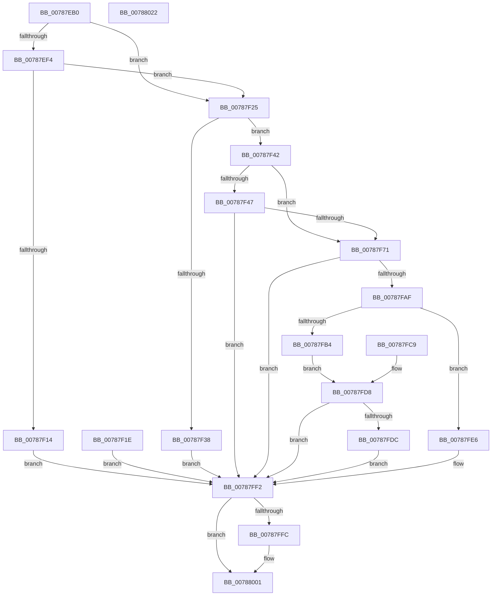

# PsCreatePartition

- RVA: `0x00787EB0`–`0x00788023` (길이 `371` bytes)
- VA: `0x0000000140787EB0`
- 실행 섹션: `PAGE`
- PDB 이름 있음: `예`; PDB Function 태그: `아니요`
- unwind 정보 RVA: `0x000CF4AC`
- 디코드: `100`개 명령, `371/371` bytes 표시
- 미해석 바이트: `0` (있으면 어셈블리에 `.byte`로 보존)

> 이 문서는 커널 이미지의 기계어와 PDB 기호를 분석해 생성했습니다. 4번과 5번은 함수 원형과 자료형을 바이너리 사용 방식에서 추정한 C 해석이며 원본 소스 복구 결과는 아닙니다.

## 1. Dependencies

- 직접 호출 지점: **6**; 고유 호출 대상: **5**
- 직접 호출자로 확인된 함수: **3**
- RIP 상대 이미지 참조: **2**

### Outgoing calls
- `0x00787F2F` → [SeSinglePrivilegeCheck](../87/SeSinglePrivilegeCheck_function_00871E20.md) (function, `0x00871E20`)
- `0x00787F62` → [PsReferencePartitionByHandle](../90/PsReferencePartitionByHandle_function_0090337C.md) (function, `0x0090337C`)
- `0x00787FA4` → [PspAllocatePartition](PspAllocatePartition_function_0078802C.md) (function, `0x0078802C`)
- `0x00787FB9` → [PsDereferencePartition](../../text/34/PsDereferencePartition_function_00342E70.md) (function, `0x00342E70`)
- `0x00787FDF` → [ObCloseHandle](../8A/ObCloseHandle_function_008A1870.md) (function, `0x008A1870`)
- `0x00787FFC` → [PsDereferencePartition](../../text/34/PsDereferencePartition_function_00342E70.md) (function, `0x00342E70`)

### Direct callers
- [NtCreatePartition](NtCreatePartition_function_00787DC0.md) at `0x00787DDE`
- [MiInitializePartitionSpecialPurposeMemory](../80/MiInitializePartitionSpecialPurposeMemory_function_0080F704.md) at `0x0080F8EC`
- [PspInitializeSystemPartitionPhase0](../../init/C4/PspInitializeSystemPartitionPhase0_function_00C46898.md) at `0x00C469BE`

### Static image references
- `0x00787F28` → RVA `0x00FD9AD0` (`PAGEDATA`; read)
- `0x00787FEB` → RVA `0x00FC6EA0` (`ALMOSTRO`; write)

## 2. Other-region calls and transfers

- 다른 실행 섹션으로 향하는 call: **2**
  - `0x00787FB9` → [PsDereferencePartition](../../text/34/PsDereferencePartition_function_00342E70.md) (`PAGE` → `.text`)
  - `0x00787FFC` → [PsDereferencePartition](../../text/34/PsDereferencePartition_function_00342E70.md) (`PAGE` → `.text`)
- 별도 외부 분기/꼬리 이동을 확인하지 못했습니다.

## 3. Assembly (complete function range)

```asm
00787EB0  48 8B C4                        mov rax, rsp
00787EB3  48 89 58 08                     mov qword ptr [rax + 8], rbx
00787EB7  48 89 70 10                     mov qword ptr [rax + 0x10], rsi
00787EBB  48 89 78 18                     mov qword ptr [rax + 0x18], rdi
00787EBF  4C 89 60 20                     mov qword ptr [rax + 0x20], r12
00787EC3  41 55                           push r13
00787EC5  41 56                           push r14
00787EC7  41 57                           push r15
00787EC9  48 83 EC 70                     sub rsp, 0x70
00787ECD  4D 8B E1                        mov r12, r9
00787ED0  45 8B E8                        mov r13d, r8d
00787ED3  4C 8B FA                        mov r15, rdx
00787ED6  48 8B F9                        mov rdi, rcx
00787ED9  33 DB                           xor ebx, ebx
00787EDB  48 89 58 C8                     mov qword ptr [rax - 0x38], rbx
00787EDF  48 89 58 C0                     mov qword ptr [rax - 0x40], rbx
00787EE3  48 89 58 D0                     mov qword ptr [rax - 0x30], rbx
00787EE7  40 8A B4 24 B0 00 00 00         mov sil, byte ptr [rsp + 0xb0]
00787EEF  40 84 F6                        test sil, sil
00787EF2  74 31                           je 0x140787f25
00787EF4  48 B9 00 00 FF FF FF 7F 00 00   movabs rcx, 0x7fffffff0000
00787EFE  48 3B D1                        cmp rdx, rcx
00787F01  48 0F 42 CA                     cmovb rcx, rdx
00787F05  48 8B 01                        mov rax, qword ptr [rcx]
00787F08  48 89 01                        mov qword ptr [rcx], rax
00787F0B  39 9C 24 B8 00 00 00            cmp dword ptr [rsp + 0xb8], ebx
00787F12  74 11                           je 0x140787f25
00787F14  BF 0D 00 00 C0                  mov edi, 0xc000000d
00787F19  E9 D4 00 00 00                  jmp 0x140787ff2
00787F1E  8B F8                           mov edi, eax
00787F20  E9 CD 00 00 00                  jmp 0x140787ff2
00787F25  40 8A D6                        mov dl, sil
00787F28  48 8B 0D A1 1B 85 00            mov rcx, qword ptr [rip + 0x851ba1]
00787F2F  E8 EC 9E 0E 00                  call 0x140871e20
00787F34  84 C0                           test al, al
00787F36  75 0A                           jne 0x140787f42
00787F38  BF 61 00 00 C0                  mov edi, 0xc0000061
00787F3D  E9 B0 00 00 00                  jmp 0x140787ff2
00787F42  48 85 FF                        test rdi, rdi
00787F45  74 2A                           je 0x140787f71
00787F47  48 8D 44 24 58                  lea rax, [rsp + 0x58]
00787F4C  48 89 44 24 20                  mov qword ptr [rsp + 0x20], rax
00787F51  41 B9 50 73 43 70               mov r9d, 0x70437350
00787F57  44 8A C6                        mov r8b, sil
00787F5A  BA 02 00 00 00                  mov edx, 2
00787F5F  48 8B CF                        mov rcx, rdi
00787F62  E8 15 B4 17 00                  call 0x14090337c
00787F67  8B F8                           mov edi, eax
00787F69  85 C0                           test eax, eax
00787F6B  0F 88 81 00 00 00               js 0x140787ff2
00787F71  8B 84 24 B8 00 00 00            mov eax, dword ptr [rsp + 0xb8]
00787F78  A8 01                           test al, 1
00787F7A  4C 8D 74 24 48                  lea r14, [rsp + 0x48]
00787F7F  4C 0F 45 F3                     cmovne r14, rbx
00787F83  4C 89 74 24 30                  mov qword ptr [rsp + 0x30], r14
00787F88  48 8D 4C 24 50                  lea rcx, [rsp + 0x50]
00787F8D  48 89 4C 24 28                  mov qword ptr [rsp + 0x28], rcx
00787F92  89 44 24 20                     mov dword ptr [rsp + 0x20], eax
00787F96  4C 8B 4C 24 58                  mov r9, qword ptr [rsp + 0x58]
00787F9B  44 8A C6                        mov r8b, sil
00787F9E  41 8B D5                        mov edx, r13d
00787FA1  49 8B CC                        mov rcx, r12
00787FA4  E8 83 00 00 00                  call 0x14078802c
00787FA9  8B F8                           mov edi, eax
00787FAB  85 C0                           test eax, eax
00787FAD  78 43                           js 0x140787ff2
00787FAF  4D 85 F6                        test r14, r14
00787FB2  74 32                           je 0x140787fe6
00787FB4  48 8B 4C 24 50                  mov rcx, qword ptr [rsp + 0x50]
00787FB9  E8 B2 AE BB FF                  call 0x140342e70
00787FBE  90                              nop
00787FBF  48 8B 4C 24 48                  mov rcx, qword ptr [rsp + 0x48]
00787FC4  49 89 0F                        mov qword ptr [r15], rcx
00787FC7  EB 0F                           jmp 0x140787fd8
00787FC9  8B F8                           mov edi, eax
00787FCB  40 8A B4 24 B0 00 00 00         mov sil, byte ptr [rsp + 0xb0]
00787FD3  48 8B 4C 24 48                  mov rcx, qword ptr [rsp + 0x48]
00787FD8  85 FF                           test edi, edi
00787FDA  79 16                           jns 0x140787ff2
00787FDC  40 8A D6                        mov dl, sil
00787FDF  E8 8C 98 11 00                  call 0x1408a1870
00787FE4  EB 0C                           jmp 0x140787ff2
00787FE6  48 8B 44 24 50                  mov rax, qword ptr [rsp + 0x50]
00787FEB  48 89 05 AE EE 83 00            mov qword ptr [rip + 0x83eeae], rax
00787FF2  48 8B 4C 24 58                  mov rcx, qword ptr [rsp + 0x58]
00787FF7  48 85 C9                        test rcx, rcx
00787FFA  74 05                           je 0x140788001
00787FFC  E8 6F AE BB FF                  call 0x140342e70
00788001  8B C7                           mov eax, edi
00788003  4C 8D 5C 24 70                  lea r11, [rsp + 0x70]
00788008  49 8B 5B 20                     mov rbx, qword ptr [r11 + 0x20]
0078800C  49 8B 73 28                     mov rsi, qword ptr [r11 + 0x28]
00788010  49 8B 7B 30                     mov rdi, qword ptr [r11 + 0x30]
00788014  4D 8B 63 38                     mov r12, qword ptr [r11 + 0x38]
00788018  49 8B E3                        mov rsp, r11
0078801B  41 5F                           pop r15
0078801D  41 5E                           pop r14
0078801F  41 5D                           pop r13
00788021  C3                              ret
00788022  CC                              int3
```

## 4. C-style interpretation (structured pseudocode)

```c
__int64 __fastcall PsCreatePartition(__int64 a1, __int64 a2, int a3, __int64 a4, unsigned __int8 a5, unsigned int a6)
{
    __int64 result;
    __int64 v_r14;
    __int64 v_rbx;
    __int64 v_rsp;
    unsigned __int64 v_stack_m18;
    unsigned __int64 v_stack_m30;
    unsigned __int64 v_stack_m38;
    unsigned __int64 v_stack_m40;
    unsigned __int64 v_stack_m58;
    unsigned __int64 v_stack_m60;
    unsigned __int64 v_stack_m68;
    unsigned __int8 v_stack_p28;

    *(unsigned __int64 *)(v_rsp + 8) = v_rbx;
    *(unsigned __int64 *)(v_rsp + 16) = v_rsi;
    *(unsigned __int64 *)(v_rsp + 24) = v_rdi;
    *(unsigned __int64 *)(v_rsp + 32) = v_r12;
    v_rsp = (v_rsp) - (112);
    v_rbx = 0;
    *(unsigned __int64 *)(v_rsp - 56) = 0;
    *(unsigned __int64 *)(v_rsp - 64) = 0;
    *(unsigned __int64 *)(v_rsp - 48) = 0;
    if (a5 == 0) goto loc_00787F25;
    if (a2 < a1) { a1 = a2; }
    *(unsigned __int64 *)(a1) = *(unsigned __int64 *)(a1);
    if (a6 == 0) goto loc_00787F25;
    goto loc_00787FF2;
loc_00787F25:
    result = SeSinglePrivilegeCheck(*(unsigned __int64 *)(v_rip + 8723361), a5, a3, a4);
    if ((unsigned __int8)(result) != 0) goto loc_00787F42;
    goto loc_00787FF2;
loc_00787F42:
    if ((unsigned int)(0xC0000061ULL) == 0) goto loc_00787F71;
    v_stack_m68 = v_stack_m30;
    result = PsReferencePartitionByHandle((unsigned int)(0xC0000061ULL), 2, a5, (unsigned int)(0x70437350ULL));
    if (sign_flag) goto loc_00787FF2;
loc_00787F71:
    v_r14 = v_stack_m40;
    if ((((unsigned __int8)((unsigned int)(a6))) & (1)) != 0) { v_r14 = 0; }
    v_stack_m58 = v_r14;
    v_stack_m60 = v_stack_m38;
    v_stack_m68 = (unsigned int)((unsigned int)(a6));
    result = PspAllocatePartition(a4, (unsigned int)((unsigned int)((unsigned int)(a3))), a5, v_stack_m30);
    if (sign_flag) goto loc_00787FF2;
    if (v_r14 == 0) goto loc_00787FE6;
    result = PsDereferencePartition(v_stack_m38, (unsigned int)((unsigned int)((unsigned int)(a3))), a5, v_stack_m30);
    *(unsigned __int64 *)(a2) = v_stack_m40;
    goto loc_00787FD8;
loc_00787FD8:
    if (!sign_flag) goto loc_00787FF2;
    result = ObCloseHandle(v_stack_m40, a5, a5, v_stack_m30);
    goto loc_00787FF2;
loc_00787FE6:
    *(unsigned __int64 *)(v_rip + 8646318) = v_stack_m38;
loc_00787FF2:
    result = v_stack_m38;
    if (v_stack_m30 != 0) {
        result = PsDereferencePartition(v_stack_m30, a5, a5, v_stack_m30);
    }
    return (unsigned int)((unsigned int)((unsigned int)((unsigned int)(result))));
}
```

## 5. (Beta) C Style

```c
int64_t PsCreatePartition(int64_t Arg1, void *Arg2, int32_t Arg3, int64_t Arg4, uint8_t Arg5, uint32_t Arg6)
{
    uint8_t *arg2 = (uint8_t *)Arg2;

    int64_t result;
    int64_t local_r14;
    int64_t local_rbx;
    int64_t local_rsp;
    uint64_t v_stack_m18;
    uint64_t v_stack_m30;
    uint64_t v_stack_m38;
    uint64_t v_stack_m40;
    uint64_t v_stack_m58;
    uint64_t v_stack_m60;
    uint64_t v_stack_m68;
    uint8_t v_stack_p28;

    *(uint64_t *)(local_rsp + 0x8) = local_rbx;
    *(uint64_t *)(local_rsp + 0x10) = local_rsi;
    *(uint64_t *)(local_rsp + 0x18) = local_rdi;
    *(uint64_t *)(local_rsp + 0x20) = local_r12;
    local_rsp = (local_rsp) - (112);
    local_rbx = 0;
    *(uint64_t *)(local_rsp - 0x38) = 0;
    *(uint64_t *)(local_rsp - 0x40) = 0;
    *(uint64_t *)(local_rsp - 0x30) = 0;
    if (Arg5 == 0) goto loc_00787F25;
    if (Arg2 < Arg1) { Arg1 = Arg2; }
    *(uint64_t *)(Arg1) = *(uint64_t *)(Arg1);
    if (Arg6 == 0) goto loc_00787F25;
    goto loc_00787FF2;
loc_00787F25:
    result = SeSinglePrivilegeCheck(*(uint64_t *)(v_rip + 0x851BA1), Arg5, Arg3, Arg4);
    if ((uint8_t)(result) != 0) goto loc_00787F42;
    goto loc_00787FF2;
loc_00787F42:
    if ((uint32_t)(0xC0000061ULL) == 0) goto loc_00787F71;
    v_stack_m68 = v_stack_m30;
    result = PsReferencePartitionByHandle((uint32_t)(0xC0000061ULL), 2, Arg5, (uint32_t)(0x70437350ULL));
    if (sign_flag) goto loc_00787FF2;
loc_00787F71:
    local_r14 = v_stack_m40;
    if ((((uint8_t)((uint32_t)(Arg6))) & (1)) != 0) { local_r14 = 0; }
    v_stack_m58 = local_r14;
    v_stack_m60 = v_stack_m38;
    v_stack_m68 = (uint32_t)((uint32_t)(Arg6));
    result = PspAllocatePartition(Arg4, (uint32_t)((uint32_t)((uint32_t)(Arg3))), Arg5, v_stack_m30);
    if (sign_flag) goto loc_00787FF2;
    if (local_r14 == 0) goto loc_00787FE6;
    result = PsDereferencePartition(v_stack_m38, (uint32_t)((uint32_t)((uint32_t)(Arg3))), Arg5, v_stack_m30);
    *(uint64_t *)(arg2) = v_stack_m40;
    goto loc_00787FD8;
loc_00787FD8:
    if (!sign_flag) goto loc_00787FF2;
    result = ObCloseHandle(v_stack_m40, Arg5, Arg5, v_stack_m30);
    goto loc_00787FF2;
loc_00787FE6:
    *(uint64_t *)(v_rip + 0x83EEAE) = v_stack_m38;
loc_00787FF2:
    result = v_stack_m38;
    if (v_stack_m30 != 0) {
        result = PsDereferencePartition(v_stack_m30, Arg5, Arg5, v_stack_m30);
    }
    return (uint32_t)((uint32_t)((uint32_t)((uint32_t)(result))));
}
```

### 관측된 메모리 오프셋

구조체 형식이 확인되지 않은 접근은 인자 기준의 오프셋으로만 기록했습니다.

| 기준 인자 | 오프셋 표현 | 폭 (bit) | 접근 |
|---|---:|---:|---|
| `Arg2` | `+ 0x0` | `64` | `W` |

## 6. Execution-region graph

[열기: 2D/3D 그래프와 함수 탐색 컨트롤 패널](../../../control-panel.html?section=page&rva=0x00787EB0&view=graph)

- 2D 그래프는 위에서 아래로 흐르고, 3D 그래프는 빈 공간을 드래그해 회전합니다. Shift+드래그는 이동, 휠은 확대·축소, 함수 노드 선택은 대상 보고서 이동입니다.

### Static fallback


