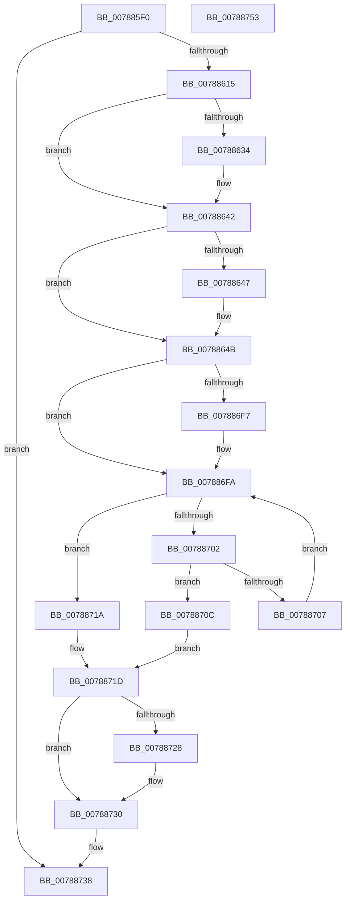

# PsDeleteVsmEnclave

- RVA: `0x007885F0`–`0x00788754` (길이 `356` bytes)
- VA: `0x00000001407885F0`
- 실행 섹션: `PAGE`
- PDB 이름 있음: `예`; PDB Function 태그: `아니요`
- unwind 정보 RVA: `0x00061768`
- 디코드: `101`개 명령, `356/356` bytes 표시
- 미해석 바이트: `0` (있으면 어셈블리에 `.byte`로 보존)

> 이 문서는 커널 이미지의 기계어와 PDB 기호를 분석해 생성했습니다. 4번과 5번은 함수 원형과 자료형을 바이너리 사용 방식에서 추정한 C 해석이며 원본 소스 복구 결과는 아닙니다.

## 1. Dependencies

- 직접 호출 지점: **5**; 고유 호출 대상: **5**
- 직접 호출자로 확인된 함수: **1**
- RIP 상대 이미지 참조: **0**

### Outgoing calls
- `0x00788624` → [KeAbPreAcquire](../../text/21/KeAbPreAcquire_function_00210230.md) (function, `0x00210230`)
- `0x0078863D` → [ExfAcquirePushLockExclusiveEx](../../text/20/ExfAcquirePushLockExclusiveEx_function_0020FC90.md) (function, `0x0020FC90`)
- `0x0078872B` → [ExfTryToWakePushLock](../../text/26/ExfTryToWakePushLock_function_00265DD0.md) (function, `0x00265DD0`)
- `0x00788733` → [KeAbPostRelease](../../text/2E/KeAbPostRelease_function_002E1600.md) (function, `0x002E1600`)
- `0x0078873B` → [PsDereferenceVsmEnclave](../A0/PsDereferenceVsmEnclave_function_00A0D7D4.md) (function, `0x00A0D7D4`)

### Direct callers
- [MiDeleteEnclavePages](../../pagelk/B7/MiDeleteEnclavePages_function_00B7E228.md) at `0x00B7E3D4`

### Static image references
- 디코드된 RIP-relative 메모리 참조가 없습니다.

## 2. Other-region calls and transfers

- 다른 실행 섹션으로 향하는 call: **4**
  - `0x00788624` → [KeAbPreAcquire](../../text/21/KeAbPreAcquire_function_00210230.md) (`PAGE` → `.text`)
  - `0x0078863D` → [ExfAcquirePushLockExclusiveEx](../../text/20/ExfAcquirePushLockExclusiveEx_function_0020FC90.md) (`PAGE` → `.text`)
  - `0x0078872B` → [ExfTryToWakePushLock](../../text/26/ExfTryToWakePushLock_function_00265DD0.md) (`PAGE` → `.text`)
  - `0x00788733` → [KeAbPostRelease](../../text/2E/KeAbPostRelease_function_002E1600.md) (`PAGE` → `.text`)
- 별도 외부 분기/꼬리 이동을 확인하지 못했습니다.

## 3. Assembly (complete function range)

```asm
007885F0  48 89 5C 24 08                  mov qword ptr [rsp + 8], rbx
007885F5  48 89 6C 24 18                  mov qword ptr [rsp + 0x18], rbp
007885FA  56                              push rsi
007885FB  57                              push rdi
007885FC  41 56                           push r14
007885FE  48 83 EC 20                     sub rsp, 0x20
00788602  45 33 F6                        xor r14d, r14d
00788605  48 8B FA                        mov rdi, rdx
00788608  48 8B E9                        mov rbp, rcx
0078860B  44 38 72 4C                     cmp byte ptr [rdx + 0x4c], r14b
0078860F  0F 85 23 01 00 00               jne 0x140788738
00788615  48 8D 99 58 06 00 00            lea rbx, [rcx + 0x658]
0078861C  45 33 C0                        xor r8d, r8d
0078861F  48 8B CB                        mov rcx, rbx
00788622  33 D2                           xor edx, edx
00788624  E8 07 7C A8 FF                  call 0x140210230
00788629  F0 48 0F BA 2B 00               lock bts qword ptr [rbx], 0
0078862F  48 8B F0                        mov rsi, rax
00788632  73 0E                           jae 0x140788642
00788634  4C 8B C3                        mov r8, rbx
00788637  48 8B D0                        mov rdx, rax
0078863A  48 8B CB                        mov rcx, rbx
0078863D  E8 4E 76 A8 FF                  call 0x14020fc90
00788642  48 85 F6                        test rsi, rsi
00788645  74 04                           je 0x14078864b
00788647  C6 46 0A 01                     mov byte ptr [rsi + 0xa], 1
0078864B  4C 8B 9D 48 06 00 00            mov r11, qword ptr [rbp + 0x648]
00788652  48 83 C8 FF                     or rax, 0xffffffffffffffff
00788656  48 8B D0                        mov rdx, rax
00788659  45 8B 53 04                     mov r10d, dword ptr [r11 + 4]
0078865D  41 8B CA                        mov ecx, r10d
00788660  83 E1 1F                        and ecx, 0x1f
00788663  41 C1 EA 05                     shr r10d, 5
00788667  48 D3 E2                        shl rdx, cl
0078866A  48 23 57 08                     and rdx, qword ptr [rdi + 8]
0078866E  48 89 54 24 48                  mov qword ptr [rsp + 0x48], rdx
00788673  0F B6 CA                        movzx ecx, dl
00788676  48 81 C1 CB 5D B1 00            add rcx, 0xb15dcb
0078867D  48 6B D1 25                     imul rdx, rcx, 0x25
00788681  0F B6 4C 24 49                  movzx ecx, byte ptr [rsp + 0x49]
00788686  48 03 D1                        add rdx, rcx
00788689  0F B6 4C 24 4A                  movzx ecx, byte ptr [rsp + 0x4a]
0078868E  4C 6B C2 25                     imul r8, rdx, 0x25
00788692  4C 03 C1                        add r8, rcx
00788695  0F B6 4C 24 4B                  movzx ecx, byte ptr [rsp + 0x4b]
0078869A  49 6B D0 25                     imul rdx, r8, 0x25
0078869E  48 03 D1                        add rdx, rcx
007886A1  0F B6 4C 24 4C                  movzx ecx, byte ptr [rsp + 0x4c]
007886A6  4C 6B C2 25                     imul r8, rdx, 0x25
007886AA  4C 03 C1                        add r8, rcx
007886AD  0F B6 4C 24 4D                  movzx ecx, byte ptr [rsp + 0x4d]
007886B2  49 6B D0 25                     imul rdx, r8, 0x25
007886B6  48 03 D1                        add rdx, rcx
007886B9  0F B6 4C 24 4E                  movzx ecx, byte ptr [rsp + 0x4e]
007886BE  4C 6B C2 25                     imul r8, rdx, 0x25
007886C2  41 8D 52 FF                     lea edx, [r10 - 1]
007886C6  4C 03 C1                        add r8, rcx
007886C9  0F B6 4C 24 4F                  movzx ecx, byte ptr [rsp + 0x4f]
007886CE  4D 6B C8 25                     imul r9, r8, 0x25
007886D2  49 03 C9                        add rcx, r9
007886D5  8B C9                           mov ecx, ecx
007886D7  48 23 D1                        and rdx, rcx
007886DA  49 8B 4B 08                     mov rcx, qword ptr [r11 + 8]
007886DE  4C 8D 04 D1                     lea r8, [rcx + rdx*8]
007886E2  48 8B 0F                        mov rcx, qword ptr [rdi]
007886E5  48 BA 02 00 00 00 00 00 00 80   movabs rdx, 0x8000000000000002
007886EF  48 23 CA                        and rcx, rdx
007886F2  48 3B CA                        cmp rcx, rdx
007886F5  75 03                           jne 0x1407886fa
007886F7  49 8B 0E                        mov rcx, qword ptr [r14]
007886FA  49 8B 08                        mov rcx, qword ptr [r8]
007886FD  F6 C1 01                        test cl, 1
00788700  75 18                           jne 0x14078871a
00788702  48 3B CF                        cmp rcx, rdi
00788705  74 05                           je 0x14078870c
00788707  4C 8B C1                        mov r8, rcx
0078870A  EB EE                           jmp 0x1407886fa
0078870C  48 8B 0F                        mov rcx, qword ptr [rdi]
0078870F  49 89 08                        mov qword ptr [r8], rcx
00788712  41 FF 0B                        dec dword ptr [r11]
00788715  48 09 17                        or qword ptr [rdi], rdx
00788718  EB 03                           jmp 0x14078871d
0078871A  49 8B 0E                        mov rcx, qword ptr [r14]
0078871D  F0 48 0F C1 03                  lock xadd qword ptr [rbx], rax
00788722  24 06                           and al, 6
00788724  3C 02                           cmp al, 2
00788726  75 08                           jne 0x140788730
00788728  48 8B CB                        mov rcx, rbx
0078872B  E8 A0 D6 AD FF                  call 0x140265dd0
00788730  48 8B CB                        mov rcx, rbx
00788733  E8 C8 8E B5 FF                  call 0x1402e1600
00788738  48 8B CF                        mov rcx, rdi
0078873B  E8 94 50 28 00                  call 0x140a0d7d4
00788740  48 8B 5C 24 40                  mov rbx, qword ptr [rsp + 0x40]
00788745  48 8B 6C 24 50                  mov rbp, qword ptr [rsp + 0x50]
0078874A  48 83 C4 20                     add rsp, 0x20
0078874E  41 5E                           pop r14
00788750  5F                              pop rdi
00788751  5E                              pop rsi
00788752  C3                              ret
00788753  CC                              int3
```

## 4. C-style interpretation (structured pseudocode)

```c
__int64 __fastcall PsDeleteVsmEnclave(__int64 a1, __int64 a2, int a3)
{
    __int64 result;
    __int64 v_r10;
    __int64 v_r14;
    __int64 v_rsp;
    unsigned __int64 v_stack_p10;
    unsigned __int8 v_stack_p11;
    unsigned __int8 v_stack_p12;
    unsigned __int8 v_stack_p13;
    unsigned __int8 v_stack_p14;
    unsigned __int8 v_stack_p15;
    unsigned __int8 v_stack_p16;
    unsigned __int8 v_stack_p17;
    unsigned __int64 v_stack_p18;
    unsigned __int64 v_stack_p8;

    v_stack_p8 = v_rbx;
    v_stack_p18 = v_rbp;
    v_rsp = (v_rsp) - (32);
    v_r14 = 0;
    if ((*(unsigned __int8 *)(a2 + 76)) != 0) goto loc_00788738;
    a3 = 0;
    a2 = 0;
    result = KeAbPreAcquire(a1 + 1624, a2, a3, a4);
    if (!(condition_is_above_or_equal)) {
        a3 = a1 + 1624;
        a2 = result;
        a1 = a1 + 1624;
        result = ExfAcquirePushLockExclusiveEx(a1, a2, a3, a4);
    }
    if (result != 0) {
        *(unsigned __int8 *)(result + 10) = 1;
    }
    result = (result) | (-1);
    a1 = (unsigned int)(((unsigned int)((unsigned int)((unsigned int)(*(unsigned int *)(*(unsigned __int64 *)(a1 + 1608) + 4))))) & (31));
    v_r10 = (unsigned int)(((unsigned int)(*(unsigned int *)(*(unsigned __int64 *)(a1 + 1608) + 4))) >> (5));
    a2 = (result) << ((unsigned __int8)(a1));
    a2 = (a2) & (*(unsigned __int64 *)(a2 + 8));
    v_stack_p10 = a2;
    a1 = ((unsigned __int8)(a2)) + (0xB15DCBULL);
    a2 = (a2) * (a1);
    a2 = (a2) + (v_stack_p11);
    a3 = (a3) * (a2);
    a3 = (a3) + (v_stack_p12);
    a2 = (a2) * (a3);
    a2 = (a2) + (v_stack_p13);
    a3 = (a3) * (a2);
    a3 = (a3) + (v_stack_p14);
    a2 = (a2) * (a3);
    a2 = (a2) + (v_stack_p15);
    a3 = (a3) * (a2);
    a3 = (a3) + (v_stack_p16);
    a4 = (a4) * (a3);
    a1 = (v_stack_p17) + (a4);
    a2 = (v_r10 - 1) & ((unsigned int)((unsigned int)(a1)));
    a1 = (*(unsigned __int64 *)(a2)) & (a2);
    if (a1 == a2) {
        a1 = *(unsigned __int64 *)(v_r14);
    }
    if ((((unsigned __int8)(*(unsigned __int64 *)(*(unsigned __int64 *)(*(unsigned __int64 *)(a1 + 1608) + 8) + a2 * 8))) & (1)) != 0) goto loc_0078871A;
    if ((*(unsigned __int64 *)(*(unsigned __int64 *)(*(unsigned __int64 *)(a1 + 1608) + 8) + a2 * 8)) == a2) goto loc_0078870C;
    goto loc_007886FA;
loc_0078870C:
    *(unsigned __int64 *)(*(unsigned __int64 *)(*(unsigned __int64 *)(*(unsigned __int64 *)(a1 + 1608) + 8) + a2 * 8)) = *(unsigned __int64 *)(a2);
    goto loc_0078871D;
loc_0078871A:
loc_0078871D:
    result = (unsigned __int8)((result) & (6));
    if (((unsigned __int8)(result)) == 2) {
        a1 = a1 + 1624;
        result = ExfTryToWakePushLock(a1, a2, *(unsigned __int64 *)(*(unsigned __int64 *)(*(unsigned __int64 *)(a1 + 1608) + 8) + a2 * 8), a4);
    }
    result = KeAbPostRelease(a1 + 1624, a2, *(unsigned __int64 *)(*(unsigned __int64 *)(*(unsigned __int64 *)(a1 + 1608) + 8) + a2 * 8), a4);
loc_00788738:
    result = PsDereferenceVsmEnclave(a2, a2, *(unsigned __int64 *)(*(unsigned __int64 *)(*(unsigned __int64 *)(a1 + 1608) + 8) + a2 * 8), a4);
    v_rsp = (v_rsp) + (32);
    return result;
}
```

## 5. (Beta) C Style

```c
int64_t PsDeleteVsmEnclave(void *Arg1, void *Arg2, int32_t Arg3)
{
    uint8_t *arg1 = (uint8_t *)Arg1;
    uint8_t *arg2 = (uint8_t *)Arg2;

    int64_t result;
    int64_t local_r10;
    int64_t local_r14;
    int64_t local_rsp;
    uint64_t v_stack_p10;
    uint8_t v_stack_p11;
    uint8_t v_stack_p12;
    uint8_t v_stack_p13;
    uint8_t v_stack_p14;
    uint8_t v_stack_p15;
    uint8_t v_stack_p16;
    uint8_t v_stack_p17;
    uint64_t v_stack_p18;
    uint64_t v_stack_p8;

    v_stack_p8 = local_rbx;
    v_stack_p18 = local_rbp;
    local_rsp = (local_rsp) - (32);
    local_r14 = 0;
    if ((*(uint8_t *)(arg2 + 0x4C)) != 0) goto loc_00788738;
    Arg3 = 0;
    Arg2 = 0;
    result = KeAbPreAcquire(Arg1 + 1624, Arg2, Arg3, a4);
    if (!(condition_is_above_or_equal)) {
        Arg3 = Arg1 + 1624;
        Arg2 = result;
        Arg1 = Arg1 + 1624;
        result = ExfAcquirePushLockExclusiveEx(Arg1, Arg2, Arg3, a4);
    }
    if (result != 0) {
        *(uint8_t *)(result + 0xA) = 1;
    }
    result = (result) | (-1);
    Arg1 = (uint32_t)(((uint32_t)((uint32_t)((uint32_t)(*(uint32_t *)(*(uint64_t *)(arg1 + 0x648) + 0x4))))) & (31));
    local_r10 = (uint32_t)(((uint32_t)(*(uint32_t *)(*(uint64_t *)(arg1 + 0x648) + 0x4))) >> (5));
    Arg2 = (result) << ((uint8_t)(Arg1));
    Arg2 = (Arg2) & (*(uint64_t *)(arg2 + 0x8));
    v_stack_p10 = Arg2;
    Arg1 = ((uint8_t)(Arg2)) + (0xB15DCBULL);
    Arg2 = (Arg2) * (Arg1);
    Arg2 = (Arg2) + (v_stack_p11);
    Arg3 = (Arg3) * (Arg2);
    Arg3 = (Arg3) + (v_stack_p12);
    Arg2 = (Arg2) * (Arg3);
    Arg2 = (Arg2) + (v_stack_p13);
    Arg3 = (Arg3) * (Arg2);
    Arg3 = (Arg3) + (v_stack_p14);
    Arg2 = (Arg2) * (Arg3);
    Arg2 = (Arg2) + (v_stack_p15);
    Arg3 = (Arg3) * (Arg2);
    Arg3 = (Arg3) + (v_stack_p16);
    a4 = (a4) * (Arg3);
    Arg1 = (v_stack_p17) + (a4);
    Arg2 = (local_r10 - 1) & ((uint32_t)((uint32_t)(Arg1)));
    Arg1 = (*(uint64_t *)(arg2)) & (Arg2);
    if (Arg1 == Arg2) {
        Arg1 = *(uint64_t *)(local_r14);
    }
    if ((((uint8_t)(*(uint64_t *)(*(uint64_t *)(*(uint64_t *)(arg1 + 0x648) + 0x8) + arg2 * 8))) & (1)) != 0) goto loc_0078871A;
    if ((*(uint64_t *)(*(uint64_t *)(*(uint64_t *)(arg1 + 0x648) + 0x8) + arg2 * 8)) == Arg2) goto loc_0078870C;
    goto loc_007886FA;
loc_0078870C:
    *(uint64_t *)(*(uint64_t *)(*(uint64_t *)(*(uint64_t *)(arg1 + 0x648) + 0x8) + arg2 * 8)) = *(uint64_t *)(arg2);
    goto loc_0078871D;
loc_0078871A:
loc_0078871D:
    result = (uint8_t)((result) & (6));
    if (((uint8_t)(result)) == 2) {
        Arg1 = Arg1 + 1624;
        result = ExfTryToWakePushLock(Arg1, Arg2, *(uint64_t *)(*(uint64_t *)(*(uint64_t *)(arg1 + 0x648) + 0x8) + arg2 * 8), a4);
    }
    result = KeAbPostRelease(Arg1 + 1624, Arg2, *(uint64_t *)(*(uint64_t *)(*(uint64_t *)(arg1 + 0x648) + 0x8) + arg2 * 8), a4);
loc_00788738:
    result = PsDereferenceVsmEnclave(Arg2, Arg2, *(uint64_t *)(*(uint64_t *)(*(uint64_t *)(arg1 + 0x648) + 0x8) + arg2 * 8), a4);
    local_rsp = (local_rsp) + (32);
    return result;
}
```

### 관측된 메모리 오프셋

구조체 형식이 확인되지 않은 접근은 인자 기준의 오프셋으로만 기록했습니다.

| 기준 인자 | 오프셋 표현 | 폭 (bit) | 접근 |
|---|---:|---:|---|
| `Arg1` | `+ 0x0` | `64` | `R/W` |
| `Arg1` | `+ 0x648` | `64` | `R` |
| `Arg1` | `+ 0x658` | `64` | `R` |
| `Arg2` | `+ 0x0` | `64` | `R` |
| `Arg2` | `+ 0x0` | `64` | `R/W` |
| `Arg2` | `+ 0x8` | `64` | `R` |
| `Arg2` | `+ 0x4C` | `8` | `R` |

## 6. Execution-region graph

[열기: 2D/3D 그래프와 함수 탐색 컨트롤 패널](../../../control-panel.html?section=page&rva=0x007885F0&view=graph)

- 2D 그래프는 위에서 아래로 흐르고, 3D 그래프는 빈 공간을 드래그해 회전합니다. Shift+드래그는 이동, 휠은 확대·축소, 함수 노드 선택은 대상 보고서 이동입니다.

### Static fallback


