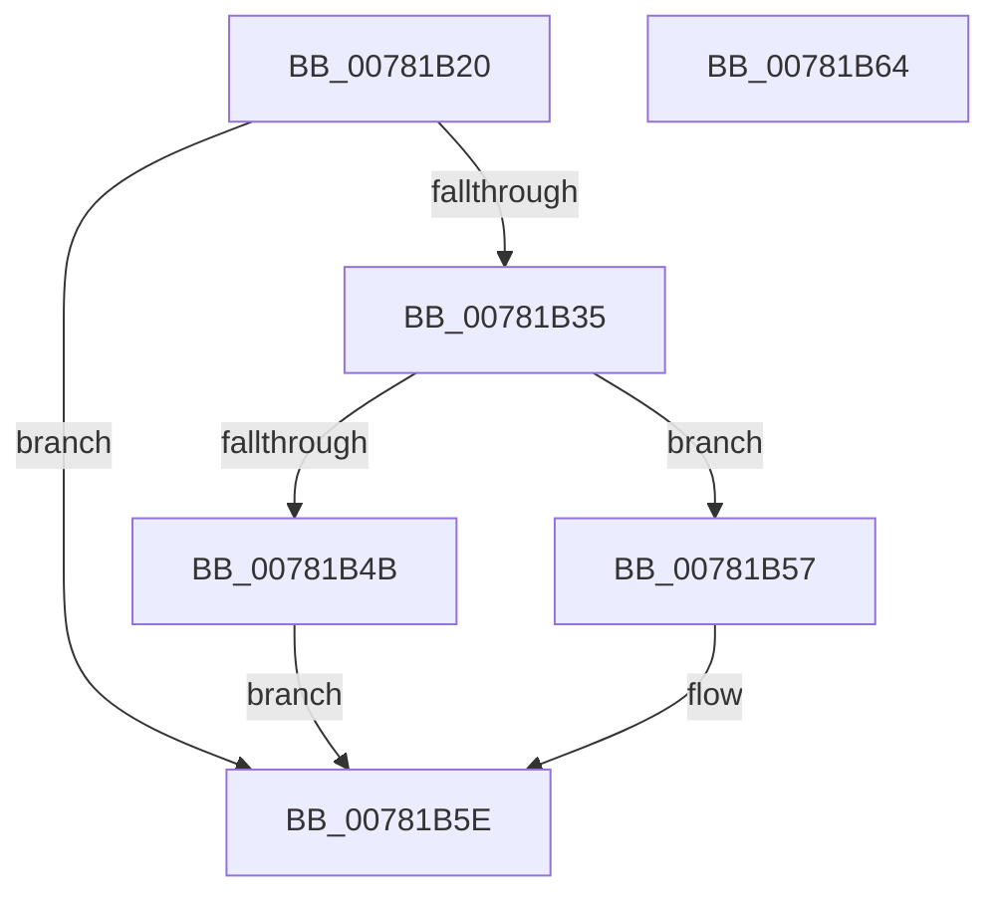

# PsEstablishWin32Callouts

- RVA: `0x00781B20`–`0x00781B65` (길이 `69` bytes)
- VA: `0x0000000140781B20`
- 실행 섹션: `PAGE`
- PDB 이름 있음: `예`; PDB Function 태그: `아니요`
- unwind 정보 RVA: `0x0005CF00`
- 디코드: `22`개 명령, `69/69` bytes 표시
- 미해석 바이트: `0` (있으면 어셈블리에 `.byte`로 보존)

> 이 문서는 커널 이미지의 기계어와 PDB 기호를 분석해 생성했습니다. 4번과 5번은 함수 원형과 자료형을 바이너리 사용 방식에서 추정한 C 해석이며 원본 소스 복구 결과는 아닙니다.

## 1. Dependencies

- 직접 호출 지점: **3**; 고유 호출 대상: **3**
- 직접 호출자로 확인된 함수: **0**
- RIP 상대 이미지 참조: **2**

### Outgoing calls
- `0x00781B28` → [ExAllocateCallBack](../AA/ExAllocateCallBack_function_00AA1AE0.md) (function, `0x00AA1AE0`)
- `0x00781B42` → [ExCompareExchangeCallBack](../../text/41/ExCompareExchangeCallBack_function_0041BCD0.md) (function, `0x0041BCD0`)
- `0x00781B50` → [ExFreePoolWithTag](../../poolcode/B8/ExFreePoolWithTag_function_00B82870.md) (function, `0x00B82870`)

### Direct callers
- 이 함수 시작 RVA로 연결되는 직접 call은 확인되지 않았습니다. 간접 호출은 완전히 역산할 수 없습니다.

### Static image references
- `0x00781B38` → RVA `0x00F05F08` (`.data`; read)
- `0x00781B57` → RVA `0x00F06628` (`.data`; write)

## 2. Other-region calls and transfers

- 다른 실행 섹션으로 향하는 call: **2**
  - `0x00781B42` → [ExCompareExchangeCallBack](../../text/41/ExCompareExchangeCallBack_function_0041BCD0.md) (`PAGE` → `.text`)
  - `0x00781B50` → [ExFreePoolWithTag](../../poolcode/B8/ExFreePoolWithTag_function_00B82870.md) (`PAGE` → `POOLCODE`)
- 별도 외부 분기/꼬리 이동을 확인하지 못했습니다.

## 3. Assembly (complete function range)

```asm
00781B20  40 53                           push rbx
00781B22  48 83 EC 20                     sub rsp, 0x20
00781B26  33 D2                           xor edx, edx
00781B28  E8 B3 FF 31 00                  call 0x140aa1ae0
00781B2D  48 8B D8                        mov rbx, rax
00781B30  48 85 C0                        test rax, rax
00781B33  74 29                           je 0x140781b5e
00781B35  45 33 C0                        xor r8d, r8d
00781B38  48 8D 0D C9 43 78 00            lea rcx, [rip + 0x7843c9]
00781B3F  48 8B D0                        mov rdx, rax
00781B42  E8 89 A1 C9 FF                  call 0x14041bcd0
00781B47  84 C0                           test al, al
00781B49  75 0C                           jne 0x140781b57
00781B4B  33 D2                           xor edx, edx
00781B4D  48 8B CB                        mov rcx, rbx
00781B50  E8 1B 0D 40 00                  call 0x140b82870
00781B55  EB 07                           jmp 0x140781b5e
00781B57  C6 05 CA 4A 78 00 01            mov byte ptr [rip + 0x784aca], 1
00781B5E  48 83 C4 20                     add rsp, 0x20
00781B62  5B                              pop rbx
00781B63  C3                              ret
00781B64  CC                              int3
```

## 4. C-style interpretation (structured pseudocode)

```c
__int64 __fastcall PsEstablishWin32Callouts(__int64 a1, int a2, int a3)
{
    __int64 result;
    __int64 v_rsp;

    v_rsp = (v_rsp) - (32);
    a2 = 0;
    result = ExAllocateCallBack(a1, a2, a3, a4);
    if (result == 0) goto loc_00781B5E;
    a3 = 0;
    result = ExCompareExchangeCallBack(v_rip + 7881673, result, a3, a4);
    if ((unsigned __int8)(result) != 0) goto loc_00781B57;
    a2 = 0;
    result = ExFreePoolWithTag(result, a2, a3, a4);
    goto loc_00781B5E;
loc_00781B57:
    *(unsigned __int8 *)(v_rip + 7883466) = 1;
loc_00781B5E:
    v_rsp = (v_rsp) + (32);
    return result;
}
```

## 5. (Beta) C Style

```c
int64_t PsEstablishWin32Callouts(int64_t Arg1, int32_t Arg2, int32_t Arg3)
{
    int64_t result;
    int64_t local_rsp;

    local_rsp = (local_rsp) - (32);
    Arg2 = 0;
    result = ExAllocateCallBack(Arg1, Arg2, Arg3, a4);
    if (result == 0) goto loc_00781B5E;
    Arg3 = 0;
    result = ExCompareExchangeCallBack(v_rip + 7881673, result, Arg3, a4);
    if ((uint8_t)(result) != 0) goto loc_00781B57;
    Arg2 = 0;
    result = ExFreePoolWithTag(result, Arg2, Arg3, a4);
    goto loc_00781B5E;
loc_00781B57:
    *(uint8_t *)(v_rip + 0x784ACA) = 1;
loc_00781B5E:
    local_rsp = (local_rsp) + (32);
    return result;
}
```

## 6. Execution-region graph

[열기: 2D/3D 그래프와 함수 탐색 컨트롤 패널](../../../control-panel.html?section=page&rva=0x00781B20&view=graph)

- 2D 그래프는 위에서 아래로 흐르고, 3D 그래프는 빈 공간을 드래그해 회전합니다. Shift+드래그는 이동, 휠은 확대·축소, 함수 노드 선택은 대상 보고서 이동입니다.

### Static fallback


