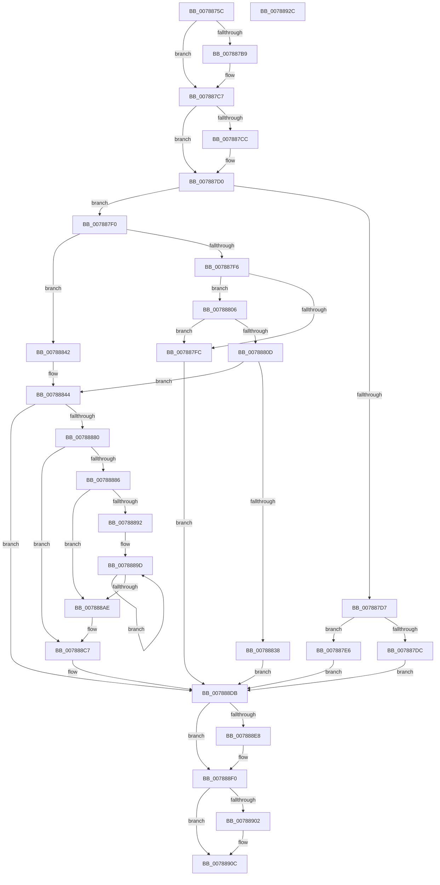

# PsInitializeVsmEnclave

- RVA: `0x0078875C`–`0x0078892D` (길이 `465` bytes)
- VA: `0x000000014078875C`
- 실행 섹션: `PAGE`
- PDB 이름 있음: `예`; PDB Function 태그: `아니요`
- unwind 정보 RVA: `0x000C6A34`
- 디코드: `130`개 명령, `465/465` bytes 표시
- 미해석 바이트: `0` (있으면 어셈블리에 `.byte`로 보존)

> 이 문서는 커널 이미지의 기계어와 PDB 기호를 분석해 생성했습니다. 4번과 5번은 함수 원형과 자료형을 바이너리 사용 방식에서 추정한 C 해석이며 원본 소스 복구 결과는 아닙니다.

## 1. Dependencies

- 직접 호출 지점: **8**; 고유 호출 대상: **8**
- 직접 호출자로 확인된 함수: **1**
- RIP 상대 이미지 참조: **0**

### Outgoing calls
- `0x007887A9` → [KeAbPreAcquire](../../text/21/KeAbPreAcquire_function_00210230.md) (function, `0x00210230`)
- `0x007887C2` → [ExfAcquirePushLockExclusiveEx](../../text/20/ExfAcquirePushLockExclusiveEx_function_0020FC90.md) (function, `0x0020FC90`)
- `0x0078882B` → [ExAllocatePool2](../../poolcode/B8/ExAllocatePool2_function_00B820F0.md) (function, `0x00B820F0`)
- `0x00788875` → [VslInitializeEnclave](../71/VslInitializeEnclave_function_00718D64.md) (function, `0x00718D64`)
- `0x007888EB` → [ExfTryToWakePushLock](../../text/26/ExfTryToWakePushLock_function_00265DD0.md) (function, `0x00265DD0`)
- `0x007888F3` → [KeAbPostRelease](../../text/2E/KeAbPostRelease_function_002E1600.md) (function, `0x002E1600`)
- `0x007888F8` → [KeLeaveCriticalRegion](../../text/25/KeLeaveCriticalRegion_function_0025D8B0.md) (function, `0x0025D8B0`)
- `0x00788907` → [ExFreePoolWithTag](../../poolcode/B8/ExFreePoolWithTag_function_00B82870.md) (function, `0x00B82870`)

### Direct callers
- [MiInitializeVsmEnclave](../80/MiInitializeVsmEnclave_function_00808AE0.md) at `0x00808BC8`

### Static image references
- 디코드된 RIP-relative 메모리 참조가 없습니다.

## 2. Other-region calls and transfers

- 다른 실행 섹션으로 향하는 call: **7**
  - `0x007887A9` → [KeAbPreAcquire](../../text/21/KeAbPreAcquire_function_00210230.md) (`PAGE` → `.text`)
  - `0x007887C2` → [ExfAcquirePushLockExclusiveEx](../../text/20/ExfAcquirePushLockExclusiveEx_function_0020FC90.md) (`PAGE` → `.text`)
  - `0x0078882B` → [ExAllocatePool2](../../poolcode/B8/ExAllocatePool2_function_00B820F0.md) (`PAGE` → `POOLCODE`)
  - `0x007888EB` → [ExfTryToWakePushLock](../../text/26/ExfTryToWakePushLock_function_00265DD0.md) (`PAGE` → `.text`)
  - `0x007888F3` → [KeAbPostRelease](../../text/2E/KeAbPostRelease_function_002E1600.md) (`PAGE` → `.text`)
  - `0x007888F8` → [KeLeaveCriticalRegion](../../text/25/KeLeaveCriticalRegion_function_0025D8B0.md) (`PAGE` → `.text`)
  - `0x00788907` → [ExFreePoolWithTag](../../poolcode/B8/ExFreePoolWithTag_function_00B82870.md) (`PAGE` → `POOLCODE`)
- 별도 외부 분기/꼬리 이동을 확인하지 못했습니다.

## 3. Assembly (complete function range)

```asm
0078875C  48 8B C4                        mov rax, rsp
0078875F  48 89 58 08                     mov qword ptr [rax + 8], rbx
00788763  48 89 68 10                     mov qword ptr [rax + 0x10], rbp
00788767  48 89 70 18                     mov qword ptr [rax + 0x18], rsi
0078876B  4C 89 48 20                     mov qword ptr [rax + 0x20], r9
0078876F  57                              push rdi
00788770  41 54                           push r12
00788772  41 55                           push r13
00788774  41 56                           push r14
00788776  41 57                           push r15
00788778  48 83 EC 40                     sub rsp, 0x40
0078877C  65 48 8B 04 25 88 01 00 00      mov rax, qword ptr gs:[0x188]
00788785  4C 8D 79 30                     lea r15, [rcx + 0x30]
00788789  45 8B E0                        mov r12d, r8d
0078878C  4C 8B EA                        mov r13, rdx
0078878F  48 8B F1                        mov rsi, rcx
00788792  48 83 CB FF                     or rbx, 0xffffffffffffffff
00788796  45 33 C0                        xor r8d, r8d
00788799  33 D2                           xor edx, edx
0078879B  66 01 98 E4 01 00 00            add word ptr [rax + 0x1e4], bx
007887A2  49 8B CF                        mov rcx, r15
007887A5  90                              nop
007887A6  45 33 F6                        xor r14d, r14d
007887A9  E8 82 7A A8 FF                  call 0x140210230
007887AE  F0 49 0F BA 2F 00               lock bts qword ptr [r15], 0
007887B4  48 8B F8                        mov rdi, rax
007887B7  73 0E                           jae 0x1407887c7
007887B9  4D 8B C7                        mov r8, r15
007887BC  48 8B D0                        mov rdx, rax
007887BF  49 8B CF                        mov rcx, r15
007887C2  E8 C9 74 A8 FF                  call 0x14020fc90
007887C7  48 85 FF                        test rdi, rdi
007887CA  74 04                           je 0x1407887d0
007887CC  C6 47 0A 01                     mov byte ptr [rdi + 0xa], 1
007887D0  8B 4E 2C                        mov ecx, dword ptr [rsi + 0x2c]
007887D3  85 C9                           test ecx, ecx
007887D5  74 19                           je 0x1407887f0
007887D7  83 F9 01                        cmp ecx, 1
007887DA  74 0A                           je 0x1407887e6
007887DC  BF 12 05 00 C0                  mov edi, 0xc0000512
007887E1  E9 F5 00 00 00                  jmp 0x1407888db
007887E6  BF 10 05 00 C0                  mov edi, 0xc0000510
007887EB  E9 EB 00 00 00                  jmp 0x1407888db
007887F0  44 38 76 4C                     cmp byte ptr [rsi + 0x4c], r14b
007887F4  75 4C                           jne 0x140788842
007887F6  41 83 FC 08                     cmp r12d, 8
007887FA  74 0A                           je 0x140788806
007887FC  BF 04 00 00 C0                  mov edi, 0xc0000004
00788801  E9 D5 00 00 00                  jmp 0x1407888db
00788806  41 83 7D 00 08                  cmp dword ptr [r13], 8
0078880B  75 EF                           jne 0x1407887fc
0078880D  41 8B 6D 04                     mov ebp, dword ptr [r13 + 4]
00788811  B9 01 01 00 00                  mov ecx, 0x101
00788816  41 B8 50 73 45 74               mov r8d, 0x74457350
0078881C  48 8D 14 AD 00 00 00 00         lea rdx, [rbp*4]
00788824  48 03 D5                        add rdx, rbp
00788827  48 C1 E2 03                     shl rdx, 3
0078882B  E8 C0 98 3F 00                  call 0x140b820f0
00788830  4C 8B F0                        mov r14, rax
00788833  48 85 C0                        test rax, rax
00788836  75 0C                           jne 0x140788844
00788838  BF 9A 00 00 C0                  mov edi, 0xc000009a
0078883D  E9 99 00 00 00                  jmp 0x1407888db
00788842  33 ED                           xor ebp, ebp
00788844  48 8B 4E 18                     mov rcx, qword ptr [rsi + 0x18]
00788848  48 8D 46 28                     lea rax, [rsi + 0x28]
0078884C  48 89 44 24 30                  mov qword ptr [rsp + 0x30], rax
00788851  48 8D 56 50                     lea rdx, [rsi + 0x50]
00788855  48 8B 84 24 90 00 00 00         mov rax, qword ptr [rsp + 0x90]
0078885D  45 8B CC                        mov r9d, r12d
00788860  48 89 44 24 28                  mov qword ptr [rsp + 0x28], rax
00788865  4D 8B C5                        mov r8, r13
00788868  48 8B 84 24 88 00 00 00         mov rax, qword ptr [rsp + 0x88]
00788870  48 89 44 24 20                  mov qword ptr [rsp + 0x20], rax
00788875  E8 EA 04 F9 FF                  call 0x140718d64
0078887A  8B F8                           mov edi, eax
0078887C  85 C0                           test eax, eax
0078887E  78 5B                           js 0x1407888db
00788880  80 7E 4C 00                     cmp byte ptr [rsi + 0x4c], 0
00788884  75 41                           jne 0x1407888c7
00788886  89 6E 48                        mov dword ptr [rsi + 0x48], ebp
00788889  49 83 26 00                     and qword ptr [r14], 0
0078888D  83 FD 01                        cmp ebp, 1
00788890  76 1C                           jbe 0x1407888ae
00788892  49 8D 4E 28                     lea rcx, [r14 + 0x28]
00788896  49 8B D6                        mov rdx, r14
00788899  44 8D 45 FF                     lea r8d, [rbp - 1]
0078889D  48 89 11                        mov qword ptr [rcx], rdx
007888A0  48 83 C2 28                     add rdx, 0x28
007888A4  48 8D 49 28                     lea rcx, [rcx + 0x28]
007888A8  49 83 E8 01                     sub r8, 1
007888AC  75 EF                           jne 0x14078889d
007888AE  8D 45 FF                        lea eax, [rbp - 1]
007888B1  4C 89 76 78                     mov qword ptr [rsi + 0x78], r14
007888B5  48 8D 04 80                     lea rax, [rax + rax*4]
007888B9  49 8D 0C C6                     lea rcx, [r14 + rax*8]
007888BD  45 33 F6                        xor r14d, r14d
007888C0  48 89 8E 80 00 00 00            mov qword ptr [rsi + 0x80], rcx
007888C7  48 8D 46 38                     lea rax, [rsi + 0x38]
007888CB  33 FF                           xor edi, edi
007888CD  48 89 40 08                     mov qword ptr [rax + 8], rax
007888D1  48 89 00                        mov qword ptr [rax], rax
007888D4  C7 46 2C 01 00 00 00            mov dword ptr [rsi + 0x2c], 1
007888DB  F0 49 0F C1 1F                  lock xadd qword ptr [r15], rbx
007888E0  80 E3 06                        and bl, 6
007888E3  80 FB 02                        cmp bl, 2
007888E6  75 08                           jne 0x1407888f0
007888E8  49 8B CF                        mov rcx, r15
007888EB  E8 E0 D4 AD FF                  call 0x140265dd0
007888F0  49 8B CF                        mov rcx, r15
007888F3  E8 08 8D B5 FF                  call 0x1402e1600
007888F8  E8 B3 4F AD FF                  call 0x14025d8b0
007888FD  4D 85 F6                        test r14, r14
00788900  74 0A                           je 0x14078890c
00788902  33 D2                           xor edx, edx
00788904  49 8B CE                        mov rcx, r14
00788907  E8 64 9F 3F 00                  call 0x140b82870
0078890C  4C 8D 5C 24 40                  lea r11, [rsp + 0x40]
00788911  8B C7                           mov eax, edi
00788913  49 8B 5B 30                     mov rbx, qword ptr [r11 + 0x30]
00788917  49 8B 6B 38                     mov rbp, qword ptr [r11 + 0x38]
0078891B  49 8B 73 40                     mov rsi, qword ptr [r11 + 0x40]
0078891F  49 8B E3                        mov rsp, r11
00788922  41 5F                           pop r15
00788924  41 5E                           pop r14
00788926  41 5D                           pop r13
00788928  41 5C                           pop r12
0078892A  5F                              pop rdi
0078892B  C3                              ret
0078892C  CC                              int3
```

## 4. C-style interpretation (structured pseudocode)

```c
__int64 __fastcall PsInitializeVsmEnclave(__int64 a1, __int64 a2, int a3, __int64 a4, __int64 a5)
{
    __int64 result;
    __int64 v_r14;
    __int64 v_rbp;
    __int64 v_rbx;
    __int64 v_rdi;
    __int64 v_rsp;
    unsigned __int64 v_stack_m28;
    unsigned __int64 v_stack_m38;
    unsigned __int64 v_stack_m40;
    unsigned __int64 v_stack_m48;
    unsigned __int64 v_stack_p20;

    *(unsigned __int64 *)(v_rsp + 8) = v_rbx;
    *(unsigned __int64 *)(v_rsp + 16) = v_rbp;
    *(unsigned __int64 *)(v_rsp + 24) = v_rsi;
    *(unsigned __int64 *)(v_rsp + 32) = a4;
    v_rsp = (v_rsp) - (64);
    v_rbx = (v_rbx) | (-1);
    a3 = 0;
    a2 = 0;
    v_r14 = 0;
    result = KeAbPreAcquire(a1 + 48, a2, a3, a4);
    if (!(condition_is_above_or_equal)) {
        a3 = a1 + 48;
        a2 = result;
        a1 = a1 + 48;
        result = ExfAcquirePushLockExclusiveEx(a1, a2, a3, a4);
    }
    if (result != 0) {
        *(unsigned __int8 *)(result + 10) = 1;
    }
    if ((unsigned int)((unsigned int)(*(unsigned int *)(a1 + 44))) == 0) goto loc_007887F0;
    if (((unsigned int)((unsigned int)(*(unsigned int *)(a1 + 44)))) == 1) goto loc_007887E6;
    goto loc_007888DB;
loc_007887E6:
    goto loc_007888DB;
loc_007887F0:
    if ((*(unsigned __int8 *)(a1 + 76)) != 0) goto loc_00788842;
    if (((unsigned int)((unsigned int)(a3))) == 8) goto loc_00788806;
loc_007887FC:
    goto loc_007888DB;
loc_00788806:
    if ((*(unsigned int *)(a2)) != 8) goto loc_007887FC;
    a2 = ((unsigned int)(*(unsigned int *)(a2 + 4)) * 4) + ((unsigned int)(*(unsigned int *)(a2 + 4)));
    a2 = (a2) << (3);
    result = ExAllocatePool2(257, a2, (unsigned int)(0x74457350ULL), a4);
    if (result != 0) goto loc_00788844;
    goto loc_007888DB;
loc_00788842:
    v_rbp = 0;
loc_00788844:
    v_stack_m38 = a1 + 40;
    v_stack_m40 = a5;
    v_stack_m48 = v_stack_p20;
    result = VslInitializeEnclave(*(unsigned __int64 *)(a1 + 24), a1 + 80, a2, (unsigned int)((unsigned int)((unsigned int)(a3))));
    if (sign_flag) goto loc_007888DB;
    if ((*(unsigned __int8 *)(a1 + 76)) != 0) goto loc_007888C7;
    *(unsigned int *)(a1 + 72) = 0;
    if (0 <= 1) goto loc_007888AE;
loc_0078889D:
    *(unsigned __int64 *)(result + 40) = result;
    a2 = (result) + (40);
    a3 = (v_rbp - 1) - (1);
    if (condition_is_not_equal) goto loc_0078889D;
loc_007888AE:
    *(unsigned __int64 *)(a1 + 120) = result;
    v_r14 = 0;
    *(unsigned __int64 *)(a1 + 128) = result + v_rbp - 1 + v_rbp - 1 * 4 * 8;
loc_007888C7:
    v_rdi = 0;
    *(unsigned __int64 *)(a1 + 56 + 8) = a1 + 56;
    *(unsigned __int64 *)(a1 + 56) = a1 + 56;
    *(unsigned int *)(a1 + 44) = 1;
loc_007888DB:
    v_rbx = (unsigned __int8)((v_rbx) & (6));
    result = a1 + 56;
    if (((unsigned __int8)(v_rbx)) == 2) {
        a1 = a1 + 48;
        result = ExfTryToWakePushLock(a1, a2, a3, (unsigned int)((unsigned int)((unsigned int)(a3))));
    }
    result = KeAbPostRelease(a1 + 48, a2, a3, (unsigned int)((unsigned int)((unsigned int)(a3))));
    result = KeLeaveCriticalRegion(a1 + 48, a2, a3, (unsigned int)((unsigned int)((unsigned int)(a3))));
    if (0 != 0) {
        a2 = 0;
        a1 = 0;
        result = ExFreePoolWithTag(a1, a2, a3, (unsigned int)((unsigned int)((unsigned int)(a3))));
    }
    return 0;
}
```

## 5. (Beta) C Style

```c
int64_t PsInitializeVsmEnclave(void *Arg1, void *Arg2, int32_t Arg3, int64_t Arg4, int64_t Arg5)
{
    uint8_t *arg1 = (uint8_t *)Arg1;
    uint8_t *arg2 = (uint8_t *)Arg2;

    int64_t result;
    int64_t local_r14;
    int64_t local_rbp;
    int64_t local_rbx;
    int64_t local_rdi;
    int64_t local_rsp;
    uint64_t v_stack_m28;
    uint64_t v_stack_m38;
    uint64_t v_stack_m40;
    uint64_t v_stack_m48;
    uint64_t v_stack_p20;

    *(uint64_t *)(local_rsp + 0x8) = local_rbx;
    *(uint64_t *)(local_rsp + 0x10) = local_rbp;
    *(uint64_t *)(local_rsp + 0x18) = local_rsi;
    *(uint64_t *)(local_rsp + 0x20) = Arg4;
    local_rsp = (local_rsp) - (64);
    local_rbx = (local_rbx) | (-1);
    Arg3 = 0;
    Arg2 = 0;
    local_r14 = 0;
    result = KeAbPreAcquire(Arg1 + 48, Arg2, Arg3, Arg4);
    if (!(condition_is_above_or_equal)) {
        Arg3 = Arg1 + 48;
        Arg2 = result;
        Arg1 = Arg1 + 48;
        result = ExfAcquirePushLockExclusiveEx(Arg1, Arg2, Arg3, Arg4);
    }
    if (result != 0) {
        *(uint8_t *)(result + 0xA) = 1;
    }
    if ((uint32_t)((uint32_t)(*(uint32_t *)(arg1 + 0x2C))) == 0) goto loc_007887F0;
    if (((uint32_t)((uint32_t)(*(uint32_t *)(arg1 + 0x2C)))) == 1) goto loc_007887E6;
    goto loc_007888DB;
loc_007887E6:
    goto loc_007888DB;
loc_007887F0:
    if ((*(uint8_t *)(arg1 + 0x4C)) != 0) goto loc_00788842;
    if (((uint32_t)((uint32_t)(Arg3))) == 8) goto loc_00788806;
loc_007887FC:
    goto loc_007888DB;
loc_00788806:
    if ((*(uint32_t *)(arg2)) != 8) goto loc_007887FC;
    Arg2 = ((uint32_t)(*(uint32_t *)(arg2 + 0x4)) * 4) + ((uint32_t)(*(uint32_t *)(arg2 + 0x4)));
    Arg2 = (Arg2) << (3);
    result = ExAllocatePool2(257, Arg2, (uint32_t)(0x74457350ULL), Arg4);
    if (result != 0) goto loc_00788844;
    goto loc_007888DB;
loc_00788842:
    local_rbp = 0;
loc_00788844:
    v_stack_m38 = Arg1 + 40;
    v_stack_m40 = Arg5;
    v_stack_m48 = v_stack_p20;
    result = VslInitializeEnclave(*(uint64_t *)(arg1 + 0x18), Arg1 + 80, Arg2, (uint32_t)((uint32_t)((uint32_t)(Arg3))));
    if (sign_flag) goto loc_007888DB;
    if ((*(uint8_t *)(arg1 + 0x4C)) != 0) goto loc_007888C7;
    *(uint32_t *)(arg1 + 0x48) = 0;
    if (0 <= 1) goto loc_007888AE;
loc_0078889D:
    *(uint64_t *)(result + 0x28) = result;
    Arg2 = (result) + (40);
    Arg3 = (local_rbp - 1) - (1);
    if (condition_is_not_equal) goto loc_0078889D;
loc_007888AE:
    *(uint64_t *)(arg1 + 0x78) = result;
    local_r14 = 0;
    *(uint64_t *)(arg1 + 0x80) = result + local_rbp - 1 + local_rbp - 1 * 4 * 8;
loc_007888C7:
    local_rdi = 0;
    *(void **)(arg1 + 0x38 + 0x8) = Arg1 + 56;
    *(void **)(arg1 + 0x38) = Arg1 + 56;
    *(uint32_t *)(arg1 + 0x2C) = 1;
loc_007888DB:
    local_rbx = (uint8_t)((local_rbx) & (6));
    result = Arg1 + 56;
    if (((uint8_t)(local_rbx)) == 2) {
        Arg1 = Arg1 + 48;
        result = ExfTryToWakePushLock(Arg1, Arg2, Arg3, (uint32_t)((uint32_t)((uint32_t)(Arg3))));
    }
    result = KeAbPostRelease(Arg1 + 48, Arg2, Arg3, (uint32_t)((uint32_t)((uint32_t)(Arg3))));
    result = KeLeaveCriticalRegion(Arg1 + 48, Arg2, Arg3, (uint32_t)((uint32_t)((uint32_t)(Arg3))));
    if (0 != 0) {
        Arg2 = 0;
        Arg1 = 0;
        result = ExFreePoolWithTag(Arg1, Arg2, Arg3, (uint32_t)((uint32_t)((uint32_t)(Arg3))));
    }
    return 0;
}
```

### 관측된 메모리 오프셋

구조체 형식이 확인되지 않은 접근은 인자 기준의 오프셋으로만 기록했습니다.

| 기준 인자 | 오프셋 표현 | 폭 (bit) | 접근 |
|---|---:|---:|---|
| `Arg1` | `+ 0x0` | `64` | `R/W` |
| `Arg1` | `+ 0x0` | `64` | `W` |
| `Arg1` | `+ 0x8` | `64` | `W` |
| `Arg1` | `+ 0x18` | `64` | `R` |
| `Arg1` | `+ 0x28` | `64` | `R` |
| `Arg1` | `+ 0x2C` | `32` | `R` |
| `Arg1` | `+ 0x2C` | `32` | `W` |
| `Arg1` | `+ 0x30` | `64` | `R` |
| `Arg1` | `+ 0x38` | `64` | `R` |
| `Arg1` | `+ 0x48` | `32` | `W` |
| `Arg1` | `+ 0x4C` | `8` | `R` |
| `Arg1` | `+ 0x50` | `64` | `R` |
| `Arg1` | `+ 0x78` | `64` | `W` |
| `Arg1` | `+ 0x80` | `64` | `W` |
| `Arg2` | `+ 0x0` | `32` | `R` |
| `Arg2` | `+ 0x4` | `32` | `R` |

## 6. Execution-region graph

[열기: 2D/3D 그래프와 함수 탐색 컨트롤 패널](../../../control-panel.html?section=page&rva=0x0078875C&view=graph)

- 2D 그래프는 위에서 아래로 흐르고, 3D 그래프는 빈 공간을 드래그해 회전합니다. Shift+드래그는 이동, 휠은 확대·축소, 함수 노드 선택은 대상 보고서 이동입니다.

### Static fallback


