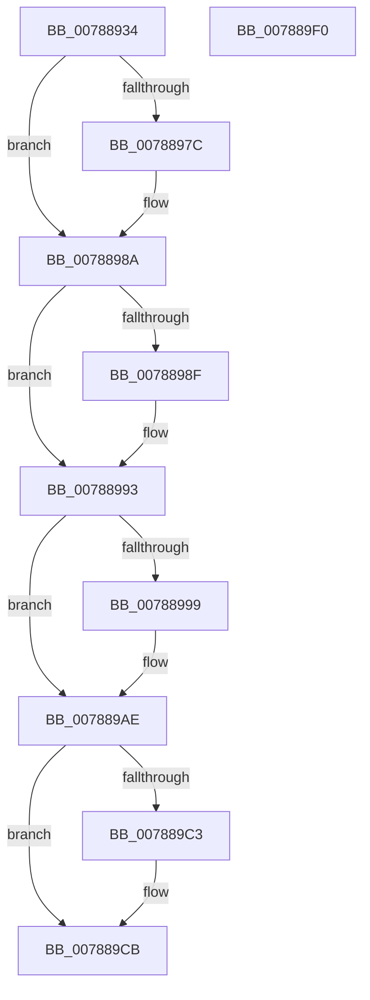

# PsIsVsmEnclaveTerminated

- RVA: `0x00788934`–`0x007889F1` (길이 `189` bytes)
- VA: `0x0000000140788934`
- 실행 섹션: `PAGE`
- PDB 이름 있음: `예`; PDB Function 태그: `아니요`
- unwind 정보 RVA: `0x0005C954`
- 디코드: `51`개 명령, `189/189` bytes 표시
- 미해석 바이트: `0` (있으면 어셈블리에 `.byte`로 보존)

> 이 문서는 커널 이미지의 기계어와 PDB 기호를 분석해 생성했습니다. 4번과 5번은 함수 원형과 자료형을 바이너리 사용 방식에서 추정한 C 해석이며 원본 소스 복구 결과는 아닙니다.

## 1. Dependencies

- 직접 호출 지점: **6**; 고유 호출 대상: **6**
- 직접 호출자로 확인된 함수: **1**
- RIP 상대 이미지 참조: **0**

### Outgoing calls
- `0x0078896C` → [KeAbPreAcquire](../../text/21/KeAbPreAcquire_function_00210230.md) (function, `0x00210230`)
- `0x00788985` → [ExfAcquirePushLockExclusiveEx](../../text/20/ExfAcquirePushLockExclusiveEx_function_0020FC90.md) (function, `0x0020FC90`)
- `0x007889A9` → [KeSetEvent](../../text/33/KeSetEvent_function_0033F310.md) (function, `0x0033F310`)
- `0x007889C6` → [ExfTryToWakePushLock](../../text/26/ExfTryToWakePushLock_function_00265DD0.md) (function, `0x00265DD0`)
- `0x007889CE` → [KeAbPostRelease](../../text/2E/KeAbPostRelease_function_002E1600.md) (function, `0x002E1600`)
- `0x007889D3` → [KeLeaveCriticalRegion](../../text/25/KeLeaveCriticalRegion_function_0025D8B0.md) (function, `0x0025D8B0`)

### Direct callers
- [MiCanDeleteEnclave](../../text/68/MiCanDeleteEnclave_function_00686D18.md) at `0x00686DA9`

### Static image references
- 디코드된 RIP-relative 메모리 참조가 없습니다.

## 2. Other-region calls and transfers

- 다른 실행 섹션으로 향하는 call: **6**
  - `0x0078896C` → [KeAbPreAcquire](../../text/21/KeAbPreAcquire_function_00210230.md) (`PAGE` → `.text`)
  - `0x00788985` → [ExfAcquirePushLockExclusiveEx](../../text/20/ExfAcquirePushLockExclusiveEx_function_0020FC90.md) (`PAGE` → `.text`)
  - `0x007889A9` → [KeSetEvent](../../text/33/KeSetEvent_function_0033F310.md) (`PAGE` → `.text`)
  - `0x007889C6` → [ExfTryToWakePushLock](../../text/26/ExfTryToWakePushLock_function_00265DD0.md) (`PAGE` → `.text`)
  - `0x007889CE` → [KeAbPostRelease](../../text/2E/KeAbPostRelease_function_002E1600.md) (`PAGE` → `.text`)
  - `0x007889D3` → [KeLeaveCriticalRegion](../../text/25/KeLeaveCriticalRegion_function_0025D8B0.md) (`PAGE` → `.text`)
- 별도 외부 분기/꼬리 이동을 확인하지 못했습니다.

## 3. Assembly (complete function range)

```asm
00788934  48 89 5C 24 08                  mov qword ptr [rsp + 8], rbx
00788939  48 89 6C 24 10                  mov qword ptr [rsp + 0x10], rbp
0078893E  48 89 74 24 18                  mov qword ptr [rsp + 0x18], rsi
00788943  57                              push rdi
00788944  48 83 EC 20                     sub rsp, 0x20
00788948  65 48 8B 04 25 88 01 00 00      mov rax, qword ptr gs:[0x188]
00788951  48 8D 79 30                     lea rdi, [rcx + 0x30]
00788955  48 8B F1                        mov rsi, rcx
00788958  48 83 CB FF                     or rbx, 0xffffffffffffffff
0078895C  45 33 C0                        xor r8d, r8d
0078895F  33 D2                           xor edx, edx
00788961  48 8B CF                        mov rcx, rdi
00788964  66 01 98 E4 01 00 00            add word ptr [rax + 0x1e4], bx
0078896B  90                              nop
0078896C  E8 BF 78 A8 FF                  call 0x140210230
00788971  F0 48 0F BA 2F 00               lock bts qword ptr [rdi], 0
00788977  48 8B E8                        mov rbp, rax
0078897A  73 0E                           jae 0x14078898a
0078897C  4C 8B C7                        mov r8, rdi
0078897F  48 8B D0                        mov rdx, rax
00788982  48 8B CF                        mov rcx, rdi
00788985  E8 06 73 A8 FF                  call 0x14020fc90
0078898A  48 85 ED                        test rbp, rbp
0078898D  74 04                           je 0x140788993
0078898F  C6 45 0A 01                     mov byte ptr [rbp + 0xa], 1
00788993  83 7E 2C 00                     cmp dword ptr [rsi + 0x2c], 0
00788997  75 15                           jne 0x1407889ae
00788999  48 8D 4E 50                     lea rcx, [rsi + 0x50]
0078899D  C7 46 2C 02 00 00 00            mov dword ptr [rsi + 0x2c], 2
007889A4  45 33 C0                        xor r8d, r8d
007889A7  33 D2                           xor edx, edx
007889A9  E8 62 69 BB FF                  call 0x14033f310
007889AE  83 7E 2C 02                     cmp dword ptr [rsi + 0x2c], 2
007889B2  40 0F 94 C6                     sete sil
007889B6  F0 48 0F C1 1F                  lock xadd qword ptr [rdi], rbx
007889BB  80 E3 06                        and bl, 6
007889BE  80 FB 02                        cmp bl, 2
007889C1  75 08                           jne 0x1407889cb
007889C3  48 8B CF                        mov rcx, rdi
007889C6  E8 05 D4 AD FF                  call 0x140265dd0
007889CB  48 8B CF                        mov rcx, rdi
007889CE  E8 2D 8C B5 FF                  call 0x1402e1600
007889D3  E8 D8 4E AD FF                  call 0x14025d8b0
007889D8  48 8B 5C 24 30                  mov rbx, qword ptr [rsp + 0x30]
007889DD  40 8A C6                        mov al, sil
007889E0  48 8B 74 24 40                  mov rsi, qword ptr [rsp + 0x40]
007889E5  48 8B 6C 24 38                  mov rbp, qword ptr [rsp + 0x38]
007889EA  48 83 C4 20                     add rsp, 0x20
007889EE  5F                              pop rdi
007889EF  C3                              ret
007889F0  CC                              int3
```

## 4. C-style interpretation (structured pseudocode)

```c
__int64 __fastcall PsIsVsmEnclaveTerminated(__int64 a1, int a2, int a3)
{
    __int64 result;
    __int64 v_rbx;
    __int64 v_rsi;
    __int64 v_rsp;
    unsigned __int64 v_stack_p10;
    unsigned __int64 v_stack_p18;
    unsigned __int64 v_stack_p8;

    v_stack_p8 = v_rbx;
    v_stack_p10 = v_rbp;
    v_stack_p18 = v_rsi;
    v_rsp = (v_rsp) - (32);
    v_rbx = (v_rbx) | (-1);
    a3 = 0;
    a2 = 0;
    result = KeAbPreAcquire(a1 + 48, a2, a3, a4);
    if (!(condition_is_above_or_equal)) {
        a3 = a1 + 48;
        a2 = result;
        a1 = a1 + 48;
        result = ExfAcquirePushLockExclusiveEx(a1, a2, a3, a4);
    }
    if (result != 0) {
        *(unsigned __int8 *)(result + 10) = 1;
    }
    if ((*(unsigned int *)(a1 + 44)) == 0) {
        a1 = a1 + 80;
        *(unsigned int *)(a1 + 44) = 2;
        a3 = 0;
        a2 = 0;
        result = KeSetEvent(a1, a2, a3, a4);
    }
    v_rsi = ((*(unsigned int *)(a1 + 44)) == 2) ? 1 : 0;
    v_rbx = (unsigned __int8)((v_rbx) & (6));
    if (((unsigned __int8)(v_rbx)) == 2) {
        a1 = a1 + 48;
        result = ExfTryToWakePushLock(a1, a2, a3, a4);
    }
    result = KeAbPostRelease(a1 + 48, a2, a3, a4);
    result = KeLeaveCriticalRegion(a1 + 48, a2, a3, a4);
    v_rsp = (v_rsp) + (32);
    return (unsigned __int8)(v_rsi);
}
```

## 5. (Beta) C Style

```c
int64_t PsIsVsmEnclaveTerminated(void *Arg1, int32_t Arg2, int32_t Arg3)
{
    uint8_t *arg1 = (uint8_t *)Arg1;

    int64_t result;
    int64_t local_rbx;
    int64_t local_rsi;
    int64_t local_rsp;
    uint64_t v_stack_p10;
    uint64_t v_stack_p18;
    uint64_t v_stack_p8;

    v_stack_p8 = local_rbx;
    v_stack_p10 = local_rbp;
    v_stack_p18 = local_rsi;
    local_rsp = (local_rsp) - (32);
    local_rbx = (local_rbx) | (-1);
    Arg3 = 0;
    Arg2 = 0;
    result = KeAbPreAcquire(Arg1 + 48, Arg2, Arg3, a4);
    if (!(condition_is_above_or_equal)) {
        Arg3 = Arg1 + 48;
        Arg2 = result;
        Arg1 = Arg1 + 48;
        result = ExfAcquirePushLockExclusiveEx(Arg1, Arg2, Arg3, a4);
    }
    if (result != 0) {
        *(uint8_t *)(result + 0xA) = 1;
    }
    if ((*(uint32_t *)(arg1 + 0x2C)) == 0) {
        Arg1 = Arg1 + 80;
        *(uint32_t *)(arg1 + 0x2C) = 2;
        Arg3 = 0;
        Arg2 = 0;
        result = KeSetEvent(Arg1, Arg2, Arg3, a4);
    }
    local_rsi = ((*(uint32_t *)(arg1 + 0x2C)) == 2) ? 1 : 0;
    local_rbx = (uint8_t)((local_rbx) & (6));
    if (((uint8_t)(local_rbx)) == 2) {
        Arg1 = Arg1 + 48;
        result = ExfTryToWakePushLock(Arg1, Arg2, Arg3, a4);
    }
    result = KeAbPostRelease(Arg1 + 48, Arg2, Arg3, a4);
    result = KeLeaveCriticalRegion(Arg1 + 48, Arg2, Arg3, a4);
    local_rsp = (local_rsp) + (32);
    return (uint8_t)(local_rsi);
}
```

### 관측된 메모리 오프셋

구조체 형식이 확인되지 않은 접근은 인자 기준의 오프셋으로만 기록했습니다.

| 기준 인자 | 오프셋 표현 | 폭 (bit) | 접근 |
|---|---:|---:|---|
| `Arg1` | `+ 0x0` | `64` | `R/W` |
| `Arg1` | `+ 0x2C` | `32` | `R` |
| `Arg1` | `+ 0x2C` | `32` | `W` |
| `Arg1` | `+ 0x30` | `64` | `R` |
| `Arg1` | `+ 0x50` | `64` | `R` |

## 6. Execution-region graph

[열기: 2D/3D 그래프와 함수 탐색 컨트롤 패널](../../../control-panel.html?section=page&rva=0x00788934&view=graph)

- 2D 그래프는 위에서 아래로 흐르고, 3D 그래프는 빈 공간을 드래그해 회전합니다. Shift+드래그는 이동, 휠은 확대·축소, 함수 노드 선택은 대상 보고서 이동입니다.

### Static fallback


