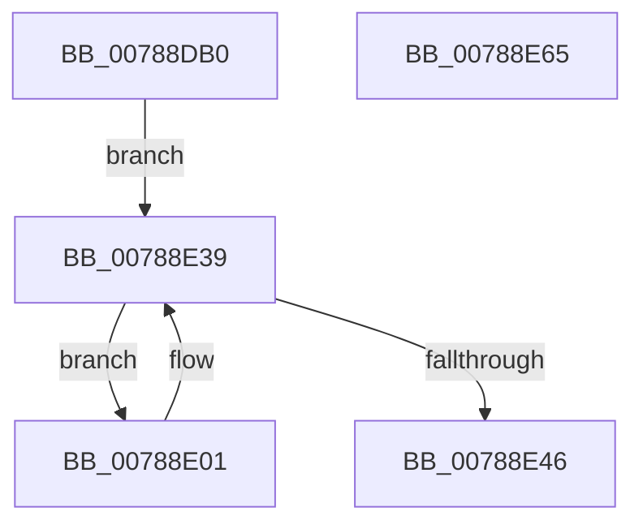

# PsPerfLogSessionRundown

- RVA: `0x00788DB0`–`0x00788E66` (길이 `182` bytes)
- VA: `0x0000000140788DB0`
- 실행 섹션: `PAGE`
- PDB 이름 있음: `예`; PDB Function 태그: `아니요`
- unwind 정보 RVA: `0x000CF55C`
- 디코드: `49`개 명령, `182/182` bytes 표시
- 미해석 바이트: `0` (있으면 어셈블리에 `.byte`로 보존)

> 이 문서는 커널 이미지의 기계어와 PDB 기호를 분석해 생성했습니다. 4번과 5번은 함수 원형과 자료형을 바이너리 사용 방식에서 추정한 C 해석이며 원본 소스 복구 결과는 아닙니다.

## 1. Dependencies

- 직접 호출 지점: **3**; 고유 호출 대상: **3**
- 직접 호출자로 확인된 함수: **1**
- RIP 상대 이미지 참조: **1**

### Outgoing calls
- `0x00788E31` → [EtwTraceSiloDcEvent](../../text/48/EtwTraceSiloDcEvent_function_0048B28C.md) (function, `0x0048B28C`)
- `0x00788E39` → [PsGetNextSession](../91/PsGetNextSession_function_009128C0.md) (function, `0x009128C0`)
- `0x00788E50` → [_security_check_cookie](../../text/6A/_security_check_cookie_function_006AC640.md) (function, `0x006AC640`)

### Direct callers
- [EtwpKernelTraceRundown](../9E/EtwpKernelTraceRundown_function_009E4080.md) at `0x009E421A`

### Static image references
- `0x00788DBC` → RVA `0x00E0A740` (`.data`; read)

## 2. Other-region calls and transfers

- 다른 실행 섹션으로 향하는 call: **2**
  - `0x00788E31` → [EtwTraceSiloDcEvent](../../text/48/EtwTraceSiloDcEvent_function_0048B28C.md) (`PAGE` → `.text`)
  - `0x00788E50` → [_security_check_cookie](../../text/6A/_security_check_cookie_function_006AC640.md) (`PAGE` → `.text`)
- 별도 외부 분기/꼬리 이동을 확인하지 못했습니다.

## 3. Assembly (complete function range)

```asm
00788DB0  48 89 5C 24 18                  mov qword ptr [rsp + 0x18], rbx
00788DB5  55                              push rbp
00788DB6  56                              push rsi
00788DB7  57                              push rdi
00788DB8  48 83 EC 60                     sub rsp, 0x60
00788DBC  48 8B 05 7D 19 68 00            mov rax, qword ptr [rip + 0x68197d]
00788DC3  48 33 C4                        xor rax, rsp
00788DC6  48 89 44 24 50                  mov qword ptr [rsp + 0x50], rax
00788DCB  41 F7 D8                        neg r8d
00788DCE  C7 44 24 48 0C 00 00 00         mov dword ptr [rsp + 0x48], 0xc
00788DD6  0F 57 C0                        xorps xmm0, xmm0
00788DD9  48 8D 44 24 30                  lea rax, [rsp + 0x30]
00788DDE  66 1B FF                        sbb di, di
00788DE1  48 89 44 24 40                  mov qword ptr [rsp + 0x40], rax
00788DE6  83 64 24 4C 00                  and dword ptr [rsp + 0x4c], 0
00788DEB  66 F7 DF                        neg di
00788DEE  66 81 C7 4C 02                  add di, 0x24c
00788DF3  48 8B F1                        mov rsi, rcx
00788DF6  33 C9                           xor ecx, ecx
00788DF8  8B EA                           mov ebp, edx
00788DFA  0F 11 44 24 30                  movups xmmword ptr [rsp + 0x30], xmm0
00788DFF  EB 38                           jmp 0x140788e39
00788E01  48 8B 93 E8 02 00 00            mov rdx, qword ptr [rbx + 0x2e8]
00788E08  44 8B CD                        mov r9d, ebp
00788E0B  C7 44 24 28 03 18 50 00         mov dword ptr [rsp + 0x28], 0x501803
00788E13  4C 8B C6                        mov r8, rsi
00788E16  66 89 7C 24 20                  mov word ptr [rsp + 0x20], di
00788E1B  8B 4A 08                        mov ecx, dword ptr [rdx + 8]
00788E1E  89 4C 24 38                     mov dword ptr [rsp + 0x38], ecx
00788E22  48 8D 4C 24 40                  lea rcx, [rsp + 0x40]
00788E27  48 89 54 24 30                  mov qword ptr [rsp + 0x30], rdx
00788E2C  BA 01 00 00 00                  mov edx, 1
00788E31  E8 56 24 D0 FF                  call 0x14048b28c
00788E36  48 8B CB                        mov rcx, rbx
00788E39  E8 82 9A 18 00                  call 0x1409128c0
00788E3E  48 8B D8                        mov rbx, rax
00788E41  48 85 C0                        test rax, rax
00788E44  75 BB                           jne 0x140788e01
00788E46  33 C0                           xor eax, eax
00788E48  48 8B 4C 24 50                  mov rcx, qword ptr [rsp + 0x50]
00788E4D  48 33 CC                        xor rcx, rsp
00788E50  E8 EB 37 F2 FF                  call 0x1406ac640
00788E55  48 8B 9C 24 90 00 00 00         mov rbx, qword ptr [rsp + 0x90]
00788E5D  48 83 C4 60                     add rsp, 0x60
00788E61  5F                              pop rdi
00788E62  5E                              pop rsi
00788E63  5D                              pop rbp
00788E64  C3                              ret
00788E65  CC                              int3
```

## 4. C-style interpretation (structured pseudocode)

```c
__int64 __fastcall PsPerfLogSessionRundown(__int64 a1, int a2, int a3)
{
    __int64 result;
    __int64 v_rdi;
    __int64 v_rsp;
    unsigned __int64 v_stack_m28;
    unsigned int v_stack_m2C;
    unsigned int v_stack_m30;
    unsigned __int64 v_stack_m38;
    unsigned int v_stack_m40;
    unsigned __int64 v_stack_m48;
    unsigned int v_stack_m50;
    unsigned __int16 v_stack_m58;
    unsigned __int64 v_stack_p18;

    v_stack_p18 = v_rbx;
    v_rsp = (v_rsp) - (96);
    result = (*(unsigned __int64 *)(v_rip + 6822269)) ^ (v_rsp);
    v_stack_m28 = result;
    a3 = (unsigned int)(-(a3));
    v_stack_m30 = 12;
    v_stack_m38 = v_stack_m48;
    v_rdi = (unsigned __int16)(-(v_rdi));
    v_rdi = (unsigned __int16)((v_rdi) + (588));
    a1 = 0;
    v_stack_m48 = v_xmm0;
    goto loc_00788E39;
loc_00788E01:
    v_stack_m50 = 0x501803ULL;
    v_stack_m58 = (unsigned __int16)(v_rdi);
    v_stack_m40 = (unsigned int)((unsigned int)(*(unsigned int *)(*(unsigned __int64 *)(v_rbx + 744) + 8)));
    v_stack_m48 = *(unsigned __int64 *)(v_rbx + 744);
    result = EtwTraceSiloDcEvent(v_stack_m38, 1, 0, (unsigned int)((unsigned int)((unsigned int)(a2))));
loc_00788E39:
    result = PsGetNextSession(v_rbx, 1, 0, (unsigned int)((unsigned int)((unsigned int)(a2))));
    if (result != 0) goto loc_00788E01;
    result = 0;
    a1 = (v_stack_m28) ^ (v_rsp);
    result = _security_check_cookie(a1, 1, 0, (unsigned int)((unsigned int)((unsigned int)(a2))));
    v_rsp = (v_rsp) + (96);
    return result;
}
```

## 5. (Beta) C Style

```c
int64_t PsPerfLogSessionRundown(int64_t Arg1, int32_t Arg2, int32_t Arg3)
{
    int64_t result;
    int64_t local_rdi;
    int64_t local_rsp;
    uint64_t v_stack_m28;
    uint32_t v_stack_m2C;
    uint32_t v_stack_m30;
    uint64_t v_stack_m38;
    uint32_t v_stack_m40;
    uint64_t v_stack_m48;
    uint32_t v_stack_m50;
    uint16_t v_stack_m58;
    uint64_t v_stack_p18;

    v_stack_p18 = local_rbx;
    local_rsp = (local_rsp) - (96);
    result = (*(uint64_t *)(v_rip + 0x68197D)) ^ (local_rsp);
    v_stack_m28 = result;
    Arg3 = (uint32_t)(-(Arg3));
    v_stack_m30 = 12;
    v_stack_m38 = v_stack_m48;
    local_rdi = (uint16_t)(-(local_rdi));
    local_rdi = (uint16_t)((local_rdi) + (588));
    Arg1 = 0;
    v_stack_m48 = v_xmm0;
    goto loc_00788E39;
loc_00788E01:
    v_stack_m50 = 0x501803ULL;
    v_stack_m58 = (uint16_t)(local_rdi);
    v_stack_m40 = (uint32_t)((uint32_t)(*(uint32_t *)(*(uint64_t *)(local_rbx + 0x2E8) + 0x8)));
    v_stack_m48 = *(uint64_t *)(local_rbx + 0x2E8);
    result = EtwTraceSiloDcEvent(v_stack_m38, 1, 0, (uint32_t)((uint32_t)((uint32_t)(Arg2))));
loc_00788E39:
    result = PsGetNextSession(local_rbx, 1, 0, (uint32_t)((uint32_t)((uint32_t)(Arg2))));
    if (result != 0) goto loc_00788E01;
    result = 0;
    Arg1 = (v_stack_m28) ^ (local_rsp);
    result = _security_check_cookie(Arg1, 1, 0, (uint32_t)((uint32_t)((uint32_t)(Arg2))));
    local_rsp = (local_rsp) + (96);
    return result;
}
```

## 6. Execution-region graph

[열기: 2D/3D 그래프와 함수 탐색 컨트롤 패널](../../../control-panel.html?section=page&rva=0x00788DB0&view=graph)

- 2D 그래프는 위에서 아래로 흐르고, 3D 그래프는 빈 공간을 드래그해 회전합니다. Shift+드래그는 이동, 휠은 확대·축소, 함수 노드 선택은 대상 보고서 이동입니다.

### Static fallback


