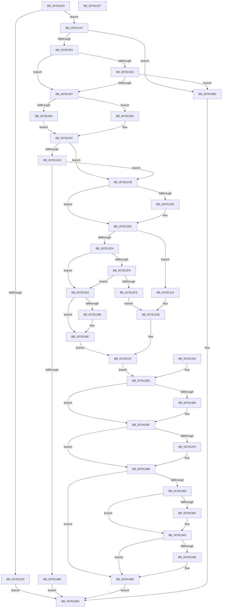

# PsQueryProcessExceptionFlags

- RVA: `0x007811E0`–`0x007813E8` (길이 `520` bytes)
- VA: `0x00000001407811E0`
- 실행 섹션: `PAGE`
- PDB 이름 있음: `예`; PDB Function 태그: `아니요`
- unwind 정보 RVA: `0x000CE328`
- 디코드: `134`개 명령, `520/520` bytes 표시
- 미해석 바이트: `0` (있으면 어셈블리에 `.byte`로 보존)

> 이 문서는 커널 이미지의 기계어와 PDB 기호를 분석해 생성했습니다. 4번과 5번은 함수 원형과 자료형을 바이너리 사용 방식에서 추정한 C 해석이며 원본 소스 복구 결과는 아닙니다.

## 1. Dependencies

- 직접 호출 지점: **7**; 고유 호출 대상: **6**
- 직접 호출자로 확인된 함수: **0**
- RIP 상대 이미지 참조: **1**

### Outgoing calls
- `0x007812B0` → [ExAcquireRundownProtection](../../text/21/ExAcquireRundownProtection_function_00216620.md) (function, `0x00216620`)
- `0x007812BC` → [KiLeaveCriticalRegionUnsafe](../../text/25/KiLeaveCriticalRegionUnsafe_function_0025F010.md) (function, `0x0025F010`)
- `0x007812DA` → [KiStackAttachProcess](../../text/21/KiStackAttachProcess_function_00216820.md) (function, `0x00216820`)
- `0x0078136A` → [KiUnstackDetachProcess](../../text/21/KiUnstackDetachProcess_function_00217D30.md) (function, `0x00217D30`)
- `0x0078137B` → [ExReleaseRundownProtection](../../text/34/ExReleaseRundownProtection_function_00349E80.md) (function, `0x00349E80`)
- `0x00781383` → [KiLeaveCriticalRegionUnsafe](../../text/25/KiLeaveCriticalRegionUnsafe_function_0025F010.md) (function, `0x0025F010`)
- `0x007813C5` → [_security_check_cookie](../../text/6A/_security_check_cookie_function_006AC640.md) (function, `0x006AC640`)

### Direct callers
- 이 함수 시작 RVA로 연결되는 직접 call은 확인되지 않았습니다. 간접 호출은 완전히 역산할 수 없습니다.

### Static image references
- `0x007811FA` → RVA `0x00E0A740` (`.data`; read)

## 2. Other-region calls and transfers

- 다른 실행 섹션으로 향하는 call: **7**
  - `0x007812B0` → [ExAcquireRundownProtection](../../text/21/ExAcquireRundownProtection_function_00216620.md) (`PAGE` → `.text`)
  - `0x007812BC` → [KiLeaveCriticalRegionUnsafe](../../text/25/KiLeaveCriticalRegionUnsafe_function_0025F010.md) (`PAGE` → `.text`)
  - `0x007812DA` → [KiStackAttachProcess](../../text/21/KiStackAttachProcess_function_00216820.md) (`PAGE` → `.text`)
  - `0x0078136A` → [KiUnstackDetachProcess](../../text/21/KiUnstackDetachProcess_function_00217D30.md) (`PAGE` → `.text`)
  - `0x0078137B` → [ExReleaseRundownProtection](../../text/34/ExReleaseRundownProtection_function_00349E80.md) (`PAGE` → `.text`)
  - `0x00781383` → [KiLeaveCriticalRegionUnsafe](../../text/25/KiLeaveCriticalRegionUnsafe_function_0025F010.md) (`PAGE` → `.text`)
  - `0x007813C5` → [_security_check_cookie](../../text/6A/_security_check_cookie_function_006AC640.md) (`PAGE` → `.text`)
- 별도 외부 분기/꼬리 이동을 확인하지 못했습니다.

## 3. Assembly (complete function range)

```asm
007811E0  48 89 5C 24 10                  mov qword ptr [rsp + 0x10], rbx
007811E5  48 89 74 24 20                  mov qword ptr [rsp + 0x20], rsi
007811EA  57                              push rdi
007811EB  41 54                           push r12
007811ED  41 55                           push r13
007811EF  41 56                           push r14
007811F1  41 57                           push r15
007811F3  48 81 EC 90 00 00 00            sub rsp, 0x90
007811FA  48 8B 05 3F 95 68 00            mov rax, qword ptr [rip + 0x68953f]
00781201  48 33 C4                        xor rax, rsp
00781204  48 89 84 24 80 00 00 00         mov qword ptr [rsp + 0x80], rax
0078120C  4C 89 44 24 30                  mov qword ptr [rsp + 0x30], r8
00781211  44 8B FA                        mov r15d, edx
00781214  48 8B F1                        mov rsi, rcx
00781217  48 89 4C 24 40                  mov qword ptr [rsp + 0x40], rcx
0078121C  4C 89 44 24 48                  mov qword ptr [rsp + 0x48], r8
00781221  0F 57 C0                        xorps xmm0, xmm0
00781224  0F 11 44 24 50                  movups xmmword ptr [rsp + 0x50], xmm0
00781229  0F 11 44 24 60                  movups xmmword ptr [rsp + 0x60], xmm0
0078122E  0F 11 44 24 70                  movups xmmword ptr [rsp + 0x70], xmm0
00781233  33 FF                           xor edi, edi
00781235  F7 C2 FE FF FF FF               test edx, 0xfffffffe
0078123B  74 0A                           je 0x140781247
0078123D  B8 F0 00 00 C0                  mov eax, 0xc00000f0
00781242  E9 73 01 00 00                  jmp 0x1407813ba
00781247  48 39 B9 E0 02 00 00            cmp qword ptr [rcx + 0x2e0], rdi
0078124E  0F 84 61 01 00 00               je 0x1407813b5
00781254  41 83 E7 01                     and r15d, 1
00781258  74 0D                           je 0x140781267
0078125A  48 39 B9 10 03 00 00            cmp qword ptr [rcx + 0x310], rdi
00781261  0F 84 4E 01 00 00               je 0x1407813b5
00781267  65 4C 8B 34 25 88 01 00 00      mov r14, qword ptr gs:[0x188]
00781270  4C 89 74 24 38                  mov qword ptr [rsp + 0x38], r14
00781275  41 BD 02 00 00 00               mov r13d, 2
0078127B  49 39 B6 B8 00 00 00            cmp qword ptr [r14 + 0xb8], rsi
00781282  74 06                           je 0x14078128a
00781284  41 8D 5D 01                     lea ebx, [r13 + 1]
00781288  EB 0D                           jmp 0x140781297
0078128A  8B DF                           mov ebx, edi
0078128C  49 39 B6 20 02 00 00            cmp qword ptr [r14 + 0x220], rsi
00781293  41 0F 45 DD                     cmovne ebx, r13d
00781297  89 5C 24 20                     mov dword ptr [rsp + 0x20], ebx
0078129B  41 3B DD                        cmp ebx, r13d
0078129E  72 2B                           jb 0x1407812cb
007812A0  66 41 FF 8E E4 01 00 00         dec word ptr [r14 + 0x1e4]
007812A8  90                              nop
007812A9  48 81 C1 E8 01 00 00            add rcx, 0x1e8
007812B0  E8 6B 53 A9 FF                  call 0x140216620
007812B5  84 C0                           test al, al
007812B7  75 12                           jne 0x1407812cb
007812B9  49 8B CE                        mov rcx, r14
007812BC  E8 4F DD AD FF                  call 0x14025f010
007812C1  B8 0A 01 00 C0                  mov eax, 0xc000010a
007812C6  E9 EF 00 00 00                  jmp 0x1407813ba
007812CB  F6 C3 01                        test bl, 1
007812CE  74 0F                           je 0x1407812df
007812D0  4C 8D 44 24 50                  lea r8, [rsp + 0x50]
007812D5  33 D2                           xor edx, edx
007812D7  48 8B CE                        mov rcx, rsi
007812DA  E8 41 55 A9 FF                  call 0x140216820
007812DF  45 85 FF                        test r15d, r15d
007812E2  74 30                           je 0x140781314
007812E4  48 8B 86 10 03 00 00            mov rax, qword ptr [rsi + 0x310]
007812EB  48 85 C0                        test rax, rax
007812EE  74 13                           je 0x140781303
007812F0  B9 64 86 00 00                  mov ecx, 0x8664
007812F5  66 39 8E EC 06 00 00            cmp word ptr [rsi + 0x6ec], cx
007812FC  75 05                           jne 0x140781303
007812FE  48 8B 00                        mov rax, qword ptr [rax]
00781301  EB 18                           jmp 0x14078131b
00781303  48 8B CF                        mov rcx, rdi
00781306  48 85 C0                        test rax, rax
00781309  74 03                           je 0x14078130e
0078130B  48 8B 08                        mov rcx, qword ptr [rax]
0078130E  48 8D 41 28                     lea rax, [rcx + 0x28]
00781312  EB 0B                           jmp 0x14078131f
00781314  48 8B 86 E0 02 00 00            mov rax, qword ptr [rsi + 0x2e0]
0078131B  48 83 C0 50                     add rax, 0x50
0078131F  44 8B 20                        mov r12d, dword ptr [rax]
00781322  44 89 64 24 24                  mov dword ptr [rsp + 0x24], r12d
00781327  44 8B FF                        mov r15d, edi
0078132A  89 7C 24 28                     mov dword ptr [rsp + 0x28], edi
0078132E  EB 2E                           jmp 0x14078135e
00781330  44 8B F8                        mov r15d, eax
00781333  45 33 E4                        xor r12d, r12d
00781336  44 89 64 24 24                  mov dword ptr [rsp + 0x24], r12d
0078133B  89 44 24 28                     mov dword ptr [rsp + 0x28], eax
0078133F  33 FF                           xor edi, edi
00781341  45 8D 6C 24 02                  lea r13d, [r12 + 2]
00781346  4C 8B 74 24 38                  mov r14, qword ptr [rsp + 0x38]
0078134B  8B 5C 24 20                     mov ebx, dword ptr [rsp + 0x20]
0078134F  48 8B 74 24 40                  mov rsi, qword ptr [rsp + 0x40]
00781354  4C 8B 44 24 48                  mov r8, qword ptr [rsp + 0x48]
00781359  4C 89 44 24 30                  mov qword ptr [rsp + 0x30], r8
0078135E  F6 C3 01                        test bl, 1
00781361  74 0C                           je 0x14078136f
00781363  33 D2                           xor edx, edx
00781365  48 8D 4C 24 50                  lea rcx, [rsp + 0x50]
0078136A  E8 C1 69 A9 FF                  call 0x140217d30
0078136F  41 3B DD                        cmp ebx, r13d
00781372  72 14                           jb 0x140781388
00781374  48 8D 8E E8 01 00 00            lea rcx, [rsi + 0x1e8]
0078137B  E8 00 8B BC FF                  call 0x140349e80
00781380  49 8B CE                        mov rcx, r14
00781383  E8 88 DC AD FF                  call 0x14025f010
00781388  45 85 FF                        test r15d, r15d
0078138B  78 23                           js 0x1407813b0
0078138D  48 8B 44 24 30                  mov rax, qword ptr [rsp + 0x30]
00781392  89 38                           mov dword ptr [rax], edi
00781394  41 F6 C4 04                     test r12b, 4
00781398  74 0B                           je 0x1407813a5
0078139A  C7 00 01 00 00 00               mov dword ptr [rax], 1
007813A0  BF 01 00 00 00                  mov edi, 1
007813A5  41 F6 C4 08                     test r12b, 8
007813A9  74 05                           je 0x1407813b0
007813AB  41 0B FD                        or edi, r13d
007813AE  89 38                           mov dword ptr [rax], edi
007813B0  41 8B C7                        mov eax, r15d
007813B3  EB 05                           jmp 0x1407813ba
007813B5  B8 EF 00 00 C0                  mov eax, 0xc00000ef
007813BA  48 8B 8C 24 80 00 00 00         mov rcx, qword ptr [rsp + 0x80]
007813C2  48 33 CC                        xor rcx, rsp
007813C5  E8 76 B2 F2 FF                  call 0x1406ac640
007813CA  4C 8D 9C 24 90 00 00 00         lea r11, [rsp + 0x90]
007813D2  49 8B 5B 38                     mov rbx, qword ptr [r11 + 0x38]
007813D6  49 8B 73 48                     mov rsi, qword ptr [r11 + 0x48]
007813DA  49 8B E3                        mov rsp, r11
007813DD  41 5F                           pop r15
007813DF  41 5E                           pop r14
007813E1  41 5D                           pop r13
007813E3  41 5C                           pop r12
007813E5  5F                              pop rdi
007813E6  C3                              ret
007813E7  CC                              int3
```

## 4. C-style interpretation (structured pseudocode)

```c
__int64 __fastcall PsQueryProcessExceptionFlags(__int64 a1, int a2, __int64 a3)
{
    __int64 result;
    __int64 v_r15;
    __int64 v_rbx;
    __int64 v_rdi;
    __int64 v_rsp;
    unsigned __int64 v_stack_m28;
    unsigned __int64 v_stack_m38;
    unsigned __int64 v_stack_m48;
    unsigned __int64 v_stack_m58;
    unsigned __int64 v_stack_m68;
    unsigned __int64 v_stack_m70;
    unsigned __int64 v_stack_m78;
    unsigned __int64 v_stack_m80;
    unsigned __int64 v_stack_m88;
    unsigned int v_stack_m90;
    unsigned int v_stack_m94;
    unsigned int v_stack_m98;
    unsigned __int64 v_stack_p10;
    unsigned __int64 v_stack_p20;

    v_stack_p10 = v_rbx;
    v_stack_p20 = v_rsi;
    v_rsp = (v_rsp) - (144);
    result = (*(unsigned __int64 *)(v_rip + 6853951)) ^ (v_rsp);
    v_stack_m38 = result;
    v_stack_m88 = a3;
    v_stack_m78 = a1;
    v_stack_m70 = a3;
    v_stack_m68 = v_xmm0;
    v_stack_m58 = v_xmm0;
    v_stack_m48 = v_xmm0;
    v_rdi = 0;
    if (((a2) & (0xFFFFFFFEULL)) == 0) goto loc_00781247;
    goto loc_007813BA;
loc_00781247:
    if ((*(unsigned __int64 *)(a1 + 736)) == 0) goto loc_007813B5;
    v_r15 = (unsigned int)(((unsigned int)(a2)) & (1));
    if (condition_is_equal) goto loc_00781267;
    if ((*(unsigned __int64 *)(a1 + 784)) == 0) goto loc_007813B5;
loc_00781267:
    v_stack_m80 = *(unsigned __int64 *)(gs_base + (0 + 392));
    if ((*(unsigned __int64 *)(*(unsigned __int64 *)(gs_base + (0 + 392)) + 184)) == a1) goto loc_0078128A;
    goto loc_00781297;
loc_0078128A:
    v_rbx = 0;
    if ((*(unsigned __int64 *)(*(unsigned __int64 *)(gs_base + (0 + 392)) + 544)) != a1) { v_rbx = 2; }
loc_00781297:
    v_stack_m98 = (unsigned int)(v_rbx);
    if (((unsigned int)(v_rbx)) < 2) goto loc_007812CB;
    a1 = (a1) + (488);
    result = ExAcquireRundownProtection(a1, a2, a3, a4);
    if ((unsigned __int8)(result) != 0) goto loc_007812CB;
    result = KiLeaveCriticalRegionUnsafe(*(unsigned __int64 *)(gs_base + (0 + 392)), a2, a3, a4);
    goto loc_007813BA;
loc_007812CB:
    result = (unsigned int)(0xC000010AULL);
    if ((((unsigned __int8)(v_rbx)) & (1)) != 0) {
        a3 = v_stack_m68;
        a2 = 0;
        a1 = a1;
        result = KiStackAttachProcess(a1, a2, a3, a4);
    }
    if ((unsigned int)(v_r15) == 0) goto loc_00781314;
    if (*(unsigned __int64 *)(a1 + 784) == 0) goto loc_00781303;
    if ((*(unsigned __int16 *)(a1 + 1772)) != ((unsigned __int16)((unsigned int)(0x8664ULL)))) goto loc_00781303;
    goto loc_0078131B;
loc_00781303:
    if (*(unsigned __int64 *)(*(unsigned __int64 *)(a1 + 784)) != 0) {
        a1 = *(unsigned __int64 *)(*(unsigned __int64 *)(*(unsigned __int64 *)(a1 + 784)));
    }
    goto loc_0078131F;
loc_00781314:
loc_0078131B:
    result = (*(unsigned __int64 *)(a1 + 736)) + (80);
loc_0078131F:
    v_stack_m94 = (unsigned int)((unsigned int)(*(unsigned int *)(result)));
    v_stack_m90 = 0;
    goto loc_0078135E;
loc_0078135E:
    if ((((unsigned __int8)(v_rbx)) & (1)) != 0) {
        a2 = 0;
        a1 = v_stack_m68;
        result = KiUnstackDetachProcess(a1, a2, a3, a4);
    }
    if (((unsigned int)(v_rbx)) >= 2) {
        a1 = a1 + 488;
        result = ExReleaseRundownProtection(a1, a2, a3, a4);
        a1 = *(unsigned __int64 *)(gs_base + (0 + 392));
        result = KiLeaveCriticalRegionUnsafe(a1, a2, a3, a4);
    }
    if (sign_flag) goto loc_007813B0;
    *(unsigned int *)(v_stack_m88) = 0;
    if ((((unsigned __int8)((unsigned int)(*(unsigned int *)(result)))) & (4)) != 0) {
        *(unsigned int *)(v_stack_m88) = 1;
        v_rdi = 1;
    }
    if ((((unsigned __int8)((unsigned int)(*(unsigned int *)(result)))) & (8)) != 0) {
        v_rdi = (unsigned int)((v_rdi) | (2));
        *(unsigned int *)(v_stack_m88) = (unsigned int)(v_rdi);
    }
    goto loc_007813BA;
loc_007813B5:
loc_007813BA:
    a1 = (v_stack_m38) ^ (v_rsp);
    result = _security_check_cookie(a1, a2, a3, a4);
    return result;
}
```

## 5. (Beta) C Style

```c
int64_t PsQueryProcessExceptionFlags(void *Arg1, int32_t Arg2, int64_t Arg3)
{
    uint8_t *arg1 = (uint8_t *)Arg1;

    int64_t result;
    int64_t local_r15;
    int64_t local_rbx;
    int64_t local_rdi;
    int64_t local_rsp;
    uint64_t v_stack_m28;
    uint64_t v_stack_m38;
    uint64_t v_stack_m48;
    uint64_t v_stack_m58;
    uint64_t v_stack_m68;
    uint64_t v_stack_m70;
    uint64_t v_stack_m78;
    uint64_t v_stack_m80;
    uint64_t v_stack_m88;
    uint32_t v_stack_m90;
    uint32_t v_stack_m94;
    uint32_t v_stack_m98;
    uint64_t v_stack_p10;
    uint64_t v_stack_p20;

    v_stack_p10 = local_rbx;
    v_stack_p20 = local_rsi;
    local_rsp = (local_rsp) - (144);
    result = (*(uint64_t *)(v_rip + 0x68953F)) ^ (local_rsp);
    v_stack_m38 = result;
    v_stack_m88 = Arg3;
    v_stack_m78 = Arg1;
    v_stack_m70 = Arg3;
    v_stack_m68 = v_xmm0;
    v_stack_m58 = v_xmm0;
    v_stack_m48 = v_xmm0;
    local_rdi = 0;
    if (((Arg2) & (0xFFFFFFFEULL)) == 0) goto loc_00781247;
    goto loc_007813BA;
loc_00781247:
    if ((*(uint64_t *)(arg1 + 0x2E0)) == 0) goto loc_007813B5;
    local_r15 = (uint32_t)(((uint32_t)(Arg2)) & (1));
    if (condition_is_equal) goto loc_00781267;
    if ((*(uint64_t *)(arg1 + 0x310)) == 0) goto loc_007813B5;
loc_00781267:
    v_stack_m80 = *(uint64_t *)(gs_base + (0 + 0x188));
    if ((*(uint64_t *)(*(uint64_t *)(gs_base + (0 + 0x188)) + 0xB8)) == Arg1) goto loc_0078128A;
    goto loc_00781297;
loc_0078128A:
    local_rbx = 0;
    if ((*(uint64_t *)(*(uint64_t *)(gs_base + (0 + 0x188)) + 0x220)) != Arg1) { local_rbx = 2; }
loc_00781297:
    v_stack_m98 = (uint32_t)(local_rbx);
    if (((uint32_t)(local_rbx)) < 2) goto loc_007812CB;
    Arg1 = (Arg1) + (488);
    result = ExAcquireRundownProtection(Arg1, Arg2, Arg3, a4);
    if ((uint8_t)(result) != 0) goto loc_007812CB;
    result = KiLeaveCriticalRegionUnsafe(*(uint64_t *)(gs_base + (0 + 0x188)), Arg2, Arg3, a4);
    goto loc_007813BA;
loc_007812CB:
    result = (uint32_t)(0xC000010AULL);
    if ((((uint8_t)(local_rbx)) & (1)) != 0) {
        Arg3 = v_stack_m68;
        Arg2 = 0;
        Arg1 = Arg1;
        result = KiStackAttachProcess(Arg1, Arg2, Arg3, a4);
    }
    if ((uint32_t)(local_r15) == 0) goto loc_00781314;
    if (*(uint64_t *)(arg1 + 0x310) == 0) goto loc_00781303;
    if ((*(uint16_t *)(arg1 + 0x6EC)) != ((uint16_t)((uint32_t)(0x8664ULL)))) goto loc_00781303;
    goto loc_0078131B;
loc_00781303:
    if (*(uint64_t *)(*(uint64_t *)(arg1 + 0x310)) != 0) {
        Arg1 = *(uint64_t *)(*(uint64_t *)(*(uint64_t *)(arg1 + 0x310)));
    }
    goto loc_0078131F;
loc_00781314:
loc_0078131B:
    result = (*(uint64_t *)(arg1 + 0x2E0)) + (80);
loc_0078131F:
    v_stack_m94 = (uint32_t)((uint32_t)(*(uint32_t *)(result)));
    v_stack_m90 = 0;
    goto loc_0078135E;
loc_0078135E:
    if ((((uint8_t)(local_rbx)) & (1)) != 0) {
        Arg2 = 0;
        Arg1 = v_stack_m68;
        result = KiUnstackDetachProcess(Arg1, Arg2, Arg3, a4);
    }
    if (((uint32_t)(local_rbx)) >= 2) {
        Arg1 = Arg1 + 488;
        result = ExReleaseRundownProtection(Arg1, Arg2, Arg3, a4);
        Arg1 = *(uint64_t *)(gs_base + (0 + 0x188));
        result = KiLeaveCriticalRegionUnsafe(Arg1, Arg2, Arg3, a4);
    }
    if (sign_flag) goto loc_007813B0;
    *(uint32_t *)(v_stack_m88) = 0;
    if ((((uint8_t)((uint32_t)(*(uint32_t *)(result)))) & (4)) != 0) {
        *(uint32_t *)(v_stack_m88) = 1;
        local_rdi = 1;
    }
    if ((((uint8_t)((uint32_t)(*(uint32_t *)(result)))) & (8)) != 0) {
        local_rdi = (uint32_t)((local_rdi) | (2));
        *(uint32_t *)(v_stack_m88) = (uint32_t)(local_rdi);
    }
    goto loc_007813BA;
loc_007813B5:
loc_007813BA:
    Arg1 = (v_stack_m38) ^ (local_rsp);
    result = _security_check_cookie(Arg1, Arg2, Arg3, a4);
    return result;
}
```

### 관측된 메모리 오프셋

구조체 형식이 확인되지 않은 접근은 인자 기준의 오프셋으로만 기록했습니다.

| 기준 인자 | 오프셋 표현 | 폭 (bit) | 접근 |
|---|---:|---:|---|
| `Arg1` | `+ 0x1E8` | `64` | `R` |
| `Arg1` | `+ 0x2E0` | `64` | `R` |
| `Arg1` | `+ 0x310` | `64` | `R` |
| `Arg1` | `+ 0x6EC` | `16` | `R` |

## 6. Execution-region graph

[열기: 2D/3D 그래프와 함수 탐색 컨트롤 패널](../../../control-panel.html?section=page&rva=0x007811E0&view=graph)

- 2D 그래프는 위에서 아래로 흐르고, 3D 그래프는 빈 공간을 드래그해 회전합니다. Shift+드래그는 이동, 휠은 확대·축소, 함수 노드 선택은 대상 보고서 이동입니다.

### Static fallback


