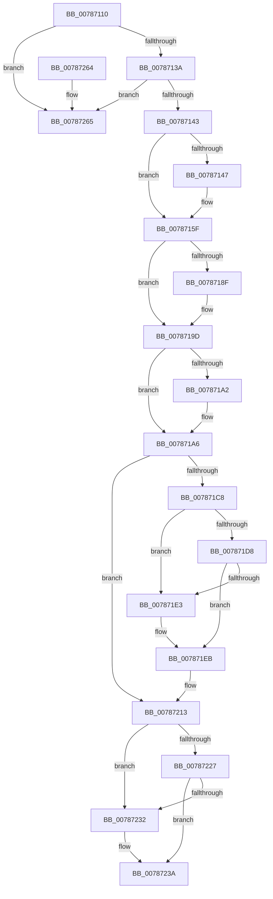

# PsRegisterAltSystemCallHandler

- RVA: `0x00787110`–`0x0078727F` (길이 `367` bytes)
- VA: `0x0000000140787110`
- 실행 섹션: `PAGE`
- PDB 이름 있음: `예`; PDB Function 태그: `아니요`
- unwind 정보 RVA: `0x000AE614`
- 디코드: `96`개 명령, `367/367` bytes 표시
- 미해석 바이트: `0` (있으면 어셈블리에 `.byte`로 보존)

> 이 문서는 커널 이미지의 기계어와 PDB 기호를 분석해 생성했습니다. 4번과 5번은 함수 원형과 자료형을 바이너리 사용 방식에서 추정한 C 해석이며 원본 소스 복구 결과는 아닙니다.

## 1. Dependencies

- 직접 호출 지점: **11**; 고유 호출 대상: **6**
- 직접 호출자로 확인된 함수: **0**
- RIP 상대 이미지 참조: **2**

### Outgoing calls
- `0x00787159` → [KeBugCheckEx](../../text/4F/KeBugCheckEx_function_004FD660.md) (function, `0x004FD660`)
- `0x0078717F` → [KeAbPreAcquire](../../text/21/KeAbPreAcquire_function_00210230.md) (function, `0x00210230`)
- `0x00787198` → [ExfAcquirePushLockExclusiveEx](../../text/20/ExfAcquirePushLockExclusiveEx_function_0020FC90.md) (function, `0x0020FC90`)
- `0x007871E6` → [ExfReleasePushLock](../../text/26/ExfReleasePushLock_function_002638D0.md) (function, `0x002638D0`)
- `0x007871EE` → [KeAbPostRelease](../../text/2E/KeAbPostRelease_function_002E1600.md) (function, `0x002E1600`)
- `0x007871F3` → [KeLeaveCriticalRegion](../../text/25/KeLeaveCriticalRegion_function_0025D8B0.md) (function, `0x0025D8B0`)
- `0x0078720D` → [KeBugCheckEx](../../text/4F/KeBugCheckEx_function_004FD660.md) (function, `0x004FD660`)
- `0x00787235` → [ExfReleasePushLock](../../text/26/ExfReleasePushLock_function_002638D0.md) (function, `0x002638D0`)
- `0x0078723D` → [KeAbPostRelease](../../text/2E/KeAbPostRelease_function_002E1600.md) (function, `0x002E1600`)
- `0x00787242` → [KeLeaveCriticalRegion](../../text/25/KeLeaveCriticalRegion_function_0025D8B0.md) (function, `0x0025D8B0`)
- `0x00787279` → [KeBugCheckEx](../../text/4F/KeBugCheckEx_function_004FD660.md) (function, `0x004FD660`)

### Direct callers
- 이 함수 시작 RVA로 연결되는 직접 call은 확인되지 않았습니다. 간접 호출은 완전히 역산할 수 없습니다.

### Static image references
- `0x00787168` → RVA `0x00F06588` (`.data`; read)
- `0x007871A6` → RVA `0x00FC72C0` (`ALMOSTRO`; read)

## 2. Other-region calls and transfers

- 다른 실행 섹션으로 향하는 call: **11**
  - `0x00787159` → [KeBugCheckEx](../../text/4F/KeBugCheckEx_function_004FD660.md) (`PAGE` → `.text`)
  - `0x0078717F` → [KeAbPreAcquire](../../text/21/KeAbPreAcquire_function_00210230.md) (`PAGE` → `.text`)
  - `0x00787198` → [ExfAcquirePushLockExclusiveEx](../../text/20/ExfAcquirePushLockExclusiveEx_function_0020FC90.md) (`PAGE` → `.text`)
  - `0x007871E6` → [ExfReleasePushLock](../../text/26/ExfReleasePushLock_function_002638D0.md) (`PAGE` → `.text`)
  - `0x007871EE` → [KeAbPostRelease](../../text/2E/KeAbPostRelease_function_002E1600.md) (`PAGE` → `.text`)
  - `0x007871F3` → [KeLeaveCriticalRegion](../../text/25/KeLeaveCriticalRegion_function_0025D8B0.md) (`PAGE` → `.text`)
  - `0x0078720D` → [KeBugCheckEx](../../text/4F/KeBugCheckEx_function_004FD660.md) (`PAGE` → `.text`)
  - `0x00787235` → [ExfReleasePushLock](../../text/26/ExfReleasePushLock_function_002638D0.md) (`PAGE` → `.text`)
  - `0x0078723D` → [KeAbPostRelease](../../text/2E/KeAbPostRelease_function_002E1600.md) (`PAGE` → `.text`)
  - `0x00787242` → [KeLeaveCriticalRegion](../../text/25/KeLeaveCriticalRegion_function_0025D8B0.md) (`PAGE` → `.text`)
  - `0x00787279` → [KeBugCheckEx](../../text/4F/KeBugCheckEx_function_004FD660.md) (`PAGE` → `.text`)
- 별도 외부 분기/꼬리 이동을 확인하지 못했습니다.

## 3. Assembly (complete function range)

```asm
00787110  48 8B C4                        mov rax, rsp
00787113  48 89 58 08                     mov qword ptr [rax + 8], rbx
00787117  48 89 68 10                     mov qword ptr [rax + 0x10], rbp
0078711B  48 89 70 18                     mov qword ptr [rax + 0x18], rsi
0078711F  48 89 78 20                     mov qword ptr [rax + 0x20], rdi
00787123  41 56                           push r14
00787125  48 83 EC 30                     sub rsp, 0x30
00787129  33 ED                           xor ebp, ebp
0078712B  48 63 DA                        movsxd rbx, edx
0078712E  48 8B F1                        mov rsi, rcx
00787131  48 85 C9                        test rcx, rcx
00787134  0F 84 2B 01 00 00               je 0x140787265
0078713A  83 FB 02                        cmp ebx, 2
0078713D  0F 83 22 01 00 00               jae 0x140787265
00787143  85 D2                           test edx, edx
00787145  75 18                           jne 0x14078715f
00787147  45 33 C9                        xor r9d, r9d
0078714A  48 89 68 E8                     mov qword ptr [rax - 0x18], rbp
0078714E  45 33 C0                        xor r8d, r8d
00787151  8D 55 03                        lea edx, [rbp + 3]
00787154  B9 E0 01 00 00                  mov ecx, 0x1e0
00787159  E8 02 65 D7 FF                  call 0x1404fd660
0078715E  CC                              int3
0078715F  65 48 8B 04 25 88 01 00 00      mov rax, qword ptr gs:[0x188]
00787168  4C 8D 35 19 F4 77 00            lea r14, [rip + 0x77f419]
0078716F  45 33 C0                        xor r8d, r8d
00787172  33 D2                           xor edx, edx
00787174  49 8B CE                        mov rcx, r14
00787177  66 FF 88 E4 01 00 00            dec word ptr [rax + 0x1e4]
0078717E  90                              nop
0078717F  E8 AC 90 A8 FF                  call 0x140210230
00787184  F0 49 0F BA 2E 00               lock bts qword ptr [r14], 0
0078718A  48 8B F8                        mov rdi, rax
0078718D  73 0E                           jae 0x14078719d
0078718F  4D 8B C6                        mov r8, r14
00787192  48 8B D0                        mov rdx, rax
00787195  49 8B CE                        mov rcx, r14
00787198  E8 F3 8A A8 FF                  call 0x14020fc90
0078719D  48 85 FF                        test rdi, rdi
007871A0  74 04                           je 0x1407871a6
007871A2  C6 47 0A 01                     mov byte ptr [rdi + 0xa], 1
007871A6  48 8D 3D 13 01 84 00            lea rdi, [rip + 0x840113]
007871AD  0F 0D 0D D4 F3 77 00            prefetchw byte ptr [rip + 0x77f3d4]
007871B4  48 8B 05 CD F3 77 00            mov rax, qword ptr [rip + 0x77f3cd]
007871BB  48 8B C8                        mov rcx, rax
007871BE  48 8D 50 F0                     lea rdx, [rax - 0x10]
007871C2  48 39 2C DF                     cmp qword ptr [rdi + rbx*8], rbp
007871C6  74 4B                           je 0x140787213
007871C8  48 83 E1 F0                     and rcx, 0xfffffffffffffff0
007871CC  48 83 F9 10                     cmp rcx, 0x10
007871D0  48 0F 46 D5                     cmovbe rdx, rbp
007871D4  A8 02                           test al, 2
007871D6  75 0B                           jne 0x1407871e3
007871D8  F0 48 0F B1 15 A7 F3 77 00      lock cmpxchg qword ptr [rip + 0x77f3a7], rdx
007871E1  74 08                           je 0x1407871eb
007871E3  49 8B CE                        mov rcx, r14
007871E6  E8 E5 C6 AD FF                  call 0x1402638d0
007871EB  49 8B CE                        mov rcx, r14
007871EE  E8 0D A4 B5 FF                  call 0x1402e1600
007871F3  E8 B8 66 AD FF                  call 0x14025d8b0
007871F8  4C 8B 04 DF                     mov r8, qword ptr [rdi + rbx*8]
007871FC  45 33 C9                        xor r9d, r9d
007871FF  B9 E0 01 00 00                  mov ecx, 0x1e0
00787204  48 89 6C 24 20                  mov qword ptr [rsp + 0x20], rbp
00787209  41 8D 51 01                     lea edx, [r9 + 1]
0078720D  E8 4E 64 D7 FF                  call 0x1404fd660
00787212  CC                              int3
00787213  48 83 E1 F0                     and rcx, 0xfffffffffffffff0
00787217  48 89 34 DF                     mov qword ptr [rdi + rbx*8], rsi
0078721B  48 83 F9 10                     cmp rcx, 0x10
0078721F  48 0F 46 D5                     cmovbe rdx, rbp
00787223  A8 02                           test al, 2
00787225  75 0B                           jne 0x140787232
00787227  F0 48 0F B1 15 58 F3 77 00      lock cmpxchg qword ptr [rip + 0x77f358], rdx
00787230  74 08                           je 0x14078723a
00787232  49 8B CE                        mov rcx, r14
00787235  E8 96 C6 AD FF                  call 0x1402638d0
0078723A  49 8B CE                        mov rcx, r14
0078723D  E8 BE A3 B5 FF                  call 0x1402e1600
00787242  E8 69 66 AD FF                  call 0x14025d8b0
00787247  48 8B 5C 24 40                  mov rbx, qword ptr [rsp + 0x40]
0078724C  33 C0                           xor eax, eax
0078724E  48 8B 6C 24 48                  mov rbp, qword ptr [rsp + 0x48]
00787253  48 8B 74 24 50                  mov rsi, qword ptr [rsp + 0x50]
00787258  48 8B 7C 24 58                  mov rdi, qword ptr [rsp + 0x58]
0078725D  48 83 C4 30                     add rsp, 0x30
00787261  41 5E                           pop r14
00787263  C3                              ret
00787264  CC                              int3
00787265  45 33 C9                        xor r9d, r9d
00787268  48 89 6C 24 20                  mov qword ptr [rsp + 0x20], rbp
0078726D  45 33 C0                        xor r8d, r8d
00787270  B9 E0 01 00 00                  mov ecx, 0x1e0
00787275  41 8D 51 02                     lea edx, [r9 + 2]
00787279  E8 E2 63 D7 FF                  call 0x1404fd660
0078727E  CC                              int3
```

## 4. C-style interpretation (structured pseudocode)

```c
__int64 __fastcall PsRegisterAltSystemCallHandler(__int64 a1, int a2, int a3, int a4)
{
    __int64 result;
    __int64 v_rbp;
    __int64 v_rsp;
    unsigned __int64 v_stack_m18;
    unsigned __int64 v_stack_p10;
    unsigned __int64 v_stack_p18;
    unsigned __int64 v_stack_p20;
    unsigned __int64 v_stack_p8;

    *(unsigned __int64 *)(v_rsp + 8) = v_rbx;
    *(unsigned __int64 *)(v_rsp + 16) = v_rbp;
    *(unsigned __int64 *)(v_rsp + 24) = v_rsi;
    *(unsigned __int64 *)(v_rsp + 32) = v_rdi;
    v_rsp = (v_rsp) - (48);
    v_rbp = 0;
    if (a1 == 0) goto loc_00787265;
    if (((unsigned int)((int)(a2))) >= 2) goto loc_00787265;
    result = v_rsp;
    if (a2 == 0) {
        a4 = 0;
        *(unsigned __int64 *)(v_rsp - 24) = 0;
        a3 = 0;
        a2 = v_rbp + 3;
        a1 = 480;
        result = KeBugCheckEx(a1, a2, a3, a4);
    }
    a3 = 0;
    a2 = 0;
    result = KeAbPreAcquire(v_rip + 7861273, a2, a3, a4);
    if (!(condition_is_above_or_equal)) {
        a3 = v_rip + 7861273;
        a2 = result;
        a1 = v_rip + 7861273;
        result = ExfAcquirePushLockExclusiveEx(a1, a2, a3, a4);
    }
    if (result != 0) {
        *(unsigned __int8 *)(result + 10) = 1;
    }
    if ((*(unsigned __int64 *)(v_rip + 8651027 + (int)(a2) * 8)) == 0) goto loc_00787213;
    a1 = (*(unsigned __int64 *)(v_rip + 7861197)) & (-16);
    a2 = *(unsigned __int64 *)(v_rip + 7861197) - 16;
    if (a1 <= 16) { a2 = 0; }
    if ((((unsigned __int8)(*(unsigned __int64 *)(v_rip + 7861197))) & (2)) != 0) goto loc_007871E3;
    result = *(unsigned __int64 *)(v_rip + 7861197);
    if ((((unsigned __int8)(*(unsigned __int64 *)(v_rip + 7861197))) & (2)) != 0) {
        a1 = v_rip + 7861273;
        result = ExfReleasePushLock(a1, a2, a3, a4);
    }
    result = KeAbPostRelease(v_rip + 7861273, a2, a3, a4);
    result = KeLeaveCriticalRegion(v_rip + 7861273, a2, a3, a4);
    a4 = 0;
    v_stack_m18 = 0;
    result = KeBugCheckEx(480, a4 + 1, *(unsigned __int64 *)(v_rip + 8651027 + (int)(a2) * 8), a4);
loc_00787213:
    a1 = (480) & (-16);
    *(unsigned __int64 *)(v_rip + 8651027 + (int)(a2) * 8) = a1;
    a2 = a4 + 1;
    if (a1 <= 16) { a2 = 0; }
    if ((((unsigned __int8)(result)) & (2)) != 0) goto loc_00787232;
    if ((((unsigned __int8)(result)) & (2)) != 0) {
        a1 = v_rip + 7861273;
        result = ExfReleasePushLock(a1, a2, *(unsigned __int64 *)(v_rip + 8651027 + (int)(a2) * 8), a4);
    }
    result = KeAbPostRelease(v_rip + 7861273, a2, *(unsigned __int64 *)(v_rip + 8651027 + (int)(a2) * 8), a4);
    result = KeLeaveCriticalRegion(v_rip + 7861273, a2, *(unsigned __int64 *)(v_rip + 8651027 + (int)(a2) * 8), a4);
    result = 0;
    v_rsp = (v_rsp) + (48);
    return result;
loc_00787265:
    a4 = 0;
    v_stack_p20 = v_stack_p10;
    a3 = 0;
    result = KeBugCheckEx(480, a4 + 2, a3, a4);
    return result;
}
```

## 5. (Beta) C Style

```c
int64_t PsRegisterAltSystemCallHandler(int64_t Arg1, int32_t Arg2, int32_t Arg3, int32_t Arg4)
{
    int64_t result;
    int64_t local_rbp;
    int64_t local_rsp;
    uint64_t v_stack_m18;
    uint64_t v_stack_p10;
    uint64_t v_stack_p18;
    uint64_t v_stack_p20;
    uint64_t v_stack_p8;

    *(uint64_t *)(local_rsp + 0x8) = local_rbx;
    *(uint64_t *)(local_rsp + 0x10) = local_rbp;
    *(uint64_t *)(local_rsp + 0x18) = local_rsi;
    *(uint64_t *)(local_rsp + 0x20) = local_rdi;
    local_rsp = (local_rsp) - (48);
    local_rbp = 0;
    if (Arg1 == 0) goto loc_00787265;
    if (((uint32_t)((int32_t)(Arg2))) >= 2) goto loc_00787265;
    result = local_rsp;
    if (Arg2 == 0) {
        Arg4 = 0;
        *(uint64_t *)(local_rsp - 0x18) = 0;
        Arg3 = 0;
        Arg2 = local_rbp + 3;
        Arg1 = 480;
        result = KeBugCheckEx(Arg1, Arg2, Arg3, Arg4);
    }
    Arg3 = 0;
    Arg2 = 0;
    result = KeAbPreAcquire(v_rip + 7861273, Arg2, Arg3, Arg4);
    if (!(condition_is_above_or_equal)) {
        Arg3 = v_rip + 7861273;
        Arg2 = result;
        Arg1 = v_rip + 7861273;
        result = ExfAcquirePushLockExclusiveEx(Arg1, Arg2, Arg3, Arg4);
    }
    if (result != 0) {
        *(uint8_t *)(result + 0xA) = 1;
    }
    if ((*(uint64_t *)(v_rip + 0x840113 + (int32_t)(Arg2) * 8)) == 0) goto loc_00787213;
    Arg1 = (*(uint64_t *)(v_rip + 0x77F3CD)) & (-16);
    Arg2 = *(uint64_t *)(v_rip + 0x77F3CD) - 16;
    if (Arg1 <= 16) { Arg2 = 0; }
    if ((((uint8_t)(*(uint64_t *)(v_rip + 0x77F3CD))) & (2)) != 0) goto loc_007871E3;
    result = *(uint64_t *)(v_rip + 0x77F3CD);
    if ((((uint8_t)(*(uint64_t *)(v_rip + 0x77F3CD))) & (2)) != 0) {
        Arg1 = v_rip + 7861273;
        result = ExfReleasePushLock(Arg1, Arg2, Arg3, Arg4);
    }
    result = KeAbPostRelease(v_rip + 7861273, Arg2, Arg3, Arg4);
    result = KeLeaveCriticalRegion(v_rip + 7861273, Arg2, Arg3, Arg4);
    Arg4 = 0;
    v_stack_m18 = 0;
    result = KeBugCheckEx(480, Arg4 + 1, *(uint64_t *)(v_rip + 0x840113 + (int32_t)(Arg2) * 8), Arg4);
loc_00787213:
    Arg1 = (480) & (-16);
    *(uint64_t *)(v_rip + 0x840113 + (int32_t)(Arg2) * 8) = Arg1;
    Arg2 = Arg4 + 1;
    if (Arg1 <= 16) { Arg2 = 0; }
    if ((((uint8_t)(result)) & (2)) != 0) goto loc_00787232;
    if ((((uint8_t)(result)) & (2)) != 0) {
        Arg1 = v_rip + 7861273;
        result = ExfReleasePushLock(Arg1, Arg2, *(uint64_t *)(v_rip + 0x840113 + (int32_t)(Arg2) * 8), Arg4);
    }
    result = KeAbPostRelease(v_rip + 7861273, Arg2, *(uint64_t *)(v_rip + 0x840113 + (int32_t)(Arg2) * 8), Arg4);
    result = KeLeaveCriticalRegion(v_rip + 7861273, Arg2, *(uint64_t *)(v_rip + 0x840113 + (int32_t)(Arg2) * 8), Arg4);
    result = 0;
    local_rsp = (local_rsp) + (48);
    return result;
loc_00787265:
    Arg4 = 0;
    v_stack_p20 = v_stack_p10;
    Arg3 = 0;
    result = KeBugCheckEx(480, Arg4 + 2, Arg3, Arg4);
    return result;
}
```

## 6. Execution-region graph

[열기: 2D/3D 그래프와 함수 탐색 컨트롤 패널](../../../control-panel.html?section=page&rva=0x00787110&view=graph)

- 2D 그래프는 위에서 아래로 흐르고, 3D 그래프는 빈 공간을 드래그해 회전합니다. Shift+드래그는 이동, 휠은 확대·축소, 함수 노드 선택은 대상 보고서 이동입니다.

### Static fallback


