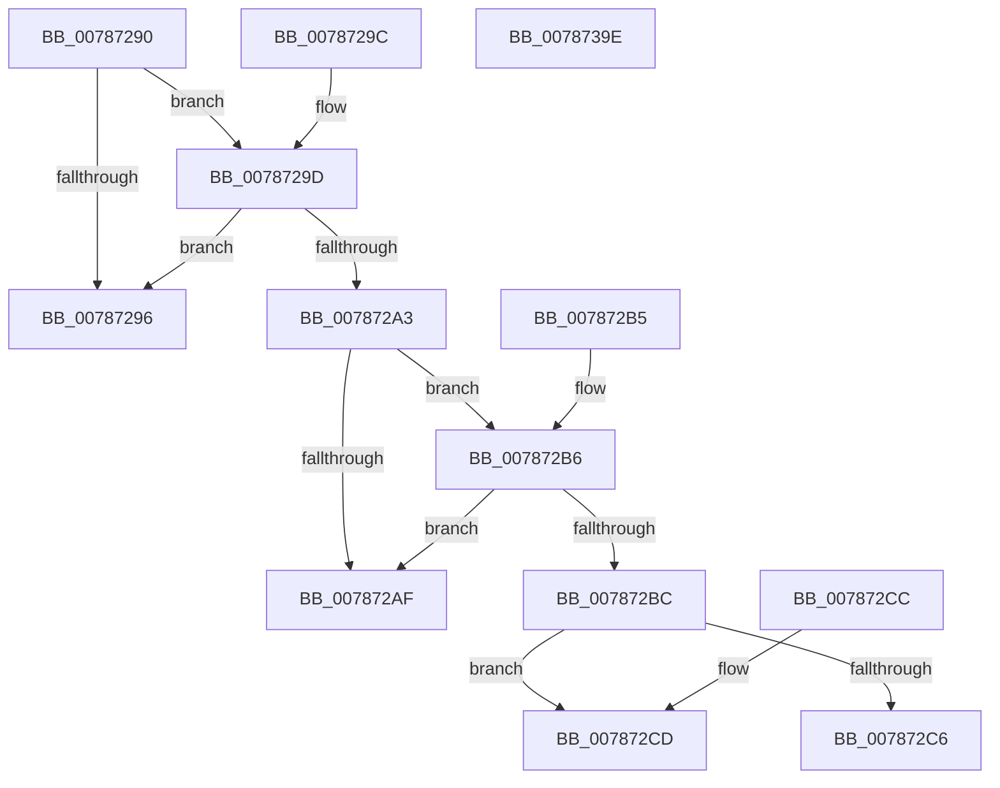

# PsRegisterPicoProvider

- RVA: `0x00787290`–`0x0078739F` (길이 `271` bytes)
- VA: `0x0000000140787290`
- 실행 섹션: `PAGE`
- PDB 이름 있음: `예`; PDB Function 태그: `아니요`
- unwind 정보 RVA: `0x000DB714`
- 디코드: `60`개 명령, `271/271` bytes 표시
- 미해석 바이트: `0` (있으면 어셈블리에 `.byte`로 보존)

> 이 문서는 커널 이미지의 기계어와 PDB 기호를 분석해 생성했습니다. 4번과 5번은 함수 원형과 자료형을 바이너리 사용 방식에서 추정한 C 해석이며 원본 소스 복구 결과는 아닙니다.

## 1. Dependencies

- 직접 호출 지점: **0**; 고유 호출 대상: **0**
- 직접 호출자로 확인된 함수: **0**
- RIP 상대 이미지 참조: **19**

### Outgoing calls
- 직접 디코드된 call 명령이 없습니다.

### Direct callers
- 이 함수 시작 RVA로 연결되는 직접 call은 확인되지 않았습니다. 간접 호출은 완전히 역산할 수 없습니다.

### Static image references
- `0x007872BE` → RVA `0x00F06580` (`.data`; read)
- `0x007872D0` → RVA `0x00F06520` (`.data`; read)
- `0x007872DB` → RVA `0x00F06530` (`.data`; read)
- `0x007872E6` → RVA `0x00F06540` (`.data`; read)
- `0x007872F1` → RVA `0x00F06550` (`.data`; read)
- `0x00787301` → RVA `0x00F06560` (`.data`; read)
- `0x0078730D` → RVA `0x007873B0` (`PspCreatePicoProcess`; read)
- `0x00787314` → RVA `0x00F06570` (`.data`; write)
- `0x0078731C` → RVA `0x00F06578` (`.data`; read)
- `0x00787328` → RVA `0x009F0D70` (`PspCreatePicoThread`; read)
- `0x00787333` → RVA `0x00AC0940` (`PspGetPicoProcessContext`; read)
- `0x0078733E` → RVA `0x00ABA470` (`PspGetPicoThreadContext`; read)
- `0x00787349` → RVA `0x00787620` (`PspPicoGetContextThreadEx`; read)
- `0x00787354` → RVA `0x00787650` (`PspPicoSetContextThreadEx`; read)
- `0x0078735F` → RVA `0x00905E80` (`PspTerminateThreadByPointer`; read)
- `0x0078736A` → RVA `0x00A4A920` (`PsResumeThread`; read)
- `0x00787375` → RVA `0x004DB050` (`PspSetPicoThreadDescriptorBase`; read)
- `0x00787380` → RVA `0x00A110D0` (`PsSuspendThread`; read)
- `0x0078738B` → RVA `0x00787710` (`PspTerminatePicoProcess`; read)

## 2. Other-region calls and transfers

- 다른 실행 섹션으로 향하는 call: **0**
- 별도 외부 분기/꼬리 이동을 확인하지 못했습니다.

## 3. Assembly (complete function range)

```asm
00787290  48 83 39 58                     cmp qword ptr [rcx], 0x58
00787294  74 07                           je 0x14078729d
00787296  B8 04 00 00 C0                  mov eax, 0xc0000004
0078729B  C3                              ret
0078729C  CC                              int3
0078729D  48 83 3A 60                     cmp qword ptr [rdx], 0x60
007872A1  75 F3                           jne 0x140787296
007872A3  41 B8 00 00 E0 FF               mov r8d, 0xffe00000
007872A9  44 85 41 48                     test dword ptr [rcx + 0x48], r8d
007872AD  74 07                           je 0x1407872b6
007872AF  B8 0D 00 00 C0                  mov eax, 0xc000000d
007872B4  C3                              ret
007872B5  CC                              int3
007872B6  44 85 41 4C                     test dword ptr [rcx + 0x4c], r8d
007872BA  75 F3                           jne 0x1407872af
007872BC  33 C0                           xor eax, eax
007872BE  38 05 BC F2 77 00               cmp byte ptr [rip + 0x77f2bc], al
007872C4  74 07                           je 0x1407872cd
007872C6  B8 89 01 00 C0                  mov eax, 0xc0000189
007872CB  C3                              ret
007872CC  CC                              int3
007872CD  0F 10 01                        movups xmm0, xmmword ptr [rcx]
007872D0  0F 11 05 49 F2 77 00            movups xmmword ptr [rip + 0x77f249], xmm0
007872D7  0F 10 49 10                     movups xmm1, xmmword ptr [rcx + 0x10]
007872DB  0F 11 0D 4E F2 77 00            movups xmmword ptr [rip + 0x77f24e], xmm1
007872E2  0F 10 41 20                     movups xmm0, xmmword ptr [rcx + 0x20]
007872E6  0F 11 05 53 F2 77 00            movups xmmword ptr [rip + 0x77f253], xmm0
007872ED  0F 10 51 30                     movups xmm2, xmmword ptr [rcx + 0x30]
007872F1  0F 11 15 58 F2 77 00            movups xmmword ptr [rip + 0x77f258], xmm2
007872F8  0F 10 41 40                     movups xmm0, xmmword ptr [rcx + 0x40]
007872FC  66 0F 73 DA 08                  psrldq xmm2, 8
00787301  0F 11 05 58 F2 77 00            movups xmmword ptr [rip + 0x77f258], xmm0
00787308  F2 0F 10 49 50                  movsd xmm1, qword ptr [rcx + 0x50]
0078730D  48 8D 0D 9C 00 00 00            lea rcx, [rip + 0x9c]
00787314  F2 0F 11 0D 54 F2 77 00         movsd qword ptr [rip + 0x77f254], xmm1
0078731C  66 0F D6 15 54 F2 77 00         movq qword ptr [rip + 0x77f254], xmm2
00787324  48 89 4A 08                     mov qword ptr [rdx + 8], rcx
00787328  48 8D 0D 41 9A 26 00            lea rcx, [rip + 0x269a41]
0078732F  48 89 4A 10                     mov qword ptr [rdx + 0x10], rcx
00787333  48 8D 0D 06 96 33 00            lea rcx, [rip + 0x339606]
0078733A  48 89 4A 18                     mov qword ptr [rdx + 0x18], rcx
0078733E  48 8D 0D 2B 31 33 00            lea rcx, [rip + 0x33312b]
00787345  48 89 4A 20                     mov qword ptr [rdx + 0x20], rcx
00787349  48 8D 0D D0 02 00 00            lea rcx, [rip + 0x2d0]
00787350  48 89 4A 28                     mov qword ptr [rdx + 0x28], rcx
00787354  48 8D 0D F5 02 00 00            lea rcx, [rip + 0x2f5]
0078735B  48 89 4A 30                     mov qword ptr [rdx + 0x30], rcx
0078735F  48 8D 0D 1A EB 17 00            lea rcx, [rip + 0x17eb1a]
00787366  48 89 4A 38                     mov qword ptr [rdx + 0x38], rcx
0078736A  48 8D 0D AF 35 2C 00            lea rcx, [rip + 0x2c35af]
00787371  48 89 4A 40                     mov qword ptr [rdx + 0x40], rcx
00787375  48 8D 0D D4 3C D5 FF            lea rcx, [rip - 0x2ac32c]
0078737C  48 89 4A 48                     mov qword ptr [rdx + 0x48], rcx
00787380  48 8D 0D 49 9D 28 00            lea rcx, [rip + 0x289d49]
00787387  48 89 4A 50                     mov qword ptr [rdx + 0x50], rcx
0078738B  48 8D 0D 7E 03 00 00            lea rcx, [rip + 0x37e]
00787392  48 89 4A 58                     mov qword ptr [rdx + 0x58], rcx
00787396  48 C7 02 60 00 00 00            mov qword ptr [rdx], 0x60
0078739D  C3                              ret
0078739E  CC                              int3
```

## 4. C-style interpretation (structured pseudocode)

```c
__int64 __fastcall PsRegisterPicoProvider(__int64 a1, __int64 a2)
{
    __int64 result;

    if ((*(unsigned __int64 *)(a1)) == 88) goto loc_0078729D;
loc_00787296:
    return (unsigned int)(0xC0000004ULL);
loc_0078729D:
    if ((*(unsigned __int64 *)(a2)) != 96) goto loc_00787296;
    if (((*(unsigned int *)(a1 + 72)) & ((unsigned int)((unsigned int)(0xFFE00000ULL)))) == 0) goto loc_007872B6;
loc_007872AF:
    return (unsigned int)(0xC000000DULL);
loc_007872B6:
    if (((*(unsigned int *)(a1 + 76)) & ((unsigned int)((unsigned int)(0xFFE00000ULL)))) != 0) goto loc_007872AF;
    result = 0;
    if ((*(unsigned __int8 *)(v_rip + 7860924)) == 0) goto loc_007872CD;
    return (unsigned int)(0xC0000189ULL);
loc_007872CD:
    *(unsigned __int64 *)(v_rip + 7860809) = v_xmm0;
    *(unsigned __int64 *)(v_rip + 7860814) = v_xmm1;
    *(unsigned __int64 *)(v_rip + 7860819) = v_xmm0;
    *(unsigned __int64 *)(v_rip + 7860824) = v_xmm2;
    *(unsigned __int64 *)(v_rip + 7860824) = v_xmm0;
    *(unsigned __int64 *)(v_rip + 7860820) = v_xmm1;
    *(unsigned __int64 *)(v_rip + 7860820) = v_xmm2;
    *(unsigned __int64 *)(a2 + 8) = v_rip + 156;
    *(unsigned __int64 *)(a2 + 16) = v_rip + 2529857;
    *(unsigned __int64 *)(a2 + 24) = v_rip + 3380742;
    *(unsigned __int64 *)(a2 + 32) = v_rip + 3354923;
    *(unsigned __int64 *)(a2 + 40) = v_rip + 720;
    *(unsigned __int64 *)(a2 + 48) = v_rip + 757;
    *(unsigned __int64 *)(a2 + 56) = v_rip + 1567514;
    *(unsigned __int64 *)(a2 + 64) = v_rip + 2897327;
    *(unsigned __int64 *)(a2 + 72) = v_rip - 2802476;
    *(unsigned __int64 *)(a2 + 80) = v_rip + 2661705;
    *(unsigned __int64 *)(a2 + 88) = v_rip + 894;
    *(unsigned __int64 *)(a2) = 96;
    return (unsigned int)(0xC0000189ULL);
}
```

## 5. (Beta) C Style

```c
int64_t PsRegisterPicoProvider(void *Arg1, void *Arg2)
{
    uint8_t *arg1 = (uint8_t *)Arg1;
    uint8_t *arg2 = (uint8_t *)Arg2;

    int64_t result;

    if ((*(uint64_t *)(arg1)) == 88) goto loc_0078729D;
loc_00787296:
    return (uint32_t)(0xC0000004ULL);
loc_0078729D:
    if ((*(uint64_t *)(arg2)) != 96) goto loc_00787296;
    if (((*(uint32_t *)(arg1 + 0x48)) & ((uint32_t)((uint32_t)(0xFFE00000ULL)))) == 0) goto loc_007872B6;
loc_007872AF:
    return (uint32_t)(0xC000000DULL);
loc_007872B6:
    if (((*(uint32_t *)(arg1 + 0x4C)) & ((uint32_t)((uint32_t)(0xFFE00000ULL)))) != 0) goto loc_007872AF;
    result = 0;
    if ((*(uint8_t *)(v_rip + 0x77F2BC)) == 0) goto loc_007872CD;
    return (uint32_t)(0xC0000189ULL);
loc_007872CD:
    *(uint64_t *)(v_rip + 0x77F249) = v_xmm0;
    *(uint64_t *)(v_rip + 0x77F24E) = v_xmm1;
    *(uint64_t *)(v_rip + 0x77F253) = v_xmm0;
    *(uint64_t *)(v_rip + 0x77F258) = v_xmm2;
    *(uint64_t *)(v_rip + 0x77F258) = v_xmm0;
    *(uint64_t *)(v_rip + 0x77F254) = v_xmm1;
    *(uint64_t *)(v_rip + 0x77F254) = v_xmm2;
    *(uint64_t *)(arg2 + 0x8) = v_rip + 156;
    *(uint64_t *)(arg2 + 0x10) = v_rip + 2529857;
    *(uint64_t *)(arg2 + 0x18) = v_rip + 3380742;
    *(uint64_t *)(arg2 + 0x20) = v_rip + 3354923;
    *(uint64_t *)(arg2 + 0x28) = v_rip + 720;
    *(uint64_t *)(arg2 + 0x30) = v_rip + 757;
    *(uint64_t *)(arg2 + 0x38) = v_rip + 1567514;
    *(uint64_t *)(arg2 + 0x40) = v_rip + 2897327;
    *(uint64_t *)(arg2 + 0x48) = v_rip - 2802476;
    *(uint64_t *)(arg2 + 0x50) = v_rip + 2661705;
    *(uint64_t *)(arg2 + 0x58) = v_rip + 894;
    *(uint64_t *)(arg2) = 96;
    return (uint32_t)(0xC0000189ULL);
}
```

### 관측된 메모리 오프셋

구조체 형식이 확인되지 않은 접근은 인자 기준의 오프셋으로만 기록했습니다.

| 기준 인자 | 오프셋 표현 | 폭 (bit) | 접근 |
|---|---:|---:|---|
| `Arg1` | `+ 0x0` | `64` | `R` |
| `Arg1` | `+ 0x0` | `128` | `R` |
| `Arg1` | `+ 0x10` | `128` | `R` |
| `Arg1` | `+ 0x20` | `128` | `R` |
| `Arg1` | `+ 0x30` | `128` | `R` |
| `Arg1` | `+ 0x40` | `128` | `R` |
| `Arg1` | `+ 0x48` | `32` | `R` |
| `Arg1` | `+ 0x4C` | `32` | `R` |
| `Arg1` | `+ 0x50` | `64` | `R` |
| `Arg2` | `+ 0x0` | `64` | `R` |
| `Arg2` | `+ 0x0` | `64` | `W` |
| `Arg2` | `+ 0x8` | `64` | `W` |
| `Arg2` | `+ 0x10` | `64` | `W` |
| `Arg2` | `+ 0x18` | `64` | `W` |
| `Arg2` | `+ 0x20` | `64` | `W` |
| `Arg2` | `+ 0x28` | `64` | `W` |
| `Arg2` | `+ 0x30` | `64` | `W` |
| `Arg2` | `+ 0x38` | `64` | `W` |
| `Arg2` | `+ 0x40` | `64` | `W` |
| `Arg2` | `+ 0x48` | `64` | `W` |
| `Arg2` | `+ 0x50` | `64` | `W` |
| `Arg2` | `+ 0x58` | `64` | `W` |

## 6. Execution-region graph

[열기: 2D/3D 그래프와 함수 탐색 컨트롤 패널](../../../control-panel.html?section=page&rva=0x00787290&view=graph)

- 2D 그래프는 위에서 아래로 흐르고, 3D 그래프는 빈 공간을 드래그해 회전합니다. Shift+드래그는 이동, 휠은 확대·축소, 함수 노드 선택은 대상 보고서 이동입니다.

### Static fallback


