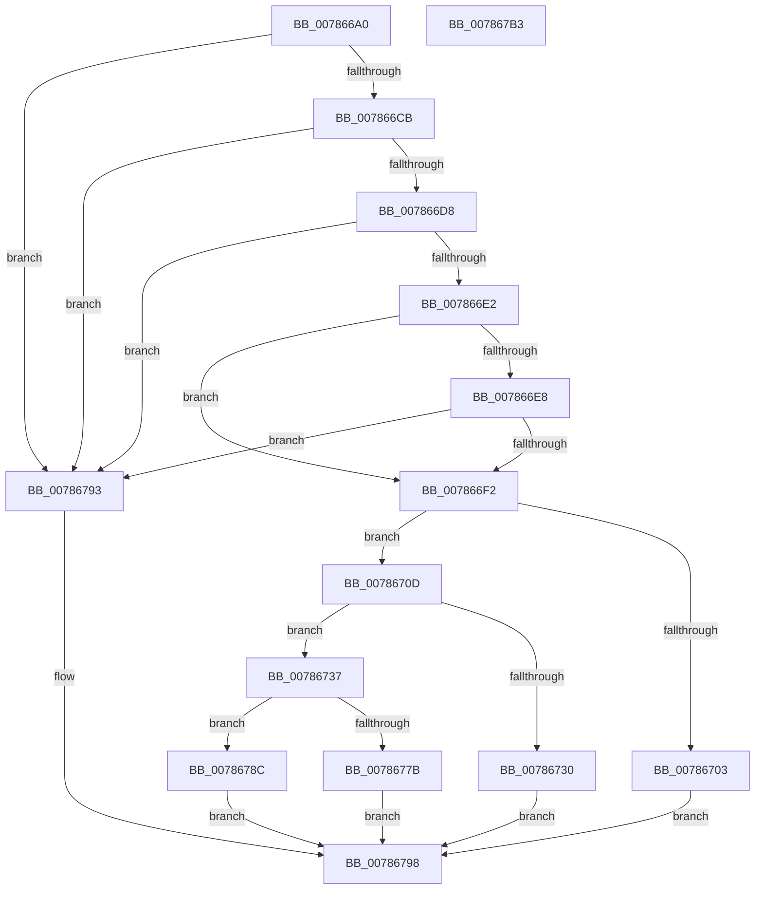

# PsRegisterSiloMonitor

- RVA: `0x007866A0`–`0x007867B4` (길이 `276` bytes)
- VA: `0x00000001407866A0`
- 실행 섹션: `PAGE`
- PDB 이름 있음: `예`; PDB Function 태그: `아니요`
- unwind 정보 RVA: `0x0005E6B4`
- 디코드: `75`개 명령, `276/276` bytes 표시
- 미해석 바이트: `0` (있으면 어셈블리에 `.byte`로 보존)

> 이 문서는 커널 이미지의 기계어와 PDB 기호를 분석해 생성했습니다. 4번과 5번은 함수 원형과 자료형을 바이너리 사용 방식에서 추정한 C 해석이며 원본 소스 복구 결과는 아닙니다.

## 1. Dependencies

- 직접 호출 지점: **6**; 고유 호출 대상: **6**
- 직접 호출자로 확인된 함수: **0**
- RIP 상대 이미지 참조: **0**

### Outgoing calls
- `0x007866F2` → [PsGetCurrentSilo](../../text/40/PsGetCurrentSilo_function_004094A0.md) (function, `0x004094A0`)
- `0x007866FA` → [PsIsHostSilo](../../text/44/PsIsHostSilo_function_00443B30.md) (function, `0x00443B30`)
- `0x00786723` → [ExAllocatePool2](../../poolcode/B8/ExAllocatePool2_function_00B820F0.md) (function, `0x00B820F0`)
- `0x00786767` → [RtlCopyUnicodeString](../../text/3F/RtlCopyUnicodeString_function_003FEF30.md) (function, `0x003FEF30`)
- `0x00786770` → [PspStorageAllocSlot](PspStorageAllocSlot_function_00789B68.md) (function, `0x00789B68`)
- `0x00786783` → [ExFreePoolWithTag](../../poolcode/B8/ExFreePoolWithTag_function_00B82870.md) (function, `0x00B82870`)

### Direct callers
- 이 함수 시작 RVA로 연결되는 직접 call은 확인되지 않았습니다. 간접 호출은 완전히 역산할 수 없습니다.

### Static image references
- 디코드된 RIP-relative 메모리 참조가 없습니다.

## 2. Other-region calls and transfers

- 다른 실행 섹션으로 향하는 call: **5**
  - `0x007866F2` → [PsGetCurrentSilo](../../text/40/PsGetCurrentSilo_function_004094A0.md) (`PAGE` → `.text`)
  - `0x007866FA` → [PsIsHostSilo](../../text/44/PsIsHostSilo_function_00443B30.md) (`PAGE` → `.text`)
  - `0x00786723` → [ExAllocatePool2](../../poolcode/B8/ExAllocatePool2_function_00B820F0.md) (`PAGE` → `POOLCODE`)
  - `0x00786767` → [RtlCopyUnicodeString](../../text/3F/RtlCopyUnicodeString_function_003FEF30.md) (`PAGE` → `.text`)
  - `0x00786783` → [ExFreePoolWithTag](../../poolcode/B8/ExFreePoolWithTag_function_00B82870.md) (`PAGE` → `POOLCODE`)
- 별도 외부 분기/꼬리 이동을 확인하지 못했습니다.

## 3. Assembly (complete function range)

```asm
007866A0  48 8B C4                        mov rax, rsp
007866A3  48 89 58 08                     mov qword ptr [rax + 8], rbx
007866A7  48 89 68 10                     mov qword ptr [rax + 0x10], rbp
007866AB  48 89 70 18                     mov qword ptr [rax + 0x18], rsi
007866AF  48 89 78 20                     mov qword ptr [rax + 0x20], rdi
007866B3  41 56                           push r14
007866B5  48 83 EC 20                     sub rsp, 0x20
007866B9  45 33 F6                        xor r14d, r14d
007866BC  48 8B F2                        mov rsi, rdx
007866BF  48 8B D9                        mov rbx, rcx
007866C2  44 38 31                        cmp byte ptr [rcx], r14b
007866C5  0F 84 C8 00 00 00               je 0x140786793
007866CB  48 8B 41 08                     mov rax, qword ptr [rcx + 8]
007866CF  48 85 C0                        test rax, rax
007866D2  0F 84 BB 00 00 00               je 0x140786793
007866D8  66 44 39 30                     cmp word ptr [rax], r14w
007866DC  0F 84 B1 00 00 00               je 0x140786793
007866E2  4C 39 71 10                     cmp qword ptr [rcx + 0x10], r14
007866E6  75 0A                           jne 0x1407866f2
007866E8  4C 39 71 18                     cmp qword ptr [rcx + 0x18], r14
007866EC  0F 84 A1 00 00 00               je 0x140786793
007866F2  E8 A9 2D C8 FF                  call 0x1404094a0
007866F7  48 8B C8                        mov rcx, rax
007866FA  E8 31 D4 CB FF                  call 0x140443b30
007866FF  84 C0                           test al, al
00786701  75 0A                           jne 0x14078670d
00786703  B8 61 00 00 C0                  mov eax, 0xc0000061
00786708  E9 8B 00 00 00                  jmp 0x140786798
0078670D  48 8B 43 08                     mov rax, qword ptr [rbx + 8]
00786711  B9 00 01 00 00                  mov ecx, 0x100
00786716  41 B8 53 69 6C 4D               mov r8d, 0x4d6c6953
0078671C  0F B7 28                        movzx ebp, word ptr [rax]
0078671F  48 8D 55 38                     lea rdx, [rbp + 0x38]
00786723  E8 C8 B9 3F 00                  call 0x140b820f0
00786728  48 8B F8                        mov rdi, rax
0078672B  48 85 C0                        test rax, rax
0078672E  75 07                           jne 0x140786737
00786730  B8 9A 00 00 C0                  mov eax, 0xc000009a
00786735  EB 61                           jmp 0x140786798
00786737  8A 43 01                        mov al, byte ptr [rbx + 1]
0078673A  48 8D 4F 28                     lea rcx, [rdi + 0x28]
0078673E  88 47 10                        mov byte ptr [rdi + 0x10], al
00786741  8A 43 02                        mov al, byte ptr [rbx + 2]
00786744  88 47 11                        mov byte ptr [rdi + 0x11], al
00786747  48 8B 43 10                     mov rax, qword ptr [rbx + 0x10]
0078674B  48 89 47 18                     mov qword ptr [rdi + 0x18], rax
0078674F  48 8B 43 18                     mov rax, qword ptr [rbx + 0x18]
00786753  48 89 47 20                     mov qword ptr [rdi + 0x20], rax
00786757  48 8D 47 38                     lea rax, [rdi + 0x38]
0078675B  48 89 47 30                     mov qword ptr [rdi + 0x30], rax
0078675F  66 89 6F 2A                     mov word ptr [rdi + 0x2a], bp
00786763  48 8B 53 08                     mov rdx, qword ptr [rbx + 8]
00786767  E8 C4 87 C7 FF                  call 0x1403fef30
0078676C  48 8D 4F 14                     lea rcx, [rdi + 0x14]
00786770  E8 F3 33 00 00                  call 0x140789b68
00786775  8B D8                           mov ebx, eax
00786777  85 C0                           test eax, eax
00786779  79 11                           jns 0x14078678c
0078677B  BA 53 69 6C 4D                  mov edx, 0x4d6c6953
00786780  48 8B CF                        mov rcx, rdi
00786783  E8 E8 C0 3F 00                  call 0x140b82870
00786788  8B C3                           mov eax, ebx
0078678A  EB 0C                           jmp 0x140786798
0078678C  48 89 3E                        mov qword ptr [rsi], rdi
0078678F  33 C0                           xor eax, eax
00786791  EB 05                           jmp 0x140786798
00786793  B8 0D 00 00 C0                  mov eax, 0xc000000d
00786798  48 8B 5C 24 30                  mov rbx, qword ptr [rsp + 0x30]
0078679D  48 8B 6C 24 38                  mov rbp, qword ptr [rsp + 0x38]
007867A2  48 8B 74 24 40                  mov rsi, qword ptr [rsp + 0x40]
007867A7  48 8B 7C 24 48                  mov rdi, qword ptr [rsp + 0x48]
007867AC  48 83 C4 20                     add rsp, 0x20
007867B0  41 5E                           pop r14
007867B2  C3                              ret
007867B3  CC                              int3
```

## 4. C-style interpretation (structured pseudocode)

```c
__int64 __fastcall PsRegisterSiloMonitor(__int64 a1, __int64 a2)
{
    __int64 result;
    __int64 v_r14;
    __int64 v_rsp;
    unsigned __int64 v_stack_p10;
    unsigned __int64 v_stack_p18;
    unsigned __int64 v_stack_p20;
    unsigned __int64 v_stack_p8;

    *(unsigned __int64 *)(v_rsp + 8) = v_rbx;
    *(unsigned __int64 *)(v_rsp + 16) = v_rbp;
    *(unsigned __int64 *)(v_rsp + 24) = v_rsi;
    *(unsigned __int64 *)(v_rsp + 32) = v_rdi;
    v_rsp = (v_rsp) - (32);
    v_r14 = 0;
    if ((*(unsigned __int8 *)(a1)) == 0) goto loc_00786793;
    if (*(unsigned __int64 *)(a1 + 8) == 0) goto loc_00786793;
    if ((*(unsigned __int16 *)(*(unsigned __int64 *)(a1 + 8))) == 0) goto loc_00786793;
    if ((*(unsigned __int64 *)(a1 + 16)) != 0) goto loc_007866F2;
    if ((*(unsigned __int64 *)(a1 + 24)) == 0) goto loc_00786793;
loc_007866F2:
    result = PsGetCurrentSilo(a1, a2, a3, a4);
    result = PsIsHostSilo(result, a2, a3, a4);
    if ((unsigned __int8)(result) != 0) goto loc_0078670D;
    goto loc_00786798;
loc_0078670D:
    result = ExAllocatePool2(256, *(unsigned __int16 *)(*(unsigned __int64 *)(a1 + 8)) + 56, (unsigned int)(0x4D6C6953ULL), a4);
    if (result != 0) goto loc_00786737;
    goto loc_00786798;
loc_00786737:
    *(unsigned __int8 *)(result + 16) = (unsigned __int8)(*(unsigned __int8 *)(a1 + 1));
    *(unsigned __int8 *)(result + 17) = (unsigned __int8)(*(unsigned __int8 *)(a1 + 2));
    *(unsigned __int64 *)(result + 24) = *(unsigned __int64 *)(a1 + 16);
    *(unsigned __int64 *)(result + 32) = *(unsigned __int64 *)(a1 + 24);
    *(unsigned __int64 *)(result + 48) = result + 56;
    *(unsigned __int16 *)(result + 42) = (unsigned __int16)(*(unsigned __int16 *)(*(unsigned __int64 *)(a1 + 8)));
    result = RtlCopyUnicodeString(result + 40, *(unsigned __int64 *)(a1 + 8), (unsigned int)(0x4D6C6953ULL), a4);
    result = PspStorageAllocSlot(result + 20, *(unsigned __int64 *)(a1 + 8), (unsigned int)(0x4D6C6953ULL), a4);
    if (!sign_flag) goto loc_0078678C;
    result = ExFreePoolWithTag(result, (unsigned int)(0x4D6C6953ULL), (unsigned int)(0x4D6C6953ULL), a4);
    goto loc_00786798;
loc_0078678C:
    *(unsigned __int64 *)(a2) = result;
    result = 0;
    goto loc_00786798;
loc_00786793:
loc_00786798:
    v_rsp = (v_rsp) + (32);
    return (unsigned int)(0xC000000DULL);
}
```

## 5. (Beta) C Style

```c
int64_t PsRegisterSiloMonitor(void *Arg1, void *Arg2)
{
    uint8_t *arg1 = (uint8_t *)Arg1;
    uint8_t *arg2 = (uint8_t *)Arg2;

    int64_t result;
    int64_t local_r14;
    int64_t local_rsp;
    uint64_t v_stack_p10;
    uint64_t v_stack_p18;
    uint64_t v_stack_p20;
    uint64_t v_stack_p8;

    *(uint64_t *)(local_rsp + 0x8) = local_rbx;
    *(uint64_t *)(local_rsp + 0x10) = local_rbp;
    *(uint64_t *)(local_rsp + 0x18) = local_rsi;
    *(uint64_t *)(local_rsp + 0x20) = local_rdi;
    local_rsp = (local_rsp) - (32);
    local_r14 = 0;
    if ((*(uint8_t *)(arg1)) == 0) goto loc_00786793;
    if (*(uint64_t *)(arg1 + 0x8) == 0) goto loc_00786793;
    if ((*(uint16_t *)(*(uint64_t *)(arg1 + 0x8))) == 0) goto loc_00786793;
    if ((*(uint64_t *)(arg1 + 0x10)) != 0) goto loc_007866F2;
    if ((*(uint64_t *)(arg1 + 0x18)) == 0) goto loc_00786793;
loc_007866F2:
    result = PsGetCurrentSilo(Arg1, Arg2, a3, a4);
    result = PsIsHostSilo(result, Arg2, a3, a4);
    if ((uint8_t)(result) != 0) goto loc_0078670D;
    goto loc_00786798;
loc_0078670D:
    result = ExAllocatePool2(256, *(uint16_t *)(*(uint64_t *)(arg1 + 0x8)) + 56, (uint32_t)(0x4D6C6953ULL), a4);
    if (result != 0) goto loc_00786737;
    goto loc_00786798;
loc_00786737:
    *(uint8_t *)(result + 0x10) = (uint8_t)(*(uint8_t *)(arg1 + 0x1));
    *(uint8_t *)(result + 0x11) = (uint8_t)(*(uint8_t *)(arg1 + 0x2));
    *(uint64_t *)(result + 0x18) = *(uint64_t *)(arg1 + 0x10);
    *(uint64_t *)(result + 0x20) = *(uint64_t *)(arg1 + 0x18);
    *(uint64_t *)(result + 0x30) = result + 56;
    *(uint16_t *)(result + 0x2A) = (uint16_t)(*(uint16_t *)(*(uint64_t *)(arg1 + 0x8)));
    result = RtlCopyUnicodeString(result + 40, *(uint64_t *)(arg1 + 0x8), (uint32_t)(0x4D6C6953ULL), a4);
    result = PspStorageAllocSlot(result + 20, *(uint64_t *)(arg1 + 0x8), (uint32_t)(0x4D6C6953ULL), a4);
    if (!sign_flag) goto loc_0078678C;
    result = ExFreePoolWithTag(result, (uint32_t)(0x4D6C6953ULL), (uint32_t)(0x4D6C6953ULL), a4);
    goto loc_00786798;
loc_0078678C:
    *(uint64_t *)(arg2) = result;
    result = 0;
    goto loc_00786798;
loc_00786793:
loc_00786798:
    local_rsp = (local_rsp) + (32);
    return (uint32_t)(0xC000000DULL);
}
```

### 관측된 메모리 오프셋

구조체 형식이 확인되지 않은 접근은 인자 기준의 오프셋으로만 기록했습니다.

| 기준 인자 | 오프셋 표현 | 폭 (bit) | 접근 |
|---|---:|---:|---|
| `Arg1` | `+ 0x0` | `8` | `R` |
| `Arg1` | `+ 0x1` | `8` | `R` |
| `Arg1` | `+ 0x2` | `8` | `R` |
| `Arg1` | `+ 0x8` | `64` | `R` |
| `Arg1` | `+ 0x10` | `64` | `R` |
| `Arg1` | `+ 0x18` | `64` | `R` |
| `Arg2` | `+ 0x0` | `64` | `W` |

## 6. Execution-region graph

[열기: 2D/3D 그래프와 함수 탐색 컨트롤 패널](../../../control-panel.html?section=page&rva=0x007866A0&view=graph)

- 2D 그래프는 위에서 아래로 흐르고, 3D 그래프는 빈 공간을 드래그해 회전합니다. Shift+드래그는 이동, 휠은 확대·축소, 함수 노드 선택은 대상 보고서 이동입니다.

### Static fallback


