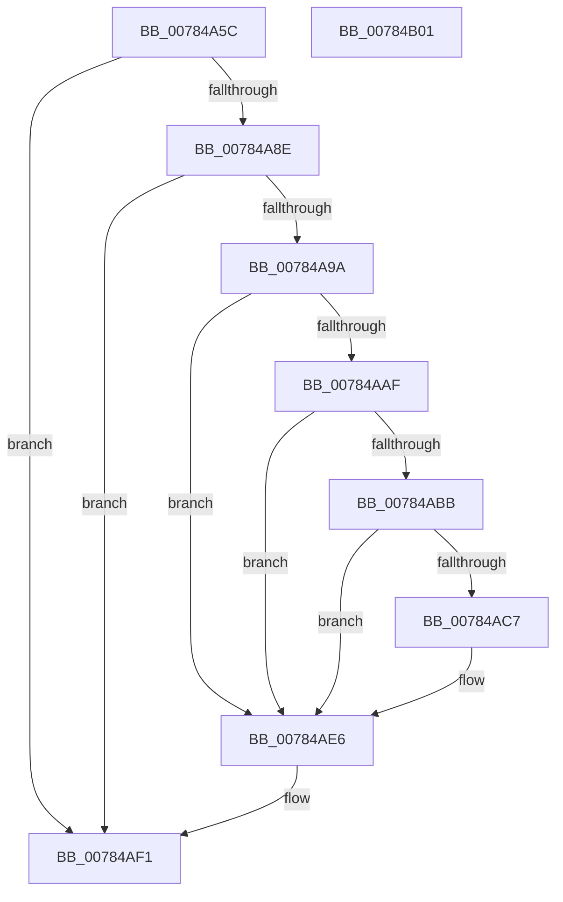

# PsReportProcessMemoryLimitViolation

- RVA: `0x00784A5C`–`0x00784B02` (길이 `166` bytes)
- VA: `0x0000000140784A5C`
- 실행 섹션: `PAGE`
- PDB 이름 있음: `예`; PDB Function 태그: `아니요`
- unwind 정보 RVA: `0x00060BC4`
- 디코드: `38`개 명령, `166/166` bytes 표시
- 미해석 바이트: `0` (있으면 어셈블리에 `.byte`로 보존)

> 이 문서는 커널 이미지의 기계어와 PDB 기호를 분석해 생성했습니다. 4번과 5번은 함수 원형과 자료형을 바이너리 사용 방식에서 추정한 C 해석이며 원본 소스 복구 결과는 아닙니다.

## 1. Dependencies

- 직접 호출 지점: **3**; 고유 호출 대상: **3**
- 직접 호출자로 확인된 함수: **1**
- RIP 상대 이미지 참조: **0**

### Outgoing calls
- `0x00784AA0` → [PspLockJobMemoryLimitsShared](../91/PspLockJobMemoryLimitsShared_function_0091A394.md) (function, `0x0091A394`)
- `0x00784AE1` → [PspSendJobNotification](../../text/49/PspSendJobNotification_function_0049EC28.md) (function, `0x0049EC28`)
- `0x00784AEC` → [PspUnlockJobMemoryLimitsShared](../91/PspUnlockJobMemoryLimitsShared_function_0091A420.md) (function, `0x0091A420`)

### Direct callers
- [MiChargeProcessCommitment](../../text/43/MiChargeProcessCommitment_function_004384C0.md) at `0x0043853B`

### Static image references
- 디코드된 RIP-relative 메모리 참조가 없습니다.

## 2. Other-region calls and transfers

- 다른 실행 섹션으로 향하는 call: **1**
  - `0x00784AE1` → [PspSendJobNotification](../../text/49/PspSendJobNotification_function_0049EC28.md) (`PAGE` → `.text`)
- 별도 외부 분기/꼬리 이동을 확인하지 못했습니다.

## 3. Assembly (complete function range)

```asm
00784A5C  48 89 5C 24 08                  mov qword ptr [rsp + 8], rbx
00784A61  48 89 74 24 10                  mov qword ptr [rsp + 0x10], rsi
00784A66  57                              push rdi
00784A67  48 83 EC 20                     sub rsp, 0x20
00784A6B  65 48 8B 34 25 88 01 00 00      mov rsi, qword ptr gs:[0x188]
00784A74  48 8B BE B8 00 00 00            mov rdi, qword ptr [rsi + 0xb8]
00784A7B  48 8B 87 A0 02 00 00            mov rax, qword ptr [rdi + 0x2a0]
00784A82  48 8B 98 00 04 00 00            mov rbx, qword ptr [rax + 0x400]
00784A89  48 85 DB                        test rbx, rbx
00784A8C  74 63                           je 0x140784af1
00784A8E  F7 83 00 01 00 00 00 01 00 00   test dword ptr [rbx + 0x100], 0x100
00784A98  74 57                           je 0x140784af1
00784A9A  48 8B D6                        mov rdx, rsi
00784A9D  48 8B CB                        mov rcx, rbx
00784AA0  E8 EF 58 19 00                  call 0x14091a394
00784AA5  48 83 BB 28 02 00 00 00         cmp qword ptr [rbx + 0x228], 0
00784AAD  74 37                           je 0x140784ae6
00784AAF  F7 83 50 04 00 00 00 02 00 00   test dword ptr [rbx + 0x450], 0x200
00784AB9  74 2B                           je 0x140784ae6
00784ABB  8B 87 F0 01 00 00               mov eax, dword ptr [rdi + 0x1f0]
00784AC1  24 24                           and al, 0x24
00784AC3  3C 04                           cmp al, 4
00784AC5  75 1F                           jne 0x140784ae6
00784AC7  F0 83 8F F0 01 00 00 20         lock or dword ptr [rdi + 0x1f0], 0x20
00784ACF  4C 8B 87 D0 01 00 00            mov r8, qword ptr [rdi + 0x1d0]
00784AD6  41 B1 01                        mov r9b, 1
00784AD9  BA 09 00 00 00                  mov edx, 9
00784ADE  48 8B CB                        mov rcx, rbx
00784AE1  E8 42 A1 D1 FF                  call 0x14049ec28
00784AE6  48 8B D6                        mov rdx, rsi
00784AE9  48 8B CB                        mov rcx, rbx
00784AEC  E8 2F 59 19 00                  call 0x14091a420
00784AF1  48 8B 5C 24 30                  mov rbx, qword ptr [rsp + 0x30]
00784AF6  48 8B 74 24 38                  mov rsi, qword ptr [rsp + 0x38]
00784AFB  48 83 C4 20                     add rsp, 0x20
00784AFF  5F                              pop rdi
00784B00  C3                              ret
00784B01  CC                              int3
```

## 4. C-style interpretation (structured pseudocode)

```c
__int64 __fastcall PsReportProcessMemoryLimitViolation(void)
{
    __int64 result;
    __int64 v_rsp;
    unsigned __int64 v_stack_p10;
    unsigned __int64 v_stack_p8;

    v_stack_p8 = v_rbx;
    v_stack_p10 = v_rsi;
    v_rsp = (v_rsp) - (32);
    if (*(unsigned __int64 *)(*(unsigned __int64 *)(*(unsigned __int64 *)(*(unsigned __int64 *)(gs_base + (0 + 392)) + 184) + 672) + 1024) == 0) goto loc_00784AF1;
    if (((*(unsigned int *)(*(unsigned __int64 *)(*(unsigned __int64 *)(*(unsigned __int64 *)(*(unsigned __int64 *)(gs_base + (0 + 392)) + 184) + 672) + 1024) + 256)) & (256)) == 0) goto loc_00784AF1;
    result = PspLockJobMemoryLimitsShared(*(unsigned __int64 *)(*(unsigned __int64 *)(*(unsigned __int64 *)(*(unsigned __int64 *)(gs_base + (0 + 392)) + 184) + 672) + 1024), *(unsigned __int64 *)(gs_base + (0 + 392)), a3, a4);
    if ((*(unsigned __int64 *)(*(unsigned __int64 *)(*(unsigned __int64 *)(*(unsigned __int64 *)(*(unsigned __int64 *)(gs_base + (0 + 392)) + 184) + 672) + 1024) + 552)) == 0) goto loc_00784AE6;
    if (((*(unsigned int *)(*(unsigned __int64 *)(*(unsigned __int64 *)(*(unsigned __int64 *)(*(unsigned __int64 *)(gs_base + (0 + 392)) + 184) + 672) + 1024) + 1104)) & (512)) == 0) goto loc_00784AE6;
    result = (unsigned __int8)(((unsigned int)(*(unsigned int *)(*(unsigned __int64 *)(*(unsigned __int64 *)(gs_base + (0 + 392)) + 184) + 496))) & (36));
    if (((unsigned __int8)(result)) == 4) {
        a3 = *(unsigned __int64 *)(*(unsigned __int64 *)(*(unsigned __int64 *)(gs_base + (0 + 392)) + 184) + 464);
        a4 = 1;
        a2 = 9;
        a1 = *(unsigned __int64 *)(*(unsigned __int64 *)(*(unsigned __int64 *)(*(unsigned __int64 *)(gs_base + (0 + 392)) + 184) + 672) + 1024);
        result = PspSendJobNotification(a1, a2, a3, a4);
    }
    result = PspUnlockJobMemoryLimitsShared(*(unsigned __int64 *)(*(unsigned __int64 *)(*(unsigned __int64 *)(*(unsigned __int64 *)(gs_base + (0 + 392)) + 184) + 672) + 1024), *(unsigned __int64 *)(gs_base + (0 + 392)), a3, a4);
loc_00784AF1:
    v_rsp = (v_rsp) + (32);
    return result;
}
```

## 5. (Beta) C Style

```c
void PsReportProcessMemoryLimitViolation(void)
{
    int64_t result;
    int64_t local_rsp;
    uint64_t v_stack_p10;
    uint64_t v_stack_p8;

    v_stack_p8 = local_rbx;
    v_stack_p10 = local_rsi;
    local_rsp = (local_rsp) - (32);
    if (*(uint64_t *)(*(uint64_t *)(*(uint64_t *)(*(uint64_t *)(gs_base + (0 + 0x188)) + 0xB8) + 0x2A0) + 0x400) == 0) goto loc_00784AF1;
    if (((*(uint32_t *)(*(uint64_t *)(*(uint64_t *)(*(uint64_t *)(*(uint64_t *)(gs_base + (0 + 0x188)) + 0xB8) + 0x2A0) + 0x400) + 0x100)) & (256)) == 0) goto loc_00784AF1;
    result = PspLockJobMemoryLimitsShared(*(uint64_t *)(*(uint64_t *)(*(uint64_t *)(*(uint64_t *)(gs_base + (0 + 0x188)) + 0xB8) + 0x2A0) + 0x400), *(uint64_t *)(gs_base + (0 + 0x188)), a3, a4);
    if ((*(uint64_t *)(*(uint64_t *)(*(uint64_t *)(*(uint64_t *)(*(uint64_t *)(gs_base + (0 + 0x188)) + 0xB8) + 0x2A0) + 0x400) + 0x228)) == 0) goto loc_00784AE6;
    if (((*(uint32_t *)(*(uint64_t *)(*(uint64_t *)(*(uint64_t *)(*(uint64_t *)(gs_base + (0 + 0x188)) + 0xB8) + 0x2A0) + 0x400) + 0x450)) & (512)) == 0) goto loc_00784AE6;
    result = (uint8_t)(((uint32_t)(*(uint32_t *)(*(uint64_t *)(*(uint64_t *)(gs_base + (0 + 0x188)) + 0xB8) + 0x1F0))) & (36));
    if (((uint8_t)(result)) == 4) {
        a3 = *(uint64_t *)(*(uint64_t *)(*(uint64_t *)(gs_base + (0 + 0x188)) + 0xB8) + 0x1D0);
        a4 = 1;
        a2 = 9;
        a1 = *(uint64_t *)(*(uint64_t *)(*(uint64_t *)(*(uint64_t *)(gs_base + (0 + 0x188)) + 0xB8) + 0x2A0) + 0x400);
        result = PspSendJobNotification(a1, a2, a3, a4);
    }
    result = PspUnlockJobMemoryLimitsShared(*(uint64_t *)(*(uint64_t *)(*(uint64_t *)(*(uint64_t *)(gs_base + (0 + 0x188)) + 0xB8) + 0x2A0) + 0x400), *(uint64_t *)(gs_base + (0 + 0x188)), a3, a4);
loc_00784AF1:
    local_rsp = (local_rsp) + (32);
    return result;
}
```

## 6. Execution-region graph

[열기: 2D/3D 그래프와 함수 탐색 컨트롤 패널](../../../control-panel.html?section=page&rva=0x00784A5C&view=graph)

- 2D 그래프는 위에서 아래로 흐르고, 3D 그래프는 빈 공간을 드래그해 회전합니다. Shift+드래그는 이동, 휠은 확대·축소, 함수 노드 선택은 대상 보고서 이동입니다.

### Static fallback


