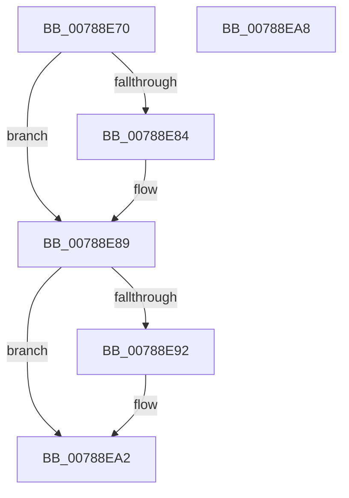

# PsSessionObjectDelete

- RVA: `0x00788E70`–`0x00788EA9` (길이 `57` bytes)
- VA: `0x0000000140788E70`
- 실행 섹션: `PAGE`
- PDB 이름 있음: `예`; PDB Function 태그: `아니요`
- unwind 정보 RVA: `0x0005CF00`
- 디코드: `19`개 명령, `57/57` bytes 표시
- 미해석 바이트: `0` (있으면 어셈블리에 `.byte`로 보존)

> 이 문서는 커널 이미지의 기계어와 PDB 기호를 분석해 생성했습니다. 4번과 5번은 함수 원형과 자료형을 바이너리 사용 방식에서 추정한 C 해석이며 원본 소스 복구 결과는 아닙니다.

## 1. Dependencies

- 직접 호출 지점: **3**; 고유 호출 대상: **3**
- 직접 호출자로 확인된 함수: **0**
- RIP 상대 이미지 참조: **0**

### Outgoing calls
- `0x00788E84` → [PspReleaseReferenceToSession](../A9/PspReleaseReferenceToSession_function_00A9E444.md) (function, `0x00A9E444`)
- `0x00788E92` → [KeRemoveSchedulingGroup](../../text/4A/KeRemoveSchedulingGroup_function_004AD328.md) (function, `0x004AD328`)
- `0x00788E9D` → [ExFreePoolWithTag](../../poolcode/B8/ExFreePoolWithTag_function_00B82870.md) (function, `0x00B82870`)

### Direct callers
- 이 함수 시작 RVA로 연결되는 직접 call은 확인되지 않았습니다. 간접 호출은 완전히 역산할 수 없습니다.

### Static image references
- 디코드된 RIP-relative 메모리 참조가 없습니다.

## 2. Other-region calls and transfers

- 다른 실행 섹션으로 향하는 call: **2**
  - `0x00788E92` → [KeRemoveSchedulingGroup](../../text/4A/KeRemoveSchedulingGroup_function_004AD328.md) (`PAGE` → `.text`)
  - `0x00788E9D` → [ExFreePoolWithTag](../../poolcode/B8/ExFreePoolWithTag_function_00B82870.md) (`PAGE` → `POOLCODE`)
- 별도 외부 분기/꼬리 이동을 확인하지 못했습니다.

## 3. Assembly (complete function range)

```asm
00788E70  40 53                           push rbx
00788E72  48 83 EC 20                     sub rsp, 0x20
00788E76  48 8B D9                        mov rbx, rcx
00788E79  48 8B 49 18                     mov rcx, qword ptr [rcx + 0x18]
00788E7D  8B 41 04                        mov eax, dword ptr [rcx + 4]
00788E80  A8 04                           test al, 4
00788E82  74 05                           je 0x140788e89
00788E84  E8 BB 55 31 00                  call 0x140a9e444
00788E89  48 8B 4B 20                     mov rcx, qword ptr [rbx + 0x20]
00788E8D  48 85 C9                        test rcx, rcx
00788E90  74 10                           je 0x140788ea2
00788E92  E8 91 44 D2 FF                  call 0x1404ad328
00788E97  48 8B 4B 20                     mov rcx, qword ptr [rbx + 0x20]
00788E9B  33 D2                           xor edx, edx
00788E9D  E8 CE 99 3F 00                  call 0x140b82870
00788EA2  48 83 C4 20                     add rsp, 0x20
00788EA6  5B                              pop rbx
00788EA7  C3                              ret
00788EA8  CC                              int3
```

## 4. C-style interpretation (structured pseudocode)

```c
__int64 __fastcall PsSessionObjectDelete(__int64 a1, int a2)
{
    __int64 result;
    __int64 v_rsp;

    v_rsp = (v_rsp) - (32);
    result = (unsigned int)(*(unsigned int *)(*(unsigned __int64 *)(a1 + 24) + 4));
    if ((((unsigned __int8)((unsigned int)(*(unsigned int *)(*(unsigned __int64 *)(a1 + 24) + 4)))) & (4)) != 0) {
        result = PspReleaseReferenceToSession(*(unsigned __int64 *)(a1 + 24), a2, a3, a4);
    }
    if (*(unsigned __int64 *)(a1 + 32) != 0) {
        result = KeRemoveSchedulingGroup(*(unsigned __int64 *)(a1 + 32), a2, a3, a4);
        a1 = *(unsigned __int64 *)(a1 + 32);
        a2 = 0;
        result = ExFreePoolWithTag(a1, a2, a3, a4);
    }
    v_rsp = (v_rsp) + (32);
    return result;
}
```

## 5. (Beta) C Style

```c
int64_t PsSessionObjectDelete(void *Arg1, int32_t Arg2)
{
    uint8_t *arg1 = (uint8_t *)Arg1;

    int64_t result;
    int64_t local_rsp;

    local_rsp = (local_rsp) - (32);
    result = (uint32_t)(*(uint32_t *)(*(uint64_t *)(arg1 + 0x18) + 0x4));
    if ((((uint8_t)((uint32_t)(*(uint32_t *)(*(uint64_t *)(arg1 + 0x18) + 0x4)))) & (4)) != 0) {
        result = PspReleaseReferenceToSession(*(uint64_t *)(arg1 + 0x18), Arg2, a3, a4);
    }
    if (*(uint64_t *)(arg1 + 0x20) != 0) {
        result = KeRemoveSchedulingGroup(*(uint64_t *)(arg1 + 0x20), Arg2, a3, a4);
        Arg1 = *(uint64_t *)(arg1 + 0x20);
        Arg2 = 0;
        result = ExFreePoolWithTag(Arg1, Arg2, a3, a4);
    }
    local_rsp = (local_rsp) + (32);
    return result;
}
```

### 관측된 메모리 오프셋

구조체 형식이 확인되지 않은 접근은 인자 기준의 오프셋으로만 기록했습니다.

| 기준 인자 | 오프셋 표현 | 폭 (bit) | 접근 |
|---|---:|---:|---|
| `Arg1` | `+ 0x18` | `64` | `R` |
| `Arg1` | `+ 0x20` | `64` | `R` |

## 6. Execution-region graph

[열기: 2D/3D 그래프와 함수 탐색 컨트롤 패널](../../../control-panel.html?section=page&rva=0x00788E70&view=graph)

- 2D 그래프는 위에서 아래로 흐르고, 3D 그래프는 빈 공간을 드래그해 회전합니다. Shift+드래그는 이동, 휠은 확대·축소, 함수 노드 선택은 대상 보고서 이동입니다.

### Static fallback


