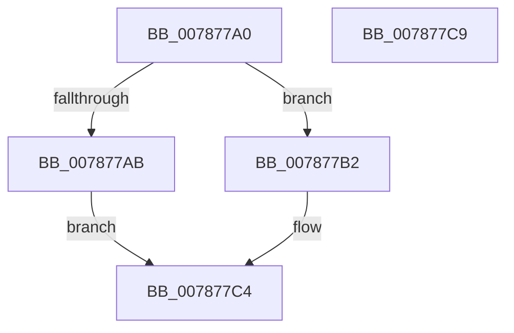

# PsSetCreateProcessNotifyRoutineEx2

- RVA: `0x007877A0`–`0x007877CA` (길이 `42` bytes)
- VA: `0x00000001407877A0`
- 실행 섹션: `PAGE`
- PDB 이름 있음: `예`; PDB Function 태그: `아니요`
- unwind 정보 RVA: `0x0005C788`
- 디코드: `15`개 명령, `42/42` bytes 표시
- 미해석 바이트: `0` (있으면 어셈블리에 `.byte`로 보존)

> 이 문서는 커널 이미지의 기계어와 PDB 기호를 분석해 생성했습니다. 4번과 5번은 함수 원형과 자료형을 바이너리 사용 방식에서 추정한 C 해석이며 원본 소스 복구 결과는 아닙니다.

## 1. Dependencies

- 직접 호출 지점: **1**; 고유 호출 대상: **1**
- 직접 호출자로 확인된 함수: **0**
- RIP 상대 이미지 참조: **0**

### Outgoing calls
- `0x007877BF` → [PspSetCreateProcessNotifyRoutine](../AA/PspSetCreateProcessNotifyRoutine_function_00AA75EC.md) (function, `0x00AA75EC`)

### Direct callers
- 이 함수 시작 RVA로 연결되는 직접 call은 확인되지 않았습니다. 간접 호출은 완전히 역산할 수 없습니다.

### Static image references
- 디코드된 RIP-relative 메모리 참조가 없습니다.

## 2. Other-region calls and transfers

- 다른 실행 섹션으로 향하는 call: **0**
- 별도 외부 분기/꼬리 이동을 확인하지 못했습니다.

## 3. Assembly (complete function range)

```asm
007877A0  48 83 EC 28                     sub rsp, 0x28
007877A4  48 8B C2                        mov rax, rdx
007877A7  85 C9                           test ecx, ecx
007877A9  74 07                           je 0x1407877b2
007877AB  B8 0D 00 00 C0                  mov eax, 0xc000000d
007877B0  EB 12                           jmp 0x1407877c4
007877B2  41 F6 D8                        neg r8b
007877B5  48 8B C8                        mov rcx, rax
007877B8  1B D2                           sbb edx, edx
007877BA  F7 DA                           neg edx
007877BC  83 C2 06                        add edx, 6
007877BF  E8 28 FE 31 00                  call 0x140aa75ec
007877C4  48 83 C4 28                     add rsp, 0x28
007877C8  C3                              ret
007877C9  CC                              int3
```

## 4. C-style interpretation (structured pseudocode)

```c
__int64 __fastcall PsSetCreateProcessNotifyRoutineEx2(int a1, __int64 a2, unsigned __int8 a3)
{
    __int64 result;
    __int64 v_rsp;

    v_rsp = (v_rsp) - (40);
    if (a1 == 0) goto loc_007877B2;
    goto loc_007877C4;
loc_007877B2:
    a3 = (unsigned __int8)(-(a3));
    a2 = (unsigned int)(-(a2));
    a2 = (unsigned int)((a2) + (6));
    result = PspSetCreateProcessNotifyRoutine((unsigned int)(0xC000000DULL), a2, a3, a4);
loc_007877C4:
    v_rsp = (v_rsp) + (40);
    return result;
}
```

## 5. (Beta) C Style

```c
int64_t PsSetCreateProcessNotifyRoutineEx2(int32_t Arg1, int64_t Arg2, uint8_t Arg3)
{
    int64_t result;
    int64_t local_rsp;

    local_rsp = (local_rsp) - (40);
    if (Arg1 == 0) goto loc_007877B2;
    goto loc_007877C4;
loc_007877B2:
    Arg3 = (uint8_t)(-(Arg3));
    Arg2 = (uint32_t)(-(Arg2));
    Arg2 = (uint32_t)((Arg2) + (6));
    result = PspSetCreateProcessNotifyRoutine((uint32_t)(0xC000000DULL), Arg2, Arg3, a4);
loc_007877C4:
    local_rsp = (local_rsp) + (40);
    return result;
}
```

## 6. Execution-region graph

[열기: 2D/3D 그래프와 함수 탐색 컨트롤 패널](../../../control-panel.html?section=page&rva=0x007877A0&view=graph)

- 2D 그래프는 위에서 아래로 흐르고, 3D 그래프는 빈 공간을 드래그해 회전합니다. Shift+드래그는 이동, 휠은 확대·축소, 함수 노드 선택은 대상 보고서 이동입니다.

### Static fallback


