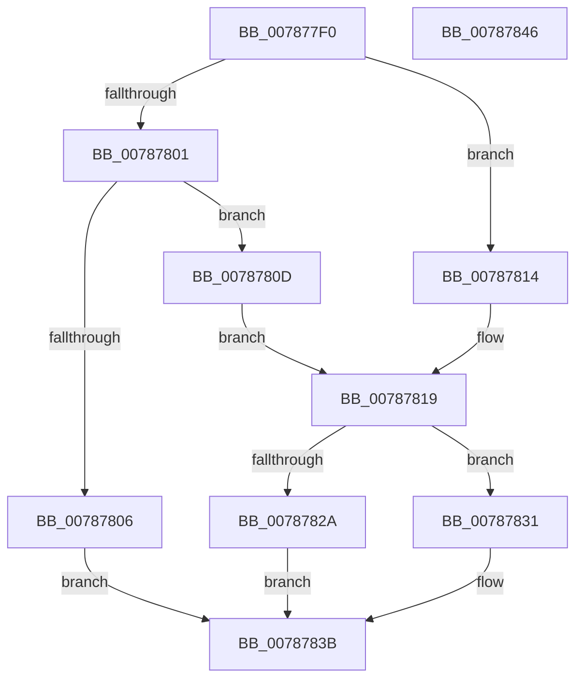

# PsSetCreateThreadNotifyRoutineEx

- RVA: `0x007877F0`–`0x00787847` (길이 `87` bytes)
- VA: `0x00000001407877F0`
- 실행 섹션: `PAGE`
- PDB 이름 있음: `예`; PDB Function 태그: `아니요`
- unwind 정보 RVA: `0x0005CAAC`
- 디코드: `28`개 명령, `87/87` bytes 표시
- 미해석 바이트: `0` (있으면 어셈블리에 `.byte`로 보존)

> 이 문서는 커널 이미지의 기계어와 PDB 기호를 분석해 생성했습니다. 4번과 5번은 함수 원형과 자료형을 바이너리 사용 방식에서 추정한 C 해석이며 원본 소스 복구 결과는 아닙니다.

## 1. Dependencies

- 직접 호출 지점: **2**; 고유 호출 대상: **2**
- 직접 호출자로 확인된 함수: **0**
- RIP 상대 이미지 참조: **0**

### Outgoing calls
- `0x00787821` → [MmVerifyCallbackFunctionCheckFlags](../../text/4F/MmVerifyCallbackFunctionCheckFlags_function_004F7360.md) (function, `0x004F7360`)
- `0x00787836` → [PspSetCreateThreadNotifyRoutine](PspSetCreateThreadNotifyRoutine_function_00787868.md) (function, `0x00787868`)

### Direct callers
- 이 함수 시작 RVA로 연결되는 직접 call은 확인되지 않았습니다. 간접 호출은 완전히 역산할 수 없습니다.

### Static image references
- 디코드된 RIP-relative 메모리 참조가 없습니다.

## 2. Other-region calls and transfers

- 다른 실행 섹션으로 향하는 call: **1**
  - `0x00787821` → [MmVerifyCallbackFunctionCheckFlags](../../text/4F/MmVerifyCallbackFunctionCheckFlags_function_004F7360.md) (`PAGE` → `.text`)
- 별도 외부 분기/꼬리 이동을 확인하지 못했습니다.

## 3. Assembly (complete function range)

```asm
007877F0  48 89 5C 24 08                  mov qword ptr [rsp + 8], rbx
007877F5  57                              push rdi
007877F6  48 83 EC 20                     sub rsp, 0x20
007877FA  48 8B FA                        mov rdi, rdx
007877FD  85 C9                           test ecx, ecx
007877FF  74 13                           je 0x140787814
00787801  83 F9 01                        cmp ecx, 1
00787804  74 07                           je 0x14078780d
00787806  B8 0D 00 00 C0                  mov eax, 0xc000000d
0078780B  EB 2E                           jmp 0x14078783b
0078780D  BB 02 00 00 00                  mov ebx, 2
00787812  EB 05                           jmp 0x140787819
00787814  BB 01 00 00 00                  mov ebx, 1
00787819  BA 20 00 00 00                  mov edx, 0x20
0078781E  48 8B CF                        mov rcx, rdi
00787821  E8 3A FB D6 FF                  call 0x1404f7360
00787826  85 C0                           test eax, eax
00787828  75 07                           jne 0x140787831
0078782A  B8 22 00 00 C0                  mov eax, 0xc0000022
0078782F  EB 0A                           jmp 0x14078783b
00787831  8B D3                           mov edx, ebx
00787833  48 8B CF                        mov rcx, rdi
00787836  E8 2D 00 00 00                  call 0x140787868
0078783B  48 8B 5C 24 30                  mov rbx, qword ptr [rsp + 0x30]
00787840  48 83 C4 20                     add rsp, 0x20
00787844  5F                              pop rdi
00787845  C3                              ret
00787846  CC                              int3
```

## 4. C-style interpretation (structured pseudocode)

```c
__int64 __fastcall PsSetCreateThreadNotifyRoutineEx(int a1, __int64 a2)
{
    __int64 result;
    __int64 v_rsp;
    unsigned __int64 v_stack_p8;

    v_stack_p8 = v_rbx;
    v_rsp = (v_rsp) - (32);
    if (a1 == 0) goto loc_00787814;
    if (a1 == 1) goto loc_0078780D;
    goto loc_0078783B;
loc_0078780D:
    goto loc_00787819;
loc_00787814:
loc_00787819:
    result = MmVerifyCallbackFunctionCheckFlags(a2, 32, a3, a4);
    if ((unsigned int)(result) != 0) goto loc_00787831;
    goto loc_0078783B;
loc_00787831:
    result = PspSetCreateThreadNotifyRoutine(a2, 1, a3, a4);
loc_0078783B:
    v_rsp = (v_rsp) + (32);
    return result;
}
```

## 5. (Beta) C Style

```c
int64_t PsSetCreateThreadNotifyRoutineEx(int32_t Arg1, int64_t Arg2)
{
    int64_t result;
    int64_t local_rsp;
    uint64_t v_stack_p8;

    v_stack_p8 = local_rbx;
    local_rsp = (local_rsp) - (32);
    if (Arg1 == 0) goto loc_00787814;
    if (Arg1 == 1) goto loc_0078780D;
    goto loc_0078783B;
loc_0078780D:
    goto loc_00787819;
loc_00787814:
loc_00787819:
    result = MmVerifyCallbackFunctionCheckFlags(Arg2, 32, a3, a4);
    if ((uint32_t)(result) != 0) goto loc_00787831;
    goto loc_0078783B;
loc_00787831:
    result = PspSetCreateThreadNotifyRoutine(Arg2, 1, a3, a4);
loc_0078783B:
    local_rsp = (local_rsp) + (32);
    return result;
}
```

## 6. Execution-region graph

[열기: 2D/3D 그래프와 함수 탐색 컨트롤 패널](../../../control-panel.html?section=page&rva=0x007877F0&view=graph)

- 2D 그래프는 위에서 아래로 흐르고, 3D 그래프는 빈 공간을 드래그해 회전합니다. Shift+드래그는 이동, 휠은 확대·축소, 함수 노드 선택은 대상 보고서 이동입니다.

### Static fallback


