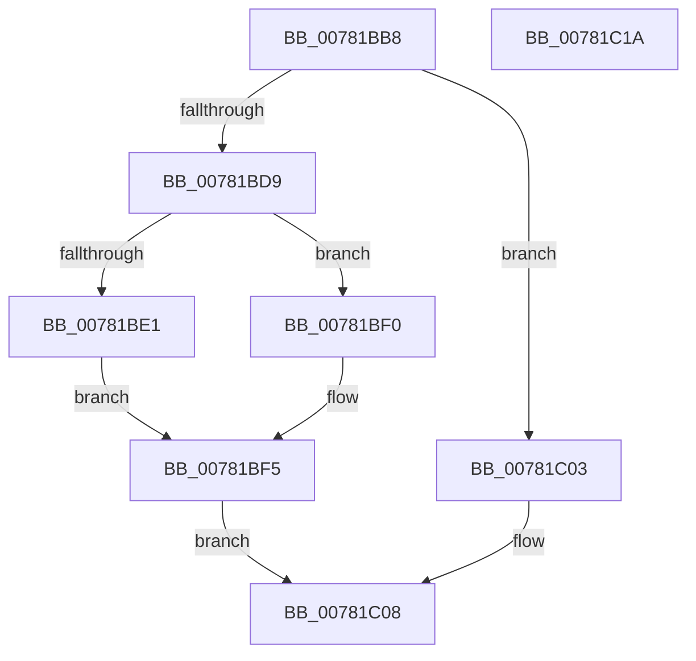

# PsSetProcessHandleTracingInformation

- RVA: `0x00781BB8`–`0x00781C1B` (길이 `99` bytes)
- VA: `0x0000000140781BB8`
- 실행 섹션: `PAGE`
- PDB 이름 있음: `예`; PDB Function 태그: `아니요`
- unwind 정보 RVA: `0x00060BC4`
- 디코드: `30`개 명령, `99/99` bytes 표시
- 미해석 바이트: `0` (있으면 어셈블리에 `.byte`로 보존)

> 이 문서는 커널 이미지의 기계어와 PDB 기호를 분석해 생성했습니다. 4번과 5번은 함수 원형과 자료형을 바이너리 사용 방식에서 추정한 C 해석이며 원본 소스 복구 결과는 아닙니다.

## 1. Dependencies

- 직접 호출 지점: **4**; 고유 호출 대상: **4**
- 직접 호출자로 확인된 함수: **2**
- RIP 상대 이미지 참조: **0**

### Outgoing calls
- `0x00781BCD` → [ObReferenceProcessHandleTable](../89/ObReferenceProcessHandleTable_function_00893B70.md) (function, `0x00893B70`)
- `0x00781BE7` → [ExEnableHandleTracing](../AD/ExEnableHandleTracing_function_00AD2C8C.md) (function, `0x00AD2C8C`)
- `0x00781BF0` → [ExDisableHandleTracing](../../text/65/ExDisableHandleTracing_function_00655CBC.md) (function, `0x00655CBC`)
- `0x00781BFC` → [ExReleaseRundownProtection](../../text/34/ExReleaseRundownProtection_function_00349E80.md) (function, `0x00349E80`)

### Direct callers
- [NtSetInformationProcess](../AE/NtSetInformationProcess_function_00AE5370.md) at `0x00AE6991`
- [NtSetInformationProcess](../AE/NtSetInformationProcess_function_00AE5370.md) at `0x00AE699D`
- [ViSettingsEnableKernelHandleChecking](../../pagevrfy/BA/ViSettingsEnableKernelHandleChecking_function_00BAB360.md) at `0x00BAB371`
- [ViSettingsEnableKernelHandleChecking](../../pagevrfy/BA/ViSettingsEnableKernelHandleChecking_function_00BAB360.md) at `0x00BAB3A0`

### Static image references
- 디코드된 RIP-relative 메모리 참조가 없습니다.

## 2. Other-region calls and transfers

- 다른 실행 섹션으로 향하는 call: **2**
  - `0x00781BF0` → [ExDisableHandleTracing](../../text/65/ExDisableHandleTracing_function_00655CBC.md) (`PAGE` → `.text`)
  - `0x00781BFC` → [ExReleaseRundownProtection](../../text/34/ExReleaseRundownProtection_function_00349E80.md) (`PAGE` → `.text`)
- 별도 외부 분기/꼬리 이동을 확인하지 못했습니다.

## 3. Assembly (complete function range)

```asm
00781BB8  48 89 5C 24 08                  mov qword ptr [rsp + 8], rbx
00781BBD  48 89 74 24 10                  mov qword ptr [rsp + 0x10], rsi
00781BC2  57                              push rdi
00781BC3  48 83 EC 20                     sub rsp, 0x20
00781BC7  48 8B FA                        mov rdi, rdx
00781BCA  48 8B F1                        mov rsi, rcx
00781BCD  E8 9E 1F 11 00                  call 0x140893b70
00781BD2  33 DB                           xor ebx, ebx
00781BD4  48 85 C0                        test rax, rax
00781BD7  74 2A                           je 0x140781c03
00781BD9  48 8B C8                        mov rcx, rax
00781BDC  48 85 FF                        test rdi, rdi
00781BDF  74 0F                           je 0x140781bf0
00781BE1  44 8B 07                        mov r8d, dword ptr [rdi]
00781BE4  8B 57 04                        mov edx, dword ptr [rdi + 4]
00781BE7  E8 A0 10 35 00                  call 0x140ad2c8c
00781BEC  8B D8                           mov ebx, eax
00781BEE  EB 05                           jmp 0x140781bf5
00781BF0  E8 C7 40 ED FF                  call 0x140655cbc
00781BF5  48 8D 8E E8 01 00 00            lea rcx, [rsi + 0x1e8]
00781BFC  E8 7F 82 BC FF                  call 0x140349e80
00781C01  EB 05                           jmp 0x140781c08
00781C03  BB 0A 01 00 C0                  mov ebx, 0xc000010a
00781C08  48 8B 74 24 38                  mov rsi, qword ptr [rsp + 0x38]
00781C0D  8B C3                           mov eax, ebx
00781C0F  48 8B 5C 24 30                  mov rbx, qword ptr [rsp + 0x30]
00781C14  48 83 C4 20                     add rsp, 0x20
00781C18  5F                              pop rdi
00781C19  C3                              ret
00781C1A  CC                              int3
```

## 4. C-style interpretation (structured pseudocode)

```c
__int64 __fastcall PsSetProcessHandleTracingInformation(__int64 a1, __int64 a2)
{
    __int64 result;
    __int64 v_rbx;
    __int64 v_rsp;
    unsigned __int64 v_stack_p10;
    unsigned __int64 v_stack_p8;

    v_stack_p8 = v_rbx;
    v_stack_p10 = v_rsi;
    v_rsp = (v_rsp) - (32);
    result = ObReferenceProcessHandleTable(a1, a2, a3, a4);
    v_rbx = 0;
    if (result == 0) goto loc_00781C03;
    if (a2 == 0) goto loc_00781BF0;
    result = ExEnableHandleTracing(result, (unsigned int)(*(unsigned int *)(a2 + 4)), (unsigned int)(*(unsigned int *)(a2)), a4);
    goto loc_00781BF5;
loc_00781BF0:
    result = ExDisableHandleTracing(result, (unsigned int)(*(unsigned int *)(a2 + 4)), (unsigned int)(*(unsigned int *)(a2)), a4);
loc_00781BF5:
    result = ExReleaseRundownProtection(a1 + 488, (unsigned int)(*(unsigned int *)(a2 + 4)), (unsigned int)(*(unsigned int *)(a2)), a4);
    goto loc_00781C08;
loc_00781C03:
loc_00781C08:
    v_rsp = (v_rsp) + (32);
    return (unsigned int)((unsigned int)((unsigned int)(0xC000010AULL)));
}
```

## 5. (Beta) C Style

```c
int64_t PsSetProcessHandleTracingInformation(void *Arg1, int64_t Arg2)
{
    uint8_t *arg1 = (uint8_t *)Arg1;

    int64_t result;
    int64_t local_rbx;
    int64_t local_rsp;
    uint64_t v_stack_p10;
    uint64_t v_stack_p8;

    v_stack_p8 = local_rbx;
    v_stack_p10 = local_rsi;
    local_rsp = (local_rsp) - (32);
    result = ObReferenceProcessHandleTable(Arg1, Arg2, a3, a4);
    local_rbx = 0;
    if (result == 0) goto loc_00781C03;
    if (Arg2 == 0) goto loc_00781BF0;
    result = ExEnableHandleTracing(result, (uint32_t)(*(uint32_t *)(Arg2 + 0x4)), (uint32_t)(*(uint32_t *)(Arg2)), a4);
    goto loc_00781BF5;
loc_00781BF0:
    result = ExDisableHandleTracing(result, (uint32_t)(*(uint32_t *)(Arg2 + 0x4)), (uint32_t)(*(uint32_t *)(Arg2)), a4);
loc_00781BF5:
    result = ExReleaseRundownProtection(Arg1 + 488, (uint32_t)(*(uint32_t *)(Arg2 + 0x4)), (uint32_t)(*(uint32_t *)(Arg2)), a4);
    goto loc_00781C08;
loc_00781C03:
loc_00781C08:
    local_rsp = (local_rsp) + (32);
    return (uint32_t)((uint32_t)((uint32_t)(0xC000010AULL)));
}
```

### 관측된 메모리 오프셋

구조체 형식이 확인되지 않은 접근은 인자 기준의 오프셋으로만 기록했습니다.

| 기준 인자 | 오프셋 표현 | 폭 (bit) | 접근 |
|---|---:|---:|---|
| `Arg1` | `+ 0x1E8` | `64` | `R` |

## 6. Execution-region graph

[열기: 2D/3D 그래프와 함수 탐색 컨트롤 패널](../../../control-panel.html?section=page&rva=0x00781BB8&view=graph)

- 2D 그래프는 위에서 아래로 흐르고, 3D 그래프는 빈 공간을 드래그해 회전합니다. Shift+드래그는 이동, 휠은 확대·축소, 함수 노드 선택은 대상 보고서 이동입니다.

### Static fallback


