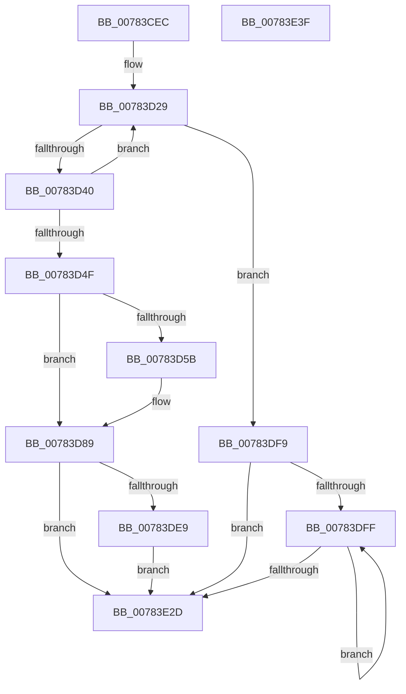

# PsSetVmProcessorHostProcess

- RVA: `0x00783CEC`–`0x00783E40` (길이 `340` bytes)
- VA: `0x0000000140783CEC`
- 실행 섹션: `PAGE`
- PDB 이름 있음: `예`; PDB Function 태그: `아니요`
- unwind 정보 RVA: `0x000CEF90`
- 디코드: `83`개 명령, `340/340` bytes 표시
- 미해석 바이트: `0` (있으면 어셈블리에 `.byte`로 보존)

> 이 문서는 커널 이미지의 기계어와 PDB 기호를 분석해 생성했습니다. 4번과 5번은 함수 원형과 자료형을 바이너리 사용 방식에서 추정한 C 해석이며 원본 소스 복구 결과는 아닙니다.

## 1. Dependencies

- 직접 호출 지점: **6**; 고유 호출 대상: **6**
- 직접 호출자로 확인된 함수: **1**
- RIP 상대 이미지 참조: **3**

### Outgoing calls
- `0x00783D84` → [PspSynchronizeThreadIsolationDomains](../../text/3C/PspSynchronizeThreadIsolationDomains_function_003C479C.md) (function, `0x003C479C`)
- `0x00783D94` → [KeInitializeEvent](../../text/40/KeInitializeEvent_function_0040DD10.md) (function, `0x0040DD10`)
- `0x00783DB7` → [ExQueueWorkItem](../../text/2F/ExQueueWorkItem_function_002F9520.md) (function, `0x002F9520`)
- `0x00783DCE` → [KeWaitForSingleObject](../../text/20/KeWaitForSingleObject_function_0020E6B0.md) (function, `0x0020E6B0`)
- `0x00783DF2` → [ExfUnblockPushLock](../../text/2A/ExfUnblockPushLock_function_002A3FE0.md) (function, `0x002A3FE0`)
- `0x00783E19` → [ExBlockOnAddressPushLock](../../text/2A/ExBlockOnAddressPushLock_function_002A43A0.md) (function, `0x002A43A0`)

### Direct callers
- [VmSetVpHostProcess](../7A/VmSetVpHostProcess_function_007AD6B0.md) at `0x007AD6B4`

### Static image references
- `0x00783D67` → RVA `0x00E0C590` (`.data`; read/write)
- `0x00783D9E` → RVA `0x00784830` (`PspSetVmProcessorHostProcessWorkerRoutine`; read)
- `0x00783DDF` → RVA `0x00F06620` (`.data`; read)

## 2. Other-region calls and transfers

- 다른 실행 섹션으로 향하는 call: **6**
  - `0x00783D84` → [PspSynchronizeThreadIsolationDomains](../../text/3C/PspSynchronizeThreadIsolationDomains_function_003C479C.md) (`PAGE` → `.text`)
  - `0x00783D94` → [KeInitializeEvent](../../text/40/KeInitializeEvent_function_0040DD10.md) (`PAGE` → `.text`)
  - `0x00783DB7` → [ExQueueWorkItem](../../text/2F/ExQueueWorkItem_function_002F9520.md) (`PAGE` → `.text`)
  - `0x00783DCE` → [KeWaitForSingleObject](../../text/20/KeWaitForSingleObject_function_0020E6B0.md) (`PAGE` → `.text`)
  - `0x00783DF2` → [ExfUnblockPushLock](../../text/2A/ExfUnblockPushLock_function_002A3FE0.md) (`PAGE` → `.text`)
  - `0x00783E19` → [ExBlockOnAddressPushLock](../../text/2A/ExBlockOnAddressPushLock_function_002A43A0.md) (`PAGE` → `.text`)
- 별도 외부 분기/꼬리 이동을 확인하지 못했습니다.

## 3. Assembly (complete function range)

```asm
00783CEC  48 89 74 24 10                  mov qword ptr [rsp + 0x10], rsi
00783CF1  48 89 7C 24 18                  mov qword ptr [rsp + 0x18], rdi
00783CF6  55                              push rbp
00783CF7  48 8B EC                        mov rbp, rsp
00783CFA  48 83 EC 70                     sub rsp, 0x70
00783CFE  0F 57 C9                        xorps xmm1, xmm1
00783D01  48 8D B1 FC 05 00 00            lea rsi, [rcx + 0x5fc]
00783D08  0F 57 C0                        xorps xmm0, xmm0
00783D0B  33 C0                           xor eax, eax
00783D0D  0F 11 45 C0                     movups xmmword ptr [rbp - 0x40], xmm0
00783D11  48 89 45 D0                     mov qword ptr [rbp - 0x30], rax
00783D15  48 8B F9                        mov rdi, rcx
00783D18  0F 11 4D D8                     movups xmmword ptr [rbp - 0x28], xmm1
00783D1C  0F 11 4D E8                     movups xmmword ptr [rbp - 0x18], xmm1
00783D20  0F 0D 0E                        prefetchw byte ptr [rsi]
00783D23  8B 81 FC 05 00 00               mov eax, dword ptr [rcx + 0x5fc]
00783D29  89 45 10                        mov dword ptr [rbp + 0x10], eax
00783D2C  8B D0                           mov edx, eax
00783D2E  44 8B C8                        mov r9d, eax
00783D31  44 8B C0                        mov r8d, eax
00783D34  8B C8                           mov ecx, eax
00783D36  0F BA E0 17                     bt eax, 0x17
00783D3A  0F 82 B9 00 00 00               jb 0x140783df9
00783D40  81 C9 00 00 80 01               or ecx, 0x1800000
00783D46  F0 0F B1 0E                     lock cmpxchg dword ptr [rsi], ecx
00783D4A  41 3B C0                        cmp eax, r8d
00783D4D  75 DA                           jne 0x140783d29
00783D4F  48 8B 87 60 07 00 00            mov rax, qword ptr [rdi + 0x760]
00783D56  48 85 C0                        test rax, rax
00783D59  75 2E                           jne 0x140783d89
00783D5B  F0 81 0E 00 00 20 00            lock or dword ptr [rsi], 0x200000
00783D62  B8 01 00 00 00                  mov eax, 1
00783D67  F0 48 0F C1 05 20 88 68 00      lock xadd qword ptr [rip + 0x688820], rax
00783D70  48 FF C0                        inc rax
00783D73  48 8B CF                        mov rcx, rdi
00783D76  48 89 87 60 07 00 00            mov qword ptr [rdi + 0x760], rax
00783D7D  48 89 87 68 07 00 00            mov qword ptr [rdi + 0x768], rax
00783D84  E8 13 0A C4 FF                  call 0x1403c479c
00783D89  45 33 C0                        xor r8d, r8d
00783D8C  48 8D 4D C0                     lea rcx, [rbp - 0x40]
00783D90  41 8D 50 01                     lea edx, [r8 + 1]
00783D94  E8 77 9F C8 FF                  call 0x14040dd10
00783D99  48 83 65 D8 00                  and qword ptr [rbp - 0x28], 0
00783D9E  48 8D 05 8B 0A 00 00            lea rax, [rip + 0xa8b]
00783DA5  48 89 45 E8                     mov qword ptr [rbp - 0x18], rax
00783DA9  48 8D 4D D8                     lea rcx, [rbp - 0x28]
00783DAD  48 8D 45 C0                     lea rax, [rbp - 0x40]
00783DB1  33 D2                           xor edx, edx
00783DB3  48 89 45 F0                     mov qword ptr [rbp - 0x10], rax
00783DB7  E8 64 57 B7 FF                  call 0x1402f9520
00783DBC  48 83 64 24 20 00               and qword ptr [rsp + 0x20], 0
00783DC2  48 8D 4D C0                     lea rcx, [rbp - 0x40]
00783DC6  45 33 C9                        xor r9d, r9d
00783DC9  45 33 C0                        xor r8d, r8d
00783DCC  33 D2                           xor edx, edx
00783DCE  E8 DD A8 A8 FF                  call 0x14020e6b0
00783DD3  F0 81 26 FF FF FF FE            lock and dword ptr [rsi], 0xfeffffff
00783DDA  F0 83 0C 24 00                  lock or dword ptr [rsp], 0
00783DDF  48 83 3D 39 28 78 00 00         cmp qword ptr [rip + 0x782839], 0
00783DE7  74 44                           je 0x140783e2d
00783DE9  33 D2                           xor edx, edx
00783DEB  48 8D 0D 2E 28 78 00            lea rcx, [rip + 0x78282e]
00783DF2  E8 E9 01 B2 FF                  call 0x1402a3fe0
00783DF7  EB 34                           jmp 0x140783e2d
00783DF9  0F BA E2 18                     bt edx, 0x18
00783DFD  73 2E                           jae 0x140783e2d
00783DFF  48 83 64 24 20 00               and qword ptr [rsp + 0x20], 0
00783E05  4C 8D 45 10                     lea r8, [rbp + 0x10]
00783E09  41 B9 04 00 00 00               mov r9d, 4
00783E0F  48 8D 0D 0A 28 78 00            lea rcx, [rip + 0x78280a]
00783E16  48 8B D6                        mov rdx, rsi
00783E19  E8 82 05 B2 FF                  call 0x1402a43a0
00783E1E  8B 87 FC 05 00 00               mov eax, dword ptr [rdi + 0x5fc]
00783E24  89 45 10                        mov dword ptr [rbp + 0x10], eax
00783E27  0F BA E0 18                     bt eax, 0x18
00783E2B  72 D2                           jb 0x140783dff
00783E2D  4C 8D 5C 24 70                  lea r11, [rsp + 0x70]
00783E32  49 8B 73 18                     mov rsi, qword ptr [r11 + 0x18]
00783E36  49 8B 7B 20                     mov rdi, qword ptr [r11 + 0x20]
00783E3A  49 8B E3                        mov rsp, r11
00783E3D  5D                              pop rbp
00783E3E  C3                              ret
00783E3F  CC                              int3
```

## 4. C-style interpretation (structured pseudocode)

```c
__int64 __fastcall PsSetVmProcessorHostProcess(__int64 a1)
{
    __int64 result;
    __int64 v_rsp;
    unsigned __int64 v_stack_m18;
    unsigned __int64 v_stack_m20;
    unsigned __int64 v_stack_m30;
    unsigned __int64 v_stack_m38;
    unsigned __int64 v_stack_m48;
    unsigned __int64 v_stack_m58;
    unsigned int v_stack_m78;
    unsigned __int64 v_stack_m8;
    unsigned __int64 v_stack_p10;
    unsigned __int64 v_stack_p18;
    unsigned int v_stack_p8;

    v_stack_p10 = v_rsi;
    v_stack_p18 = v_rdi;
    v_rsp = (v_rsp) - (112);
    result = 0;
    v_stack_m48 = v_xmm0;
    v_stack_m38 = 0;
    v_stack_m30 = v_xmm1;
    v_stack_m20 = v_xmm1;
loc_00783D29:
    v_stack_p8 = (unsigned int)((unsigned int)(*(unsigned int *)(a1 + 1532)));
    if (condition_is_below) goto loc_00783DF9;
    a1 = (unsigned int)(((unsigned int)((unsigned int)((unsigned int)(*(unsigned int *)(a1 + 1532))))) | (0x1800000ULL));
    if (((unsigned int)((unsigned int)(*(unsigned int *)(a1 + 1532)))) != ((unsigned int)((unsigned int)((unsigned int)((unsigned int)(*(unsigned int *)(a1 + 1532))))))) goto loc_00783D29;
    result = *(unsigned __int64 *)(a1 + 1888);
    if (*(unsigned __int64 *)(a1 + 1888) == 0) {
        result = 1;
        result = (result) + 1;
        a1 = a1;
        *(unsigned __int64 *)(a1 + 1888) = result;
        *(unsigned __int64 *)(a1 + 1896) = result;
        result = PspSynchronizeThreadIsolationDomains(a1, (unsigned int)((unsigned int)((unsigned int)(*(unsigned int *)(a1 + 1532)))), (unsigned int)((unsigned int)((unsigned int)(*(unsigned int *)(a1 + 1532)))), (unsigned int)((unsigned int)((unsigned int)(*(unsigned int *)(a1 + 1532)))));
    }
    a3 = 0;
    result = KeInitializeEvent(v_stack_m48, a3 + 1, a3, (unsigned int)((unsigned int)((unsigned int)(*(unsigned int *)(a1 + 1532)))));
    v_stack_m20 = v_rip + 2699;
    a2 = 0;
    v_stack_m18 = v_stack_m48;
    result = ExQueueWorkItem(v_stack_m30, a2, a3, (unsigned int)((unsigned int)((unsigned int)(*(unsigned int *)(a1 + 1532)))));
    a4 = 0;
    a3 = 0;
    a2 = 0;
    result = KeWaitForSingleObject(v_stack_m48, a2, a3, a4);
    if ((*(unsigned __int64 *)(v_rip + 7874617)) == 0) goto loc_00783E2D;
    a2 = 0;
    result = ExfUnblockPushLock(v_rip + 7874606, a2, a3, a4);
    goto loc_00783E2D;
loc_00783DF9:
    if (condition_is_above_or_equal) goto loc_00783E2D;
loc_00783DFF:
    result = ExBlockOnAddressPushLock(v_rip + 7874570, a1 + 1532, v_stack_p8, 4);
    v_stack_p8 = (unsigned int)((unsigned int)(*(unsigned int *)(a1 + 1532)));
    if (condition_is_below) goto loc_00783DFF;
loc_00783E2D:
    return (unsigned int)(*(unsigned int *)(a1 + 1532));
}
```

## 5. (Beta) C Style

```c
int64_t PsSetVmProcessorHostProcess(void *Arg1)
{
    uint8_t *arg1 = (uint8_t *)Arg1;

    int64_t result;
    int64_t local_rsp;
    uint64_t v_stack_m18;
    uint64_t v_stack_m20;
    uint64_t v_stack_m30;
    uint64_t v_stack_m38;
    uint64_t v_stack_m48;
    uint64_t v_stack_m58;
    uint32_t v_stack_m78;
    uint64_t v_stack_m8;
    uint64_t v_stack_p10;
    uint64_t v_stack_p18;
    uint32_t v_stack_p8;

    v_stack_p10 = local_rsi;
    v_stack_p18 = local_rdi;
    local_rsp = (local_rsp) - (112);
    result = 0;
    v_stack_m48 = v_xmm0;
    v_stack_m38 = 0;
    v_stack_m30 = v_xmm1;
    v_stack_m20 = v_xmm1;
loc_00783D29:
    v_stack_p8 = (uint32_t)((uint32_t)(*(uint32_t *)(arg1 + 0x5FC)));
    if (condition_is_below) goto loc_00783DF9;
    Arg1 = (uint32_t)(((uint32_t)((uint32_t)((uint32_t)(*(uint32_t *)(arg1 + 0x5FC))))) | (0x1800000ULL));
    if (((uint32_t)((uint32_t)(*(uint32_t *)(arg1 + 0x5FC)))) != ((uint32_t)((uint32_t)((uint32_t)((uint32_t)(*(uint32_t *)(arg1 + 0x5FC))))))) goto loc_00783D29;
    result = *(uint64_t *)(arg1 + 0x760);
    if (*(uint64_t *)(arg1 + 0x760) == 0) {
        result = 1;
        result = (result) + 1;
        Arg1 = Arg1;
        *(uint64_t *)(arg1 + 0x760) = result;
        *(uint64_t *)(arg1 + 0x768) = result;
        result = PspSynchronizeThreadIsolationDomains(Arg1, (uint32_t)((uint32_t)((uint32_t)(*(uint32_t *)(arg1 + 0x5FC)))), (uint32_t)((uint32_t)((uint32_t)(*(uint32_t *)(arg1 + 0x5FC)))), (uint32_t)((uint32_t)((uint32_t)(*(uint32_t *)(arg1 + 0x5FC)))));
    }
    a3 = 0;
    result = KeInitializeEvent(v_stack_m48, a3 + 1, a3, (uint32_t)((uint32_t)((uint32_t)(*(uint32_t *)(arg1 + 0x5FC)))));
    v_stack_m20 = v_rip + 2699;
    a2 = 0;
    v_stack_m18 = v_stack_m48;
    result = ExQueueWorkItem(v_stack_m30, a2, a3, (uint32_t)((uint32_t)((uint32_t)(*(uint32_t *)(arg1 + 0x5FC)))));
    a4 = 0;
    a3 = 0;
    a2 = 0;
    result = KeWaitForSingleObject(v_stack_m48, a2, a3, a4);
    if ((*(uint64_t *)(v_rip + 0x782839)) == 0) goto loc_00783E2D;
    a2 = 0;
    result = ExfUnblockPushLock(v_rip + 7874606, a2, a3, a4);
    goto loc_00783E2D;
loc_00783DF9:
    if (condition_is_above_or_equal) goto loc_00783E2D;
loc_00783DFF:
    result = ExBlockOnAddressPushLock(v_rip + 7874570, Arg1 + 1532, v_stack_p8, 4);
    v_stack_p8 = (uint32_t)((uint32_t)(*(uint32_t *)(arg1 + 0x5FC)));
    if (condition_is_below) goto loc_00783DFF;
loc_00783E2D:
    return (uint32_t)(*(uint32_t *)(arg1 + 0x5FC));
}
```

### 관측된 메모리 오프셋

구조체 형식이 확인되지 않은 접근은 인자 기준의 오프셋으로만 기록했습니다.

| 기준 인자 | 오프셋 표현 | 폭 (bit) | 접근 |
|---|---:|---:|---|
| `Arg1` | `+ 0x0` | `8` | `R` |
| `Arg1` | `+ 0x0` | `32` | `R` |
| `Arg1` | `+ 0x0` | `32` | `R/W` |
| `Arg1` | `+ 0x5FC` | `32` | `R` |
| `Arg1` | `+ 0x5FC` | `64` | `R` |
| `Arg1` | `+ 0x760` | `64` | `R` |
| `Arg1` | `+ 0x760` | `64` | `W` |
| `Arg1` | `+ 0x768` | `64` | `W` |

## 6. Execution-region graph

[열기: 2D/3D 그래프와 함수 탐색 컨트롤 패널](../../../control-panel.html?section=page&rva=0x00783CEC&view=graph)

- 2D 그래프는 위에서 아래로 흐르고, 3D 그래프는 빈 공간을 드래그해 회전합니다. Shift+드래그는 이동, 휠은 확대·축소, 함수 노드 선택은 대상 보고서 이동입니다.

### Static fallback


