# PsShutdownSystem

- RVA: `0x00785E94`–`0x007861A0` (길이 `780` bytes)
- VA: `0x0000000140785E94`
- 실행 섹션: `PAGE`
- PDB 이름 있음: `예`; PDB Function 태그: `아니요`
- unwind 정보 RVA: `0x000CF2AC`
- 디코드: `195`개 명령, `780/780` bytes 표시
- 미해석 바이트: `0` (있으면 어셈블리에 `.byte`로 보존)

> 이 문서는 커널 이미지의 기계어와 PDB 기호를 분석해 생성했습니다. 4번과 5번은 함수 원형과 자료형을 바이너리 사용 방식에서 추정한 C 해석이며 원본 소스 복구 결과는 아닙니다.

## 1. Dependencies

- 직접 호출 지점: **22**; 고유 호출 대상: **18**
- 직접 호출자로 확인된 함수: **1**
- RIP 상대 이미지 참조: **12**

### Outgoing calls
- `0x00785EE3` → [PsGetServerSiloGlobals](../../text/22/PsGetServerSiloGlobals_function_002250A0.md) (function, `0x002250A0`)
- `0x00785F08` → [PsIsCurrentThreadInServerSilo](../../text/43/PsIsCurrentThreadInServerSilo_function_004362E0.md) (function, `0x004362E0`)
- `0x00785F1F` → [PsTerminateServerSilo](../77/PsTerminateServerSilo_function_0077F620.md) (function, `0x0077F620`)
- `0x00785F2A` → [PspGetNextSilo](../91/PspGetNextSilo_function_00919F78.md) (function, `0x00919F78`)
- `0x00785F40` → [PsEnumProcesses](../91/PsEnumProcesses_function_0091BE84.md) (function, `0x0091BE84`)
- `0x00785F4B` → [PsGetNextProcess](../91/PsGetNextProcess_function_0091C900.md) (function, `0x0091C900`)
- `0x00785F88` → [PsTerminateProcess](../90/PsTerminateProcess_function_00904C64.md) (function, `0x00904C64`)
- `0x00785FA9` → [ObfReferenceObject](../../text/20/ObfReferenceObject_function_0020FA20.md) (function, `0x0020FA20`)
- `0x00785FB8` → [PsGetNextProcess](../91/PsGetNextProcess_function_0091C900.md) (function, `0x0091C900`)
- `0x00785FF1` → [KeWaitForMultipleObjects](../../text/20/KeWaitForMultipleObjects_function_0020D110.md) (function, `0x0020D110`)
- `0x0078600B` → [ObfDereferenceObject](../../text/2F/ObfDereferenceObject_function_002F9350.md) (function, `0x002F9350`)
- `0x0078605D` → [PsTerminateProcess](../90/PsTerminateProcess_function_00904C64.md) (function, `0x00904C64`)
- `0x00786069` → [PspWaitForUsermodeExit](PspWaitForUsermodeExit_function_0078661C.md) (function, `0x0078661C`)
- `0x0078609C` → [MiUnmapViewOfSection](../88/MiUnmapViewOfSection_function_0088A4C4.md) (function, `0x0088A4C4`)
- `0x007860B5` → [ObFastReplaceObject](../../text/45/ObFastReplaceObject_function_0045819C.md) (function, `0x0045819C`)
- `0x007860DB` → [ExfAcquireReleasePushLockExclusive](../../text/41/ExfAcquireReleasePushLockExclusive_function_00419C2C.md) (function, `0x00419C2C`)
- `0x007860E3` → [KiLeaveCriticalRegionUnsafe](../../text/25/KiLeaveCriticalRegionUnsafe_function_0025F010.md) (function, `0x0025F010`)
- `0x007860EB` → [ObfDereferenceObject](../../text/2F/ObfDereferenceObject_function_002F9350.md) (function, `0x002F9350`)
- `0x00786108` → [ZwClose](../../text/6A/ZwClose_function_006AD2B0.md) (function, `0x006AD2B0`)
- `0x0078612F` → [ObfDereferenceObject](../../text/2F/ObfDereferenceObject_function_002F9350.md) (function, `0x002F9350`)
- `0x0078615C` → [EtwUnregister](../A7/EtwUnregister_function_00A723D0.md) (function, `0x00A723D0`)
- `0x0078616C` → [_security_check_cookie](../../text/6A/_security_check_cookie_function_006AC640.md) (function, `0x006AC640`)

### Direct callers
- [PopGracefulShutdown](../../pagelk/B6/PopGracefulShutdown_function_00B6BEC8.md) at `0x00B6BF3E`

### Static image references
- `0x00785EB1` → RVA `0x00E0A740` (`.data`; read)
- `0x00785EF6` → RVA `0x00FDA360` (`PAGEDATA`; read)
- `0x00785F39` → RVA `0x007865B0` (`PspFreezeProcessWorker`; read)
- `0x00785F68` → RVA `0x00FC6B70` (`ALMOSTRO`; read)
- `0x00786032` → RVA `0x00FD9A9D` (`PAGEDATA`; read)
- `0x00786043` → RVA `0x00F0C8B0` (`.data`; read)
- `0x0078606E` → RVA `0x00FD8130` (`PAGEDATA`; read)
- `0x0078608F` → RVA `0x00FC6AB0` (`ALMOSTRO`; read)
- `0x007860FA` → RVA `0x00FC6EA0` (`ALMOSTRO`; read)
- `0x00786146` → RVA `0x00E08660` (`.data`; read)
- `0x0078614D` → RVA `0x00E08660` (`.data`; read/write)
- `0x00786155` → RVA `0x00E08640` (`.data`; read/write)

## 2. Other-region calls and transfers

- 다른 실행 섹션으로 향하는 call: **12**
  - `0x00785EE3` → [PsGetServerSiloGlobals](../../text/22/PsGetServerSiloGlobals_function_002250A0.md) (`PAGE` → `.text`)
  - `0x00785F08` → [PsIsCurrentThreadInServerSilo](../../text/43/PsIsCurrentThreadInServerSilo_function_004362E0.md) (`PAGE` → `.text`)
  - `0x00785FA9` → [ObfReferenceObject](../../text/20/ObfReferenceObject_function_0020FA20.md) (`PAGE` → `.text`)
  - `0x00785FF1` → [KeWaitForMultipleObjects](../../text/20/KeWaitForMultipleObjects_function_0020D110.md) (`PAGE` → `.text`)
  - `0x0078600B` → [ObfDereferenceObject](../../text/2F/ObfDereferenceObject_function_002F9350.md) (`PAGE` → `.text`)
  - `0x007860B5` → [ObFastReplaceObject](../../text/45/ObFastReplaceObject_function_0045819C.md) (`PAGE` → `.text`)
  - `0x007860DB` → [ExfAcquireReleasePushLockExclusive](../../text/41/ExfAcquireReleasePushLockExclusive_function_00419C2C.md) (`PAGE` → `.text`)
  - `0x007860E3` → [KiLeaveCriticalRegionUnsafe](../../text/25/KiLeaveCriticalRegionUnsafe_function_0025F010.md) (`PAGE` → `.text`)
  - `0x007860EB` → [ObfDereferenceObject](../../text/2F/ObfDereferenceObject_function_002F9350.md) (`PAGE` → `.text`)
  - `0x00786108` → [ZwClose](../../text/6A/ZwClose_function_006AD2B0.md) (`PAGE` → `.text`)
  - `0x0078612F` → [ObfDereferenceObject](../../text/2F/ObfDereferenceObject_function_002F9350.md) (`PAGE` → `.text`)
  - `0x0078616C` → [_security_check_cookie](../../text/6A/_security_check_cookie_function_006AC640.md) (`PAGE` → `.text`)
- 별도 외부 분기/꼬리 이동을 확인하지 못했습니다.

## 3. Assembly (complete function range)

```asm
00785E94  4C 8B DC                        mov r11, rsp
00785E97  49 89 5B 08                     mov qword ptr [r11 + 8], rbx
00785E9B  49 89 6B 10                     mov qword ptr [r11 + 0x10], rbp
00785E9F  49 89 73 18                     mov qword ptr [r11 + 0x18], rsi
00785EA3  49 89 7B 20                     mov qword ptr [r11 + 0x20], rdi
00785EA7  41 54                           push r12
00785EA9  41 56                           push r14
00785EAB  41 57                           push r15
00785EAD  48 83 EC 70                     sub rsp, 0x70
00785EB1  48 8B 05 88 48 68 00            mov rax, qword ptr [rip + 0x684888]
00785EB8  48 33 C4                        xor rax, rsp
00785EBB  48 89 44 24 60                  mov qword ptr [rsp + 0x60], rax
00785EC0  83 C8 FF                        or eax, 0xffffffff
00785EC3  C7 44 24 40 00 36 65 C4         mov dword ptr [rsp + 0x40], 0xc4653600
00785ECB  89 44 24 44                     mov dword ptr [rsp + 0x44], eax
00785ECF  0F 57 C0                        xorps xmm0, xmm0
00785ED2  33 C0                           xor eax, eax
00785ED4  33 C9                           xor ecx, ecx
00785ED6  0F 11 44 24 48                  movups xmmword ptr [rsp + 0x48], xmm0
00785EDB  49 89 43 D0                     mov qword ptr [r11 - 0x30], rax
00785EDF  44 8D 60 01                     lea r12d, [rax + 1]
00785EE3  E8 B8 F1 A9 FF                  call 0x1402250a0
00785EE8  65 48 8B 0C 25 88 01 00 00      mov rcx, qword ptr gs:[0x188]
00785EF1  4C 8B F8                        mov r15, rax
00785EF4  33 C0                           xor eax, eax
00785EF6  F0 48 0F B1 0D 61 44 85 00      lock cmpxchg qword ptr [rip + 0x854461], rcx
00785EFF  74 07                           je 0x140785f08
00785F01  33 C0                           xor eax, eax
00785F03  E9 5C 02 00 00                  jmp 0x140786164
00785F08  E8 D3 03 CB FF                  call 0x1404362e0
00785F0D  84 C0                           test al, al
00785F0F  74 02                           je 0x140785f13
00785F11  CD 2C                           int 0x2c
00785F13  33 C9                           xor ecx, ecx
00785F15  EB 10                           jmp 0x140785f27
00785F17  BA EB 02 00 C0                  mov edx, 0xc00002eb
00785F1C  48 8B CB                        mov rcx, rbx
00785F1F  E8 FC 96 FF FF                  call 0x14077f620
00785F24  48 8B CB                        mov rcx, rbx
00785F27  41 8A D4                        mov dl, r12b
00785F2A  E8 49 40 19 00                  call 0x140919f78
00785F2F  48 8B D8                        mov rbx, rax
00785F32  48 85 C0                        test rax, rax
00785F35  75 E0                           jne 0x140785f17
00785F37  33 D2                           xor edx, edx
00785F39  48 8D 0D 70 06 00 00            lea rcx, [rip + 0x670]
00785F40  E8 3F 5F 19 00                  call 0x14091be84
00785F45  33 F6                           xor esi, esi
00785F47  33 C9                           xor ecx, ecx
00785F49  33 FF                           xor edi, edi
00785F4B  E8 B0 69 19 00                  call 0x14091c900
00785F50  48 8B D8                        mov rbx, rax
00785F53  48 85 C0                        test rax, rax
00785F56  0F 84 35 02 00 00               je 0x140786191
00785F5C  8B 83 FC 05 00 00               mov eax, dword ptr [rbx + 0x5fc]
00785F62  0F BA E0 0C                     bt eax, 0xc
00785F66  72 4D                           jb 0x140785fb5
00785F68  48 3B 1D 01 0C 84 00            cmp rbx, qword ptr [rip + 0x840c01]
00785F6F  74 44                           je 0x140785fb5
00785F71  49 3B 9F 50 03 00 00            cmp rbx, qword ptr [r15 + 0x350]
00785F78  74 3B                           je 0x140785fb5
00785F7A  0F BA E0 1E                     bt eax, 0x1e
00785F7E  72 35                           jb 0x140785fb5
00785F80  BA EB 02 00 C0                  mov edx, 0xc00002eb
00785F85  48 8B CB                        mov rcx, rbx
00785F88  E8 D7 EC 17 00                  call 0x140904c64
00785F8D  8B C8                           mov ecx, eax
00785F8F  8B 83 F4 01 00 00               mov eax, dword ptr [rbx + 0x1f4]
00785F95  A8 04                           test al, 4
00785F97  75 1C                           jne 0x140785fb5
00785F99  81 F9 22 01 00 00               cmp ecx, 0x122
00785F9F  74 14                           je 0x140785fb5
00785FA1  83 FF 03                        cmp edi, 3
00785FA4  73 0F                           jae 0x140785fb5
00785FA6  48 8B CB                        mov rcx, rbx
00785FA9  E8 72 9A A8 FF                  call 0x14020fa20
00785FAE  48 89 5C FC 48                  mov qword ptr [rsp + rdi*8 + 0x48], rbx
00785FB3  FF C7                           inc edi
00785FB5  48 8B CB                        mov rcx, rbx
00785FB8  E8 43 69 19 00                  call 0x14091c900
00785FBD  48 8B D8                        mov rbx, rax
00785FC0  48 85 C0                        test rax, rax
00785FC3  75 97                           jne 0x140785f5c
00785FC5  85 FF                           test edi, edi
00785FC7  0F 84 C4 01 00 00               je 0x140786191
00785FCD  48 21 44 24 38                  and qword ptr [rsp + 0x38], rax
00785FD2  48 8D 54 24 48                  lea rdx, [rsp + 0x48]
00785FD7  48 8D 44 24 40                  lea rax, [rsp + 0x40]
00785FDC  45 33 C9                        xor r9d, r9d
00785FDF  48 89 44 24 30                  mov qword ptr [rsp + 0x30], rax
00785FE4  45 8B C4                        mov r8d, r12d
00785FE7  88 5C 24 28                     mov byte ptr [rsp + 0x28], bl
00785FEB  8B CF                           mov ecx, edi
00785FED  88 5C 24 20                     mov byte ptr [rsp + 0x20], bl
00785FF1  E8 1A 71 A8 FF                  call 0x14020d110
00785FF6  44 8B F0                        mov r14d, eax
00785FF9  85 FF                           test edi, edi
00785FFB  0F 84 90 01 00 00               je 0x140786191
00786001  48 8D 5C 24 48                  lea rbx, [rsp + 0x48]
00786006  8B EF                           mov ebp, edi
00786008  48 8B 0B                        mov rcx, qword ptr [rbx]
0078600B  E8 40 33 B7 FF                  call 0x1402f9350
00786010  48 8D 5B 08                     lea rbx, [rbx + 8]
00786014  48 83 ED 01                     sub rbp, 1
00786018  75 EE                           jne 0x140786008
0078601A  41 81 FE 02 01 00 00            cmp r14d, 0x102
00786021  0F 85 6A 01 00 00               jne 0x140786191
00786027  FF C6                           inc esi
00786029  83 FE 0A                        cmp esi, 0xa
0078602C  0F 86 15 FF FF FF               jbe 0x140785f47
00786032  8A 05 65 3A 85 00               mov al, byte ptr [rip + 0x853a65]
00786038  84 C0                           test al, al
0078603A  0F 85 07 FF FF FF               jne 0x140785f47
00786040  45 33 E4                        xor r12d, r12d
00786043  83 3D 66 68 78 00 00            cmp dword ptr [rip + 0x786866], 0
0078604A  74 22                           je 0x14078606e
0078604C  49 8B 8F 50 03 00 00            mov rcx, qword ptr [r15 + 0x350]
00786053  48 85 C9                        test rcx, rcx
00786056  74 16                           je 0x14078606e
00786058  BA EB 02 00 C0                  mov edx, 0xc00002eb
0078605D  E8 02 EC 17 00                  call 0x140904c64
00786062  49 8B 8F 50 03 00 00            mov rcx, qword ptr [r15 + 0x350]
00786069  E8 AE 05 00 00                  call 0x14078661c
0078606E  48 8D 1D BB 20 85 00            lea rbx, [rip + 0x8520bb]
00786075  BF 06 00 00 00                  mov edi, 6
0078607A  41 83 CF FF                     or r15d, 0xffffffff
0078607E  48 8B 03                        mov rax, qword ptr [rbx]
00786081  48 85 C0                        test rax, rax
00786084  74 6A                           je 0x1407860f0
00786086  48 8B 50 20                     mov rdx, qword ptr [rax + 0x20]
0078608A  48 85 D2                        test rdx, rdx
0078608D  74 12                           je 0x1407860a1
0078608F  48 8B 0D 1A 0A 84 00            mov rcx, qword ptr [rip + 0x840a1a]
00786096  45 33 C9                        xor r9d, r9d
00786099  45 33 C0                        xor r8d, r8d
0078609C  E8 23 44 10 00                  call 0x14088a4c4
007860A1  48 8B 03                        mov rax, qword ptr [rbx]
007860A4  33 D2                           xor edx, edx
007860A6  65 48 8B 34 25 88 01 00 00      mov rsi, qword ptr gs:[0x188]
007860AF  48 8B 28                        mov rbp, qword ptr [rax]
007860B2  48 8B CD                        mov rcx, rbp
007860B5  E8 E2 20 CD FF                  call 0x14045819c
007860BA  4C 8B F0                        mov r14, rax
007860BD  48 85 C0                        test rax, rax
007860C0  74 2E                           je 0x1407860f0
007860C2  66 44 01 BE E4 01 00 00         add word ptr [rsi + 0x1e4], r15w
007860CA  48 8D 4D 08                     lea rcx, [rbp + 8]
007860CE  90                              nop
007860CF  F0 83 0C 24 00                  lock or dword ptr [rsp], 0
007860D4  48 8B 01                        mov rax, qword ptr [rcx]
007860D7  A8 01                           test al, 1
007860D9  74 05                           je 0x1407860e0
007860DB  E8 4C 3B C9 FF                  call 0x140419c2c
007860E0  48 8B CE                        mov rcx, rsi
007860E3  E8 28 8F AD FF                  call 0x14025f010
007860E8  49 8B CE                        mov rcx, r14
007860EB  E8 60 32 B7 FF                  call 0x1402f9350
007860F0  48 83 C3 08                     add rbx, 8
007860F4  48 83 EF 01                     sub rdi, 1
007860F8  75 84                           jne 0x14078607e
007860FA  48 8B 0D 9F 0D 84 00            mov rcx, qword ptr [rip + 0x840d9f]
00786101  48 8B 89 80 00 00 00            mov rcx, qword ptr [rcx + 0x80]
00786108  E8 A3 71 F2 FF                  call 0x1406ad2b0
0078610D  48 8B 05 8C 0D 84 00            mov rax, qword ptr [rip + 0x840d8c]
00786114  48 21 B8 80 00 00 00            and qword ptr [rax + 0x80], rdi
0078611B  48 8B 05 8E 09 84 00            mov rax, qword ptr [rip + 0x84098e]
00786122  48 8B 88 48 03 00 00            mov rcx, qword ptr [rax + 0x348]
00786129  48 83 F9 02                     cmp rcx, 2
0078612D  72 17                           jb 0x140786146
0078612F  E8 1C 32 B7 FF                  call 0x1402f9350
00786134  48 8B 0D 75 09 84 00            mov rcx, qword ptr [rip + 0x840975]
0078613B  48 C7 81 48 03 00 00 01 00 00 00  mov qword ptr [rcx + 0x348], 1
00786146  48 8B 0D 13 25 68 00            mov rcx, qword ptr [rip + 0x682513]
0078614D  48 83 25 0B 25 68 00 00         and qword ptr [rip + 0x68250b], 0
00786155  83 25 E4 24 68 00 00            and dword ptr [rip + 0x6824e4], 0
0078615C  E8 6F C2 2E 00                  call 0x140a723d0
00786161  41 8B C4                        mov eax, r12d
00786164  48 8B 4C 24 60                  mov rcx, qword ptr [rsp + 0x60]
00786169  48 33 CC                        xor rcx, rsp
0078616C  E8 CF 64 F2 FF                  call 0x1406ac640
00786171  4C 8D 5C 24 70                  lea r11, [rsp + 0x70]
00786176  49 8B 5B 20                     mov rbx, qword ptr [r11 + 0x20]
0078617A  49 8B 6B 28                     mov rbp, qword ptr [r11 + 0x28]
0078617E  49 8B 73 30                     mov rsi, qword ptr [r11 + 0x30]
00786182  49 8B 7B 38                     mov rdi, qword ptr [r11 + 0x38]
00786186  49 8B E3                        mov rsp, r11
00786189  41 5F                           pop r15
0078618B  41 5E                           pop r14
0078618D  41 5C                           pop r12
0078618F  C3                              ret
00786190  CC                              int3
00786191  33 F6                           xor esi, esi
00786193  85 FF                           test edi, edi
00786195  0F 85 AC FD FF FF               jne 0x140785f47
0078619B  E9 A3 FE FF FF                  jmp 0x140786043
```

## 4. C-style interpretation (structured pseudocode)

```c
__int64 __fastcall PsShutdownSystem(int a1, __int64 a2, __int64 a3, int a4)
{
    __int64 result;
    __int64 v_r12;
    __int64 v_r15;
    __int64 v_rbp;
    __int64 v_rbx;
    __int64 v_rdi;
    __int64 v_rsi;
    __int64 v_rsp;
    unsigned __int64 v_stack_m18;
    unsigned __int64 v_stack_m28;
    unsigned __int64 v_stack_m40;
    unsigned int v_stack_m44;
    unsigned int v_stack_m48;
    unsigned __int64 v_stack_m50;
    unsigned __int64 v_stack_m58;
    unsigned __int8 v_stack_m60;
    unsigned __int8 v_stack_m68;
    unsigned int v_stack_m88;

    *(unsigned __int64 *)(v_rsp + 8) = v_rbx;
    *(unsigned __int64 *)(v_rsp + 16) = v_rbp;
    *(unsigned __int64 *)(v_rsp + 24) = v_rsi;
    *(unsigned __int64 *)(v_rsp + 32) = v_rdi;
    v_rsp = (v_rsp) - (112);
    result = (*(unsigned __int64 *)(v_rip + 6834312)) ^ (v_rsp);
    v_stack_m28 = result;
    result = (unsigned int)((result) | (0xFFFFFFFFULL));
    v_stack_m48 = 0xC4653600ULL;
    v_stack_m44 = (unsigned int)(result);
    result = 0;
    a1 = 0;
    v_stack_m40 = v_xmm0;
    *(unsigned __int64 *)(v_rsp - 48) = 0;
    result = PsGetServerSiloGlobals(a1, a2, a3, a4);
    result = 0;
    if (condition_is_equal) goto loc_00785F08;
    result = 0;
    goto loc_00786164;
loc_00785F08:
    result = PsIsCurrentThreadInServerSilo(*(unsigned __int64 *)(gs_base + (0 + 392)), a2, a3, a4);
    if ((unsigned __int8)(result) != 0) {
    }
    a1 = 0;
    goto loc_00785F27;
loc_00785F17:
    result = PsTerminateServerSilo(v_rbx, (unsigned int)(0xC00002EBULL), a3, a4);
loc_00785F27:
    result = PspGetNextSilo(v_rbx, (unsigned __int8)(result + 1), a3, a4);
    if (result != 0) goto loc_00785F17;
    a2 = 0;
    result = PsEnumProcesses(v_rip + 1648, a2, a3, a4);
    v_rsi = 0;
loc_00785F47:
    a1 = 0;
    v_rdi = 0;
    result = PsGetNextProcess(a1, a2, a3, a4);
    if (result == 0) goto loc_00786191;
loc_00785F5C:
    if (condition_is_below) goto loc_00785FB5;
    if (result == (*(unsigned __int64 *)(v_rip + 8653825))) goto loc_00785FB5;
    if (result == (*(unsigned __int64 *)(result + 848))) goto loc_00785FB5;
    if (result < (*(unsigned __int64 *)(result + 848))) goto loc_00785FB5;
    result = PsTerminateProcess(result, (unsigned int)(0xC00002EBULL), a3, a4);
    if ((((unsigned __int8)((unsigned int)(*(unsigned int *)(result + 500)))) & (4)) != 0) goto loc_00785FB5;
    if (((unsigned int)((unsigned int)((unsigned int)(result)))) == 290) goto loc_00785FB5;
    result = (unsigned int)(*(unsigned int *)(result + 500));
    if (0 < 3) {
        a1 = result;
        result = ObfReferenceObject(a1, (unsigned int)(0xC00002EBULL), a3, a4);
        *(unsigned __int64 *)(v_rsp + v_rdi * 8 + 72) = result;
        v_rdi = (unsigned int)((v_rdi) + 1);
    }
    result = PsGetNextProcess(result, (unsigned int)(0xC00002EBULL), a3, a4);
    if (result != 0) goto loc_00785F5C;
    if ((unsigned int)(v_rdi) == 0) goto loc_00786191;
    a4 = 0;
    v_stack_m58 = v_stack_m48;
    v_stack_m60 = (unsigned __int8)(result);
    v_stack_m68 = (unsigned __int8)(result);
    result = KeWaitForMultipleObjects((unsigned int)((unsigned int)(v_rdi)), v_stack_m40, (unsigned int)((unsigned int)(result + 1)), a4);
    if ((unsigned int)(v_rdi) == 0) goto loc_00786191;
loc_00786008:
    result = ObfDereferenceObject(*(unsigned __int64 *)(v_stack_m40), v_stack_m40, (unsigned int)((unsigned int)(result + 1)), a4);
    v_rbp = ((unsigned int)((unsigned int)(v_rdi))) - (1);
    if (condition_is_not_equal) goto loc_00786008;
    if (((unsigned int)((unsigned int)((unsigned int)(result)))) != 258) goto loc_00786191;
    v_rsi = (unsigned int)((v_rsi) + 1);
    if (((unsigned int)(v_rsi)) <= 10) goto loc_00785F47;
    if ((unsigned __int8)(*(unsigned __int8 *)(v_rip + 8731237)) != 0) goto loc_00785F47;
    v_r12 = 0;
loc_00786043:
    if ((*(unsigned int *)(v_rip + 7891046)) == 0) goto loc_0078606E;
    result = *(unsigned __int8 *)(v_rip + 8731237);
    if (*(unsigned __int64 *)(result + 848) != 0) {
        a2 = 0xC00002EBULL;
        result = PsTerminateProcess(*(unsigned __int64 *)(result + 848), a2, (unsigned int)((unsigned int)(result + 1)), a4);
        a1 = *(unsigned __int64 *)(result + 848);
        result = PspWaitForUsermodeExit(a1, a2, (unsigned int)((unsigned int)(result + 1)), a4);
    }
    v_r15 = (unsigned int)((result) | (0xFFFFFFFFULL));
loc_0078607E:
    if (*(unsigned __int64 *)(v_rip + 8724667) == 0) goto loc_007860F0;
    result = *(unsigned __int64 *)(v_rip + 8724667);
    if (*(unsigned __int64 *)(*(unsigned __int64 *)(v_rip + 8724667) + 32) != 0) {
        a1 = *(unsigned __int64 *)(v_rip + 8653338);
        a4 = 0;
        a3 = 0;
        result = MiUnmapViewOfSection(a1, *(unsigned __int64 *)(*(unsigned __int64 *)(v_rip + 8724667) + 32), a3, a4);
    }
    a2 = 0;
    result = ObFastReplaceObject(*(unsigned __int64 *)(*(unsigned __int64 *)(v_rip + 8724667)), a2, a3, a4);
    if (result == 0) goto loc_007860F0;
    result = *(unsigned __int64 *)(*(unsigned __int64 *)(*(unsigned __int64 *)(v_rip + 8724667)) + 8);
    if ((((unsigned __int8)(*(unsigned __int64 *)(*(unsigned __int64 *)(*(unsigned __int64 *)(v_rip + 8724667)) + 8))) & (1)) != 0) {
        result = ExfAcquireReleasePushLockExclusive(*(unsigned __int64 *)(*(unsigned __int64 *)(v_rip + 8724667)) + 8, a2, a3, a4);
    }
    result = KiLeaveCriticalRegionUnsafe(*(unsigned __int64 *)(gs_base + (0 + 392)), a2, a3, a4);
    result = ObfDereferenceObject(result, a2, a3, a4);
loc_007860F0:
    v_rbx = (v_rip + 8724667) + (8);
    v_rdi = (6) - (1);
    if (condition_is_not_equal) goto loc_0078607E;
    result = ZwClose(*(unsigned __int64 *)(*(unsigned __int64 *)(v_rip + 8654239) + 128), a2, a3, a4);
    result = *(unsigned __int64 *)(v_rip + 8653198);
    if ((*(unsigned __int64 *)(*(unsigned __int64 *)(v_rip + 8653198) + 840)) >= 2) {
        result = ObfDereferenceObject(*(unsigned __int64 *)(*(unsigned __int64 *)(v_rip + 8653198) + 840), a2, a3, a4);
        a1 = *(unsigned __int64 *)(v_rip + 8653173);
        *(unsigned __int64 *)(a1 + 840) = 1;
    }
    result = EtwUnregister(*(unsigned __int64 *)(v_rip + 6825235), a2, a3, a4);
loc_00786164:
    a1 = (v_stack_m28) ^ (v_rsp);
    result = _security_check_cookie(a1, a2, a3, a4);
    return result;
loc_00786191:
    v_rsi = 0;
    if ((unsigned int)(*(unsigned __int64 *)(v_stack_m18 + 56)) != 0) goto loc_00785F47;
    goto loc_00786043;
}
```

## 5. (Beta) C Style

```c
int64_t PsShutdownSystem(int32_t Arg1, int64_t Arg2, int64_t Arg3, int32_t Arg4)
{
    int64_t result;
    int64_t local_r12;
    int64_t local_r15;
    int64_t local_rbp;
    int64_t local_rbx;
    int64_t local_rdi;
    int64_t local_rsi;
    int64_t local_rsp;
    uint64_t v_stack_m18;
    uint64_t v_stack_m28;
    uint64_t v_stack_m40;
    uint32_t v_stack_m44;
    uint32_t v_stack_m48;
    uint64_t v_stack_m50;
    uint64_t v_stack_m58;
    uint8_t v_stack_m60;
    uint8_t v_stack_m68;
    uint32_t v_stack_m88;

    *(uint64_t *)(local_rsp + 0x8) = local_rbx;
    *(uint64_t *)(local_rsp + 0x10) = local_rbp;
    *(uint64_t *)(local_rsp + 0x18) = local_rsi;
    *(uint64_t *)(local_rsp + 0x20) = local_rdi;
    local_rsp = (local_rsp) - (112);
    result = (*(uint64_t *)(v_rip + 0x684888)) ^ (local_rsp);
    v_stack_m28 = result;
    result = (uint32_t)((result) | (0xFFFFFFFFULL));
    v_stack_m48 = 0xC4653600ULL;
    v_stack_m44 = (uint32_t)(result);
    result = 0;
    Arg1 = 0;
    v_stack_m40 = v_xmm0;
    *(uint64_t *)(local_rsp - 0x30) = 0;
    result = PsGetServerSiloGlobals(Arg1, Arg2, Arg3, Arg4);
    result = 0;
    if (condition_is_equal) goto loc_00785F08;
    result = 0;
    goto loc_00786164;
loc_00785F08:
    result = PsIsCurrentThreadInServerSilo(*(uint64_t *)(gs_base + (0 + 0x188)), Arg2, Arg3, Arg4);
    if ((uint8_t)(result) != 0) {
    }
    Arg1 = 0;
    goto loc_00785F27;
loc_00785F17:
    result = PsTerminateServerSilo(local_rbx, (uint32_t)(0xC00002EBULL), Arg3, Arg4);
loc_00785F27:
    result = PspGetNextSilo(local_rbx, (uint8_t)(result + 1), Arg3, Arg4);
    if (result != 0) goto loc_00785F17;
    Arg2 = 0;
    result = PsEnumProcesses(v_rip + 1648, Arg2, Arg3, Arg4);
    local_rsi = 0;
loc_00785F47:
    Arg1 = 0;
    local_rdi = 0;
    result = PsGetNextProcess(Arg1, Arg2, Arg3, Arg4);
    if (result == 0) goto loc_00786191;
loc_00785F5C:
    if (condition_is_below) goto loc_00785FB5;
    if (result == (*(uint64_t *)(v_rip + 0x840C01))) goto loc_00785FB5;
    if (result == (*(uint64_t *)(result + 0x350))) goto loc_00785FB5;
    if (result < (*(uint64_t *)(result + 0x350))) goto loc_00785FB5;
    result = PsTerminateProcess(result, (uint32_t)(0xC00002EBULL), Arg3, Arg4);
    if ((((uint8_t)((uint32_t)(*(uint32_t *)(result + 0x1F4)))) & (4)) != 0) goto loc_00785FB5;
    if (((uint32_t)((uint32_t)((uint32_t)(result)))) == 290) goto loc_00785FB5;
    result = (uint32_t)(*(uint32_t *)(result + 0x1F4));
    if (0 < 3) {
        Arg1 = result;
        result = ObfReferenceObject(Arg1, (uint32_t)(0xC00002EBULL), Arg3, Arg4);
        *(uint64_t *)(local_rsp + local_rdi * 8 + 0x48) = result;
        local_rdi = (uint32_t)((local_rdi) + 1);
    }
    result = PsGetNextProcess(result, (uint32_t)(0xC00002EBULL), Arg3, Arg4);
    if (result != 0) goto loc_00785F5C;
    if ((uint32_t)(local_rdi) == 0) goto loc_00786191;
    Arg4 = 0;
    v_stack_m58 = v_stack_m48;
    v_stack_m60 = (uint8_t)(result);
    v_stack_m68 = (uint8_t)(result);
    result = KeWaitForMultipleObjects((uint32_t)((uint32_t)(local_rdi)), v_stack_m40, (uint32_t)((uint32_t)(result + 1)), Arg4);
    if ((uint32_t)(local_rdi) == 0) goto loc_00786191;
loc_00786008:
    result = ObfDereferenceObject(*(uint64_t *)(v_stack_m40), v_stack_m40, (uint32_t)((uint32_t)(result + 1)), Arg4);
    local_rbp = ((uint32_t)((uint32_t)(local_rdi))) - (1);
    if (condition_is_not_equal) goto loc_00786008;
    if (((uint32_t)((uint32_t)((uint32_t)(result)))) != 258) goto loc_00786191;
    local_rsi = (uint32_t)((local_rsi) + 1);
    if (((uint32_t)(local_rsi)) <= 10) goto loc_00785F47;
    if ((uint8_t)(*(uint8_t *)(v_rip + 0x853A65)) != 0) goto loc_00785F47;
    local_r12 = 0;
loc_00786043:
    if ((*(uint32_t *)(v_rip + 0x786866)) == 0) goto loc_0078606E;
    result = *(uint8_t *)(v_rip + 0x853A65);
    if (*(uint64_t *)(result + 0x350) != 0) {
        Arg2 = 0xC00002EBULL;
        result = PsTerminateProcess(*(uint64_t *)(result + 0x350), Arg2, (uint32_t)((uint32_t)(result + 1)), Arg4);
        Arg1 = *(uint64_t *)(result + 0x350);
        result = PspWaitForUsermodeExit(Arg1, Arg2, (uint32_t)((uint32_t)(result + 1)), Arg4);
    }
    local_r15 = (uint32_t)((result) | (0xFFFFFFFFULL));
loc_0078607E:
    if (*(uint64_t *)(v_rip + 0x8520BB) == 0) goto loc_007860F0;
    result = *(uint64_t *)(v_rip + 0x8520BB);
    if (*(uint64_t *)(*(uint64_t *)(v_rip + 0x8520BB) + 0x20) != 0) {
        Arg1 = *(uint64_t *)(v_rip + 0x840A1A);
        Arg4 = 0;
        Arg3 = 0;
        result = MiUnmapViewOfSection(Arg1, *(uint64_t *)(*(uint64_t *)(v_rip + 0x8520BB) + 0x20), Arg3, Arg4);
    }
    Arg2 = 0;
    result = ObFastReplaceObject(*(uint64_t *)(*(uint64_t *)(v_rip + 0x8520BB)), Arg2, Arg3, Arg4);
    if (result == 0) goto loc_007860F0;
    result = *(uint64_t *)(*(uint64_t *)(*(uint64_t *)(v_rip + 0x8520BB)) + 0x8);
    if ((((uint8_t)(*(uint64_t *)(*(uint64_t *)(*(uint64_t *)(v_rip + 0x8520BB)) + 0x8))) & (1)) != 0) {
        result = ExfAcquireReleasePushLockExclusive(*(uint64_t *)(*(uint64_t *)(v_rip + 0x8520BB)) + 8, Arg2, Arg3, Arg4);
    }
    result = KiLeaveCriticalRegionUnsafe(*(uint64_t *)(gs_base + (0 + 0x188)), Arg2, Arg3, Arg4);
    result = ObfDereferenceObject(result, Arg2, Arg3, Arg4);
loc_007860F0:
    local_rbx = (v_rip + 8724667) + (8);
    local_rdi = (6) - (1);
    if (condition_is_not_equal) goto loc_0078607E;
    result = ZwClose(*(uint64_t *)(*(uint64_t *)(v_rip + 0x840D9F) + 0x80), Arg2, Arg3, Arg4);
    result = *(uint64_t *)(v_rip + 0x84098E);
    if ((*(uint64_t *)(*(uint64_t *)(v_rip + 0x84098E) + 0x348)) >= 2) {
        result = ObfDereferenceObject(*(uint64_t *)(*(uint64_t *)(v_rip + 0x84098E) + 0x348), Arg2, Arg3, Arg4);
        Arg1 = *(uint64_t *)(v_rip + 0x840975);
        *(uint64_t *)(Arg1 + 0x348) = 1;
    }
    result = EtwUnregister(*(uint64_t *)(v_rip + 0x682513), Arg2, Arg3, Arg4);
loc_00786164:
    Arg1 = (v_stack_m28) ^ (local_rsp);
    result = _security_check_cookie(Arg1, Arg2, Arg3, Arg4);
    return result;
loc_00786191:
    local_rsi = 0;
    if ((uint32_t)(*(uint64_t *)(v_stack_m18 + 0x38)) != 0) goto loc_00785F47;
    goto loc_00786043;
}
```

## 6. Execution-region graph

[열기: 2D/3D 그래프와 함수 탐색 컨트롤 패널](../../../control-panel.html?section=page&rva=0x00785E94&view=graph)

- 2D 그래프는 위에서 아래로 흐르고, 3D 그래프는 빈 공간을 드래그해 회전합니다. Shift+드래그는 이동, 휠은 확대·축소, 함수 노드 선택은 대상 보고서 이동입니다.

### Static fallback

```mermaid
flowchart TD
  bb_00785E94[BB_00785E94]
  bb_00785F01[BB_00785F01]
  bb_00785F08[BB_00785F08]
  bb_00785F11[BB_00785F11]
  bb_00785F13[BB_00785F13]
  bb_00785F17[BB_00785F17]
  bb_00785F27[BB_00785F27]
  bb_00785F37[BB_00785F37]
  bb_00785F47[BB_00785F47]
  bb_00785F5C[BB_00785F5C]
  bb_00785F68[BB_00785F68]
  bb_00785F71[BB_00785F71]
  bb_00785F7A[BB_00785F7A]
  bb_00785F80[BB_00785F80]
  bb_00785F99[BB_00785F99]
  bb_00785FA1[BB_00785FA1]
  bb_00785FA6[BB_00785FA6]
  bb_00785FB5[BB_00785FB5]
  bb_00785FC5[BB_00785FC5]
  bb_00785FCD[BB_00785FCD]
  bb_00786001[BB_00786001]
  bb_00786008[BB_00786008]
  bb_0078601A[BB_0078601A]
  bb_00786027[BB_00786027]
  bb_00786032[BB_00786032]
  bb_00786040[BB_00786040]
  bb_00786043[BB_00786043]
  bb_0078604C[BB_0078604C]
  bb_00786058[BB_00786058]
  bb_0078606E[BB_0078606E]
  bb_0078607E[BB_0078607E]
  bb_00786086[BB_00786086]
  bb_0078608F[BB_0078608F]
  bb_007860A1[BB_007860A1]
  bb_007860C2[BB_007860C2]
  bb_007860DB[BB_007860DB]
  bb_007860E0[BB_007860E0]
  bb_007860F0[BB_007860F0]
  bb_007860FA[BB_007860FA]
  bb_0078612F[BB_0078612F]
  bb_00786146[BB_00786146]
  bb_00786164[BB_00786164]
  bb_00786190[BB_00786190]
  bb_00786191[BB_00786191]
  bb_0078619B[BB_0078619B]
  bb_00785E94 -->|branch| bb_00785F08
  bb_00785E94 -->|fallthrough| bb_00785F01
  bb_00785F01 -->|branch| bb_00786164
  bb_00785F08 -->|branch| bb_00785F13
  bb_00785F08 -->|fallthrough| bb_00785F11
  bb_00785F11 -->|flow| bb_00785F13
  bb_00785F13 -->|branch| bb_00785F27
  bb_00785F17 -->|flow| bb_00785F27
  bb_00785F27 -->|branch| bb_00785F17
  bb_00785F27 -->|fallthrough| bb_00785F37
  bb_00785F37 -->|flow| bb_00785F47
  bb_00785F47 -->|branch| bb_00786191
  bb_00785F47 -->|fallthrough| bb_00785F5C
  bb_00785F5C -->|branch| bb_00785FB5
  bb_00785F5C -->|fallthrough| bb_00785F68
  bb_00785F68 -->|branch| bb_00785FB5
  bb_00785F68 -->|fallthrough| bb_00785F71
  bb_00785F71 -->|branch| bb_00785FB5
  bb_00785F71 -->|fallthrough| bb_00785F7A
  bb_00785F7A -->|branch| bb_00785FB5
  bb_00785F7A -->|fallthrough| bb_00785F80
  bb_00785F80 -->|branch| bb_00785FB5
  bb_00785F80 -->|fallthrough| bb_00785F99
  bb_00785F99 -->|branch| bb_00785FB5
  bb_00785F99 -->|fallthrough| bb_00785FA1
  bb_00785FA1 -->|branch| bb_00785FB5
  bb_00785FA1 -->|fallthrough| bb_00785FA6
  bb_00785FA6 -->|flow| bb_00785FB5
  bb_00785FB5 -->|branch| bb_00785F5C
  bb_00785FB5 -->|fallthrough| bb_00785FC5
  bb_00785FC5 -->|branch| bb_00786191
  bb_00785FC5 -->|fallthrough| bb_00785FCD
  bb_00785FCD -->|branch| bb_00786191
  bb_00785FCD -->|fallthrough| bb_00786001
  bb_00786001 -->|flow| bb_00786008
  bb_00786008 -->|branch| bb_00786008
  bb_00786008 -->|fallthrough| bb_0078601A
  bb_0078601A -->|branch| bb_00786191
  bb_0078601A -->|fallthrough| bb_00786027
  bb_00786027 -->|branch| bb_00785F47
  bb_00786027 -->|fallthrough| bb_00786032
  bb_00786032 -->|branch| bb_00785F47
  bb_00786032 -->|fallthrough| bb_00786040
  bb_00786040 -->|flow| bb_00786043
  bb_00786043 -->|branch| bb_0078606E
  bb_00786043 -->|fallthrough| bb_0078604C
  bb_0078604C -->|branch| bb_0078606E
  bb_0078604C -->|fallthrough| bb_00786058
  bb_00786058 -->|flow| bb_0078606E
  bb_0078606E -->|flow| bb_0078607E
  bb_0078607E -->|branch| bb_007860F0
  bb_0078607E -->|fallthrough| bb_00786086
  bb_00786086 -->|branch| bb_007860A1
  bb_00786086 -->|fallthrough| bb_0078608F
  bb_0078608F -->|flow| bb_007860A1
  bb_007860A1 -->|branch| bb_007860F0
  bb_007860A1 -->|fallthrough| bb_007860C2
  bb_007860C2 -->|branch| bb_007860E0
  bb_007860C2 -->|fallthrough| bb_007860DB
  bb_007860DB -->|flow| bb_007860E0
  bb_007860E0 -->|flow| bb_007860F0
  bb_007860F0 -->|branch| bb_0078607E
  bb_007860F0 -->|fallthrough| bb_007860FA
  bb_007860FA -->|branch| bb_00786146
  bb_007860FA -->|fallthrough| bb_0078612F
  bb_0078612F -->|flow| bb_00786146
  bb_00786146 -->|flow| bb_00786164
  bb_00786190 -->|flow| bb_00786191
  bb_00786191 -->|branch| bb_00785F47
  bb_00786191 -->|fallthrough| bb_0078619B
  bb_0078619B -->|branch| bb_00786043
```


