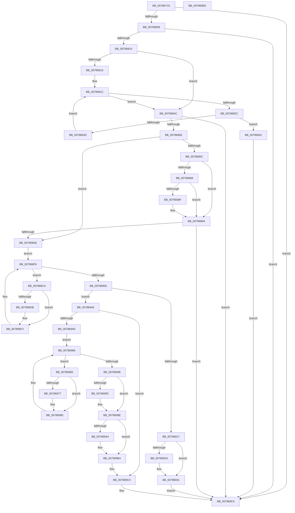

# PsStartSiloMonitor

- RVA: `0x007867C0`–`0x007869EF` (길이 `559` bytes)
- VA: `0x00000001407867C0`
- 실행 섹션: `PAGE`
- PDB 이름 있음: `예`; PDB Function 태그: `아니요`
- unwind 정보 RVA: `0x000CF308`
- 디코드: `161`개 명령, `559/559` bytes 표시
- 미해석 바이트: `0` (있으면 어셈블리에 `.byte`로 보존)

> 이 문서는 커널 이미지의 기계어와 PDB 기호를 분석해 생성했습니다. 4번과 5번은 함수 원형과 자료형을 바이너리 사용 방식에서 추정한 C 해석이며 원본 소스 복구 결과는 아닙니다.

## 1. Dependencies

- 직접 호출 지점: **22**; 고유 호출 대상: **10**
- 직접 호출자로 확인된 함수: **0**
- RIP 상대 이미지 참조: **5**

### Outgoing calls
- `0x007867F8` → [PspAcquirePushLockExclusive](../../text/5E/PspAcquirePushLockExclusive_function_005E3FDC.md) (function, `0x005E3FDC`)
- `0x0078681F` → [PspGetNextSilo](../91/PspGetNextSilo_function_00919F78.md) (function, `0x00919F78`)
- `0x0078682F` → [PspGetServerSiloStatePointer](../../text/4F/PspGetServerSiloStatePointer_function_004FCDB8.md) (function, `0x004FCDB8`)
- `0x0078686A` → [KiStackAttachProcess](../../text/21/KiStackAttachProcess_function_00216820.md) (function, `0x00216820`)
- `0x0078686F` → [HalAdjustResourceList](../../text/48/HalAdjustResourceList_function_0048FDC0.md) (function, `0x0048FDC0`)
- `0x0078687D` → [PspInvokeCreateCallback](PspInvokeCreateCallback_function_00786B94.md) (function, `0x00786B94`)
- `0x00786895` → [PspInvokeTerminateCallback](PspInvokeTerminateCallback_function_00786BF8.md) (function, `0x00786BF8`)
- `0x007868A1` → [KiUnstackDetachProcess](../../text/21/KiUnstackDetachProcess_function_00217D30.md) (function, `0x00217D30`)
- `0x007868C1` → [KiStackAttachProcess](../../text/21/KiStackAttachProcess_function_00216820.md) (function, `0x00216820`)
- `0x007868CD` → [PspGetServerSiloStatePointer](../../text/4F/PspGetServerSiloStatePointer_function_004FCDB8.md) (function, `0x004FCDB8`)
- `0x007868E4` → [PspInvokeCreateCallback](PspInvokeCreateCallback_function_00786B94.md) (function, `0x00786B94`)
- `0x007868F9` → [PspGetNextSilo](../91/PspGetNextSilo_function_00919F78.md) (function, `0x00919F78`)
- `0x0078690D` → [KiUnstackDetachProcess](../../text/21/KiUnstackDetachProcess_function_00217D30.md) (function, `0x00217D30`)
- `0x0078695D` → [KiStackAttachProcess](../../text/21/KiStackAttachProcess_function_00216820.md) (function, `0x00216820`)
- `0x00786969` → [PspGetServerSiloStatePointer](../../text/4F/PspGetServerSiloStatePointer_function_004FCDB8.md) (function, `0x004FCDB8`)
- `0x0078697D` → [PspInvokeTerminateCallback](PspInvokeTerminateCallback_function_00786BF8.md) (function, `0x00786BF8`)
- `0x0078698B` → [PspGetNextSilo](../91/PspGetNextSilo_function_00919F78.md) (function, `0x00919F78`)
- `0x007869A4` → [HalAdjustResourceList](../../text/48/HalAdjustResourceList_function_0048FDC0.md) (function, `0x0048FDC0`)
- `0x007869AF` → [PspInvokeCreateCallback](PspInvokeCreateCallback_function_00786B94.md) (function, `0x00786B94`)
- `0x007869BB` → [KiUnstackDetachProcess](../../text/21/KiUnstackDetachProcess_function_00217D30.md) (function, `0x00217D30`)
- `0x007869C5` → [PspReleasePushLockExclusive](../../text/5E/PspReleasePushLockExclusive_function_005E4040.md) (function, `0x005E4040`)
- `0x007869D4` → [_security_check_cookie](../../text/6A/_security_check_cookie_function_006AC640.md) (function, `0x006AC640`)

### Direct callers
- 이 함수 시작 RVA로 연결되는 직접 call은 확인되지 않았습니다. 간접 호출은 완전히 역산할 수 없습니다.

### Static image references
- `0x007867D2` → RVA `0x00E0A740` (`.data`; read)
- `0x0078685C` → RVA `0x00FC6AB0` (`ALMOSTRO`; read)
- `0x00786917` → RVA `0x00FDA070` (`PAGEDATA`; read)
- `0x0078691E` → RVA `0x00FDA068` (`PAGEDATA`; read)
- `0x0078693D` → RVA `0x00FDA070` (`PAGEDATA`; write)

## 2. Other-region calls and transfers

- 다른 실행 섹션으로 향하는 call: **14**
  - `0x007867F8` → [PspAcquirePushLockExclusive](../../text/5E/PspAcquirePushLockExclusive_function_005E3FDC.md) (`PAGE` → `.text`)
  - `0x0078682F` → [PspGetServerSiloStatePointer](../../text/4F/PspGetServerSiloStatePointer_function_004FCDB8.md) (`PAGE` → `.text`)
  - `0x0078686A` → [KiStackAttachProcess](../../text/21/KiStackAttachProcess_function_00216820.md) (`PAGE` → `.text`)
  - `0x0078686F` → [HalAdjustResourceList](../../text/48/HalAdjustResourceList_function_0048FDC0.md) (`PAGE` → `.text`)
  - `0x007868A1` → [KiUnstackDetachProcess](../../text/21/KiUnstackDetachProcess_function_00217D30.md) (`PAGE` → `.text`)
  - `0x007868C1` → [KiStackAttachProcess](../../text/21/KiStackAttachProcess_function_00216820.md) (`PAGE` → `.text`)
  - `0x007868CD` → [PspGetServerSiloStatePointer](../../text/4F/PspGetServerSiloStatePointer_function_004FCDB8.md) (`PAGE` → `.text`)
  - `0x0078690D` → [KiUnstackDetachProcess](../../text/21/KiUnstackDetachProcess_function_00217D30.md) (`PAGE` → `.text`)
  - `0x0078695D` → [KiStackAttachProcess](../../text/21/KiStackAttachProcess_function_00216820.md) (`PAGE` → `.text`)
  - `0x00786969` → [PspGetServerSiloStatePointer](../../text/4F/PspGetServerSiloStatePointer_function_004FCDB8.md) (`PAGE` → `.text`)
  - `0x007869A4` → [HalAdjustResourceList](../../text/48/HalAdjustResourceList_function_0048FDC0.md) (`PAGE` → `.text`)
  - `0x007869BB` → [KiUnstackDetachProcess](../../text/21/KiUnstackDetachProcess_function_00217D30.md) (`PAGE` → `.text`)
  - `0x007869C5` → [PspReleasePushLockExclusive](../../text/5E/PspReleasePushLockExclusive_function_005E4040.md) (`PAGE` → `.text`)
  - `0x007869D4` → [_security_check_cookie](../../text/6A/_security_check_cookie_function_006AC640.md) (`PAGE` → `.text`)
- 별도 외부 분기/꼬리 이동을 확인하지 못했습니다.

## 3. Assembly (complete function range)

```asm
007867C0  48 89 5C 24 10                  mov qword ptr [rsp + 0x10], rbx
007867C5  48 89 6C 24 18                  mov qword ptr [rsp + 0x18], rbp
007867CA  56                              push rsi
007867CB  57                              push rdi
007867CC  41 57                           push r15
007867CE  48 83 EC 60                     sub rsp, 0x60
007867D2  48 8B 05 67 3F 68 00            mov rax, qword ptr [rip + 0x683f67]
007867D9  48 33 C4                        xor rax, rsp
007867DC  48 89 44 24 50                  mov qword ptr [rsp + 0x50], rax
007867E1  0F 57 C0                        xorps xmm0, xmm0
007867E4  48 8B D9                        mov rbx, rcx
007867E7  0F 11 44 24 20                  movups xmmword ptr [rsp + 0x20], xmm0
007867EC  33 FF                           xor edi, edi
007867EE  0F 11 44 24 30                  movups xmmword ptr [rsp + 0x30], xmm0
007867F3  0F 11 44 24 40                  movups xmmword ptr [rsp + 0x40], xmm0
007867F8  E8 DF D7 E5 FF                  call 0x1405e3fdc
007867FD  48 39 3B                        cmp qword ptr [rbx], rdi
00786800  0F 85 BF 01 00 00               jne 0x1407869c5
00786806  48 39 7B 08                     cmp qword ptr [rbx + 8], rdi
0078680A  0F 85 B5 01 00 00               jne 0x1407869c5
00786810  44 8D 7F 01                     lea r15d, [rdi + 1]
00786814  40 38 7B 11                     cmp byte ptr [rbx + 0x11], dil
00786818  75 32                           jne 0x14078684c
0078681A  33 C9                           xor ecx, ecx
0078681C  41 8A D7                        mov dl, r15b
0078681F  E8 54 37 19 00                  call 0x140919f78
00786824  4C 8B C0                        mov r8, rax
00786827  48 85 C0                        test rax, rax
0078682A  74 20                           je 0x14078684c
0078682C  48 8B C8                        mov rcx, rax
0078682F  E8 84 65 D7 FF                  call 0x1404fcdb8
00786834  8B 08                           mov ecx, dword ptr [rax]
00786836  FF C9                           dec ecx
00786838  83 F9 02                        cmp ecx, 2
0078683B  76 05                           jbe 0x140786842
0078683D  49 8B C8                        mov rcx, r8
00786840  EB DA                           jmp 0x14078681c
00786842  BF BB 00 00 C0                  mov edi, 0xc00000bb
00786847  E9 79 01 00 00                  jmp 0x1407869c5
0078684C  48 39 7B 18                     cmp qword ptr [rbx + 0x18], rdi
00786850  0F 84 6F 01 00 00               je 0x1407869c5
00786856  40 38 7B 10                     cmp byte ptr [rbx + 0x10], dil
0078685A  74 52                           je 0x1407868ae
0078685C  48 8B 0D 4D 02 84 00            mov rcx, qword ptr [rip + 0x84024d]
00786863  4C 8D 44 24 20                  lea r8, [rsp + 0x20]
00786868  33 D2                           xor edx, edx
0078686A  E8 B1 FF A8 FF                  call 0x140216820
0078686F  E8 4C 95 D0 FF                  call 0x14048fdc0
00786874  48 8B D3                        mov rdx, rbx
00786877  48 8B C8                        mov rcx, rax
0078687A  48 8B F0                        mov rsi, rax
0078687D  E8 12 03 00 00                  call 0x140786b94
00786882  8B F8                           mov edi, eax
00786884  85 C0                           test eax, eax
00786886  79 12                           jns 0x14078689a
00786888  48 83 7B 20 00                  cmp qword ptr [rbx + 0x20], 0
0078688D  74 0B                           je 0x14078689a
0078688F  48 8B D3                        mov rdx, rbx
00786892  48 8B CE                        mov rcx, rsi
00786895  E8 5E 03 00 00                  call 0x140786bf8
0078689A  33 D2                           xor edx, edx
0078689C  48 8D 4C 24 20                  lea rcx, [rsp + 0x20]
007868A1  E8 8A 14 A9 FF                  call 0x140217d30
007868A6  85 FF                           test edi, edi
007868A8  0F 88 17 01 00 00               js 0x1407869c5
007868AE  48 8B 0D FB 01 84 00            mov rcx, qword ptr [rip + 0x8401fb]
007868B5  4C 8D 44 24 20                  lea r8, [rsp + 0x20]
007868BA  33 D2                           xor edx, edx
007868BC  40 32 F6                        xor sil, sil
007868BF  33 ED                           xor ebp, ebp
007868C1  E8 5A FF A8 FF                  call 0x140216820
007868C6  33 C9                           xor ecx, ecx
007868C8  EB 2C                           jmp 0x1407868f6
007868CA  48 8B CF                        mov rcx, rdi
007868CD  E8 E6 64 D7 FF                  call 0x1404fcdb8
007868D2  8B 08                           mov ecx, dword ptr [rax]
007868D4  FF C9                           dec ecx
007868D6  83 F9 02                        cmp ecx, 2
007868D9  77 18                           ja 0x1407868f3
007868DB  48 8B D3                        mov rdx, rbx
007868DE  48 8B CF                        mov rcx, rdi
007868E1  41 03 EF                        add ebp, r15d
007868E4  E8 AB 02 00 00                  call 0x140786b94
007868E9  85 C0                           test eax, eax
007868EB  40 0F B6 F6                     movzx esi, sil
007868EF  41 0F 48 F7                     cmovs esi, r15d
007868F3  48 8B CF                        mov rcx, rdi
007868F6  41 8A D7                        mov dl, r15b
007868F9  E8 7A 36 19 00                  call 0x140919f78
007868FE  48 8B F8                        mov rdi, rax
00786901  48 85 C0                        test rax, rax
00786904  75 C4                           jne 0x1407868ca
00786906  33 D2                           xor edx, edx
00786908  48 8D 4C 24 20                  lea rcx, [rsp + 0x20]
0078690D  E8 1E 14 A9 FF                  call 0x140217d30
00786912  40 84 F6                        test sil, sil
00786915  75 2F                           jne 0x140786946
00786917  48 8B 05 52 37 85 00            mov rax, qword ptr [rip + 0x853752]
0078691E  48 8D 0D 43 37 85 00            lea rcx, [rip + 0x853743]
00786925  48 39 08                        cmp qword ptr [rax], rcx
00786928  74 07                           je 0x140786931
0078692A  B9 03 00 00 00                  mov ecx, 3
0078692F  CD 29                           int 0x29
00786931  48 89 0B                        mov qword ptr [rbx], rcx
00786934  33 FF                           xor edi, edi
00786936  48 89 43 08                     mov qword ptr [rbx + 8], rax
0078693A  48 89 18                        mov qword ptr [rax], rbx
0078693D  48 89 1D 2C 37 85 00            mov qword ptr [rip + 0x85372c], rbx
00786944  EB 7F                           jmp 0x1407869c5
00786946  48 83 7B 20 00                  cmp qword ptr [rbx + 0x20], 0
0078694B  74 73                           je 0x1407869c0
0078694D  48 8B 0D 5C 01 84 00            mov rcx, qword ptr [rip + 0x84015c]
00786954  4C 8D 44 24 20                  lea r8, [rsp + 0x20]
00786959  33 D2                           xor edx, edx
0078695B  33 F6                           xor esi, esi
0078695D  E8 BE FE A8 FF                  call 0x140216820
00786962  33 C9                           xor ecx, ecx
00786964  EB 22                           jmp 0x140786988
00786966  48 8B CF                        mov rcx, rdi
00786969  E8 4A 64 D7 FF                  call 0x1404fcdb8
0078696E  8B 08                           mov ecx, dword ptr [rax]
00786970  FF C9                           dec ecx
00786972  83 F9 02                        cmp ecx, 2
00786975  77 0E                           ja 0x140786985
00786977  48 8B D3                        mov rdx, rbx
0078697A  48 8B CF                        mov rcx, rdi
0078697D  E8 76 02 00 00                  call 0x140786bf8
00786982  41 03 F7                        add esi, r15d
00786985  48 8B CF                        mov rcx, rdi
00786988  41 8A D7                        mov dl, r15b
0078698B  E8 E8 35 19 00                  call 0x140919f78
00786990  48 8B F8                        mov rdi, rax
00786993  48 85 C0                        test rax, rax
00786996  75 CE                           jne 0x140786966
00786998  3B EE                           cmp ebp, esi
0078699A  74 02                           je 0x14078699e
0078699C  CD 2C                           int 0x2c
0078699E  80 7B 10 00                     cmp byte ptr [rbx + 0x10], 0
007869A2  74 10                           je 0x1407869b4
007869A4  E8 17 94 D0 FF                  call 0x14048fdc0
007869A9  48 8B C8                        mov rcx, rax
007869AC  48 8B D3                        mov rdx, rbx
007869AF  E8 E0 01 00 00                  call 0x140786b94
007869B4  33 D2                           xor edx, edx
007869B6  48 8D 4C 24 20                  lea rcx, [rsp + 0x20]
007869BB  E8 70 13 A9 FF                  call 0x140217d30
007869C0  BF 40 02 00 C0                  mov edi, 0xc0000240
007869C5  E8 76 D6 E5 FF                  call 0x1405e4040
007869CA  8B C7                           mov eax, edi
007869CC  48 8B 4C 24 50                  mov rcx, qword ptr [rsp + 0x50]
007869D1  48 33 CC                        xor rcx, rsp
007869D4  E8 67 5C F2 FF                  call 0x1406ac640
007869D9  4C 8D 5C 24 60                  lea r11, [rsp + 0x60]
007869DE  49 8B 5B 28                     mov rbx, qword ptr [r11 + 0x28]
007869E2  49 8B 6B 30                     mov rbp, qword ptr [r11 + 0x30]
007869E6  49 8B E3                        mov rsp, r11
007869E9  41 5F                           pop r15
007869EB  5F                              pop rdi
007869EC  5E                              pop rsi
007869ED  C3                              ret
007869EE  CC                              int3
```

## 4. C-style interpretation (structured pseudocode)

```c
__int64 __fastcall PsStartSiloMonitor(__int64 a1)
{
    __int64 result;
    __int64 v_rbp;
    __int64 v_rdi;
    __int64 v_rsi;
    __int64 v_rsp;
    unsigned __int64 v_stack_m18;
    unsigned __int64 v_stack_m28;
    unsigned __int64 v_stack_m38;
    unsigned __int64 v_stack_m48;
    unsigned __int64 v_stack_m58;
    unsigned __int64 v_stack_p10;
    unsigned __int64 v_stack_p18;

    v_stack_p10 = v_rbx;
    v_stack_p18 = v_rbp;
    v_rsp = (v_rsp) - (96);
    result = (*(unsigned __int64 *)(v_rip + 6831975)) ^ (v_rsp);
    v_stack_m28 = result;
    v_stack_m58 = v_xmm0;
    v_rdi = 0;
    v_stack_m48 = v_xmm0;
    v_stack_m38 = v_xmm0;
    result = PspAcquirePushLockExclusive(a1, a2, a3, a4);
    if ((*(unsigned __int64 *)(a1)) != 0) goto loc_007869C5;
    if ((*(unsigned __int64 *)(a1 + 8)) != 0) goto loc_007869C5;
    if ((*(unsigned __int8 *)(a1 + 17)) != 0) goto loc_0078684C;
    a1 = 0;
loc_0078681C:
    result = PspGetNextSilo(a1, (unsigned __int8)(v_rdi + 1), a3, a4);
    if (result == 0) goto loc_0078684C;
    result = PspGetServerSiloStatePointer(result, (unsigned __int8)(v_rdi + 1), result, a4);
    a1 = (unsigned int)(((unsigned int)(*(unsigned int *)(result))) - 1);
    if (((unsigned int)(a1)) <= 2) goto loc_00786842;
    goto loc_0078681C;
loc_00786842:
    goto loc_007869C5;
loc_0078684C:
    if ((*(unsigned __int64 *)(a1 + 24)) == ((unsigned int)(0xC00000BBULL))) goto loc_007869C5;
    if ((*(unsigned __int8 *)(a1 + 16)) == ((unsigned __int8)((unsigned int)(0xC00000BBULL)))) goto loc_007868AE;
    a2 = 0;
    result = KiStackAttachProcess(*(unsigned __int64 *)(v_rip + 8651341), a2, v_stack_m58, a4);
    result = HalAdjustResourceList(*(unsigned __int64 *)(v_rip + 8651341), a2, v_stack_m58, a4);
    result = PspInvokeCreateCallback(result, a1, v_stack_m58, a4);
    if (!sign_flag) goto loc_0078689A;
    if ((*(unsigned __int64 *)(a1 + 32)) != 0) {
        a2 = a1;
        a1 = result;
        result = PspInvokeTerminateCallback(a1, a2, v_stack_m58, a4);
    }
    a2 = 0;
    result = KiUnstackDetachProcess(v_stack_m58, a2, v_stack_m58, a4);
    if (sign_flag) goto loc_007869C5;
loc_007868AE:
    a2 = 0;
    v_rsi = 0;
    v_rbp = 0;
    result = KiStackAttachProcess(*(unsigned __int64 *)(v_rip + 8651259), a2, v_stack_m58, a4);
    a1 = 0;
    goto loc_007868F6;
loc_007868CA:
    result = PspGetServerSiloStatePointer((unsigned int)((unsigned int)(result)), a2, v_stack_m58, a4);
    a1 = (unsigned int)(((unsigned int)(*(unsigned int *)(result))) - 1);
    if (((unsigned int)(a1)) <= 2) {
        a2 = a1;
        a1 = (unsigned int)((unsigned int)(result));
        v_rbp = (unsigned int)((v_rbp) + ((unsigned int)(v_rdi + 1)));
        result = PspInvokeCreateCallback(a1, a2, v_stack_m58, a4);
        v_rsi = 0;
        if (sign_flag) { v_rsi = (unsigned int)(v_rdi + 1); }
    }
loc_007868F6:
    result = PspGetNextSilo((unsigned int)((unsigned int)(result)), (unsigned __int8)(v_rdi + 1), v_stack_m58, a4);
    if (result != 0) goto loc_007868CA;
    a2 = 0;
    result = KiUnstackDetachProcess(v_stack_m58, a2, v_stack_m58, a4);
    if ((unsigned __int8)(v_rsi) != 0) goto loc_00786946;
    if ((*(unsigned __int64 *)(*(unsigned __int64 *)(v_rip + 8730450))) != (v_rip + 8730435)) {
        a1 = 3;
    }
    *(unsigned __int64 *)(a1) = a1;
    v_rdi = 0;
    *(unsigned __int64 *)(a1 + 8) = *(unsigned __int64 *)(v_rip + 8730450);
    *(unsigned __int64 *)(*(unsigned __int64 *)(v_rip + 8730450)) = a1;
    *(unsigned __int64 *)(v_rip + 8730412) = a1;
    goto loc_007869C5;
loc_00786946:
    if ((*(unsigned __int64 *)(a1 + 32)) == 0) goto loc_007869C0;
    a2 = 0;
    v_rsi = 0;
    result = KiStackAttachProcess(*(unsigned __int64 *)(v_rip + 8651100), a2, v_stack_m58, a4);
    a1 = 0;
    goto loc_00786988;
loc_00786966:
    result = PspGetServerSiloStatePointer(0, a2, v_stack_m58, a4);
    a1 = (unsigned int)(((unsigned int)(*(unsigned int *)(result))) - 1);
    if (((unsigned int)(a1)) <= 2) {
        a2 = a1;
        a1 = 0;
        result = PspInvokeTerminateCallback(a1, a2, v_stack_m58, a4);
        v_rsi = (unsigned int)((v_rsi) + ((unsigned int)(v_rdi + 1)));
    }
loc_00786988:
    result = PspGetNextSilo(0, (unsigned __int8)(v_rdi + 1), v_stack_m58, a4);
    if (result != 0) goto loc_00786966;
    if (((unsigned int)(v_rbp)) != ((unsigned int)(v_rsi))) {
    }
    if ((*(unsigned __int8 *)(a1 + 16)) != 0) {
        result = HalAdjustResourceList(0, (unsigned __int8)(v_rdi + 1), v_stack_m58, a4);
        a1 = result;
        a2 = a1;
        result = PspInvokeCreateCallback(a1, a2, v_stack_m58, a4);
    }
    a2 = 0;
    result = KiUnstackDetachProcess(v_stack_m58, a2, v_stack_m58, a4);
loc_007869C0:
loc_007869C5:
    result = PspReleasePushLockExclusive(v_stack_m58, a2, v_stack_m58, a4);
    a1 = (v_stack_m28) ^ (v_rsp);
    result = _security_check_cookie(a1, a2, v_stack_m58, a4);
    return result;
}
```

## 5. (Beta) C Style

```c
int64_t PsStartSiloMonitor(void *Arg1)
{
    uint8_t *arg1 = (uint8_t *)Arg1;

    int64_t result;
    int64_t local_rbp;
    int64_t local_rdi;
    int64_t local_rsi;
    int64_t local_rsp;
    uint64_t v_stack_m18;
    uint64_t v_stack_m28;
    uint64_t v_stack_m38;
    uint64_t v_stack_m48;
    uint64_t v_stack_m58;
    uint64_t v_stack_p10;
    uint64_t v_stack_p18;

    v_stack_p10 = local_rbx;
    v_stack_p18 = local_rbp;
    local_rsp = (local_rsp) - (96);
    result = (*(uint64_t *)(v_rip + 0x683F67)) ^ (local_rsp);
    v_stack_m28 = result;
    v_stack_m58 = v_xmm0;
    local_rdi = 0;
    v_stack_m48 = v_xmm0;
    v_stack_m38 = v_xmm0;
    result = PspAcquirePushLockExclusive(Arg1, a2, a3, a4);
    if ((*(uint64_t *)(arg1)) != 0) goto loc_007869C5;
    if ((*(uint64_t *)(arg1 + 0x8)) != 0) goto loc_007869C5;
    if ((*(uint8_t *)(arg1 + 0x11)) != 0) goto loc_0078684C;
    Arg1 = 0;
loc_0078681C:
    result = PspGetNextSilo(Arg1, (uint8_t)(local_rdi + 1), a3, a4);
    if (result == 0) goto loc_0078684C;
    result = PspGetServerSiloStatePointer(result, (uint8_t)(local_rdi + 1), result, a4);
    Arg1 = (uint32_t)(((uint32_t)(*(uint32_t *)(result))) - 1);
    if (((uint32_t)(Arg1)) <= 2) goto loc_00786842;
    goto loc_0078681C;
loc_00786842:
    goto loc_007869C5;
loc_0078684C:
    if ((*(uint64_t *)(arg1 + 0x18)) == ((uint32_t)(0xC00000BBULL))) goto loc_007869C5;
    if ((*(uint8_t *)(arg1 + 0x10)) == ((uint8_t)((uint32_t)(0xC00000BBULL)))) goto loc_007868AE;
    a2 = 0;
    result = KiStackAttachProcess(*(uint64_t *)(v_rip + 0x84024D), a2, v_stack_m58, a4);
    result = HalAdjustResourceList(*(uint64_t *)(v_rip + 0x84024D), a2, v_stack_m58, a4);
    result = PspInvokeCreateCallback(result, Arg1, v_stack_m58, a4);
    if (!sign_flag) goto loc_0078689A;
    if ((*(uint64_t *)(arg1 + 0x20)) != 0) {
        a2 = Arg1;
        Arg1 = result;
        result = PspInvokeTerminateCallback(Arg1, a2, v_stack_m58, a4);
    }
    a2 = 0;
    result = KiUnstackDetachProcess(v_stack_m58, a2, v_stack_m58, a4);
    if (sign_flag) goto loc_007869C5;
loc_007868AE:
    a2 = 0;
    local_rsi = 0;
    local_rbp = 0;
    result = KiStackAttachProcess(*(uint64_t *)(v_rip + 0x8401FB), a2, v_stack_m58, a4);
    Arg1 = 0;
    goto loc_007868F6;
loc_007868CA:
    result = PspGetServerSiloStatePointer((uint32_t)((uint32_t)(result)), a2, v_stack_m58, a4);
    Arg1 = (uint32_t)(((uint32_t)(*(uint32_t *)(result))) - 1);
    if (((uint32_t)(Arg1)) <= 2) {
        a2 = Arg1;
        Arg1 = (uint32_t)((uint32_t)(result));
        local_rbp = (uint32_t)((local_rbp) + ((uint32_t)(local_rdi + 1)));
        result = PspInvokeCreateCallback(Arg1, a2, v_stack_m58, a4);
        local_rsi = 0;
        if (sign_flag) { local_rsi = (uint32_t)(local_rdi + 1); }
    }
loc_007868F6:
    result = PspGetNextSilo((uint32_t)((uint32_t)(result)), (uint8_t)(local_rdi + 1), v_stack_m58, a4);
    if (result != 0) goto loc_007868CA;
    a2 = 0;
    result = KiUnstackDetachProcess(v_stack_m58, a2, v_stack_m58, a4);
    if ((uint8_t)(local_rsi) != 0) goto loc_00786946;
    if ((*(uint64_t *)(*(uint64_t *)(v_rip + 0x853752))) != (v_rip + 8730435)) {
        Arg1 = 3;
    }
    *(void **)(arg1) = Arg1;
    local_rdi = 0;
    *(uint64_t *)(arg1 + 0x8) = *(uint64_t *)(v_rip + 0x853752);
    *(void **)(*(uint64_t *)(v_rip + 0x853752)) = Arg1;
    *(void **)(v_rip + 0x85372C) = Arg1;
    goto loc_007869C5;
loc_00786946:
    if ((*(uint64_t *)(arg1 + 0x20)) == 0) goto loc_007869C0;
    a2 = 0;
    local_rsi = 0;
    result = KiStackAttachProcess(*(uint64_t *)(v_rip + 0x84015C), a2, v_stack_m58, a4);
    Arg1 = 0;
    goto loc_00786988;
loc_00786966:
    result = PspGetServerSiloStatePointer(0, a2, v_stack_m58, a4);
    Arg1 = (uint32_t)(((uint32_t)(*(uint32_t *)(result))) - 1);
    if (((uint32_t)(Arg1)) <= 2) {
        a2 = Arg1;
        Arg1 = 0;
        result = PspInvokeTerminateCallback(Arg1, a2, v_stack_m58, a4);
        local_rsi = (uint32_t)((local_rsi) + ((uint32_t)(local_rdi + 1)));
    }
loc_00786988:
    result = PspGetNextSilo(0, (uint8_t)(local_rdi + 1), v_stack_m58, a4);
    if (result != 0) goto loc_00786966;
    if (((uint32_t)(local_rbp)) != ((uint32_t)(local_rsi))) {
    }
    if ((*(uint8_t *)(arg1 + 0x10)) != 0) {
        result = HalAdjustResourceList(0, (uint8_t)(local_rdi + 1), v_stack_m58, a4);
        Arg1 = result;
        a2 = Arg1;
        result = PspInvokeCreateCallback(Arg1, a2, v_stack_m58, a4);
    }
    a2 = 0;
    result = KiUnstackDetachProcess(v_stack_m58, a2, v_stack_m58, a4);
loc_007869C0:
loc_007869C5:
    result = PspReleasePushLockExclusive(v_stack_m58, a2, v_stack_m58, a4);
    Arg1 = (v_stack_m28) ^ (local_rsp);
    result = _security_check_cookie(Arg1, a2, v_stack_m58, a4);
    return result;
}
```

### 관측된 메모리 오프셋

구조체 형식이 확인되지 않은 접근은 인자 기준의 오프셋으로만 기록했습니다.

| 기준 인자 | 오프셋 표현 | 폭 (bit) | 접근 |
|---|---:|---:|---|
| `Arg1` | `+ 0x0` | `64` | `R` |
| `Arg1` | `+ 0x0` | `64` | `W` |
| `Arg1` | `+ 0x8` | `64` | `R` |
| `Arg1` | `+ 0x8` | `64` | `W` |
| `Arg1` | `+ 0x10` | `8` | `R` |
| `Arg1` | `+ 0x11` | `8` | `R` |
| `Arg1` | `+ 0x18` | `64` | `R` |
| `Arg1` | `+ 0x20` | `64` | `R` |

## 6. Execution-region graph

[열기: 2D/3D 그래프와 함수 탐색 컨트롤 패널](../../../control-panel.html?section=page&rva=0x007867C0&view=graph)

- 2D 그래프는 위에서 아래로 흐르고, 3D 그래프는 빈 공간을 드래그해 회전합니다. Shift+드래그는 이동, 휠은 확대·축소, 함수 노드 선택은 대상 보고서 이동입니다.

### Static fallback


