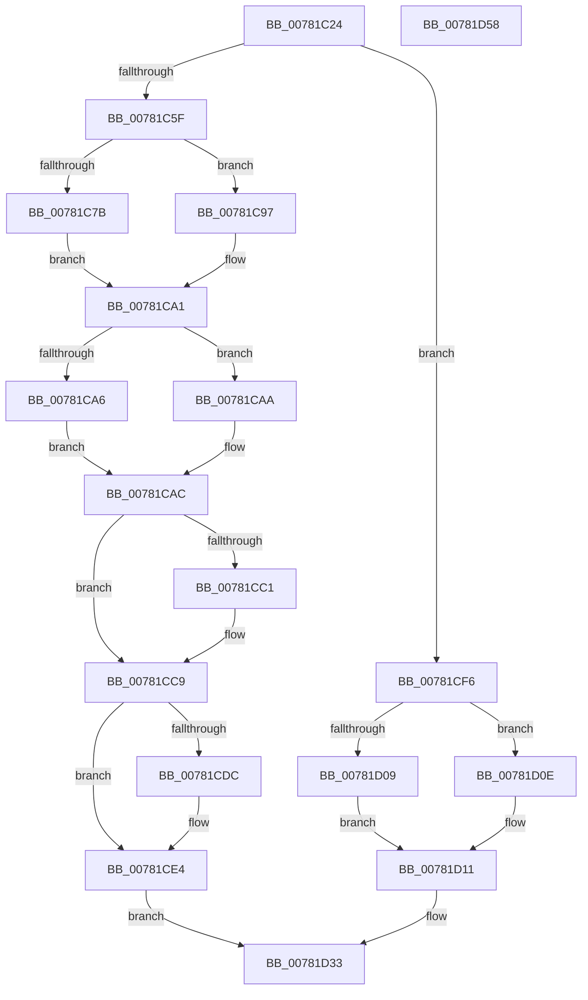

# PsSwapProcessWorkingSet

- RVA: `0x00781C24`–`0x00781D59` (길이 `309` bytes)
- VA: `0x0000000140781C24`
- 실행 섹션: `PAGE`
- PDB 이름 있음: `예`; PDB Function 태그: `아니요`
- unwind 정보 RVA: `0x000BEF48`
- 디코드: `86`개 명령, `309/309` bytes 표시
- 미해석 바이트: `0` (있으면 어셈블리에 `.byte`로 보존)

> 이 문서는 커널 이미지의 기계어와 PDB 기호를 분석해 생성했습니다. 4번과 5번은 함수 원형과 자료형을 바이너리 사용 방식에서 추정한 C 해석이며 원본 소스 복구 결과는 아닙니다.

## 1. Dependencies

- 직접 호출 지점: **13**; 고유 호출 대상: **13**
- 직접 호출자로 확인된 함수: **1**
- RIP 상대 이미지 참조: **0**

### Outgoing calls
- `0x00781C52` → [Feature_ProcesDirectSwap__private_IsEnabledDeviceUsageNoInline](../../text/5E/Feature_ProcesDirectSwap__private_IsEnabledDeviceUsageNoInline_function_005E3264.md) (function, `0x005E3264`)
- `0x00781C6A` → [PspLockProcessShared](../../text/40/PspLockProcessShared_function_004016D0.md) (function, `0x004016D0`)
- `0x00781C84` → [ExAcquireResourceSharedLite](../../text/21/ExAcquireResourceSharedLite_function_00211BC0.md) (function, `0x00211BC0`)
- `0x00781C8C` → [PspComputeExecutionState](../AA/PspComputeExecutionState_function_00AA008C.md) (function, `0x00AA008C`)
- `0x00781CB7` → [PspRequestProcessExecutionStateLegacy](../../text/5E/PspRequestProcessExecutionStateLegacy_function_005E42D8.md) (function, `0x005E42D8`)
- `0x00781CC4` → [ExReleaseResourceLite](../../text/25/ExReleaseResourceLite_function_0025FA10.md) (function, `0x0025FA10`)
- `0x00781CDF` → [ExfReleasePushLockShared](../../text/26/ExfReleasePushLockShared_function_00263440.md) (function, `0x00263440`)
- `0x00781CE7` → [KeAbPostRelease](../../text/2E/KeAbPostRelease_function_002E1600.md) (function, `0x002E1600`)
- `0x00781CEF` → [PspChangeProcessExecutionStateLegacy](../../text/5E/PspChangeProcessExecutionStateLegacy_function_005E4098.md) (function, `0x005E4098`)
- `0x00781CFB` → [PspInitializeProcessExecutionState](../../text/4B/PspInitializeProcessExecutionState_function_004BE450.md) (function, `0x004BE450`)
- `0x00781D26` → [PspRequestProcessExecutionState](../AE/PspRequestProcessExecutionState_function_00AEC7EC.md) (function, `0x00AEC7EC`)
- `0x00781D2E` → [PspChangeProcessExecutionState](../AE/PspChangeProcessExecutionState_function_00AEC594.md) (function, `0x00AEC594`)
- `0x00781D38` → [KiLeaveCriticalRegionUnsafe](../../text/25/KiLeaveCriticalRegionUnsafe_function_0025F010.md) (function, `0x0025F010`)

### Direct callers
- [MmProcessWorkingSetControl](../A6/MmProcessWorkingSetControl_function_00A616C4.md) at `0x00A61926`

### Static image references
- 디코드된 RIP-relative 메모리 참조가 없습니다.

## 2. Other-region calls and transfers

- 다른 실행 섹션으로 향하는 call: **10**
  - `0x00781C52` → [Feature_ProcesDirectSwap__private_IsEnabledDeviceUsageNoInline](../../text/5E/Feature_ProcesDirectSwap__private_IsEnabledDeviceUsageNoInline_function_005E3264.md) (`PAGE` → `.text`)
  - `0x00781C6A` → [PspLockProcessShared](../../text/40/PspLockProcessShared_function_004016D0.md) (`PAGE` → `.text`)
  - `0x00781C84` → [ExAcquireResourceSharedLite](../../text/21/ExAcquireResourceSharedLite_function_00211BC0.md) (`PAGE` → `.text`)
  - `0x00781CB7` → [PspRequestProcessExecutionStateLegacy](../../text/5E/PspRequestProcessExecutionStateLegacy_function_005E42D8.md) (`PAGE` → `.text`)
  - `0x00781CC4` → [ExReleaseResourceLite](../../text/25/ExReleaseResourceLite_function_0025FA10.md) (`PAGE` → `.text`)
  - `0x00781CDF` → [ExfReleasePushLockShared](../../text/26/ExfReleasePushLockShared_function_00263440.md) (`PAGE` → `.text`)
  - `0x00781CE7` → [KeAbPostRelease](../../text/2E/KeAbPostRelease_function_002E1600.md) (`PAGE` → `.text`)
  - `0x00781CEF` → [PspChangeProcessExecutionStateLegacy](../../text/5E/PspChangeProcessExecutionStateLegacy_function_005E4098.md) (`PAGE` → `.text`)
  - `0x00781CFB` → [PspInitializeProcessExecutionState](../../text/4B/PspInitializeProcessExecutionState_function_004BE450.md) (`PAGE` → `.text`)
  - `0x00781D38` → [KiLeaveCriticalRegionUnsafe](../../text/25/KiLeaveCriticalRegionUnsafe_function_0025F010.md) (`PAGE` → `.text`)
- 별도 외부 분기/꼬리 이동을 확인하지 못했습니다.

## 3. Assembly (complete function range)

```asm
00781C24  48 8B C4                        mov rax, rsp
00781C27  48 89 58 08                     mov qword ptr [rax + 8], rbx
00781C2B  48 89 68 10                     mov qword ptr [rax + 0x10], rbp
00781C2F  48 89 70 20                     mov qword ptr [rax + 0x20], rsi
00781C33  57                              push rdi
00781C34  41 56                           push r14
00781C36  41 57                           push r15
00781C38  48 83 EC 20                     sub rsp, 0x20
00781C3C  65 48 8B 34 25 88 01 00 00      mov rsi, qword ptr gs:[0x188]
00781C45  45 33 FF                        xor r15d, r15d
00781C48  44 88 78 18                     mov byte ptr [rax + 0x18], r15b
00781C4C  40 8A EA                        mov bpl, dl
00781C4F  48 8B D9                        mov rbx, rcx
00781C52  E8 0D 16 E6 FF                  call 0x1405e3264
00781C57  85 C0                           test eax, eax
00781C59  0F 85 97 00 00 00               jne 0x140781cf6
00781C5F  48 8B D6                        mov rdx, rsi
00781C62  44 88 7C 24 50                  mov byte ptr [rsp + 0x50], r15b
00781C67  48 8B CB                        mov rcx, rbx
00781C6A  E8 61 FA C7 FF                  call 0x1404016d0
00781C6F  48 8B BB A0 02 00 00            mov rdi, qword ptr [rbx + 0x2a0]
00781C76  48 85 FF                        test rdi, rdi
00781C79  74 1C                           je 0x140781c97
00781C7B  4C 8D 77 38                     lea r14, [rdi + 0x38]
00781C7F  B2 01                           mov dl, 1
00781C81  49 8B CE                        mov rcx, r14
00781C84  E8 37 FF A8 FF                  call 0x140211bc0
00781C89  48 8B CF                        mov rcx, rdi
00781C8C  E8 FB E3 31 00                  call 0x140aa008c
00781C91  88 44 24 50                     mov byte ptr [rsp + 0x50], al
00781C95  EB 0A                           jmp 0x140781ca1
00781C97  8A 44 24 50                     mov al, byte ptr [rsp + 0x50]
00781C9B  41 BE 38 00 00 00               mov r14d, 0x38
00781CA1  40 84 ED                        test bpl, bpl
00781CA4  74 04                           je 0x140781caa
00781CA6  0C 02                           or al, 2
00781CA8  EB 02                           jmp 0x140781cac
00781CAA  24 FD                           and al, 0xfd
00781CAC  41 B8 01 00 00 00               mov r8d, 1
00781CB2  8A D0                           mov dl, al
00781CB4  48 8B CB                        mov rcx, rbx
00781CB7  E8 1C 26 E6 FF                  call 0x1405e42d8
00781CBC  48 85 FF                        test rdi, rdi
00781CBF  74 08                           je 0x140781cc9
00781CC1  49 8B CE                        mov rcx, r14
00781CC4  E8 47 DD AD FF                  call 0x14025fa10
00781CC9  48 8D BB C8 01 00 00            lea rdi, [rbx + 0x1c8]
00781CD0  B8 11 00 00 00                  mov eax, 0x11
00781CD5  F0 4C 0F B1 3F                  lock cmpxchg qword ptr [rdi], r15
00781CDA  74 08                           je 0x140781ce4
00781CDC  48 8B CF                        mov rcx, rdi
00781CDF  E8 5C 17 AE FF                  call 0x140263440
00781CE4  48 8B CF                        mov rcx, rdi
00781CE7  E8 14 F9 B5 FF                  call 0x1402e1600
00781CEC  48 8B CB                        mov rcx, rbx
00781CEF  E8 A4 23 E6 FF                  call 0x1405e4098
00781CF4  EB 3D                           jmp 0x140781d33
00781CF6  48 8D 4C 24 50                  lea rcx, [rsp + 0x50]
00781CFB  E8 50 C7 D3 FF                  call 0x1404be450
00781D00  8A 54 24 50                     mov dl, byte ptr [rsp + 0x50]
00781D04  40 84 ED                        test bpl, bpl
00781D07  74 05                           je 0x140781d0e
00781D09  80 CA 02                        or dl, 2
00781D0C  EB 03                           jmp 0x140781d11
00781D0E  80 E2 FD                        and dl, 0xfd
00781D11  66 FF 8E E4 01 00 00            dec word ptr [rsi + 0x1e4]
00781D18  41 B9 02 00 00 00               mov r9d, 2
00781D1E  48 8B CB                        mov rcx, rbx
00781D21  90                              nop
00781D22  45 8D 41 FF                     lea r8d, [r9 - 1]
00781D26  E8 C1 AA 36 00                  call 0x140aec7ec
00781D2B  48 8B CB                        mov rcx, rbx
00781D2E  E8 61 A8 36 00                  call 0x140aec594
00781D33  48 8B CE                        mov rcx, rsi
00781D36  8B D8                           mov ebx, eax
00781D38  E8 D3 D2 AD FF                  call 0x14025f010
00781D3D  48 8B 6C 24 48                  mov rbp, qword ptr [rsp + 0x48]
00781D42  8B C3                           mov eax, ebx
00781D44  48 8B 5C 24 40                  mov rbx, qword ptr [rsp + 0x40]
00781D49  48 8B 74 24 58                  mov rsi, qword ptr [rsp + 0x58]
00781D4E  48 83 C4 20                     add rsp, 0x20
00781D52  41 5F                           pop r15
00781D54  41 5E                           pop r14
00781D56  5F                              pop rdi
00781D57  C3                              ret
00781D58  CC                              int3
```

## 4. C-style interpretation (structured pseudocode)

```c
__int64 __fastcall PsSwapProcessWorkingSet(__int64 a1, unsigned __int8 a2)
{
    __int64 result;
    __int64 v_r15;
    __int64 v_rsp;
    unsigned __int64 v_stack_p10;
    unsigned __int8 v_stack_p18;
    unsigned __int64 v_stack_p20;
    unsigned __int64 v_stack_p8;

    *(unsigned __int64 *)(v_rsp + 8) = v_rbx;
    *(unsigned __int64 *)(v_rsp + 16) = v_rbp;
    *(unsigned __int64 *)(v_rsp + 32) = v_rsi;
    v_rsp = (v_rsp) - (32);
    v_r15 = 0;
    *(unsigned __int8 *)(v_rsp + 24) = 0;
    result = Feature_ProcesDirectSwap__private_IsEnabledDeviceUsageNoInline(a1, a2, a3, a4);
    if ((unsigned int)(result) != 0) goto loc_00781CF6;
    v_stack_p18 = 0;
    result = PspLockProcessShared(a1, *(unsigned __int64 *)(gs_base + (0 + 392)), a3, a4);
    if (*(unsigned __int64 *)(a1 + 672) == 0) goto loc_00781C97;
    result = ExAcquireResourceSharedLite(*(unsigned __int64 *)(a1 + 672) + 56, 1, a3, a4);
    result = PspComputeExecutionState(*(unsigned __int64 *)(a1 + 672), 1, a3, a4);
    v_stack_p18 = (unsigned __int8)(result);
    goto loc_00781CA1;
loc_00781C97:
loc_00781CA1:
    if (a2 == 0) goto loc_00781CAA;
    result = (unsigned __int8)((v_stack_p18) | (2));
    goto loc_00781CAC;
loc_00781CAA:
    result = (unsigned __int8)((result) & (253));
loc_00781CAC:
    result = PspRequestProcessExecutionStateLegacy(a1, (unsigned __int8)(result), 1, a4);
    if (*(unsigned __int64 *)(a1 + 672) != 0) {
        a1 = 56;
        result = ExReleaseResourceLite(a1, (unsigned __int8)(result), 1, a4);
    }
    result = 17;
    if (*(unsigned __int64 *)(a1 + 672) != 0) {
        a1 = a1 + 456;
        result = ExfReleasePushLockShared(a1, (unsigned __int8)(result), 1, a4);
    }
    result = KeAbPostRelease(a1 + 456, (unsigned __int8)(result), 1, a4);
    result = PspChangeProcessExecutionStateLegacy(a1, (unsigned __int8)(result), 1, a4);
    goto loc_00781D33;
loc_00781CF6:
    result = PspInitializeProcessExecutionState(v_stack_p18, (unsigned __int8)(result), 1, a4);
    if (a2 == 0) goto loc_00781D0E;
    a2 = (unsigned __int8)((v_stack_p18) | (2));
    goto loc_00781D11;
loc_00781D0E:
    a2 = (unsigned __int8)((a2) & (253));
loc_00781D11:
    result = PspRequestProcessExecutionState(a1, a2, 2 - 1, 2);
    result = PspChangeProcessExecutionState(a1, a2, 2 - 1, 2);
loc_00781D33:
    result = KiLeaveCriticalRegionUnsafe(*(unsigned __int64 *)(gs_base + (0 + 392)), a2, 2 - 1, 2);
    v_rsp = (v_rsp) + (32);
    return (unsigned int)((unsigned int)((unsigned int)((unsigned int)(result))));
}
```

## 5. (Beta) C Style

```c
int64_t PsSwapProcessWorkingSet(void *Arg1, uint8_t Arg2)
{
    uint8_t *arg1 = (uint8_t *)Arg1;

    int64_t result;
    int64_t local_r15;
    int64_t local_rsp;
    uint64_t v_stack_p10;
    uint8_t v_stack_p18;
    uint64_t v_stack_p20;
    uint64_t v_stack_p8;

    *(uint64_t *)(local_rsp + 0x8) = local_rbx;
    *(uint64_t *)(local_rsp + 0x10) = local_rbp;
    *(uint64_t *)(local_rsp + 0x20) = local_rsi;
    local_rsp = (local_rsp) - (32);
    local_r15 = 0;
    *(uint8_t *)(local_rsp + 0x18) = 0;
    result = Feature_ProcesDirectSwap__private_IsEnabledDeviceUsageNoInline(Arg1, Arg2, a3, a4);
    if ((uint32_t)(result) != 0) goto loc_00781CF6;
    v_stack_p18 = 0;
    result = PspLockProcessShared(Arg1, *(uint64_t *)(gs_base + (0 + 0x188)), a3, a4);
    if (*(uint64_t *)(arg1 + 0x2A0) == 0) goto loc_00781C97;
    result = ExAcquireResourceSharedLite(*(uint64_t *)(arg1 + 0x2A0) + 56, 1, a3, a4);
    result = PspComputeExecutionState(*(uint64_t *)(arg1 + 0x2A0), 1, a3, a4);
    v_stack_p18 = (uint8_t)(result);
    goto loc_00781CA1;
loc_00781C97:
loc_00781CA1:
    if (Arg2 == 0) goto loc_00781CAA;
    result = (uint8_t)((v_stack_p18) | (2));
    goto loc_00781CAC;
loc_00781CAA:
    result = (uint8_t)((result) & (253));
loc_00781CAC:
    result = PspRequestProcessExecutionStateLegacy(Arg1, (uint8_t)(result), 1, a4);
    if (*(uint64_t *)(arg1 + 0x2A0) != 0) {
        Arg1 = 56;
        result = ExReleaseResourceLite(Arg1, (uint8_t)(result), 1, a4);
    }
    result = 17;
    if (*(uint64_t *)(arg1 + 0x2A0) != 0) {
        Arg1 = Arg1 + 456;
        result = ExfReleasePushLockShared(Arg1, (uint8_t)(result), 1, a4);
    }
    result = KeAbPostRelease(Arg1 + 456, (uint8_t)(result), 1, a4);
    result = PspChangeProcessExecutionStateLegacy(Arg1, (uint8_t)(result), 1, a4);
    goto loc_00781D33;
loc_00781CF6:
    result = PspInitializeProcessExecutionState(v_stack_p18, (uint8_t)(result), 1, a4);
    if (Arg2 == 0) goto loc_00781D0E;
    Arg2 = (uint8_t)((v_stack_p18) | (2));
    goto loc_00781D11;
loc_00781D0E:
    Arg2 = (uint8_t)((Arg2) & (253));
loc_00781D11:
    result = PspRequestProcessExecutionState(Arg1, Arg2, 2 - 1, 2);
    result = PspChangeProcessExecutionState(Arg1, Arg2, 2 - 1, 2);
loc_00781D33:
    result = KiLeaveCriticalRegionUnsafe(*(uint64_t *)(gs_base + (0 + 0x188)), Arg2, 2 - 1, 2);
    local_rsp = (local_rsp) + (32);
    return (uint32_t)((uint32_t)((uint32_t)((uint32_t)(result))));
}
```

### 관측된 메모리 오프셋

구조체 형식이 확인되지 않은 접근은 인자 기준의 오프셋으로만 기록했습니다.

| 기준 인자 | 오프셋 표현 | 폭 (bit) | 접근 |
|---|---:|---:|---|
| `Arg1` | `+ 0x0` | `64` | `R` |
| `Arg1` | `+ 0x1C8` | `64` | `R` |
| `Arg1` | `+ 0x2A0` | `64` | `R` |

## 6. Execution-region graph

[열기: 2D/3D 그래프와 함수 탐색 컨트롤 패널](../../../control-panel.html?section=page&rva=0x00781C24&view=graph)

- 2D 그래프는 위에서 아래로 흐르고, 3D 그래프는 빈 공간을 드래그해 회전합니다. Shift+드래그는 이동, 휠은 확대·축소, 함수 노드 선택은 대상 보고서 이동입니다.

### Static fallback


