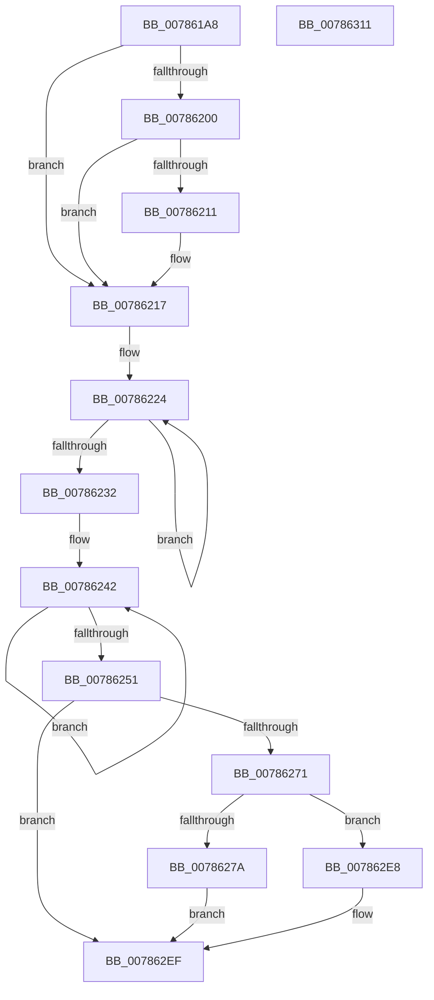

# PsTerminateMinimalProcess

- RVA: `0x007861A8`–`0x00786312` (길이 `362` bytes)
- VA: `0x00000001407861A8`
- 실행 섹션: `PAGE`
- PDB 이름 있음: `예`; PDB Function 태그: `아니요`
- unwind 정보 RVA: `0x000CF28C`
- 디코드: `97`개 명령, `362/362` bytes 표시
- 미해석 바이트: `0` (있으면 어셈블리에 `.byte`로 보존)

> 이 문서는 커널 이미지의 기계어와 PDB 기호를 분석해 생성했습니다. 4번과 5번은 함수 원형과 자료형을 바이너리 사용 방식에서 추정한 C 해석이며 원본 소스 복구 결과는 아닙니다.

## 1. Dependencies

- 직접 호출 지점: **10**; 고유 호출 대상: **7**
- 직접 호출자로 확인된 함수: **5**
- RIP 상대 이미지 참조: **1**

### Outgoing calls
- `0x007861F1` → [PspLockProcessExclusive](../../text/46/PspLockProcessExclusive_function_00460164.md) (function, `0x00460164`)
- `0x00786259` → [PspUnlockProcessExclusive](../../text/46/PspUnlockProcessExclusive_function_004601C0.md) (function, `0x004601C0`)
- `0x0078627F` → [KeStackAttachProcess](../../text/21/KeStackAttachProcess_function_00216800.md) (function, `0x00216800`)
- `0x00786297` → [PspExitLastThread](../90/PspExitLastThread_function_00904184.md) (function, `0x00904184`)
- `0x007862AB` → [PspExitLastThread](../90/PspExitLastThread_function_00904184.md) (function, `0x00904184`)
- `0x007862C0` → [PspExitLastThread](../90/PspExitLastThread_function_00904184.md) (function, `0x00904184`)
- `0x007862D5` → [PspExitLastThread](../90/PspExitLastThread_function_00904184.md) (function, `0x00904184`)
- `0x007862E1` → [KiUnstackDetachProcess](../../text/21/KiUnstackDetachProcess_function_00217D30.md) (function, `0x00217D30`)
- `0x007862EA` → [PspRundownSingleProcess](../90/PspRundownSingleProcess_function_00906D50.md) (function, `0x00906D50`)
- `0x007862F7` → [_security_check_cookie](../../text/6A/_security_check_cookie_function_006AC640.md) (function, `0x006AC640`)

### Direct callers
- [SmTerminateStoreProcess](../../text/60/SmTerminateStoreProcess_function_0060EB18.md) at `0x0060EB2E`
- [PsCreateMinimalProcess](PsCreateMinimalProcess_function_00786D14.md) at `0x0078709D`
- [PspTeardownPartition](PspTeardownPartition_function_00788480.md) at `0x00788587`
- [VmTerminateMemoryProcess](../7A/VmTerminateMemoryProcess_function_007AD6D0.md) at `0x007AD708`
- [NtTerminateProcess](../AE/NtTerminateProcess_function_00AEC320.md) at `0x00AEC3D0`

### Static image references
- `0x007861BA` → RVA `0x00E0A740` (`.data`; read)

## 2. Other-region calls and transfers

- 다른 실행 섹션으로 향하는 call: **5**
  - `0x007861F1` → [PspLockProcessExclusive](../../text/46/PspLockProcessExclusive_function_00460164.md) (`PAGE` → `.text`)
  - `0x00786259` → [PspUnlockProcessExclusive](../../text/46/PspUnlockProcessExclusive_function_004601C0.md) (`PAGE` → `.text`)
  - `0x0078627F` → [KeStackAttachProcess](../../text/21/KeStackAttachProcess_function_00216800.md) (`PAGE` → `.text`)
  - `0x007862E1` → [KiUnstackDetachProcess](../../text/21/KiUnstackDetachProcess_function_00217D30.md) (`PAGE` → `.text`)
  - `0x007862F7` → [_security_check_cookie](../../text/6A/_security_check_cookie_function_006AC640.md) (`PAGE` → `.text`)
- 별도 외부 분기/꼬리 이동을 확인하지 못했습니다.

## 3. Assembly (complete function range)

```asm
007861A8  48 89 5C 24 10                  mov qword ptr [rsp + 0x10], rbx
007861AD  48 89 6C 24 18                  mov qword ptr [rsp + 0x18], rbp
007861B2  56                              push rsi
007861B3  57                              push rdi
007861B4  41 56                           push r14
007861B6  48 83 EC 70                     sub rsp, 0x70
007861BA  48 8B 05 7F 45 68 00            mov rax, qword ptr [rip + 0x68457f]
007861C1  48 33 C4                        xor rax, rsp
007861C4  48 89 44 24 60                  mov qword ptr [rsp + 0x60], rax
007861C9  0F 57 C0                        xorps xmm0, xmm0
007861CC  8B EA                           mov ebp, edx
007861CE  0F 11 44 24 30                  movups xmmword ptr [rsp + 0x30], xmm0
007861D3  48 8B D9                        mov rbx, rcx
007861D6  BF 08 00 00 00                  mov edi, 8
007861DB  0F 11 44 24 40                  movups xmmword ptr [rsp + 0x40], xmm0
007861E0  0F 11 44 24 50                  movups xmmword ptr [rsp + 0x50], xmm0
007861E5  65 48 8B 34 25 88 01 00 00      mov rsi, qword ptr gs:[0x188]
007861EE  48 8B D6                        mov rdx, rsi
007861F1  E8 6E 9F CD FF                  call 0x140460164
007861F6  8B 83 80 03 00 00               mov eax, dword ptr [rbx + 0x380]
007861FC  85 C0                           test eax, eax
007861FE  75 17                           jne 0x140786217
00786200  81 BB 54 05 00 00 03 01 00 00   cmp dword ptr [rbx + 0x554], 0x103
0078620A  BF 08 00 00 02                  mov edi, 0x2000008
0078620F  75 06                           jne 0x140786217
00786211  89 AB 54 05 00 00               mov dword ptr [rbx + 0x554], ebp
00786217  0F 0D 8B F4 01 00 00            prefetchw byte ptr [rbx + 0x1f4]
0078621E  8B 83 F4 01 00 00               mov eax, dword ptr [rbx + 0x1f4]
00786224  8B C8                           mov ecx, eax
00786226  0B CF                           or ecx, edi
00786228  F0 0F B1 8B F4 01 00 00         lock cmpxchg dword ptr [rbx + 0x1f4], ecx
00786230  75 F2                           jne 0x140786224
00786232  44 8B F0                        mov r14d, eax
00786235  0F 0D 8B DC 07 00 00            prefetchw byte ptr [rbx + 0x7dc]
0078623C  8B 83 DC 07 00 00               mov eax, dword ptr [rbx + 0x7dc]
00786242  8B C8                           mov ecx, eax
00786244  83 C9 02                        or ecx, 2
00786247  F0 0F B1 8B DC 07 00 00         lock cmpxchg dword ptr [rbx + 0x7dc], ecx
0078624F  75 F1                           jne 0x140786242
00786251  48 8B D6                        mov rdx, rsi
00786254  48 8B CB                        mov rcx, rbx
00786257  8B E8                           mov ebp, eax
00786259  E8 62 9F CD FF                  call 0x1404601c0
0078625E  41 0F BA E6 19                  bt r14d, 0x19
00786263  0F 93 C2                        setae dl
00786266  0F BA E7 19                     bt edi, 0x19
0078626A  0F 92 C1                        setb cl
0078626D  84 D1                           test cl, dl
0078626F  74 7E                           je 0x1407862ef
00786271  48 8B CB                        mov rcx, rbx
00786274  40 F6 C5 01                     test bpl, 1
00786278  74 6E                           je 0x1407862e8
0078627A  48 8D 54 24 30                  lea rdx, [rsp + 0x30]
0078627F  E8 7C 05 A9 FF                  call 0x140216800
00786284  BF 4B 00 00 C0                  mov edi, 0xc000004b
00786289  45 33 C9                        xor r9d, r9d
0078628C  4C 8B C3                        mov r8, rbx
0078628F  89 7C 24 20                     mov dword ptr [rsp + 0x20], edi
00786293  33 D2                           xor edx, edx
00786295  33 C9                           xor ecx, ecx
00786297  E8 E8 DE 17 00                  call 0x140904184
0078629C  33 D2                           xor edx, edx
0078629E  89 7C 24 20                     mov dword ptr [rsp + 0x20], edi
007862A2  45 33 C9                        xor r9d, r9d
007862A5  4C 8B C3                        mov r8, rbx
007862A8  8D 4A 01                        lea ecx, [rdx + 1]
007862AB  E8 D4 DE 17 00                  call 0x140904184
007862B0  83 64 24 20 00                  and dword ptr [rsp + 0x20], 0
007862B5  33 D2                           xor edx, edx
007862B7  45 33 C9                        xor r9d, r9d
007862BA  4C 8B C3                        mov r8, rbx
007862BD  8D 4A 02                        lea ecx, [rdx + 2]
007862C0  E8 BF DE 17 00                  call 0x140904184
007862C5  83 64 24 20 00                  and dword ptr [rsp + 0x20], 0
007862CA  33 D2                           xor edx, edx
007862CC  45 33 C9                        xor r9d, r9d
007862CF  4C 8B C3                        mov r8, rbx
007862D2  8D 4A 03                        lea ecx, [rdx + 3]
007862D5  E8 AA DE 17 00                  call 0x140904184
007862DA  33 D2                           xor edx, edx
007862DC  48 8D 4C 24 30                  lea rcx, [rsp + 0x30]
007862E1  E8 4A 1A A9 FF                  call 0x140217d30
007862E6  EB 07                           jmp 0x1407862ef
007862E8  B2 01                           mov dl, 1
007862EA  E8 61 0A 18 00                  call 0x140906d50
007862EF  48 8B 4C 24 60                  mov rcx, qword ptr [rsp + 0x60]
007862F4  48 33 CC                        xor rcx, rsp
007862F7  E8 44 63 F2 FF                  call 0x1406ac640
007862FC  4C 8D 5C 24 70                  lea r11, [rsp + 0x70]
00786301  49 8B 5B 28                     mov rbx, qword ptr [r11 + 0x28]
00786305  49 8B 6B 30                     mov rbp, qword ptr [r11 + 0x30]
00786309  49 8B E3                        mov rsp, r11
0078630C  41 5E                           pop r14
0078630E  5F                              pop rdi
0078630F  5E                              pop rsi
00786310  C3                              ret
00786311  CC                              int3
```

## 4. C-style interpretation (structured pseudocode)

```c
__int64 __fastcall PsTerminateMinimalProcess(__int64 a1, int a2, __int64 a3, int a4)
{
    __int64 result;
    __int64 v_rsp;
    unsigned __int64 v_stack_m18;
    unsigned __int64 v_stack_m28;
    unsigned __int64 v_stack_m38;
    unsigned __int64 v_stack_m48;
    unsigned __int64 v_stack_m58;
    unsigned int v_stack_m68;
    unsigned __int64 v_stack_p10;
    unsigned __int64 v_stack_p18;

    v_stack_p10 = v_rbx;
    v_stack_p18 = v_rbp;
    v_rsp = (v_rsp) - (112);
    result = (*(unsigned __int64 *)(v_rip + 6833535)) ^ (v_rsp);
    v_stack_m28 = result;
    v_stack_m58 = v_xmm0;
    v_stack_m48 = v_xmm0;
    v_stack_m38 = v_xmm0;
    result = PspLockProcessExclusive(a1, *(unsigned __int64 *)(gs_base + (0 + 392)), a3, a4);
    if ((unsigned int)((unsigned int)(*(unsigned int *)(a1 + 896))) != 0) goto loc_00786217;
    if ((*(unsigned int *)(a1 + 1364)) == 259) {
        *(unsigned int *)(a1 + 1364) = (unsigned int)((unsigned int)(a2));
    }
loc_00786224:
    a1 = (unsigned int)(((unsigned int)((unsigned int)((unsigned int)(*(unsigned int *)(a1 + 500))))) | ((unsigned int)((unsigned int)(0x2000008ULL))));
    if (condition_is_not_equal) goto loc_00786224;
loc_00786242:
    a1 = (unsigned int)(((unsigned int)((unsigned int)((unsigned int)(*(unsigned int *)(a1 + 2012))))) | (2));
    if (condition_is_not_equal) goto loc_00786242;
    result = PspUnlockProcessExclusive(a1, *(unsigned __int64 *)(gs_base + (0 + 392)), a3, a4);
    a2 = (condition_is_above_or_equal) ? 1 : 0;
    a1 = (condition_is_below) ? 1 : 0;
    if ((((unsigned __int8)(a1)) & ((unsigned __int8)(a2))) == 0) goto loc_007862EF;
    if ((((unsigned __int8)((unsigned int)((unsigned int)((unsigned int)(*(unsigned int *)(a1 + 2012)))))) & (1)) == 0) goto loc_007862E8;
    result = KeStackAttachProcess(a1, v_stack_m58, a3, a4);
    a4 = 0;
    v_stack_m68 = (unsigned int)((unsigned int)(0xC000004BULL));
    a2 = 0;
    a1 = 0;
    result = PspExitLastThread(a1, a2, a1, a4);
    a2 = 0;
    v_stack_m68 = (unsigned int)((unsigned int)(0xC000004BULL));
    a4 = 0;
    result = PspExitLastThread(a2 + 1, a2, 0, a4);
    a2 = 0;
    a4 = 0;
    result = PspExitLastThread(a2 + 2, a2, 0, a4);
    a2 = 0;
    a4 = 0;
    result = PspExitLastThread(a2 + 3, a2, 0, a4);
    a2 = 0;
    result = KiUnstackDetachProcess(v_stack_m58, a2, 0, a4);
    goto loc_007862EF;
loc_007862E8:
    result = PspRundownSingleProcess(v_stack_m58, 1, 0, a4);
loc_007862EF:
    a1 = (v_stack_m28) ^ (v_rsp);
    result = _security_check_cookie(a1, 1, 0, a4);
    return result;
}
```

## 5. (Beta) C Style

```c
int64_t PsTerminateMinimalProcess(void *Arg1, int32_t Arg2, int64_t Arg3, int32_t Arg4)
{
    uint8_t *arg1 = (uint8_t *)Arg1;

    int64_t result;
    int64_t local_rsp;
    uint64_t v_stack_m18;
    uint64_t v_stack_m28;
    uint64_t v_stack_m38;
    uint64_t v_stack_m48;
    uint64_t v_stack_m58;
    uint32_t v_stack_m68;
    uint64_t v_stack_p10;
    uint64_t v_stack_p18;

    v_stack_p10 = local_rbx;
    v_stack_p18 = local_rbp;
    local_rsp = (local_rsp) - (112);
    result = (*(uint64_t *)(v_rip + 0x68457F)) ^ (local_rsp);
    v_stack_m28 = result;
    v_stack_m58 = v_xmm0;
    v_stack_m48 = v_xmm0;
    v_stack_m38 = v_xmm0;
    result = PspLockProcessExclusive(Arg1, *(uint64_t *)(gs_base + (0 + 0x188)), Arg3, Arg4);
    if ((uint32_t)((uint32_t)(*(uint32_t *)(arg1 + 0x380))) != 0) goto loc_00786217;
    if ((*(uint32_t *)(arg1 + 0x554)) == 259) {
        *(uint32_t *)(arg1 + 0x554) = (uint32_t)((uint32_t)(Arg2));
    }
loc_00786224:
    Arg1 = (uint32_t)(((uint32_t)((uint32_t)((uint32_t)(*(uint32_t *)(arg1 + 0x1F4))))) | ((uint32_t)((uint32_t)(0x2000008ULL))));
    if (condition_is_not_equal) goto loc_00786224;
loc_00786242:
    Arg1 = (uint32_t)(((uint32_t)((uint32_t)((uint32_t)(*(uint32_t *)(arg1 + 0x7DC))))) | (2));
    if (condition_is_not_equal) goto loc_00786242;
    result = PspUnlockProcessExclusive(Arg1, *(uint64_t *)(gs_base + (0 + 0x188)), Arg3, Arg4);
    Arg2 = (condition_is_above_or_equal) ? 1 : 0;
    Arg1 = (condition_is_below) ? 1 : 0;
    if ((((uint8_t)(Arg1)) & ((uint8_t)(Arg2))) == 0) goto loc_007862EF;
    if ((((uint8_t)((uint32_t)((uint32_t)((uint32_t)(*(uint32_t *)(arg1 + 0x7DC)))))) & (1)) == 0) goto loc_007862E8;
    result = KeStackAttachProcess(Arg1, v_stack_m58, Arg3, Arg4);
    Arg4 = 0;
    v_stack_m68 = (uint32_t)((uint32_t)(0xC000004BULL));
    Arg2 = 0;
    Arg1 = 0;
    result = PspExitLastThread(Arg1, Arg2, Arg1, Arg4);
    Arg2 = 0;
    v_stack_m68 = (uint32_t)((uint32_t)(0xC000004BULL));
    Arg4 = 0;
    result = PspExitLastThread(Arg2 + 1, Arg2, 0, Arg4);
    Arg2 = 0;
    Arg4 = 0;
    result = PspExitLastThread(Arg2 + 2, Arg2, 0, Arg4);
    Arg2 = 0;
    Arg4 = 0;
    result = PspExitLastThread(Arg2 + 3, Arg2, 0, Arg4);
    Arg2 = 0;
    result = KiUnstackDetachProcess(v_stack_m58, Arg2, 0, Arg4);
    goto loc_007862EF;
loc_007862E8:
    result = PspRundownSingleProcess(v_stack_m58, 1, 0, Arg4);
loc_007862EF:
    Arg1 = (v_stack_m28) ^ (local_rsp);
    result = _security_check_cookie(Arg1, 1, 0, Arg4);
    return result;
}
```

### 관측된 메모리 오프셋

구조체 형식이 확인되지 않은 접근은 인자 기준의 오프셋으로만 기록했습니다.

| 기준 인자 | 오프셋 표현 | 폭 (bit) | 접근 |
|---|---:|---:|---|
| `Arg1` | `+ 0x1F4` | `8` | `R` |
| `Arg1` | `+ 0x1F4` | `32` | `R` |
| `Arg1` | `+ 0x380` | `32` | `R` |
| `Arg1` | `+ 0x554` | `32` | `R` |
| `Arg1` | `+ 0x554` | `32` | `W` |
| `Arg1` | `+ 0x7DC` | `8` | `R` |
| `Arg1` | `+ 0x7DC` | `32` | `R` |

## 6. Execution-region graph

[열기: 2D/3D 그래프와 함수 탐색 컨트롤 패널](../../../control-panel.html?section=page&rva=0x007861A8&view=graph)

- 2D 그래프는 위에서 아래로 흐르고, 3D 그래프는 빈 공간을 드래그해 회전합니다. Shift+드래그는 이동, 휠은 확대·축소, 함수 노드 선택은 대상 보고서 이동입니다.

### Static fallback


