# PsTerminateVsmEnclave

- RVA: `0x00788A64`–`0x00788CA7` (길이 `579` bytes)
- VA: `0x0000000140788A64`
- 실행 섹션: `PAGE`
- PDB 이름 있음: `예`; PDB Function 태그: `아니요`
- unwind 정보 RVA: `0x000CF530`
- 디코드: `158`개 명령, `579/579` bytes 표시
- 미해석 바이트: `0` (있으면 어셈블리에 `.byte`로 보존)

> 이 문서는 커널 이미지의 기계어와 PDB 기호를 분석해 생성했습니다. 4번과 5번은 함수 원형과 자료형을 바이너리 사용 방식에서 추정한 C 해석이며 원본 소스 복구 결과는 아닙니다.

## 1. Dependencies

- 직접 호출 지점: **15**; 고유 호출 대상: **12**
- 직접 호출자로 확인된 함수: **2**
- RIP 상대 이미지 참조: **1**

### Outgoing calls
- `0x00788AC3` → [KeAbPreAcquire](../../text/21/KeAbPreAcquire_function_00210230.md) (function, `0x00210230`)
- `0x00788AE4` → [ExfAcquirePushLockSharedEx](../../text/21/ExfAcquirePushLockSharedEx_function_0021044C.md) (function, `0x0021044C`)
- `0x00788B09` → [KeSetEvent](../../text/33/KeSetEvent_function_0033F310.md) (function, `0x0033F310`)
- `0x00788B3D` → [KeAbPreAcquire](../../text/21/KeAbPreAcquire_function_00210230.md) (function, `0x00210230`)
- `0x00788B57` → [ExfAcquirePushLockExclusiveEx](../../text/20/ExfAcquirePushLockExclusiveEx_function_0020FC90.md) (function, `0x0020FC90`)
- `0x00788BA2` → [KeSetEvent](../../text/33/KeSetEvent_function_0033F310.md) (function, `0x0033F310`)
- `0x00788BC1` → [ExfTryToWakePushLock](../../text/26/ExfTryToWakePushLock_function_00265DD0.md) (function, `0x00265DD0`)
- `0x00788BC9` → [KeAbPostRelease](../../text/2E/KeAbPostRelease_function_002E1600.md) (function, `0x002E1600`)
- `0x00788BDD` → [memset](../../text/6C/memset_function_006C6C40.md) (function, `0x006C6C40`)
- `0x00788BFA` → [VslpEnterIumSecureMode](../../text/23/VslpEnterIumSecureMode_function_00235E50.md) (function, `0x00235E50`)
- `0x00788C0C` → [ExfReleasePushLockShared](../../text/26/ExfReleasePushLockShared_function_00263440.md) (function, `0x00263440`)
- `0x00788C14` → [KeAbPostRelease](../../text/2E/KeAbPostRelease_function_002E1600.md) (function, `0x002E1600`)
- `0x00788C19` → [KeLeaveCriticalRegion](../../text/25/KeLeaveCriticalRegion_function_0025D8B0.md) (function, `0x0025D8B0`)
- `0x00788C56` → [KeWaitForSingleObject](../../text/20/KeWaitForSingleObject_function_0020E6B0.md) (function, `0x0020E6B0`)
- `0x00788C80` → [_security_check_cookie](../../text/6A/_security_check_cookie_function_006AC640.md) (function, `0x006AC640`)

### Direct callers
- [sub_006F88AE](../../text/6F/Unknown_function_006F88AE.md) at `0x006F8E9A`
- [MiTerminateEnclave](../80/MiTerminateEnclave_function_00808C18.md) at `0x00808C83`

### Static image references
- `0x00788A83` → RVA `0x00E0A740` (`.data`; read)

## 2. Other-region calls and transfers

- 다른 실행 섹션으로 향하는 call: **15**
  - `0x00788AC3` → [KeAbPreAcquire](../../text/21/KeAbPreAcquire_function_00210230.md) (`PAGE` → `.text`)
  - `0x00788AE4` → [ExfAcquirePushLockSharedEx](../../text/21/ExfAcquirePushLockSharedEx_function_0021044C.md) (`PAGE` → `.text`)
  - `0x00788B09` → [KeSetEvent](../../text/33/KeSetEvent_function_0033F310.md) (`PAGE` → `.text`)
  - `0x00788B3D` → [KeAbPreAcquire](../../text/21/KeAbPreAcquire_function_00210230.md) (`PAGE` → `.text`)
  - `0x00788B57` → [ExfAcquirePushLockExclusiveEx](../../text/20/ExfAcquirePushLockExclusiveEx_function_0020FC90.md) (`PAGE` → `.text`)
  - `0x00788BA2` → [KeSetEvent](../../text/33/KeSetEvent_function_0033F310.md) (`PAGE` → `.text`)
  - `0x00788BC1` → [ExfTryToWakePushLock](../../text/26/ExfTryToWakePushLock_function_00265DD0.md) (`PAGE` → `.text`)
  - `0x00788BC9` → [KeAbPostRelease](../../text/2E/KeAbPostRelease_function_002E1600.md) (`PAGE` → `.text`)
  - `0x00788BDD` → [memset](../../text/6C/memset_function_006C6C40.md) (`PAGE` → `.text`)
  - `0x00788BFA` → [VslpEnterIumSecureMode](../../text/23/VslpEnterIumSecureMode_function_00235E50.md) (`PAGE` → `.text`)
  - `0x00788C0C` → [ExfReleasePushLockShared](../../text/26/ExfReleasePushLockShared_function_00263440.md) (`PAGE` → `.text`)
  - `0x00788C14` → [KeAbPostRelease](../../text/2E/KeAbPostRelease_function_002E1600.md) (`PAGE` → `.text`)
  - `0x00788C19` → [KeLeaveCriticalRegion](../../text/25/KeLeaveCriticalRegion_function_0025D8B0.md) (`PAGE` → `.text`)
  - `0x00788C56` → [KeWaitForSingleObject](../../text/20/KeWaitForSingleObject_function_0020E6B0.md) (`PAGE` → `.text`)
  - `0x00788C80` → [_security_check_cookie](../../text/6A/_security_check_cookie_function_006AC640.md) (`PAGE` → `.text`)
- 별도 외부 분기/꼬리 이동을 확인하지 못했습니다.

## 3. Assembly (complete function range)

```asm
00788A64  48 89 5C 24 10                  mov qword ptr [rsp + 0x10], rbx
00788A69  48 89 6C 24 18                  mov qword ptr [rsp + 0x18], rbp
00788A6E  48 89 74 24 20                  mov qword ptr [rsp + 0x20], rsi
00788A73  57                              push rdi
00788A74  41 54                           push r12
00788A76  41 55                           push r13
00788A78  41 56                           push r14
00788A7A  41 57                           push r15
00788A7C  48 81 EC C0 00 00 00            sub rsp, 0xc0
00788A83  48 8B 05 B6 1C 68 00            mov rax, qword ptr [rip + 0x681cb6]
00788A8A  48 33 C4                        xor rax, rsp
00788A8D  48 89 84 24 B0 00 00 00         mov qword ptr [rsp + 0xb0], rax
00788A95  4C 8D 71 30                     lea r14, [rcx + 0x30]
00788A99  8B FA                           mov edi, edx
00788A9B  48 8B F1                        mov rsi, rcx
00788A9E  45 33 E4                        xor r12d, r12d
00788AA1  4C 89 64 24 30                  mov qword ptr [rsp + 0x30], r12
00788AA6  48 83 CB FF                     or rbx, 0xffffffffffffffff
00788AAA  65 48 8B 04 25 88 01 00 00      mov rax, qword ptr gs:[0x188]
00788AB3  45 33 C0                        xor r8d, r8d
00788AB6  33 D2                           xor edx, edx
00788AB8  49 8B CE                        mov rcx, r14
00788ABB  66 01 98 E4 01 00 00            add word ptr [rax + 0x1e4], bx
00788AC2  90                              nop
00788AC3  E8 68 77 A8 FF                  call 0x140210230
00788AC8  48 8B E8                        mov rbp, rax
00788ACB  45 8D 6C 24 11                  lea r13d, [r12 + 0x11]
00788AD0  33 C0                           xor eax, eax
00788AD2  F0 4D 0F B1 2E                  lock cmpxchg qword ptr [r14], r13
00788AD7  74 10                           je 0x140788ae9
00788AD9  4D 8B CE                        mov r9, r14
00788ADC  4C 8B C5                        mov r8, rbp
00788ADF  33 D2                           xor edx, edx
00788AE1  49 8B CE                        mov rcx, r14
00788AE4  E8 63 79 A8 FF                  call 0x14021044c
00788AE9  48 85 ED                        test rbp, rbp
00788AEC  74 04                           je 0x140788af2
00788AEE  C6 45 0A 01                     mov byte ptr [rbp + 0xa], 1
00788AF2  8B 46 2C                        mov eax, dword ptr [rsi + 0x2c]
00788AF5  85 C0                           test eax, eax
00788AF7  75 1A                           jne 0x140788b13
00788AF9  48 8D 4E 50                     lea rcx, [rsi + 0x50]
00788AFD  C7 46 2C 02 00 00 00            mov dword ptr [rsi + 0x2c], 2
00788B04  45 33 C0                        xor r8d, r8d
00788B07  33 D2                           xor edx, edx
00788B09  E8 02 68 BB FF                  call 0x14033f310
00788B0E  E9 EC 00 00 00                  jmp 0x140788bff
00788B13  40 F6 C7 04                     test dil, 4
00788B17  0F 85 E2 00 00 00               jne 0x140788bff
00788B1D  83 F8 01                        cmp eax, 1
00788B20  0F 85 D9 00 00 00               jne 0x140788bff
00788B26  48 8D 6E 70                     lea rbp, [rsi + 0x70]
00788B2A  44 89 66 28                     mov dword ptr [rsi + 0x28], r12d
00788B2E  48 8B CD                        mov rcx, rbp
00788B31  C7 46 2C 02 00 00 00            mov dword ptr [rsi + 0x2c], 2
00788B38  45 33 C0                        xor r8d, r8d
00788B3B  33 D2                           xor edx, edx
00788B3D  E8 EE 76 A8 FF                  call 0x140210230
00788B42  F0 48 0F BA 6D 00 00            lock bts qword ptr [rbp], 0
00788B49  4C 8B F8                        mov r15, rax
00788B4C  73 0E                           jae 0x140788b5c
00788B4E  4C 8B C5                        mov r8, rbp
00788B51  48 8B D0                        mov rdx, rax
00788B54  48 8B CD                        mov rcx, rbp
00788B57  E8 34 71 A8 FF                  call 0x14020fc90
00788B5C  4D 85 FF                        test r15, r15
00788B5F  74 05                           je 0x140788b66
00788B61  41 C6 47 0A 01                  mov byte ptr [r15 + 0xa], 1
00788B66  44 89 66 48                     mov dword ptr [rsi + 0x48], r12d
00788B6A  4C 8D 7E 38                     lea r15, [rsi + 0x38]
00788B6E  49 8B 0F                        mov rcx, qword ptr [r15]
00788B71  49 3B CF                        cmp rcx, r15
00788B74  74 3A                           je 0x140788bb0
00788B76  48 8B 11                        mov rdx, qword ptr [rcx]
00788B79  48 39 4A 08                     cmp qword ptr [rdx + 8], rcx
00788B7D  75 2A                           jne 0x140788ba9
00788B7F  48 8B 41 08                     mov rax, qword ptr [rcx + 8]
00788B83  48 39 08                        cmp qword ptr [rax], rcx
00788B86  75 21                           jne 0x140788ba9
00788B88  48 89 10                        mov qword ptr [rax], rdx
00788B8B  45 33 C0                        xor r8d, r8d
00788B8E  48 89 42 08                     mov qword ptr [rdx + 8], rax
00788B92  33 D2                           xor edx, edx
00788B94  4C 89 21                        mov qword ptr [rcx], r12
00788B97  C7 41 28 12 05 00 C0            mov dword ptr [rcx + 0x28], 0xc0000512
00788B9E  48 83 C1 10                     add rcx, 0x10
00788BA2  E8 69 67 BB FF                  call 0x14033f310
00788BA7  EB C5                           jmp 0x140788b6e
00788BA9  B9 03 00 00 00                  mov ecx, 3
00788BAE  CD 29                           int 0x29
00788BB0  F0 48 0F C1 5D 00               lock xadd qword ptr [rbp], rbx
00788BB6  80 E3 06                        and bl, 6
00788BB9  80 FB 02                        cmp bl, 2
00788BBC  75 08                           jne 0x140788bc6
00788BBE  48 8B CD                        mov rcx, rbp
00788BC1  E8 0A D2 AD FF                  call 0x140265dd0
00788BC6  48 8B CD                        mov rcx, rbp
00788BC9  E8 32 8A B5 FF                  call 0x1402e1600
00788BCE  85 FF                           test edi, edi
00788BD0  78 2D                           js 0x140788bff
00788BD2  33 D2                           xor edx, edx
00788BD4  48 8D 4C 24 40                  lea rcx, [rsp + 0x40]
00788BD9  44 8D 42 68                     lea r8d, [rdx + 0x68]
00788BDD  E8 5E E0 F3 FF                  call 0x1406c6c40
00788BE2  48 8B 56 18                     mov rdx, qword ptr [rsi + 0x18]
00788BE6  4C 8D 4C 24 40                  lea r9, [rsp + 0x40]
00788BEB  48 89 54 24 48                  mov qword ptr [rsp + 0x48], rdx
00788BF0  45 33 C0                        xor r8d, r8d
00788BF3  BA 33 00 00 00                  mov edx, 0x33
00788BF8  B1 02                           mov cl, 2
00788BFA  E8 51 D2 AA FF                  call 0x140235e50
00788BFF  49 8B C5                        mov rax, r13
00788C02  F0 4D 0F B1 26                  lock cmpxchg qword ptr [r14], r12
00788C07  74 08                           je 0x140788c11
00788C09  49 8B CE                        mov rcx, r14
00788C0C  E8 2F A8 AD FF                  call 0x140263440
00788C11  49 8B CE                        mov rcx, r14
00788C14  E8 E7 89 B5 FF                  call 0x1402e1600
00788C19  E8 92 4C AD FF                  call 0x14025d8b0
00788C1E  85 FF                           test edi, edi
00788C20  79 04                           jns 0x140788c26
00788C22  33 C0                           xor eax, eax
00788C24  EB 4F                           jmp 0x140788c75
00788C26  40 8A C7                        mov al, dil
00788C29  48 8D 4E 50                     lea rcx, [rsi + 0x50]
00788C2D  24 05                           and al, 5
00788C2F  F6 D8                           neg al
00788C31  48 8D 44 24 30                  lea rax, [rsp + 0x30]
00788C36  48 1B D2                        sbb rdx, rdx
00788C39  45 33 C9                        xor r9d, r9d
00788C3C  48 23 D0                        and rdx, rax
00788C3F  65 48 8B 04 25 88 01 00 00      mov rax, qword ptr gs:[0x188]
00788C48  48 89 54 24 20                  mov qword ptr [rsp + 0x20], rdx
00788C4D  33 D2                           xor edx, edx
00788C4F  44 8A 80 32 02 00 00            mov r8b, byte ptr [rax + 0x232]
00788C56  E8 55 5A A8 FF                  call 0x14020e6b0
00788C5B  3D 02 01 00 00                  cmp eax, 0x102
00788C60  75 13                           jne 0x140788c75
00788C62  40 80 E7 04                     and dil, 4
00788C66  40 F6 DF                        neg dil
00788C69  1B C0                           sbb eax, eax
00788C6B  25 0E 04 00 C0                  and eax, 0xc000040e
00788C70  05 03 01 00 00                  add eax, 0x103
00788C75  48 8B 8C 24 B0 00 00 00         mov rcx, qword ptr [rsp + 0xb0]
00788C7D  48 33 CC                        xor rcx, rsp
00788C80  E8 BB 39 F2 FF                  call 0x1406ac640
00788C85  4C 8D 9C 24 C0 00 00 00         lea r11, [rsp + 0xc0]
00788C8D  49 8B 5B 38                     mov rbx, qword ptr [r11 + 0x38]
00788C91  49 8B 6B 40                     mov rbp, qword ptr [r11 + 0x40]
00788C95  49 8B 73 48                     mov rsi, qword ptr [r11 + 0x48]
00788C99  49 8B E3                        mov rsp, r11
00788C9C  41 5F                           pop r15
00788C9E  41 5E                           pop r14
00788CA0  41 5D                           pop r13
00788CA2  41 5C                           pop r12
00788CA4  5F                              pop rdi
00788CA5  C3                              ret
00788CA6  CC                              int3
```

## 4. C-style interpretation (structured pseudocode)

```c
__int64 __fastcall PsTerminateVsmEnclave(__int64 a1, int a2, int a3)
{
    __int64 result;
    __int64 v_r12;
    __int64 v_rbx;
    __int64 v_rdi;
    __int64 v_rsp;
    unsigned __int64 v_stack_m28;
    unsigned __int64 v_stack_m38;
    unsigned __int64 v_stack_mA0;
    unsigned __int64 v_stack_mA8;
    unsigned __int64 v_stack_mB8;
    unsigned __int64 v_stack_mC8;
    unsigned __int64 v_stack_p10;
    unsigned __int64 v_stack_p18;
    unsigned __int64 v_stack_p20;

    v_stack_p10 = v_rbx;
    v_stack_p18 = v_rbp;
    v_stack_p20 = v_rsi;
    v_rsp = (v_rsp) - (192);
    result = (*(unsigned __int64 *)(v_rip + 6823094)) ^ (v_rsp);
    v_stack_m38 = result;
    v_r12 = 0;
    v_stack_mB8 = 0;
    v_rbx = (v_rbx) | (-1);
    a3 = 0;
    a2 = 0;
    result = KeAbPreAcquire(a1 + 48, a2, a3, a4);
    result = 0;
    if (!(condition_is_equal)) {
        a4 = a1 + 48;
        a3 = 0;
        a2 = 0;
        a1 = a1 + 48;
        result = ExfAcquirePushLockSharedEx(a1, a2, a3, a4);
    }
    if (result != 0) {
        *(unsigned __int8 *)(result + 10) = 1;
    }
    if ((unsigned int)((unsigned int)(*(unsigned int *)(a1 + 44))) != 0) goto loc_00788B13;
    *(unsigned int *)(a1 + 44) = 2;
    a3 = 0;
    a2 = 0;
    result = KeSetEvent(a1 + 80, a2, a3, a4);
    goto loc_00788BFF;
loc_00788B13:
    if ((((unsigned __int8)((unsigned int)(a2))) & (4)) != 0) goto loc_00788BFF;
    if (((unsigned int)(result)) != 1) goto loc_00788BFF;
    *(unsigned int *)(a1 + 40) = 0;
    *(unsigned int *)(a1 + 44) = 2;
    a3 = 0;
    a2 = 0;
    result = KeAbPreAcquire(a1 + 112, a2, a3, a4);
    if (!(condition_is_above_or_equal)) {
        a3 = a1 + 112;
        a2 = result;
        a1 = a1 + 112;
        result = ExfAcquirePushLockExclusiveEx(a1, a2, a3, a4);
    }
    if (result != 0) {
        *(unsigned __int8 *)(result + 10) = 1;
    }
    *(unsigned int *)(a1 + 72) = 0;
loc_00788B6E:
    if ((*(unsigned __int64 *)(a1 + 56)) == (a1 + 56)) goto loc_00788BB0;
    if ((*(unsigned __int64 *)(*(unsigned __int64 *)(*(unsigned __int64 *)(a1 + 56)) + 8)) != (*(unsigned __int64 *)(a1 + 56))) goto loc_00788BA9;
    if ((*(unsigned __int64 *)(*(unsigned __int64 *)(*(unsigned __int64 *)(a1 + 56) + 8))) != (*(unsigned __int64 *)(a1 + 56))) goto loc_00788BA9;
    *(unsigned __int64 *)(*(unsigned __int64 *)(*(unsigned __int64 *)(a1 + 56) + 8)) = *(unsigned __int64 *)(*(unsigned __int64 *)(a1 + 56));
    a3 = 0;
    *(unsigned __int64 *)(*(unsigned __int64 *)(*(unsigned __int64 *)(a1 + 56)) + 8) = *(unsigned __int64 *)(*(unsigned __int64 *)(a1 + 56) + 8);
    a2 = 0;
    *(unsigned __int64 *)(*(unsigned __int64 *)(a1 + 56)) = 0;
    *(unsigned int *)(*(unsigned __int64 *)(a1 + 56) + 40) = 0xC0000512ULL;
    a1 = (*(unsigned __int64 *)(a1 + 56)) + (16);
    result = KeSetEvent(a1, a2, a3, a4);
    goto loc_00788B6E;
loc_00788BA9:
loc_00788BB0:
    v_rbx = (unsigned __int8)((v_rbx) & (6));
    if (((unsigned __int8)(v_rbx)) == 2) {
        a1 = a1 + 112;
        result = ExfTryToWakePushLock(a1, a2, a3, a4);
    }
    result = KeAbPostRelease(a1 + 112, a2, a3, a4);
    if (!(sign_flag)) {
        a2 = 0;
        a1 = v_stack_mA8;
        a3 = a2 + 104;
        result = memset(a1, a2, a3, a4);
        a2 = *(unsigned __int64 *)(a1 + 24);
        a4 = v_stack_mA8;
        v_stack_mA0 = a2;
        a3 = 0;
        a2 = 51;
        a1 = 2;
        result = VslpEnterIumSecureMode(a1, a2, a3, a4);
    }
    result = v_r12 + 17;
    if (!(condition_is_equal)) {
        a1 = a1 + 48;
        result = ExfReleasePushLockShared(a1, a2, a3, a4);
    }
    result = KeAbPostRelease(a1 + 48, a2, a3, a4);
    result = KeLeaveCriticalRegion(a1 + 48, a2, a3, a4);
    if (!sign_flag) goto loc_00788C26;
    result = 0;
    goto loc_00788C75;
loc_00788C26:
    result = (unsigned __int8)(((unsigned __int8)((unsigned int)(a2))) & (5));
    result = (unsigned __int8)(-(result));
    a4 = 0;
    a2 = (a2) & (v_stack_mB8);
    v_stack_mC8 = a2;
    a2 = 0;
    result = KeWaitForSingleObject(a1 + 80, a2, *(unsigned __int8 *)(*(unsigned __int64 *)(gs_base + (0 + 392)) + 562), a4);
    v_rdi = (unsigned int)(a2);
    if (((unsigned int)(result)) == 258) {
        v_rdi = (unsigned __int8)(((unsigned int)(a2)) & (4));
        v_rdi = (unsigned __int8)(-(v_rdi));
        result = (unsigned int)((result) & (0xC000040EULL));
        result = (unsigned int)((result) + (259));
    }
    a1 = (v_stack_m38) ^ (v_rsp);
    result = _security_check_cookie(a1, a2, *(unsigned __int8 *)(*(unsigned __int64 *)(gs_base + (0 + 392)) + 562), a4);
    return result;
}
```

## 5. (Beta) C Style

```c
int64_t PsTerminateVsmEnclave(void *Arg1, int32_t Arg2, int32_t Arg3)
{
    uint8_t *arg1 = (uint8_t *)Arg1;

    int64_t result;
    int64_t local_r12;
    int64_t local_rbx;
    int64_t local_rdi;
    int64_t local_rsp;
    uint64_t v_stack_m28;
    uint64_t v_stack_m38;
    uint64_t v_stack_mA0;
    uint64_t v_stack_mA8;
    uint64_t v_stack_mB8;
    uint64_t v_stack_mC8;
    uint64_t v_stack_p10;
    uint64_t v_stack_p18;
    uint64_t v_stack_p20;

    v_stack_p10 = local_rbx;
    v_stack_p18 = local_rbp;
    v_stack_p20 = local_rsi;
    local_rsp = (local_rsp) - (192);
    result = (*(uint64_t *)(v_rip + 0x681CB6)) ^ (local_rsp);
    v_stack_m38 = result;
    local_r12 = 0;
    v_stack_mB8 = 0;
    local_rbx = (local_rbx) | (-1);
    Arg3 = 0;
    Arg2 = 0;
    result = KeAbPreAcquire(Arg1 + 48, Arg2, Arg3, a4);
    result = 0;
    if (!(condition_is_equal)) {
        a4 = Arg1 + 48;
        Arg3 = 0;
        Arg2 = 0;
        Arg1 = Arg1 + 48;
        result = ExfAcquirePushLockSharedEx(Arg1, Arg2, Arg3, a4);
    }
    if (result != 0) {
        *(uint8_t *)(result + 0xA) = 1;
    }
    if ((uint32_t)((uint32_t)(*(uint32_t *)(arg1 + 0x2C))) != 0) goto loc_00788B13;
    *(uint32_t *)(arg1 + 0x2C) = 2;
    Arg3 = 0;
    Arg2 = 0;
    result = KeSetEvent(Arg1 + 80, Arg2, Arg3, a4);
    goto loc_00788BFF;
loc_00788B13:
    if ((((uint8_t)((uint32_t)(Arg2))) & (4)) != 0) goto loc_00788BFF;
    if (((uint32_t)(result)) != 1) goto loc_00788BFF;
    *(uint32_t *)(arg1 + 0x28) = 0;
    *(uint32_t *)(arg1 + 0x2C) = 2;
    Arg3 = 0;
    Arg2 = 0;
    result = KeAbPreAcquire(Arg1 + 112, Arg2, Arg3, a4);
    if (!(condition_is_above_or_equal)) {
        Arg3 = Arg1 + 112;
        Arg2 = result;
        Arg1 = Arg1 + 112;
        result = ExfAcquirePushLockExclusiveEx(Arg1, Arg2, Arg3, a4);
    }
    if (result != 0) {
        *(uint8_t *)(result + 0xA) = 1;
    }
    *(uint32_t *)(arg1 + 0x48) = 0;
loc_00788B6E:
    if ((*(uint64_t *)(arg1 + 0x38)) == (Arg1 + 56)) goto loc_00788BB0;
    if ((*(uint64_t *)(*(uint64_t *)(*(uint64_t *)(arg1 + 0x38)) + 0x8)) != (*(uint64_t *)(arg1 + 0x38))) goto loc_00788BA9;
    if ((*(uint64_t *)(*(uint64_t *)(*(uint64_t *)(arg1 + 0x38) + 0x8))) != (*(uint64_t *)(arg1 + 0x38))) goto loc_00788BA9;
    *(uint64_t *)(*(uint64_t *)(*(uint64_t *)(arg1 + 0x38) + 0x8)) = *(uint64_t *)(*(uint64_t *)(arg1 + 0x38));
    Arg3 = 0;
    *(uint64_t *)(*(uint64_t *)(*(uint64_t *)(arg1 + 0x38)) + 0x8) = *(uint64_t *)(*(uint64_t *)(arg1 + 0x38) + 0x8);
    Arg2 = 0;
    *(uint64_t *)(*(uint64_t *)(arg1 + 0x38)) = 0;
    *(uint32_t *)(*(uint64_t *)(arg1 + 0x38) + 0x28) = 0xC0000512ULL;
    Arg1 = (*(uint64_t *)(arg1 + 0x38)) + (16);
    result = KeSetEvent(Arg1, Arg2, Arg3, a4);
    goto loc_00788B6E;
loc_00788BA9:
loc_00788BB0:
    local_rbx = (uint8_t)((local_rbx) & (6));
    if (((uint8_t)(local_rbx)) == 2) {
        Arg1 = Arg1 + 112;
        result = ExfTryToWakePushLock(Arg1, Arg2, Arg3, a4);
    }
    result = KeAbPostRelease(Arg1 + 112, Arg2, Arg3, a4);
    if (!(sign_flag)) {
        Arg2 = 0;
        Arg1 = v_stack_mA8;
        Arg3 = Arg2 + 104;
        result = memset(Arg1, Arg2, Arg3, a4);
        Arg2 = *(uint64_t *)(arg1 + 0x18);
        a4 = v_stack_mA8;
        v_stack_mA0 = Arg2;
        Arg3 = 0;
        Arg2 = 51;
        Arg1 = 2;
        result = VslpEnterIumSecureMode(Arg1, Arg2, Arg3, a4);
    }
    result = local_r12 + 17;
    if (!(condition_is_equal)) {
        Arg1 = Arg1 + 48;
        result = ExfReleasePushLockShared(Arg1, Arg2, Arg3, a4);
    }
    result = KeAbPostRelease(Arg1 + 48, Arg2, Arg3, a4);
    result = KeLeaveCriticalRegion(Arg1 + 48, Arg2, Arg3, a4);
    if (!sign_flag) goto loc_00788C26;
    result = 0;
    goto loc_00788C75;
loc_00788C26:
    result = (uint8_t)(((uint8_t)((uint32_t)(Arg2))) & (5));
    result = (uint8_t)(-(result));
    a4 = 0;
    Arg2 = (Arg2) & (v_stack_mB8);
    v_stack_mC8 = Arg2;
    Arg2 = 0;
    result = KeWaitForSingleObject(Arg1 + 80, Arg2, *(uint8_t *)(*(uint64_t *)(gs_base + (0 + 0x188)) + 0x232), a4);
    local_rdi = (uint32_t)(Arg2);
    if (((uint32_t)(result)) == 258) {
        local_rdi = (uint8_t)(((uint32_t)(Arg2)) & (4));
        local_rdi = (uint8_t)(-(local_rdi));
        result = (uint32_t)((result) & (0xC000040EULL));
        result = (uint32_t)((result) + (259));
    }
    Arg1 = (v_stack_m38) ^ (local_rsp);
    result = _security_check_cookie(Arg1, Arg2, *(uint8_t *)(*(uint64_t *)(gs_base + (0 + 0x188)) + 0x232), a4);
    return result;
}
```

### 관측된 메모리 오프셋

구조체 형식이 확인되지 않은 접근은 인자 기준의 오프셋으로만 기록했습니다.

| 기준 인자 | 오프셋 표현 | 폭 (bit) | 접근 |
|---|---:|---:|---|
| `Arg1` | `+ 0x0` | `64` | `R` |
| `Arg1` | `+ 0x0` | `64` | `R/W` |
| `Arg1` | `+ 0x18` | `64` | `R` |
| `Arg1` | `+ 0x28` | `32` | `W` |
| `Arg1` | `+ 0x2C` | `32` | `R` |
| `Arg1` | `+ 0x2C` | `32` | `W` |
| `Arg1` | `+ 0x30` | `64` | `R` |
| `Arg1` | `+ 0x38` | `64` | `R` |
| `Arg1` | `+ 0x48` | `32` | `W` |
| `Arg1` | `+ 0x50` | `64` | `R` |
| `Arg1` | `+ 0x70` | `64` | `R` |

## 6. Execution-region graph

[열기: 2D/3D 그래프와 함수 탐색 컨트롤 패널](../../../control-panel.html?section=page&rva=0x00788A64&view=graph)

- 2D 그래프는 위에서 아래로 흐르고, 3D 그래프는 빈 공간을 드래그해 회전합니다. Shift+드래그는 이동, 휠은 확대·축소, 함수 노드 선택은 대상 보고서 이동입니다.

### Static fallback

```mermaid
flowchart TD
  bb_00788A64[BB_00788A64]
  bb_00788AD9[BB_00788AD9]
  bb_00788AE9[BB_00788AE9]
  bb_00788AEE[BB_00788AEE]
  bb_00788AF2[BB_00788AF2]
  bb_00788AF9[BB_00788AF9]
  bb_00788B13[BB_00788B13]
  bb_00788B1D[BB_00788B1D]
  bb_00788B26[BB_00788B26]
  bb_00788B4E[BB_00788B4E]
  bb_00788B5C[BB_00788B5C]
  bb_00788B61[BB_00788B61]
  bb_00788B66[BB_00788B66]
  bb_00788B6E[BB_00788B6E]
  bb_00788B76[BB_00788B76]
  bb_00788B7F[BB_00788B7F]
  bb_00788B88[BB_00788B88]
  bb_00788BA9[BB_00788BA9]
  bb_00788BB0[BB_00788BB0]
  bb_00788BBE[BB_00788BBE]
  bb_00788BC6[BB_00788BC6]
  bb_00788BD2[BB_00788BD2]
  bb_00788BFF[BB_00788BFF]
  bb_00788C09[BB_00788C09]
  bb_00788C11[BB_00788C11]
  bb_00788C22[BB_00788C22]
  bb_00788C26[BB_00788C26]
  bb_00788C62[BB_00788C62]
  bb_00788C75[BB_00788C75]
  bb_00788CA6[BB_00788CA6]
  bb_00788A64 -->|branch| bb_00788AE9
  bb_00788A64 -->|fallthrough| bb_00788AD9
  bb_00788AD9 -->|flow| bb_00788AE9
  bb_00788AE9 -->|branch| bb_00788AF2
  bb_00788AE9 -->|fallthrough| bb_00788AEE
  bb_00788AEE -->|flow| bb_00788AF2
  bb_00788AF2 -->|branch| bb_00788B13
  bb_00788AF2 -->|fallthrough| bb_00788AF9
  bb_00788AF9 -->|branch| bb_00788BFF
  bb_00788B13 -->|branch| bb_00788BFF
  bb_00788B13 -->|fallthrough| bb_00788B1D
  bb_00788B1D -->|branch| bb_00788BFF
  bb_00788B1D -->|fallthrough| bb_00788B26
  bb_00788B26 -->|branch| bb_00788B5C
  bb_00788B26 -->|fallthrough| bb_00788B4E
  bb_00788B4E -->|flow| bb_00788B5C
  bb_00788B5C -->|branch| bb_00788B66
  bb_00788B5C -->|fallthrough| bb_00788B61
  bb_00788B61 -->|flow| bb_00788B66
  bb_00788B66 -->|flow| bb_00788B6E
  bb_00788B6E -->|branch| bb_00788BB0
  bb_00788B6E -->|fallthrough| bb_00788B76
  bb_00788B76 -->|branch| bb_00788BA9
  bb_00788B76 -->|fallthrough| bb_00788B7F
  bb_00788B7F -->|branch| bb_00788BA9
  bb_00788B7F -->|fallthrough| bb_00788B88
  bb_00788B88 -->|branch| bb_00788B6E
  bb_00788BA9 -->|flow| bb_00788BB0
  bb_00788BB0 -->|branch| bb_00788BC6
  bb_00788BB0 -->|fallthrough| bb_00788BBE
  bb_00788BBE -->|flow| bb_00788BC6
  bb_00788BC6 -->|branch| bb_00788BFF
  bb_00788BC6 -->|fallthrough| bb_00788BD2
  bb_00788BD2 -->|flow| bb_00788BFF
  bb_00788BFF -->|branch| bb_00788C11
  bb_00788BFF -->|fallthrough| bb_00788C09
  bb_00788C09 -->|flow| bb_00788C11
  bb_00788C11 -->|branch| bb_00788C26
  bb_00788C11 -->|fallthrough| bb_00788C22
  bb_00788C22 -->|branch| bb_00788C75
  bb_00788C26 -->|branch| bb_00788C75
  bb_00788C26 -->|fallthrough| bb_00788C62
  bb_00788C62 -->|flow| bb_00788C75
```


