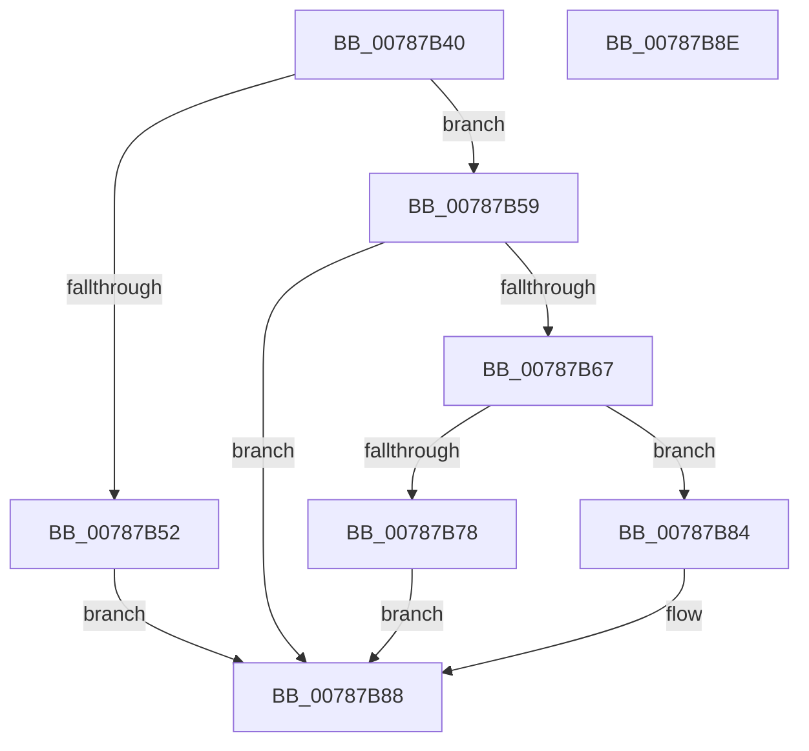

# PsTlsAlloc

- RVA: `0x00787B40`–`0x00787B8F` (길이 `79` bytes)
- VA: `0x0000000140787B40`
- 실행 섹션: `PAGE`
- PDB 이름 있음: `예`; PDB Function 태그: `아니요`
- unwind 정보 RVA: `0x0005CF00`
- 디코드: `26`개 명령, `79/79` bytes 표시
- 미해석 바이트: `0` (있으면 어셈블리에 `.byte`로 보존)

> 이 문서는 커널 이미지의 기계어와 PDB 기호를 분석해 생성했습니다. 4번과 5번은 함수 원형과 자료형을 바이너리 사용 방식에서 추정한 C 해석이며 원본 소스 복구 결과는 아닙니다.

## 1. Dependencies

- 직접 호출 지점: **2**; 고유 호출 대상: **2**
- 직접 호출자로 확인된 함수: **1**
- RIP 상대 이미지 참조: **1**

### Outgoing calls
- `0x00787B5E` → [PspTlsAlloc](PspTlsAlloc_function_00787BD8.md) (function, `0x00787BD8`)
- `0x00787B78` → [PsTlsFree](PsTlsFree_function_00787BA0.md) (function, `0x00787BA0`)

### Direct callers
- [PspTlsInitialize](../../init/C4/PspTlsInitialize_function_00C46754.md) at `0x00C46782`

### Static image references
- `0x00787B67` → RVA `0x00E281C0` (`.data`; read)

## 2. Other-region calls and transfers

- 다른 실행 섹션으로 향하는 call: **0**
- 별도 외부 분기/꼬리 이동을 확인하지 못했습니다.

## 3. Assembly (complete function range)

```asm
00787B40  40 53                           push rbx
00787B42  48 83 EC 20                     sub rsp, 0x20
00787B46  83 64 24 38 00                  and dword ptr [rsp + 0x38], 0
00787B4B  49 8B D8                        mov rbx, r8
00787B4E  85 D2                           test edx, edx
00787B50  74 07                           je 0x140787b59
00787B52  B8 0D 00 00 C0                  mov eax, 0xc000000d
00787B57  EB 2F                           jmp 0x140787b88
00787B59  48 8D 54 24 38                  lea rdx, [rsp + 0x38]
00787B5E  E8 75 00 00 00                  call 0x140787bd8
00787B63  85 C0                           test eax, eax
00787B65  78 21                           js 0x140787b88
00787B67  8B 05 53 06 6A 00               mov eax, dword ptr [rip + 0x6a0653]
00787B6D  8B 4C 24 38                     mov ecx, dword ptr [rsp + 0x38]
00787B71  83 C0 02                        add eax, 2
00787B74  3B C8                           cmp ecx, eax
00787B76  76 0C                           jbe 0x140787b84
00787B78  E8 23 00 00 00                  call 0x140787ba0
00787B7D  B8 17 00 00 C0                  mov eax, 0xc0000017
00787B82  EB 04                           jmp 0x140787b88
00787B84  89 0B                           mov dword ptr [rbx], ecx
00787B86  33 C0                           xor eax, eax
00787B88  48 83 C4 20                     add rsp, 0x20
00787B8C  5B                              pop rbx
00787B8D  C3                              ret
00787B8E  CC                              int3
```

## 4. C-style interpretation (structured pseudocode)

```c
__int64 __fastcall PsTlsAlloc(__int64 a1, int a2, __int64 a3)
{
    __int64 result;
    __int64 v_rsp;
    unsigned int v_stack_p10;

    v_rsp = (v_rsp) - (32);
    if (a2 == 0) goto loc_00787B59;
    goto loc_00787B88;
loc_00787B59:
    result = PspTlsAlloc(a1, v_stack_p10, a3, a4);
    if (sign_flag) goto loc_00787B88;
    result = (unsigned int)(((unsigned int)(*(unsigned int *)(v_rip + 6948435))) + (2));
    if (((unsigned int)((unsigned int)(v_stack_p10))) <= ((unsigned int)(result))) goto loc_00787B84;
    result = PsTlsFree((unsigned int)(v_stack_p10), v_stack_p10, a3, a4);
    goto loc_00787B88;
loc_00787B84:
    *(unsigned int *)(a3) = (unsigned int)((unsigned int)(v_stack_p10));
    result = 0;
loc_00787B88:
    v_rsp = (v_rsp) + (32);
    return result;
}
```

## 5. (Beta) C Style

```c
int64_t PsTlsAlloc(int64_t Arg1, int32_t Arg2, void *Arg3)
{
    uint8_t *arg3 = (uint8_t *)Arg3;

    int64_t result;
    int64_t local_rsp;
    uint32_t v_stack_p10;

    local_rsp = (local_rsp) - (32);
    if (Arg2 == 0) goto loc_00787B59;
    goto loc_00787B88;
loc_00787B59:
    result = PspTlsAlloc(Arg1, v_stack_p10, Arg3, a4);
    if (sign_flag) goto loc_00787B88;
    result = (uint32_t)(((uint32_t)(*(uint32_t *)(v_rip + 0x6A0653))) + (2));
    if (((uint32_t)((uint32_t)(v_stack_p10))) <= ((uint32_t)(result))) goto loc_00787B84;
    result = PsTlsFree((uint32_t)(v_stack_p10), v_stack_p10, Arg3, a4);
    goto loc_00787B88;
loc_00787B84:
    *(uint32_t *)(arg3) = (uint32_t)((uint32_t)(v_stack_p10));
    result = 0;
loc_00787B88:
    local_rsp = (local_rsp) + (32);
    return result;
}
```

### 관측된 메모리 오프셋

구조체 형식이 확인되지 않은 접근은 인자 기준의 오프셋으로만 기록했습니다.

| 기준 인자 | 오프셋 표현 | 폭 (bit) | 접근 |
|---|---:|---:|---|
| `Arg3` | `+ 0x0` | `32` | `W` |

## 6. Execution-region graph

[열기: 2D/3D 그래프와 함수 탐색 컨트롤 패널](../../../control-panel.html?section=page&rva=0x00787B40&view=graph)

- 2D 그래프는 위에서 아래로 흐르고, 3D 그래프는 빈 공간을 드래그해 회전합니다. Shift+드래그는 이동, 휠은 확대·축소, 함수 노드 선택은 대상 보고서 이동입니다.

### Static fallback


