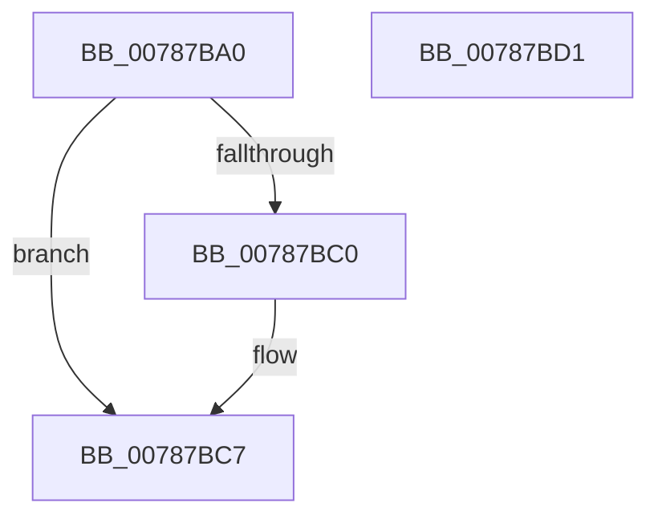

# PsTlsFree

- RVA: `0x00787BA0`–`0x00787BD2` (길이 `50` bytes)
- VA: `0x0000000140787BA0`
- 실행 섹션: `PAGE`
- PDB 이름 있음: `예`; PDB Function 태그: `아니요`
- unwind 정보 RVA: `0x0005C788`
- 디코드: `14`개 명령, `50/50` bytes 표시
- 미해석 바이트: `0` (있으면 어셈블리에 `.byte`로 보존)

> 이 문서는 커널 이미지의 기계어와 PDB 기호를 분석해 생성했습니다. 4번과 5번은 함수 원형과 자료형을 바이너리 사용 방식에서 추정한 C 해석이며 원본 소스 복구 결과는 아닙니다.

## 1. Dependencies

- 직접 호출 지점: **2**; 고유 호출 대상: **2**
- 직접 호출자로 확인된 함수: **1**
- RIP 상대 이미지 참조: **0**

### Outgoing calls
- `0x00787BB7` → [RtlpFlsFree](../79/RtlpFlsFree_function_0079521C.md) (function, `0x0079521C`)
- `0x00787BC7` → [KeLeaveGuardedRegion](../../text/2E/KeLeaveGuardedRegion_function_002E2C40.md) (function, `0x002E2C40`)

### Direct callers
- [PsTlsAlloc](PsTlsAlloc_function_00787B40.md) at `0x00787B78`

### Static image references
- 디코드된 RIP-relative 메모리 참조가 없습니다.

## 2. Other-region calls and transfers

- 다른 실행 섹션으로 향하는 call: **1**
  - `0x00787BC7` → [KeLeaveGuardedRegion](../../text/2E/KeLeaveGuardedRegion_function_002E2C40.md) (`PAGE` → `.text`)
- 별도 외부 분기/꼬리 이동을 확인하지 못했습니다.

## 3. Assembly (complete function range)

```asm
00787BA0  48 83 EC 28                     sub rsp, 0x28
00787BA4  65 48 8B 04 25 88 01 00 00      mov rax, qword ptr gs:[0x188]
00787BAD  8B D1                           mov edx, ecx
00787BAF  66 FF 88 E6 01 00 00            dec word ptr [rax + 0x1e6]
00787BB6  90                              nop
00787BB7  E8 60 D6 00 00                  call 0x14079521c
00787BBC  85 C0                           test eax, eax
00787BBE  79 07                           jns 0x140787bc7
00787BC0  B9 46 00 00 00                  mov ecx, 0x46
00787BC5  CD 29                           int 0x29
00787BC7  E8 74 B0 B5 FF                  call 0x1402e2c40
00787BCC  48 83 C4 28                     add rsp, 0x28
00787BD0  C3                              ret
00787BD1  CC                              int3
```

## 4. C-style interpretation (structured pseudocode)

```c
__int64 __fastcall PsTlsFree(int a1)
{
    __int64 result;
    __int64 v_rsp;

    v_rsp = (v_rsp) - (40);
    result = RtlpFlsFree(a1, (unsigned int)(a1), a3, a4);
    if (sign_flag) {
        a1 = 70;
    }
    result = KeLeaveGuardedRegion(a1, (unsigned int)(a1), a3, a4);
    v_rsp = (v_rsp) + (40);
    return result;
}
```

## 5. (Beta) C Style

```c
int64_t PsTlsFree(int32_t Arg1)
{
    int64_t result;
    int64_t local_rsp;

    local_rsp = (local_rsp) - (40);
    result = RtlpFlsFree(Arg1, (uint32_t)(Arg1), a3, a4);
    if (sign_flag) {
        Arg1 = 70;
    }
    result = KeLeaveGuardedRegion(Arg1, (uint32_t)(Arg1), a3, a4);
    local_rsp = (local_rsp) + (40);
    return result;
}
```

## 6. Execution-region graph

[열기: 2D/3D 그래프와 함수 탐색 컨트롤 패널](../../../control-panel.html?section=page&rva=0x00787BA0&view=graph)

- 2D 그래프는 위에서 아래로 흐르고, 3D 그래프는 빈 공간을 드래그해 회전합니다. Shift+드래그는 이동, 휠은 확대·축소, 함수 노드 선택은 대상 보고서 이동입니다.

### Static fallback


