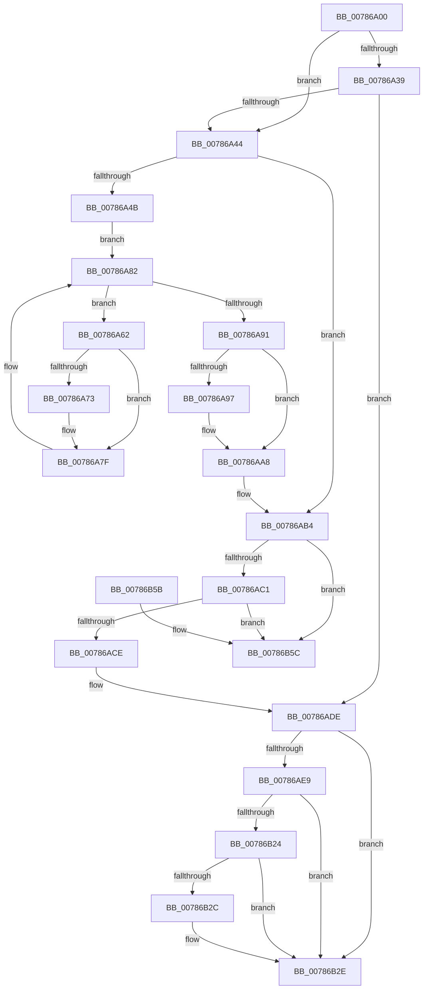

# PsUnregisterSiloMonitor

- RVA: `0x00786A00`–`0x00786B63` (길이 `355` bytes)
- VA: `0x0000000140786A00`
- 실행 섹션: `PAGE`
- PDB 이름 있음: `예`; PDB Function 태그: `아니요`
- unwind 정보 RVA: `0x000CF2F0`
- 디코드: `95`개 명령, `355/355` bytes 표시
- 미해석 바이트: `0` (있으면 어셈블리에 `.byte`로 보존)

> 이 문서는 커널 이미지의 기계어와 PDB 기호를 분석해 생성했습니다. 4번과 5번은 함수 원형과 자료형을 바이너리 사용 방식에서 추정한 C 해석이며 원본 소스 복구 결과는 아닙니다.

## 1. Dependencies

- 직접 호출 지점: **16**; 고유 호출 대상: **13**
- 직접 호출자로 확인된 함수: **0**
- RIP 상대 이미지 참조: **2**

### Outgoing calls
- `0x00786A2E` → [PspAcquirePushLockExclusive](../../text/5E/PspAcquirePushLockExclusive_function_005E3FDC.md) (function, `0x005E3FDC`)
- `0x00786A59` → [KiStackAttachProcess](../../text/21/KiStackAttachProcess_function_00216820.md) (function, `0x00216820`)
- `0x00786A65` → [PspGetServerSiloStatePointer](../../text/4F/PspGetServerSiloStatePointer_function_004FCDB8.md) (function, `0x004FCDB8`)
- `0x00786A7A` → [guard_dispatch_icall](../../text/6B/guard_dispatch_icall_function_006BAAD0.md) (function, `0x006BAAD0`)
- `0x00786A84` → [PspGetNextSilo](../91/PspGetNextSilo_function_00919F78.md) (function, `0x00919F78`)
- `0x00786A97` → [HalAdjustResourceList](../../text/48/HalAdjustResourceList_function_0048FDC0.md) (function, `0x0048FDC0`)
- `0x00786AA3` → [guard_dispatch_icall](../../text/6B/guard_dispatch_icall_function_006BAAD0.md) (function, `0x006BAAD0`)
- `0x00786AAF` → [KiUnstackDetachProcess](../../text/21/KiUnstackDetachProcess_function_00217D30.md) (function, `0x00217D30`)
- `0x00786ADE` → [PspReleasePushLockExclusive](../../text/5E/PspReleasePushLockExclusive_function_005E4040.md) (function, `0x005E4040`)
- `0x00786AF7` → [KiStackAttachProcess](../../text/21/KiStackAttachProcess_function_00216820.md) (function, `0x00216820`)
- `0x00786AFC` → [PspGetHostSiloStorage](../../text/5E/PspGetHostSiloStorage_function_005E2714.md) (function, `0x005E2714`)
- `0x00786B0D` → [PspStorageRemoveObject](PspStorageRemoveObject_function_00789D68.md) (function, `0x00789D68`)
- `0x00786B1B` → [KiUnstackDetachProcess](../../text/21/KiUnstackDetachProcess_function_00217D30.md) (function, `0x00217D30`)
- `0x00786B31` → [PspStorageFreeSlot](PspStorageFreeSlot_function_00789C64.md) (function, `0x00789C64`)
- `0x00786B3E` → [ExFreePoolWithTag](../../poolcode/B8/ExFreePoolWithTag_function_00B82870.md) (function, `0x00B82870`)
- `0x00786B4B` → [_security_check_cookie](../../text/6A/_security_check_cookie_function_006AC640.md) (function, `0x006AC640`)

### Direct callers
- 이 함수 시작 RVA로 연결되는 직접 call은 확인되지 않았습니다. 간접 호출은 완전히 역산할 수 없습니다.

### Static image references
- `0x00786A0A` → RVA `0x00E0A740` (`.data`; read)
- `0x00786A4B` → RVA `0x00FC6AB0` (`ALMOSTRO`; read)

## 2. Other-region calls and transfers

- 다른 실행 섹션으로 향하는 call: **13**
  - `0x00786A2E` → [PspAcquirePushLockExclusive](../../text/5E/PspAcquirePushLockExclusive_function_005E3FDC.md) (`PAGE` → `.text`)
  - `0x00786A59` → [KiStackAttachProcess](../../text/21/KiStackAttachProcess_function_00216820.md) (`PAGE` → `.text`)
  - `0x00786A65` → [PspGetServerSiloStatePointer](../../text/4F/PspGetServerSiloStatePointer_function_004FCDB8.md) (`PAGE` → `.text`)
  - `0x00786A7A` → [guard_dispatch_icall](../../text/6B/guard_dispatch_icall_function_006BAAD0.md) (`PAGE` → `.text`)
  - `0x00786A97` → [HalAdjustResourceList](../../text/48/HalAdjustResourceList_function_0048FDC0.md) (`PAGE` → `.text`)
  - `0x00786AA3` → [guard_dispatch_icall](../../text/6B/guard_dispatch_icall_function_006BAAD0.md) (`PAGE` → `.text`)
  - `0x00786AAF` → [KiUnstackDetachProcess](../../text/21/KiUnstackDetachProcess_function_00217D30.md) (`PAGE` → `.text`)
  - `0x00786ADE` → [PspReleasePushLockExclusive](../../text/5E/PspReleasePushLockExclusive_function_005E4040.md) (`PAGE` → `.text`)
  - `0x00786AF7` → [KiStackAttachProcess](../../text/21/KiStackAttachProcess_function_00216820.md) (`PAGE` → `.text`)
  - `0x00786AFC` → [PspGetHostSiloStorage](../../text/5E/PspGetHostSiloStorage_function_005E2714.md) (`PAGE` → `.text`)
  - `0x00786B1B` → [KiUnstackDetachProcess](../../text/21/KiUnstackDetachProcess_function_00217D30.md) (`PAGE` → `.text`)
  - `0x00786B3E` → [ExFreePoolWithTag](../../poolcode/B8/ExFreePoolWithTag_function_00B82870.md) (`PAGE` → `POOLCODE`)
  - `0x00786B4B` → [_security_check_cookie](../../text/6A/_security_check_cookie_function_006AC640.md) (`PAGE` → `.text`)
- 별도 외부 분기/꼬리 이동을 확인하지 못했습니다.

## 3. Assembly (complete function range)

```asm
00786A00  48 89 5C 24 10                  mov qword ptr [rsp + 0x10], rbx
00786A05  57                              push rdi
00786A06  48 83 EC 60                     sub rsp, 0x60
00786A0A  48 8B 05 2F 3D 68 00            mov rax, qword ptr [rip + 0x683d2f]
00786A11  48 33 C4                        xor rax, rsp
00786A14  48 89 44 24 50                  mov qword ptr [rsp + 0x50], rax
00786A19  0F 57 C0                        xorps xmm0, xmm0
00786A1C  48 8B D9                        mov rbx, rcx
00786A1F  0F 11 44 24 20                  movups xmmword ptr [rsp + 0x20], xmm0
00786A24  0F 11 44 24 30                  movups xmmword ptr [rsp + 0x30], xmm0
00786A29  0F 11 44 24 40                  movups xmmword ptr [rsp + 0x40], xmm0
00786A2E  E8 A9 D5 E5 FF                  call 0x1405e3fdc
00786A33  48 83 3B 00                     cmp qword ptr [rbx], 0
00786A37  75 0B                           jne 0x140786a44
00786A39  48 83 7B 08 00                  cmp qword ptr [rbx + 8], 0
00786A3E  0F 84 9A 00 00 00               je 0x140786ade
00786A44  48 83 7B 20 00                  cmp qword ptr [rbx + 0x20], 0
00786A49  74 69                           je 0x140786ab4
00786A4B  48 8B 0D 5E 00 84 00            mov rcx, qword ptr [rip + 0x84005e]
00786A52  4C 8D 44 24 20                  lea r8, [rsp + 0x20]
00786A57  33 D2                           xor edx, edx
00786A59  E8 C2 FD A8 FF                  call 0x140216820
00786A5E  33 C9                           xor ecx, ecx
00786A60  EB 20                           jmp 0x140786a82
00786A62  48 8B CF                        mov rcx, rdi
00786A65  E8 4E 63 D7 FF                  call 0x1404fcdb8
00786A6A  8B 08                           mov ecx, dword ptr [rax]
00786A6C  FF C9                           dec ecx
00786A6E  83 F9 02                        cmp ecx, 2
00786A71  77 0C                           ja 0x140786a7f
00786A73  48 8B 43 20                     mov rax, qword ptr [rbx + 0x20]
00786A77  48 8B CF                        mov rcx, rdi
00786A7A  E8 51 40 F3 FF                  call 0x1406baad0
00786A7F  48 8B CF                        mov rcx, rdi
00786A82  B2 01                           mov dl, 1
00786A84  E8 EF 34 19 00                  call 0x140919f78
00786A89  48 8B F8                        mov rdi, rax
00786A8C  48 85 C0                        test rax, rax
00786A8F  75 D1                           jne 0x140786a62
00786A91  80 7B 10 00                     cmp byte ptr [rbx + 0x10], 0
00786A95  74 11                           je 0x140786aa8
00786A97  E8 24 93 D0 FF                  call 0x14048fdc0
00786A9C  48 8B C8                        mov rcx, rax
00786A9F  48 8B 43 20                     mov rax, qword ptr [rbx + 0x20]
00786AA3  E8 28 40 F3 FF                  call 0x1406baad0
00786AA8  33 D2                           xor edx, edx
00786AAA  48 8D 4C 24 20                  lea rcx, [rsp + 0x20]
00786AAF  E8 7C 12 A9 FF                  call 0x140217d30
00786AB4  48 8B 03                        mov rax, qword ptr [rbx]
00786AB7  48 39 58 08                     cmp qword ptr [rax + 8], rbx
00786ABB  0F 85 9B 00 00 00               jne 0x140786b5c
00786AC1  48 8B 4B 08                     mov rcx, qword ptr [rbx + 8]
00786AC5  48 39 19                        cmp qword ptr [rcx], rbx
00786AC8  0F 85 8E 00 00 00               jne 0x140786b5c
00786ACE  48 89 01                        mov qword ptr [rcx], rax
00786AD1  48 89 48 08                     mov qword ptr [rax + 8], rcx
00786AD5  48 83 23 00                     and qword ptr [rbx], 0
00786AD9  48 83 63 08 00                  and qword ptr [rbx + 8], 0
00786ADE  E8 5D D5 E5 FF                  call 0x1405e4040
00786AE3  80 7B 10 00                     cmp byte ptr [rbx + 0x10], 0
00786AE7  74 45                           je 0x140786b2e
00786AE9  48 8B 0D C0 FF 83 00            mov rcx, qword ptr [rip + 0x83ffc0]
00786AF0  4C 8D 44 24 20                  lea r8, [rsp + 0x20]
00786AF5  33 D2                           xor edx, edx
00786AF7  E8 24 FD A8 FF                  call 0x140216820
00786AFC  E8 13 BC E5 FF                  call 0x1405e2714
00786B01  8B 53 14                        mov edx, dword ptr [rbx + 0x14]
00786B04  48 8B C8                        mov rcx, rax
00786B07  45 33 C9                        xor r9d, r9d
00786B0A  41 B0 01                        mov r8b, 1
00786B0D  E8 56 32 00 00                  call 0x140789d68
00786B12  33 D2                           xor edx, edx
00786B14  48 8D 4C 24 20                  lea rcx, [rsp + 0x20]
00786B19  8B F8                           mov edi, eax
00786B1B  E8 10 12 A9 FF                  call 0x140217d30
00786B20  85 FF                           test edi, edi
00786B22  74 0A                           je 0x140786b2e
00786B24  81 FF 25 02 00 C0               cmp edi, 0xc0000225
00786B2A  74 02                           je 0x140786b2e
00786B2C  CD 2C                           int 0x2c
00786B2E  8B 4B 14                        mov ecx, dword ptr [rbx + 0x14]
00786B31  E8 2E 31 00 00                  call 0x140789c64
00786B36  BA 53 69 6C 4D                  mov edx, 0x4d6c6953
00786B3B  48 8B CB                        mov rcx, rbx
00786B3E  E8 2D BD 3F 00                  call 0x140b82870
00786B43  48 8B 4C 24 50                  mov rcx, qword ptr [rsp + 0x50]
00786B48  48 33 CC                        xor rcx, rsp
00786B4B  E8 F0 5A F2 FF                  call 0x1406ac640
00786B50  48 8B 5C 24 78                  mov rbx, qword ptr [rsp + 0x78]
00786B55  48 83 C4 60                     add rsp, 0x60
00786B59  5F                              pop rdi
00786B5A  C3                              ret
00786B5B  CC                              int3
00786B5C  B9 03 00 00 00                  mov ecx, 3
00786B61  CD 29                           int 0x29
```

## 4. C-style interpretation (structured pseudocode)

```c
__int64 __fastcall PsUnregisterSiloMonitor(__int64 a1, int a2, __int64 a3, int a4)
{
    __int64 result;
    __int64 v_rsp;
    unsigned __int64 v_stack_m18;
    unsigned __int64 v_stack_m28;
    unsigned __int64 v_stack_m38;
    unsigned __int64 v_stack_m48;
    unsigned __int64 v_stack_p10;

    v_stack_p10 = v_rbx;
    v_rsp = (v_rsp) - (96);
    result = (*(unsigned __int64 *)(v_rip + 6831407)) ^ (v_rsp);
    v_stack_m18 = result;
    v_stack_m48 = v_xmm0;
    v_stack_m38 = v_xmm0;
    v_stack_m28 = v_xmm0;
    result = PspAcquirePushLockExclusive(a1, a2, a3, a4);
    if ((*(unsigned __int64 *)(a1)) != 0) goto loc_00786A44;
    if ((*(unsigned __int64 *)(a1 + 8)) == 0) goto loc_00786ADE;
loc_00786A44:
    if ((*(unsigned __int64 *)(a1 + 32)) == 0) goto loc_00786AB4;
    a2 = 0;
    result = KiStackAttachProcess(*(unsigned __int64 *)(v_rip + 8650846), a2, v_stack_m48, a4);
    a1 = 0;
    goto loc_00786A82;
loc_00786A62:
    result = PspGetServerSiloStatePointer(v_rdi, a2, v_stack_m48, a4);
    a1 = (unsigned int)(((unsigned int)(*(unsigned int *)(result))) - 1);
    if (((unsigned int)(a1)) <= 2) {
        result = *(unsigned __int64 *)(a1 + 32);
        a1 = v_rdi;
        result = guard_dispatch_icall(a1, a2, v_stack_m48, a4);
    }
loc_00786A82:
    result = PspGetNextSilo(v_rdi, 1, v_stack_m48, a4);
    if (result != 0) goto loc_00786A62;
    if ((*(unsigned __int8 *)(a1 + 16)) != 0) {
        result = HalAdjustResourceList(v_rdi, 1, v_stack_m48, a4);
        a1 = result;
        result = *(unsigned __int64 *)(a1 + 32);
        result = guard_dispatch_icall(a1, 1, v_stack_m48, a4);
    }
    a2 = 0;
    result = KiUnstackDetachProcess(v_stack_m48, a2, v_stack_m48, a4);
loc_00786AB4:
    if ((*(unsigned __int64 *)(*(unsigned __int64 *)(a1) + 8)) != a1) goto loc_00786B5C;
    if ((*(unsigned __int64 *)(*(unsigned __int64 *)(a1 + 8))) != a1) goto loc_00786B5C;
    *(unsigned __int64 *)(*(unsigned __int64 *)(a1 + 8)) = *(unsigned __int64 *)(a1);
    *(unsigned __int64 *)(*(unsigned __int64 *)(a1) + 8) = *(unsigned __int64 *)(a1 + 8);
loc_00786ADE:
    result = PspReleasePushLockExclusive(*(unsigned __int64 *)(a1 + 8), a2, v_stack_m48, a4);
    if ((*(unsigned __int8 *)(a1 + 16)) == 0) goto loc_00786B2E;
    a2 = 0;
    result = KiStackAttachProcess(*(unsigned __int64 *)(v_rip + 8650688), a2, v_stack_m48, a4);
    result = PspGetHostSiloStorage(*(unsigned __int64 *)(v_rip + 8650688), a2, v_stack_m48, a4);
    a4 = 0;
    result = PspStorageRemoveObject(result, (unsigned int)(*(unsigned int *)(a1 + 20)), 1, a4);
    a2 = 0;
    result = KiUnstackDetachProcess(v_stack_m48, a2, 1, a4);
    if ((unsigned int)((unsigned int)((unsigned int)(result))) == 0) goto loc_00786B2E;
    if (((unsigned int)((unsigned int)((unsigned int)(result)))) != 0xC0000225ULL) {
    }
    result = PspStorageFreeSlot((unsigned int)(*(unsigned int *)(a1 + 20)), a2, 1, a4);
    result = ExFreePoolWithTag(a1, (unsigned int)(0x4D6C6953ULL), 1, a4);
    a1 = (v_stack_m18) ^ (v_rsp);
    result = _security_check_cookie(a1, (unsigned int)(0x4D6C6953ULL), 1, a4);
    v_rsp = (v_rsp) + (96);
    return result;
loc_00786B5C:
    return result;
}
```

## 5. (Beta) C Style

```c
int64_t PsUnregisterSiloMonitor(void *Arg1, int32_t Arg2, int64_t Arg3, int32_t Arg4)
{
    uint8_t *arg1 = (uint8_t *)Arg1;

    int64_t result;
    int64_t local_rsp;
    uint64_t v_stack_m18;
    uint64_t v_stack_m28;
    uint64_t v_stack_m38;
    uint64_t v_stack_m48;
    uint64_t v_stack_p10;

    v_stack_p10 = local_rbx;
    local_rsp = (local_rsp) - (96);
    result = (*(uint64_t *)(v_rip + 0x683D2F)) ^ (local_rsp);
    v_stack_m18 = result;
    v_stack_m48 = v_xmm0;
    v_stack_m38 = v_xmm0;
    v_stack_m28 = v_xmm0;
    result = PspAcquirePushLockExclusive(Arg1, Arg2, Arg3, Arg4);
    if ((*(uint64_t *)(arg1)) != 0) goto loc_00786A44;
    if ((*(uint64_t *)(arg1 + 0x8)) == 0) goto loc_00786ADE;
loc_00786A44:
    if ((*(uint64_t *)(arg1 + 0x20)) == 0) goto loc_00786AB4;
    Arg2 = 0;
    result = KiStackAttachProcess(*(uint64_t *)(v_rip + 0x84005E), Arg2, v_stack_m48, Arg4);
    Arg1 = 0;
    goto loc_00786A82;
loc_00786A62:
    result = PspGetServerSiloStatePointer(local_rdi, Arg2, v_stack_m48, Arg4);
    Arg1 = (uint32_t)(((uint32_t)(*(uint32_t *)(result))) - 1);
    if (((uint32_t)(Arg1)) <= 2) {
        result = *(uint64_t *)(arg1 + 0x20);
        Arg1 = local_rdi;
        result = guard_dispatch_icall(Arg1, Arg2, v_stack_m48, Arg4);
    }
loc_00786A82:
    result = PspGetNextSilo(local_rdi, 1, v_stack_m48, Arg4);
    if (result != 0) goto loc_00786A62;
    if ((*(uint8_t *)(arg1 + 0x10)) != 0) {
        result = HalAdjustResourceList(local_rdi, 1, v_stack_m48, Arg4);
        Arg1 = result;
        result = *(uint64_t *)(arg1 + 0x20);
        result = guard_dispatch_icall(Arg1, 1, v_stack_m48, Arg4);
    }
    Arg2 = 0;
    result = KiUnstackDetachProcess(v_stack_m48, Arg2, v_stack_m48, Arg4);
loc_00786AB4:
    if ((*(uint64_t *)(*(uint64_t *)(arg1) + 0x8)) != Arg1) goto loc_00786B5C;
    if ((*(uint64_t *)(*(uint64_t *)(arg1 + 0x8))) != Arg1) goto loc_00786B5C;
    *(uint64_t *)(*(uint64_t *)(arg1 + 0x8)) = *(uint64_t *)(arg1);
    *(uint64_t *)(*(uint64_t *)(arg1) + 0x8) = *(uint64_t *)(arg1 + 0x8);
loc_00786ADE:
    result = PspReleasePushLockExclusive(*(uint64_t *)(arg1 + 0x8), Arg2, v_stack_m48, Arg4);
    if ((*(uint8_t *)(arg1 + 0x10)) == 0) goto loc_00786B2E;
    Arg2 = 0;
    result = KiStackAttachProcess(*(uint64_t *)(v_rip + 0x83FFC0), Arg2, v_stack_m48, Arg4);
    result = PspGetHostSiloStorage(*(uint64_t *)(v_rip + 0x83FFC0), Arg2, v_stack_m48, Arg4);
    Arg4 = 0;
    result = PspStorageRemoveObject(result, (uint32_t)(*(uint32_t *)(arg1 + 0x14)), 1, Arg4);
    Arg2 = 0;
    result = KiUnstackDetachProcess(v_stack_m48, Arg2, 1, Arg4);
    if ((uint32_t)((uint32_t)((uint32_t)(result))) == 0) goto loc_00786B2E;
    if (((uint32_t)((uint32_t)((uint32_t)(result)))) != 0xC0000225ULL) {
    }
    result = PspStorageFreeSlot((uint32_t)(*(uint32_t *)(arg1 + 0x14)), Arg2, 1, Arg4);
    result = ExFreePoolWithTag(Arg1, (uint32_t)(0x4D6C6953ULL), 1, Arg4);
    Arg1 = (v_stack_m18) ^ (local_rsp);
    result = _security_check_cookie(Arg1, (uint32_t)(0x4D6C6953ULL), 1, Arg4);
    local_rsp = (local_rsp) + (96);
    return result;
loc_00786B5C:
    return result;
}
```

### 관측된 메모리 오프셋

구조체 형식이 확인되지 않은 접근은 인자 기준의 오프셋으로만 기록했습니다.

| 기준 인자 | 오프셋 표현 | 폭 (bit) | 접근 |
|---|---:|---:|---|
| `Arg1` | `+ 0x0` | `64` | `R` |
| `Arg1` | `+ 0x0` | `64` | `R/W` |
| `Arg1` | `+ 0x8` | `64` | `R` |
| `Arg1` | `+ 0x8` | `64` | `R/W` |
| `Arg1` | `+ 0x10` | `8` | `R` |
| `Arg1` | `+ 0x14` | `32` | `R` |
| `Arg1` | `+ 0x20` | `64` | `R` |

## 6. Execution-region graph

[열기: 2D/3D 그래프와 함수 탐색 컨트롤 패널](../../../control-panel.html?section=page&rva=0x00786A00&view=graph)

- 2D 그래프는 위에서 아래로 흐르고, 3D 그래프는 빈 공간을 드래그해 회전합니다. Shift+드래그는 이동, 휠은 확대·축소, 함수 노드 선택은 대상 보고서 이동입니다.

### Static fallback


