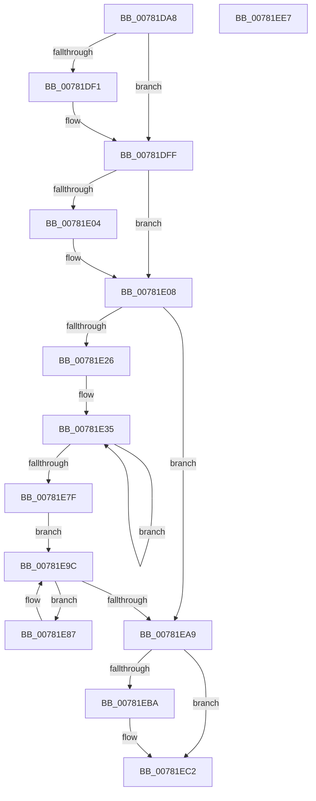

# PsUpdateActiveProcessAffinity

- RVA: `0x00781DA8`–`0x00781EE8` (길이 `320` bytes)
- VA: `0x0000000140781DA8`
- 실행 섹션: `PAGE`
- PDB 이름 있음: `예`; PDB Function 태그: `아니요`
- unwind 정보 RVA: `0x0005C954`
- 디코드: `82`개 명령, `320/320` bytes 표시
- 미해석 바이트: `0` (있으면 어셈블리에 `.byte`로 보존)

> 이 문서는 커널 이미지의 기계어와 PDB 기호를 분석해 생성했습니다. 4번과 5번은 함수 원형과 자료형을 바이너리 사용 방식에서 추정한 C 해석이며 원본 소스 복구 결과는 아닙니다.

## 1. Dependencies

- 직접 호출 지점: **8**; 고유 호출 대상: **8**
- 직접 호출자로 확인된 함수: **1**
- RIP 상대 이미지 참조: **4**

### Outgoing calls
- `0x00781DE0` → [KeAbPreAcquire](../../text/21/KeAbPreAcquire_function_00210230.md) (function, `0x00210230`)
- `0x00781DFA` → [ExfAcquirePushLockExclusiveEx](../../text/20/ExfAcquirePushLockExclusiveEx_function_0020FC90.md) (function, `0x0020FC90`)
- `0x00781E19` → [KeIsSubsetAffinityEx](../../text/2C/KeIsSubsetAffinityEx_function_002CDC80.md) (function, `0x002CDC80`)
- `0x00781E94` → [PspUpdateSingleProcessAffinity](PspUpdateSingleProcessAffinity_function_00782B00.md) (function, `0x00782B00`)
- `0x00781E9C` → [PsGetNextProcess](../91/PsGetNextProcess_function_0091C900.md) (function, `0x0091C900`)
- `0x00781EBD` → [ExfTryToWakePushLock](../../text/26/ExfTryToWakePushLock_function_00265DD0.md) (function, `0x00265DD0`)
- `0x00781EC5` → [KeAbPostRelease](../../text/2E/KeAbPostRelease_function_002E1600.md) (function, `0x002E1600`)
- `0x00781ECD` → [KiLeaveCriticalRegionUnsafe](../../text/25/KiLeaveCriticalRegionUnsafe_function_0025F010.md) (function, `0x0025F010`)

### Direct callers
- [KeStartDynamicProcessor](../74/KeStartDynamicProcessor_function_00746730.md) at `0x007467B7`

### Static image references
- `0x00781DC5` → RVA `0x00FD9DB0` (`PAGEDATA`; read)
- `0x00781E08` → RVA `0x00E0C480` (`.data`; read)
- `0x00781E12` → RVA `0x00FC7120` (`ALMOSTRO`; read)
- `0x00781EA9` → RVA `0x00FD9DB0` (`PAGEDATA`; read/write)

## 2. Other-region calls and transfers

- 다른 실행 섹션으로 향하는 call: **6**
  - `0x00781DE0` → [KeAbPreAcquire](../../text/21/KeAbPreAcquire_function_00210230.md) (`PAGE` → `.text`)
  - `0x00781DFA` → [ExfAcquirePushLockExclusiveEx](../../text/20/ExfAcquirePushLockExclusiveEx_function_0020FC90.md) (`PAGE` → `.text`)
  - `0x00781E19` → [KeIsSubsetAffinityEx](../../text/2C/KeIsSubsetAffinityEx_function_002CDC80.md) (`PAGE` → `.text`)
  - `0x00781EBD` → [ExfTryToWakePushLock](../../text/26/ExfTryToWakePushLock_function_00265DD0.md) (`PAGE` → `.text`)
  - `0x00781EC5` → [KeAbPostRelease](../../text/2E/KeAbPostRelease_function_002E1600.md) (`PAGE` → `.text`)
  - `0x00781ECD` → [KiLeaveCriticalRegionUnsafe](../../text/25/KiLeaveCriticalRegionUnsafe_function_0025F010.md) (`PAGE` → `.text`)
- 별도 외부 분기/꼬리 이동을 확인하지 못했습니다.

## 3. Assembly (complete function range)

```asm
00781DA8  48 89 5C 24 08                  mov qword ptr [rsp + 8], rbx
00781DAD  48 89 6C 24 10                  mov qword ptr [rsp + 0x10], rbp
00781DB2  48 89 74 24 18                  mov qword ptr [rsp + 0x18], rsi
00781DB7  57                              push rdi
00781DB8  48 83 EC 20                     sub rsp, 0x20
00781DBC  65 48 8B 34 25 88 01 00 00      mov rsi, qword ptr gs:[0x188]
00781DC5  48 8D 2D E4 7F 85 00            lea rbp, [rip + 0x857fe4]
00781DCC  48 83 CB FF                     or rbx, 0xffffffffffffffff
00781DD0  45 33 C0                        xor r8d, r8d
00781DD3  33 D2                           xor edx, edx
00781DD5  48 8B CD                        mov rcx, rbp
00781DD8  66 01 9E E4 01 00 00            add word ptr [rsi + 0x1e4], bx
00781DDF  90                              nop
00781DE0  E8 4B E4 A8 FF                  call 0x140210230
00781DE5  F0 48 0F BA 6D 00 00            lock bts qword ptr [rbp], 0
00781DEC  48 8B F8                        mov rdi, rax
00781DEF  73 0E                           jae 0x140781dff
00781DF1  4C 8B C5                        mov r8, rbp
00781DF4  48 8B D0                        mov rdx, rax
00781DF7  48 8B CD                        mov rcx, rbp
00781DFA  E8 91 DE A8 FF                  call 0x14020fc90
00781DFF  48 85 FF                        test rdi, rdi
00781E02  74 04                           je 0x140781e08
00781E04  C6 47 0A 01                     mov byte ptr [rdi + 0xa], 1
00781E08  48 8D 3D 71 A6 68 00            lea rdi, [rip + 0x68a671]
00781E0F  48 8B D7                        mov rdx, rdi
00781E12  48 8D 0D 07 53 84 00            lea rcx, [rip + 0x845307]
00781E19  E8 62 BE B4 FF                  call 0x1402cdc80
00781E1E  85 C0                           test eax, eax
00781E20  0F 85 83 00 00 00               jne 0x140781ea9
00781E26  B9 02 00 00 00                  mov ecx, 2
00781E2B  48 8D 05 EE 52 84 00            lea rax, [rip + 0x8452ee]
00781E32  8D 51 7E                        lea edx, [rcx + 0x7e]
00781E35  0F 10 00                        movups xmm0, xmmword ptr [rax]
00781E38  0F 10 48 10                     movups xmm1, xmmword ptr [rax + 0x10]
00781E3C  0F 11 07                        movups xmmword ptr [rdi], xmm0
00781E3F  0F 10 40 20                     movups xmm0, xmmword ptr [rax + 0x20]
00781E43  0F 11 4F 10                     movups xmmword ptr [rdi + 0x10], xmm1
00781E47  0F 10 48 30                     movups xmm1, xmmword ptr [rax + 0x30]
00781E4B  0F 11 47 20                     movups xmmword ptr [rdi + 0x20], xmm0
00781E4F  0F 10 40 40                     movups xmm0, xmmword ptr [rax + 0x40]
00781E53  0F 11 4F 30                     movups xmmword ptr [rdi + 0x30], xmm1
00781E57  0F 10 48 50                     movups xmm1, xmmword ptr [rax + 0x50]
00781E5B  0F 11 47 40                     movups xmmword ptr [rdi + 0x40], xmm0
00781E5F  0F 10 40 60                     movups xmm0, xmmword ptr [rax + 0x60]
00781E63  0F 11 4F 50                     movups xmmword ptr [rdi + 0x50], xmm1
00781E67  0F 10 48 70                     movups xmm1, xmmword ptr [rax + 0x70]
00781E6B  48 03 C2                        add rax, rdx
00781E6E  0F 11 47 60                     movups xmmword ptr [rdi + 0x60], xmm0
00781E72  48 03 FA                        add rdi, rdx
00781E75  0F 11 4F F0                     movups xmmword ptr [rdi - 0x10], xmm1
00781E79  48 83 E9 01                     sub rcx, 1
00781E7D  75 B6                           jne 0x140781e35
00781E7F  48 8B 00                        mov rax, qword ptr [rax]
00781E82  48 89 07                        mov qword ptr [rdi], rax
00781E85  EB 15                           jmp 0x140781e9c
00781E87  4C 8D 05 92 52 84 00            lea r8, [rip + 0x845292]
00781E8E  48 8B D7                        mov rdx, rdi
00781E91  48 8B CE                        mov rcx, rsi
00781E94  E8 67 0C 00 00                  call 0x140782b00
00781E99  48 8B CF                        mov rcx, rdi
00781E9C  E8 5F AA 19 00                  call 0x14091c900
00781EA1  48 8B F8                        mov rdi, rax
00781EA4  48 85 C0                        test rax, rax
00781EA7  75 DE                           jne 0x140781e87
00781EA9  F0 48 0F C1 1D FE 7E 85 00      lock xadd qword ptr [rip + 0x857efe], rbx
00781EB2  80 E3 06                        and bl, 6
00781EB5  80 FB 02                        cmp bl, 2
00781EB8  75 08                           jne 0x140781ec2
00781EBA  48 8B CD                        mov rcx, rbp
00781EBD  E8 0E 3F AE FF                  call 0x140265dd0
00781EC2  48 8B CD                        mov rcx, rbp
00781EC5  E8 36 F7 B5 FF                  call 0x1402e1600
00781ECA  48 8B CE                        mov rcx, rsi
00781ECD  E8 3E D1 AD FF                  call 0x14025f010
00781ED2  48 8B 5C 24 30                  mov rbx, qword ptr [rsp + 0x30]
00781ED7  48 8B 6C 24 38                  mov rbp, qword ptr [rsp + 0x38]
00781EDC  48 8B 74 24 40                  mov rsi, qword ptr [rsp + 0x40]
00781EE1  48 83 C4 20                     add rsp, 0x20
00781EE5  5F                              pop rdi
00781EE6  C3                              ret
00781EE7  CC                              int3
```

## 4. C-style interpretation (structured pseudocode)

```c
__int64 __fastcall PsUpdateActiveProcessAffinity(__int64 a1, int a2, int a3)
{
    __int64 result;
    __int64 v_rbx;
    __int64 v_rdi;
    __int64 v_rsp;
    unsigned __int64 v_stack_p10;
    unsigned __int64 v_stack_p18;
    unsigned __int64 v_stack_p8;

    v_stack_p8 = v_rbx;
    v_stack_p10 = v_rbp;
    v_stack_p18 = v_rsi;
    v_rsp = (v_rsp) - (32);
    v_rbx = (v_rbx) | (-1);
    a3 = 0;
    a2 = 0;
    result = KeAbPreAcquire(v_rip + 8749028, a2, a3, a4);
    if (!(condition_is_above_or_equal)) {
        a3 = v_rip + 8749028;
        a2 = result;
        a1 = v_rip + 8749028;
        result = ExfAcquirePushLockExclusiveEx(a1, a2, a3, a4);
    }
    if (result != 0) {
        *(unsigned __int8 *)(result + 10) = 1;
    }
    result = KeIsSubsetAffinityEx(v_rip + 8672007, v_rip + 6858353, a3, a4);
    if ((unsigned int)(result) != 0) goto loc_00781EA9;
loc_00781E35:
    *(unsigned __int64 *)(v_rip + 6858353) = v_xmm0;
    *(unsigned __int64 *)(v_rip + 6858353 + 16) = v_xmm1;
    *(unsigned __int64 *)(v_rip + 6858353 + 32) = v_xmm0;
    *(unsigned __int64 *)(v_rip + 6858353 + 48) = v_xmm1;
    *(unsigned __int64 *)(v_rip + 6858353 + 64) = v_xmm0;
    *(unsigned __int64 *)(v_rip + 6858353 + 80) = v_xmm1;
    result = (v_rip + 8671982) + (2 + 126);
    *(unsigned __int64 *)(v_rip + 6858353 + 96) = v_xmm0;
    v_rdi = (v_rip + 6858353) + (2 + 126);
    *(unsigned __int64 *)(v_rdi - 16) = v_xmm1;
    a1 = (2) - (1);
    if (condition_is_not_equal) goto loc_00781E35;
    *(unsigned __int64 *)(v_rdi) = *(unsigned __int64 *)(result);
    goto loc_00781E9C;
loc_00781E87:
    result = PspUpdateSingleProcessAffinity(*(unsigned __int64 *)(gs_base + (0 + 392)), v_rdi, v_rip + 8671890, a4);
loc_00781E9C:
    result = PsGetNextProcess(v_rdi, v_rdi, v_rip + 8671890, a4);
    if (result != 0) goto loc_00781E87;
loc_00781EA9:
    v_rbx = (unsigned __int8)((v_rbx) & (6));
    if (((unsigned __int8)(v_rbx)) == 2) {
        a1 = v_rip + 8749028;
        result = ExfTryToWakePushLock(a1, v_rdi, v_rip + 8671890, a4);
    }
    result = KeAbPostRelease(v_rip + 8749028, v_rdi, v_rip + 8671890, a4);
    result = KiLeaveCriticalRegionUnsafe(*(unsigned __int64 *)(gs_base + (0 + 392)), v_rdi, v_rip + 8671890, a4);
    v_rsp = (v_rsp) + (32);
    return result;
}
```

## 5. (Beta) C Style

```c
int64_t PsUpdateActiveProcessAffinity(int64_t Arg1, int32_t Arg2, int32_t Arg3)
{
    int64_t result;
    int64_t local_rbx;
    int64_t local_rdi;
    int64_t local_rsp;
    uint64_t v_stack_p10;
    uint64_t v_stack_p18;
    uint64_t v_stack_p8;

    v_stack_p8 = local_rbx;
    v_stack_p10 = local_rbp;
    v_stack_p18 = local_rsi;
    local_rsp = (local_rsp) - (32);
    local_rbx = (local_rbx) | (-1);
    Arg3 = 0;
    Arg2 = 0;
    result = KeAbPreAcquire(v_rip + 8749028, Arg2, Arg3, a4);
    if (!(condition_is_above_or_equal)) {
        Arg3 = v_rip + 8749028;
        Arg2 = result;
        Arg1 = v_rip + 8749028;
        result = ExfAcquirePushLockExclusiveEx(Arg1, Arg2, Arg3, a4);
    }
    if (result != 0) {
        *(uint8_t *)(result + 0xA) = 1;
    }
    result = KeIsSubsetAffinityEx(v_rip + 8672007, v_rip + 6858353, Arg3, a4);
    if ((uint32_t)(result) != 0) goto loc_00781EA9;
loc_00781E35:
    *(uint64_t *)(v_rip + 0x68A671) = v_xmm0;
    *(uint64_t *)(v_rip + 0x68A671 + 0x10) = v_xmm1;
    *(uint64_t *)(v_rip + 0x68A671 + 0x20) = v_xmm0;
    *(uint64_t *)(v_rip + 0x68A671 + 0x30) = v_xmm1;
    *(uint64_t *)(v_rip + 0x68A671 + 0x40) = v_xmm0;
    *(uint64_t *)(v_rip + 0x68A671 + 0x50) = v_xmm1;
    result = (v_rip + 8671982) + (2 + 126);
    *(uint64_t *)(v_rip + 0x68A671 + 0x60) = v_xmm0;
    local_rdi = (v_rip + 6858353) + (2 + 126);
    *(uint64_t *)(local_rdi - 0x10) = v_xmm1;
    Arg1 = (2) - (1);
    if (condition_is_not_equal) goto loc_00781E35;
    *(uint64_t *)(local_rdi) = *(uint64_t *)(result);
    goto loc_00781E9C;
loc_00781E87:
    result = PspUpdateSingleProcessAffinity(*(uint64_t *)(gs_base + (0 + 0x188)), local_rdi, v_rip + 8671890, a4);
loc_00781E9C:
    result = PsGetNextProcess(local_rdi, local_rdi, v_rip + 8671890, a4);
    if (result != 0) goto loc_00781E87;
loc_00781EA9:
    local_rbx = (uint8_t)((local_rbx) & (6));
    if (((uint8_t)(local_rbx)) == 2) {
        Arg1 = v_rip + 8749028;
        result = ExfTryToWakePushLock(Arg1, local_rdi, v_rip + 8671890, a4);
    }
    result = KeAbPostRelease(v_rip + 8749028, local_rdi, v_rip + 8671890, a4);
    result = KiLeaveCriticalRegionUnsafe(*(uint64_t *)(gs_base + (0 + 0x188)), local_rdi, v_rip + 8671890, a4);
    local_rsp = (local_rsp) + (32);
    return result;
}
```

## 6. Execution-region graph

[열기: 2D/3D 그래프와 함수 탐색 컨트롤 패널](../../../control-panel.html?section=page&rva=0x00781DA8&view=graph)

- 2D 그래프는 위에서 아래로 흐르고, 3D 그래프는 빈 공간을 드래그해 회전합니다. Shift+드래그는 이동, 휠은 확대·축소, 함수 노드 선택은 대상 보고서 이동입니다.

### Static fallback


