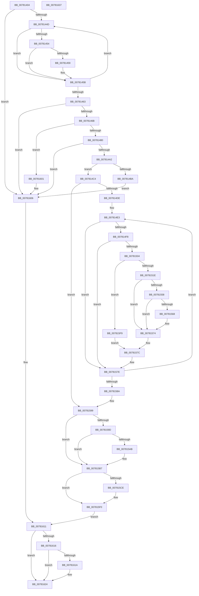

# PsUpdateSvmProcessPasidAllThreads

- RVA: `0x00781404`–`0x00781638` (길이 `564` bytes)
- VA: `0x0000000140781404`
- 실행 섹션: `PAGE`
- PDB 이름 있음: `예`; PDB Function 태그: `아니요`
- unwind 정보 RVA: `0x000CE300`
- 디코드: `162`개 명령, `564/564` bytes 표시
- 미해석 바이트: `0` (있으면 어셈블리에 `.byte`로 보존)

> 이 문서는 커널 이미지의 기계어와 PDB 기호를 분석해 생성했습니다. 4번과 5번은 함수 원형과 자료형을 바이너리 사용 방식에서 추정한 C 해석이며 원본 소스 복구 결과는 아닙니다.

## 1. Dependencies

- 직접 호출 지점: **11**; 고유 호출 대상: **8**
- 직접 호출자로 확인된 함수: **1**
- RIP 상대 이미지 참조: **1**

### Outgoing calls
- `0x00781433` → [PspLockProcessThreadListShared](../../text/3E/PspLockProcessThreadListShared_function_003ECBA0.md) (function, `0x003ECBA0`)
- `0x007814AD` → [ExAllocatePool2](../../poolcode/B8/ExAllocatePool2_function_00B820F0.md) (function, `0x00B820F0`)
- `0x0078153F` → [KeInitializeApc](../../text/42/KeInitializeApc_function_00428510.md) (function, `0x00428510`)
- `0x0078154F` → [KeInsertQueueApc](../../text/20/KeInsertQueueApc_function_00203F10.md) (function, `0x00203F10`)
- `0x0078156D` → [ExFreePoolWithTag](../../poolcode/B8/ExFreePoolWithTag_function_00B82870.md) (function, `0x00B82870`)
- `0x007815B0` → [ExFreePoolWithTag](../../poolcode/B8/ExFreePoolWithTag_function_00B82870.md) (function, `0x00B82870`)
- `0x007815BF` → [PspUnlockProcessThreadListShared](../../text/3E/PspUnlockProcessThreadListShared_function_003ECC10.md) (function, `0x003ECC10`)
- `0x007815EB` → [ExSvmUpdateThreadPasidMsrApc](../7D/ExSvmUpdateThreadPasidMsrApc_function_007D0A70.md) (function, `0x007D0A70`)
- `0x007815F2` → [KeFlushProcessWriteBuffers](../../text/2C/KeFlushProcessWriteBuffers_function_002CE4FC.md) (function, `0x002CE4FC`)
- `0x0078160C` → [PspUnlockProcessThreadListShared](../../text/3E/PspUnlockProcessThreadListShared_function_003ECC10.md) (function, `0x003ECC10`)
- `0x0078161F` → [ExFreePoolWithTag](../../poolcode/B8/ExFreePoolWithTag_function_00B82870.md) (function, `0x00B82870`)

### Direct callers
- [ExpAssignPasid](../7D/ExpAssignPasid_function_007D0AB8.md) at `0x007D0AFB`

### Static image references
- `0x00781538` → RVA `0x007D0A70` (`ExSvmUpdateThreadPasidMsrApc`; read)

## 2. Other-region calls and transfers

- 다른 실행 섹션으로 향하는 call: **10**
  - `0x00781433` → [PspLockProcessThreadListShared](../../text/3E/PspLockProcessThreadListShared_function_003ECBA0.md) (`PAGE` → `.text`)
  - `0x007814AD` → [ExAllocatePool2](../../poolcode/B8/ExAllocatePool2_function_00B820F0.md) (`PAGE` → `POOLCODE`)
  - `0x0078153F` → [KeInitializeApc](../../text/42/KeInitializeApc_function_00428510.md) (`PAGE` → `.text`)
  - `0x0078154F` → [KeInsertQueueApc](../../text/20/KeInsertQueueApc_function_00203F10.md) (`PAGE` → `.text`)
  - `0x0078156D` → [ExFreePoolWithTag](../../poolcode/B8/ExFreePoolWithTag_function_00B82870.md) (`PAGE` → `POOLCODE`)
  - `0x007815B0` → [ExFreePoolWithTag](../../poolcode/B8/ExFreePoolWithTag_function_00B82870.md) (`PAGE` → `POOLCODE`)
  - `0x007815BF` → [PspUnlockProcessThreadListShared](../../text/3E/PspUnlockProcessThreadListShared_function_003ECC10.md) (`PAGE` → `.text`)
  - `0x007815F2` → [KeFlushProcessWriteBuffers](../../text/2C/KeFlushProcessWriteBuffers_function_002CE4FC.md) (`PAGE` → `.text`)
  - `0x0078160C` → [PspUnlockProcessThreadListShared](../../text/3E/PspUnlockProcessThreadListShared_function_003ECC10.md) (`PAGE` → `.text`)
  - `0x0078161F` → [ExFreePoolWithTag](../../poolcode/B8/ExFreePoolWithTag_function_00B82870.md) (`PAGE` → `POOLCODE`)
- 별도 외부 분기/꼬리 이동을 확인하지 못했습니다.

## 3. Assembly (complete function range)

```asm
00781404  48 89 4C 24 08                  mov qword ptr [rsp + 8], rcx
00781409  53                              push rbx
0078140A  55                              push rbp
0078140B  56                              push rsi
0078140C  57                              push rdi
0078140D  41 54                           push r12
0078140F  41 55                           push r13
00781411  41 56                           push r14
00781413  41 57                           push r15
00781415  48 83 EC 58                     sub rsp, 0x58
00781419  65 4C 8B 3C 25 88 01 00 00      mov r15, qword ptr gs:[0x188]
00781422  4C 8B E9                        mov r13, rcx
00781425  49 8B D7                        mov rdx, r15
00781428  4C 89 7C 24 40                  mov qword ptr [rsp + 0x40], r15
0078142D  33 F6                           xor esi, esi
0078142F  33 DB                           xor ebx, ebx
00781431  33 ED                           xor ebp, ebp
00781433  E8 68 B7 C6 FF                  call 0x1403ecba0
00781438  4D 8D B5 70 03 00 00            lea r14, [r13 + 0x370]
0078143F  33 FF                           xor edi, edi
00781441  49 8B 16                        mov rdx, qword ptr [r14]
00781444  49 3B D6                        cmp rdx, r14
00781447  0F 84 B9 01 00 00               je 0x140781606
0078144D  8B 42 28                        mov eax, dword ptr [rdx + 0x28]
00781450  A8 01                           test al, 1
00781452  75 07                           jne 0x14078145b
00781454  38 5A 31                        cmp byte ptr [rdx + 0x31], bl
00781457  7C 02                           jl 0x14078145b
00781459  FF C7                           inc edi
0078145B  48 8B 12                        mov rdx, qword ptr [rdx]
0078145E  49 3B D6                        cmp rdx, r14
00781461  75 EA                           jne 0x14078144d
00781463  85 FF                           test edi, edi
00781465  0F 84 9B 01 00 00               je 0x140781606
0078146B  8B C7                           mov eax, edi
0078146D  41 BC FF FF FF FF               mov r12d, 0xffffffff
00781473  48 6B C8 68                     imul rcx, rax, 0x68
00781477  49 3B CC                        cmp rcx, r12
0078147A  0F 87 81 01 00 00               ja 0x140781601
00781480  8D 41 08                        lea eax, [rcx + 8]
00781483  41 8B D4                        mov edx, r12d
00781486  3B C1                           cmp eax, ecx
00781488  0F 43 D0                        cmovae edx, eax
0078148B  1B ED                           sbb ebp, ebp
0078148D  81 E5 95 00 00 C0               and ebp, 0xc0000095
00781493  89 AC 24 A8 00 00 00            mov dword ptr [rsp + 0xa8], ebp
0078149A  3B C1                           cmp eax, ecx
0078149C  0F 82 64 01 00 00               jb 0x140781606
007814A2  B9 40 00 00 00                  mov ecx, 0x40
007814A7  41 B8 50 73 53 76               mov r8d, 0x76537350
007814AD  E8 3E 0C 40 00                  call 0x140b820f0
007814B2  48 8B D8                        mov rbx, rax
007814B5  48 85 C0                        test rax, rax
007814B8  75 0A                           jne 0x1407814c4
007814BA  BD 17 00 00 C0                  mov ebp, 0xc0000017
007814BF  E9 42 01 00 00                  jmp 0x140781606
007814C4  89 38                           mov dword ptr [rax], edi
007814C6  4C 8D 40 08                     lea r8, [rax + 8]
007814CA  4D 8B 3E                        mov r15, qword ptr [r14]
007814CD  4C 89 84 24 B8 00 00 00         mov qword ptr [rsp + 0xb8], r8
007814D5  4D 3B FE                        cmp r15, r14
007814D8  0F 84 BB 00 00 00               je 0x140781599
007814DE  48 8B 6C 24 40                  mov rbp, qword ptr [rsp + 0x40]
007814E3  49 8D 97 88 FA FF FF            lea rdx, [r15 - 0x578]
007814EA  8B 82 A0 05 00 00               mov eax, dword ptr [rdx + 0x5a0]
007814F0  A8 01                           test al, 1
007814F2  0F 85 86 00 00 00               jne 0x14078157e
007814F8  45 33 C9                        xor r9d, r9d
007814FB  44 38 8A A9 05 00 00            cmp byte ptr [rdx + 0x5a9], r9b
00781502  7C 7A                           jl 0x14078157e
00781504  8B C6                           mov eax, esi
00781506  4C 6B E8 68                     imul r13, rax, 0x68
0078150A  4D 03 E8                        add r13, r8
0078150D  49 89 55 58                     mov qword ptr [r13 + 0x58], rdx
00781511  49 89 5D 60                     mov qword ptr [r13 + 0x60], rbx
00781515  48 3B D5                        cmp rdx, rbp
00781518  0F 84 DB 00 00 00               je 0x1407815f9
0078151E  4C 89 4C 24 38                  mov qword ptr [rsp + 0x38], r9
00781523  45 33 C0                        xor r8d, r8d
00781526  44 88 4C 24 30                  mov byte ptr [rsp + 0x30], r9b
0078152B  49 8B CD                        mov rcx, r13
0078152E  4C 89 4C 24 28                  mov qword ptr [rsp + 0x28], r9
00781533  4C 89 4C 24 20                  mov qword ptr [rsp + 0x20], r9
00781538  4C 8D 0D 31 F5 04 00            lea r9, [rip + 0x4f531]
0078153F  E8 CC 6F CA FF                  call 0x140428510
00781544  45 33 C9                        xor r9d, r9d
00781547  45 33 C0                        xor r8d, r8d
0078154A  33 D2                           xor edx, edx
0078154C  49 8B CD                        mov rcx, r13
0078154F  E8 BC 29 A8 FF                  call 0x140203f10
00781554  84 C0                           test al, al
00781556  75 1C                           jne 0x140781574
00781558  49 8B 45 60                     mov rax, qword ptr [r13 + 0x60]
0078155C  83 C9 FF                        or ecx, 0xffffffff
0078155F  F0 0F C1 08                     lock xadd dword ptr [rax], ecx
00781563  83 F9 01                        cmp ecx, 1
00781566  75 0C                           jne 0x140781574
00781568  33 D2                           xor edx, edx
0078156A  48 8B CB                        mov rcx, rbx
0078156D  E8 FE 12 40 00                  call 0x140b82870
00781572  33 DB                           xor ebx, ebx
00781574  4C 8B 84 24 B8 00 00 00         mov r8, qword ptr [rsp + 0xb8]
0078157C  FF C6                           inc esi
0078157E  4D 8B 3F                        mov r15, qword ptr [r15]
00781581  4D 3B FE                        cmp r15, r14
00781584  0F 85 59 FF FF FF               jne 0x1407814e3
0078158A  8B AC 24 A8 00 00 00            mov ebp, dword ptr [rsp + 0xa8]
00781591  4C 8B AC 24 A0 00 00 00         mov r13, qword ptr [rsp + 0xa0]
00781599  3B F7                           cmp esi, edi
0078159B  73 1A                           jae 0x1407815b7
0078159D  8B CE                           mov ecx, esi
0078159F  2B CF                           sub ecx, edi
007815A1  8B C1                           mov eax, ecx
007815A3  F0 0F C1 03                     lock xadd dword ptr [rbx], eax
007815A7  03 C1                           add eax, ecx
007815A9  75 0C                           jne 0x1407815b7
007815AB  33 D2                           xor edx, edx
007815AD  48 8B CB                        mov rcx, rbx
007815B0  E8 BB 12 40 00                  call 0x140b82870
007815B5  33 DB                           xor ebx, ebx
007815B7  48 8B 54 24 40                  mov rdx, qword ptr [rsp + 0x40]
007815BC  49 8B CD                        mov rcx, r13
007815BF  E8 4C B6 C6 FF                  call 0x1403ecc10
007815C4  B8 FF FF FF FF                  mov eax, 0xffffffff
007815C9  44 3B E0                        cmp r12d, eax
007815CC  74 22                           je 0x1407815f0
007815CE  48 83 64 24 20 00               and qword ptr [rsp + 0x20], 0
007815D4  45 33 C9                        xor r9d, r9d
007815D7  41 8B C4                        mov eax, r12d
007815DA  45 33 C0                        xor r8d, r8d
007815DD  48 6B C8 68                     imul rcx, rax, 0x68
007815E1  33 D2                           xor edx, edx
007815E3  48 03 8C 24 B8 00 00 00         add rcx, qword ptr [rsp + 0xb8]
007815EB  E8 80 F4 04 00                  call 0x1407d0a70
007815F0  33 C9                           xor ecx, ecx
007815F2  E8 05 CF B4 FF                  call 0x1402ce4fc
007815F7  EB 18                           jmp 0x140781611
007815F9  44 8B E6                        mov r12d, esi
007815FC  E9 7B FF FF FF                  jmp 0x14078157c
00781601  BD 95 00 00 C0                  mov ebp, 0xc0000095
00781606  49 8B D7                        mov rdx, r15
00781609  49 8B CD                        mov rcx, r13
0078160C  E8 FF B5 C6 FF                  call 0x1403ecc10
00781611  48 85 DB                        test rbx, rbx
00781614  74 0E                           je 0x140781624
00781616  85 F6                           test esi, esi
00781618  75 0A                           jne 0x140781624
0078161A  33 D2                           xor edx, edx
0078161C  48 8B CB                        mov rcx, rbx
0078161F  E8 4C 12 40 00                  call 0x140b82870
00781624  8B C5                           mov eax, ebp
00781626  48 83 C4 58                     add rsp, 0x58
0078162A  41 5F                           pop r15
0078162C  41 5E                           pop r14
0078162E  41 5D                           pop r13
00781630  41 5C                           pop r12
00781632  5F                              pop rdi
00781633  5E                              pop rsi
00781634  5D                              pop rbp
00781635  5B                              pop rbx
00781636  C3                              ret
00781637  CC                              int3
```

## 4. C-style interpretation (structured pseudocode)

```c
__int64 __fastcall PsUpdateSvmProcessPasidAllThreads(__int64 a1, __int64 a2, __int64 a3, int a4)
{
    __int64 result;
    __int64 v_r13;
    __int64 v_rbp;
    __int64 v_rbx;
    __int64 v_rdi;
    __int64 v_rsi;
    __int64 v_rsp;
    unsigned __int64 v_stack_m58;
    unsigned __int64 v_stack_m60;
    unsigned __int8 v_stack_m68;
    unsigned __int64 v_stack_m70;
    unsigned __int64 v_stack_m78;
    unsigned int v_stack_p10;
    unsigned __int64 v_stack_p20;
    unsigned __int64 v_stack_p8;

    v_stack_p8 = a1;
    v_rsp = (v_rsp) - (88);
    v_stack_m58 = *(unsigned __int64 *)(gs_base + (0 + 392));
    v_rsi = 0;
    v_rbx = 0;
    v_rbp = 0;
    result = PspLockProcessThreadListShared(a1, *(unsigned __int64 *)(gs_base + (0 + 392)), a3, a4);
    v_rdi = 0;
    if ((*(unsigned __int64 *)(a1 + 880)) == (a1 + 880)) goto loc_00781606;
loc_0078144D:
    if ((((unsigned __int8)((unsigned int)(*(unsigned int *)(*(unsigned __int64 *)(a1 + 880) + 40)))) & (1)) != 0) goto loc_0078145B;
    if ((*(unsigned __int8 *)(*(unsigned __int64 *)(a1 + 880) + 49)) >= 0) {
        v_rdi = (unsigned int)((v_rdi) + 1);
    }
    if ((*(unsigned __int64 *)(*(unsigned __int64 *)(a1 + 880))) != (a1 + 880)) goto loc_0078144D;
    if ((unsigned int)(v_rdi) == 0) goto loc_00781606;
    a1 = (a1) * ((unsigned int)((unsigned int)(v_rdi)));
    if (a1 > ((unsigned int)(0xFFFFFFFFULL))) goto loc_00781601;
    a2 = (unsigned int)((unsigned int)((unsigned int)(0xFFFFFFFFULL)));
    if (((unsigned int)(a1 + 8)) >= ((unsigned int)(a1))) { a2 = (unsigned int)(a1 + 8); }
    v_rbp = (unsigned int)((v_rbp) & (0xC0000095ULL));
    v_stack_p10 = (unsigned int)(v_rbp);
    if (((unsigned int)(a1 + 8)) < ((unsigned int)(a1))) goto loc_00781606;
    result = ExAllocatePool2(64, a2, (unsigned int)(0x76537350ULL), a4);
    if (result != 0) goto loc_007814C4;
    goto loc_00781606;
loc_007814C4:
    *(unsigned int *)(result) = (unsigned int)(v_rdi);
    v_stack_p20 = result + 8;
    if ((*(unsigned __int64 *)(a1 + 880)) == (a1 + 880)) goto loc_00781599;
loc_007814E3:
    if ((((unsigned __int8)((unsigned int)(*(unsigned int *)(*(unsigned __int64 *)(a1 + 880) - 1400 + 1440)))) & (1)) != 0) goto loc_0078157E;
    a4 = 0;
    if ((*(unsigned __int8 *)(*(unsigned __int64 *)(a1 + 880) - 1400 + 1449)) < 0) goto loc_0078157E;
    v_r13 = (a1) * (0);
    v_r13 = (v_r13) + (result + 8);
    *(unsigned __int64 *)(v_r13 + 88) = *(unsigned __int64 *)(a1 + 880) - 1400;
    *(unsigned __int64 *)(v_r13 + 96) = result;
    if ((*(unsigned __int64 *)(a1 + 880) - 1400) == v_stack_m58) goto loc_007815F9;
    v_stack_m60 = 0;
    a3 = 0;
    v_stack_m68 = 0;
    v_stack_m70 = 0;
    v_stack_m78 = 0;
    result = KeInitializeApc(v_r13, *(unsigned __int64 *)(a1 + 880) - 1400, a3, v_rip + 324913);
    a4 = 0;
    a3 = 0;
    a2 = 0;
    result = KeInsertQueueApc(v_r13, a2, a3, a4);
    if ((unsigned __int8)(result) != 0) goto loc_00781574;
    a1 = (unsigned int)((v_r13) | (0xFFFFFFFFULL));
    result = *(unsigned __int64 *)(v_r13 + 96);
    v_rbx = result;
    if (((unsigned int)(a1)) == 1) {
        a2 = 0;
        a1 = result;
        result = ExFreePoolWithTag(a1, a2, a3, a4);
        v_rbx = 0;
    }
loc_0078157C:
    v_rsi = (unsigned int)((v_rsi) + 1);
loc_0078157E:
    if ((*(unsigned __int64 *)(*(unsigned __int64 *)(a1 + 880))) != (a1 + 880)) goto loc_007814E3;
loc_00781599:
    if (((unsigned int)(v_rsi)) >= ((unsigned int)(v_rdi))) goto loc_007815B7;
    a1 = (unsigned int)(((unsigned int)((unsigned int)(v_rsi))) - ((unsigned int)(v_rdi)));
    result = (unsigned int)(((unsigned int)((unsigned int)(a1))) + ((unsigned int)(a1)));
    if (!(condition_is_not_equal)) {
        a2 = 0;
        a1 = 0;
        result = ExFreePoolWithTag(a1, a2, v_stack_p20, a4);
        v_rbx = 0;
    }
    result = PspUnlockProcessThreadListShared(v_stack_p8, v_stack_m58, v_stack_p20, a4);
    result = (unsigned int)(0xFFFFFFFFULL);
    if (((unsigned int)((unsigned int)(0xFFFFFFFFULL))) != ((unsigned int)((unsigned int)(0xFFFFFFFFULL)))) {
        a4 = 0;
        result = (unsigned int)((unsigned int)(0xFFFFFFFFULL));
        a3 = 0;
        a1 = (v_stack_p8) * (result);
        a2 = 0;
        a1 = (a1) + (v_stack_p20);
        result = ExSvmUpdateThreadPasidMsrApc(a1, a2, a3, a4);
    }
    a1 = 0;
    result = KeFlushProcessWriteBuffers(a1, a2, a3, a4);
    goto loc_00781611;
loc_007815F9:
    goto loc_0078157C;
loc_00781601:
loc_00781606:
    result = PspUnlockProcessThreadListShared(v_stack_p8, *(unsigned __int64 *)(*(unsigned __int64 *)(a1 + 880)), a3, a4);
loc_00781611:
    if (0 == 0) goto loc_00781624;
    if ((unsigned int)(v_rsi) == 0) {
        a2 = 0;
        a1 = 0;
        result = ExFreePoolWithTag(a1, a2, a3, a4);
    }
    v_rsp = (v_rsp) + (88);
    return (unsigned int)((unsigned int)((unsigned int)(0xC0000095ULL)));
}
```

## 5. (Beta) C Style

```c
int64_t PsUpdateSvmProcessPasidAllThreads(void *Arg1, int64_t Arg2, int64_t Arg3, int32_t Arg4)
{
    uint8_t *arg1 = (uint8_t *)Arg1;

    int64_t result;
    int64_t local_r13;
    int64_t local_rbp;
    int64_t local_rbx;
    int64_t local_rdi;
    int64_t local_rsi;
    int64_t local_rsp;
    uint64_t v_stack_m58;
    uint64_t v_stack_m60;
    uint8_t v_stack_m68;
    uint64_t v_stack_m70;
    uint64_t v_stack_m78;
    uint32_t v_stack_p10;
    uint64_t v_stack_p20;
    uint64_t v_stack_p8;

    v_stack_p8 = Arg1;
    local_rsp = (local_rsp) - (88);
    v_stack_m58 = *(uint64_t *)(gs_base + (0 + 0x188));
    local_rsi = 0;
    local_rbx = 0;
    local_rbp = 0;
    result = PspLockProcessThreadListShared(Arg1, *(uint64_t *)(gs_base + (0 + 0x188)), Arg3, Arg4);
    local_rdi = 0;
    if ((*(uint64_t *)(arg1 + 0x370)) == (Arg1 + 880)) goto loc_00781606;
loc_0078144D:
    if ((((uint8_t)((uint32_t)(*(uint32_t *)(*(uint64_t *)(arg1 + 0x370) + 0x28)))) & (1)) != 0) goto loc_0078145B;
    if ((*(uint8_t *)(*(uint64_t *)(arg1 + 0x370) + 0x31)) >= 0) {
        local_rdi = (uint32_t)((local_rdi) + 1);
    }
    if ((*(uint64_t *)(*(uint64_t *)(arg1 + 0x370))) != (Arg1 + 880)) goto loc_0078144D;
    if ((uint32_t)(local_rdi) == 0) goto loc_00781606;
    Arg1 = (Arg1) * ((uint32_t)((uint32_t)(local_rdi)));
    if (Arg1 > ((uint32_t)(0xFFFFFFFFULL))) goto loc_00781601;
    Arg2 = (uint32_t)((uint32_t)((uint32_t)(0xFFFFFFFFULL)));
    if (((uint32_t)(Arg1 + 8)) >= ((uint32_t)(Arg1))) { Arg2 = (uint32_t)(Arg1 + 8); }
    local_rbp = (uint32_t)((local_rbp) & (0xC0000095ULL));
    v_stack_p10 = (uint32_t)(local_rbp);
    if (((uint32_t)(Arg1 + 8)) < ((uint32_t)(Arg1))) goto loc_00781606;
    result = ExAllocatePool2(64, Arg2, (uint32_t)(0x76537350ULL), Arg4);
    if (result != 0) goto loc_007814C4;
    goto loc_00781606;
loc_007814C4:
    *(uint32_t *)(result) = (uint32_t)(local_rdi);
    v_stack_p20 = result + 8;
    if ((*(uint64_t *)(arg1 + 0x370)) == (Arg1 + 880)) goto loc_00781599;
loc_007814E3:
    if ((((uint8_t)((uint32_t)(*(uint32_t *)(*(uint64_t *)(arg1 + 0x370) - 0x578 + 0x5A0)))) & (1)) != 0) goto loc_0078157E;
    Arg4 = 0;
    if ((*(uint8_t *)(*(uint64_t *)(arg1 + 0x370) - 0x578 + 0x5A9)) < 0) goto loc_0078157E;
    local_r13 = (Arg1) * (0);
    local_r13 = (local_r13) + (result + 8);
    *(uint64_t *)(local_r13 + 0x58) = *(uint64_t *)(arg1 + 0x370) - 1400;
    *(uint64_t *)(local_r13 + 0x60) = result;
    if ((*(uint64_t *)(arg1 + 0x370) - 1400) == v_stack_m58) goto loc_007815F9;
    v_stack_m60 = 0;
    Arg3 = 0;
    v_stack_m68 = 0;
    v_stack_m70 = 0;
    v_stack_m78 = 0;
    result = KeInitializeApc(local_r13, *(uint64_t *)(arg1 + 0x370) - 1400, Arg3, v_rip + 324913);
    Arg4 = 0;
    Arg3 = 0;
    Arg2 = 0;
    result = KeInsertQueueApc(local_r13, Arg2, Arg3, Arg4);
    if ((uint8_t)(result) != 0) goto loc_00781574;
    Arg1 = (uint32_t)((local_r13) | (0xFFFFFFFFULL));
    result = *(uint64_t *)(local_r13 + 0x60);
    local_rbx = result;
    if (((uint32_t)(Arg1)) == 1) {
        Arg2 = 0;
        Arg1 = result;
        result = ExFreePoolWithTag(Arg1, Arg2, Arg3, Arg4);
        local_rbx = 0;
    }
loc_0078157C:
    local_rsi = (uint32_t)((local_rsi) + 1);
loc_0078157E:
    if ((*(uint64_t *)(*(uint64_t *)(arg1 + 0x370))) != (Arg1 + 880)) goto loc_007814E3;
loc_00781599:
    if (((uint32_t)(local_rsi)) >= ((uint32_t)(local_rdi))) goto loc_007815B7;
    Arg1 = (uint32_t)(((uint32_t)((uint32_t)(local_rsi))) - ((uint32_t)(local_rdi)));
    result = (uint32_t)(((uint32_t)((uint32_t)(Arg1))) + ((uint32_t)(Arg1)));
    if (!(condition_is_not_equal)) {
        Arg2 = 0;
        Arg1 = 0;
        result = ExFreePoolWithTag(Arg1, Arg2, v_stack_p20, Arg4);
        local_rbx = 0;
    }
    result = PspUnlockProcessThreadListShared(v_stack_p8, v_stack_m58, v_stack_p20, Arg4);
    result = (uint32_t)(0xFFFFFFFFULL);
    if (((uint32_t)((uint32_t)(0xFFFFFFFFULL))) != ((uint32_t)((uint32_t)(0xFFFFFFFFULL)))) {
        Arg4 = 0;
        result = (uint32_t)((uint32_t)(0xFFFFFFFFULL));
        Arg3 = 0;
        Arg1 = (v_stack_p8) * (result);
        Arg2 = 0;
        Arg1 = (Arg1) + (v_stack_p20);
        result = ExSvmUpdateThreadPasidMsrApc(Arg1, Arg2, Arg3, Arg4);
    }
    Arg1 = 0;
    result = KeFlushProcessWriteBuffers(Arg1, Arg2, Arg3, Arg4);
    goto loc_00781611;
loc_007815F9:
    goto loc_0078157C;
loc_00781601:
loc_00781606:
    result = PspUnlockProcessThreadListShared(v_stack_p8, *(uint64_t *)(*(uint64_t *)(arg1 + 0x370)), Arg3, Arg4);
loc_00781611:
    if (0 == 0) goto loc_00781624;
    if ((uint32_t)(local_rsi) == 0) {
        Arg2 = 0;
        Arg1 = 0;
        result = ExFreePoolWithTag(Arg1, Arg2, Arg3, Arg4);
    }
    local_rsp = (local_rsp) + (88);
    return (uint32_t)((uint32_t)((uint32_t)(0xC0000095ULL)));
}
```

### 관측된 메모리 오프셋

구조체 형식이 확인되지 않은 접근은 인자 기준의 오프셋으로만 기록했습니다.

| 기준 인자 | 오프셋 표현 | 폭 (bit) | 접근 |
|---|---:|---:|---|
| `Arg1` | `+ 0x0` | `64` | `R` |
| `Arg1` | `+ 0x58` | `64` | `W` |
| `Arg1` | `+ 0x60` | `64` | `R` |
| `Arg1` | `+ 0x60` | `64` | `W` |
| `Arg1` | `+ 0x370` | `64` | `R` |

## 6. Execution-region graph

[열기: 2D/3D 그래프와 함수 탐색 컨트롤 패널](../../../control-panel.html?section=page&rva=0x00781404&view=graph)

- 2D 그래프는 위에서 아래로 흐르고, 3D 그래프는 빈 공간을 드래그해 회전합니다. Shift+드래그는 이동, 휠은 확대·축소, 함수 노드 선택은 대상 보고서 이동입니다.

### Static fallback


