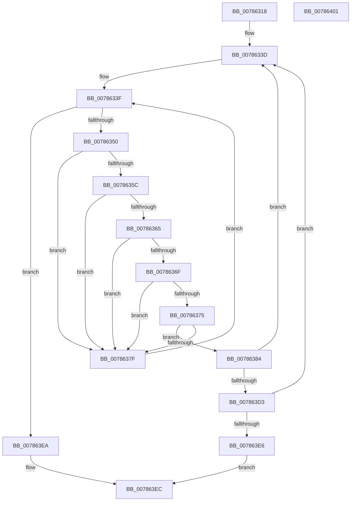

# PsWaitForAllProcesses

- RVA: `0x00786318`–`0x00786402` (길이 `234` bytes)
- VA: `0x0000000140786318`
- 실행 섹션: `PAGE`
- PDB 이름 있음: `예`; PDB Function 태그: `아니요`
- unwind 정보 RVA: `0x000A118C`
- 디코드: `63`개 명령, `234/234` bytes 표시
- 미해석 바이트: `0` (있으면 어셈블리에 `.byte`로 보존)

> 이 문서는 커널 이미지의 기계어와 PDB 기호를 분석해 생성했습니다. 4번과 5번은 함수 원형과 자료형을 바이너리 사용 방식에서 추정한 C 해석이며 원본 소스 복구 결과는 아닙니다.

## 1. Dependencies

- 직접 호출 지점: **5**; 고유 호출 대상: **4**
- 직접 호출자로 확인된 함수: **1**
- RIP 상대 이미지 참조: **1**

### Outgoing calls
- `0x0078633F` → [PsGetNextProcess](../91/PsGetNextProcess_function_0091C900.md) (function, `0x0091C900`)
- `0x0078638C` → [ObfReferenceObjectWithTag](../../text/21/ObfReferenceObjectWithTag_function_00210710.md) (function, `0x00210710`)
- `0x00786399` → [ObfDereferenceObjectWithTag](../../text/2F/ObfDereferenceObjectWithTag_function_002F78E0.md) (function, `0x002F78E0`)
- `0x007863B3` → [KeWaitForSingleObject](../../text/20/KeWaitForSingleObject_function_0020E6B0.md) (function, `0x0020E6B0`)
- `0x007863C2` → [ObfDereferenceObjectWithTag](../../text/2F/ObfDereferenceObjectWithTag_function_002F78E0.md) (function, `0x002F78E0`)

### Direct callers
- [PopGracefulShutdown](../../pagelk/B6/PopGracefulShutdown_function_00B6BEC8.md) at `0x00B6C04B`

### Static image references
- `0x0078635C` → RVA `0x00FC6B70` (`ALMOSTRO`; read)

## 2. Other-region calls and transfers

- 다른 실행 섹션으로 향하는 call: **4**
  - `0x0078638C` → [ObfReferenceObjectWithTag](../../text/21/ObfReferenceObjectWithTag_function_00210710.md) (`PAGE` → `.text`)
  - `0x00786399` → [ObfDereferenceObjectWithTag](../../text/2F/ObfDereferenceObjectWithTag_function_002F78E0.md) (`PAGE` → `.text`)
  - `0x007863B3` → [KeWaitForSingleObject](../../text/20/KeWaitForSingleObject_function_0020E6B0.md) (`PAGE` → `.text`)
  - `0x007863C2` → [ObfDereferenceObjectWithTag](../../text/2F/ObfDereferenceObjectWithTag_function_002F78E0.md) (`PAGE` → `.text`)
- 별도 외부 분기/꼬리 이동을 확인하지 못했습니다.

## 3. Assembly (complete function range)

```asm
00786318  48 8B C4                        mov rax, rsp
0078631B  48 89 58 10                     mov qword ptr [rax + 0x10], rbx
0078631F  48 89 68 18                     mov qword ptr [rax + 0x18], rbp
00786323  48 89 70 20                     mov qword ptr [rax + 0x20], rsi
00786327  57                              push rdi
00786328  48 83 EC 30                     sub rsp, 0x30
0078632C  83 48 0C FF                     or dword ptr [rax + 0xc], 0xffffffff
00786330  C7 40 08 60 79 FE FF            mov dword ptr [rax + 8], 0xfffe7960
00786337  33 ED                           xor ebp, ebp
00786339  48 8B 58 08                     mov rbx, qword ptr [rax + 8]
0078633D  33 C9                           xor ecx, ecx
0078633F  E8 BC 65 19 00                  call 0x14091c900
00786344  48 8B F0                        mov rsi, rax
00786347  48 85 C0                        test rax, rax
0078634A  0F 84 9A 00 00 00               je 0x1407863ea
00786350  8B 88 FC 05 00 00               mov ecx, dword ptr [rax + 0x5fc]
00786356  0F BA E1 0C                     bt ecx, 0xc
0078635A  72 23                           jb 0x14078637f
0078635C  48 3B 05 0D 08 84 00            cmp rax, qword ptr [rip + 0x84080d]
00786363  74 1A                           je 0x14078637f
00786365  8B 80 F4 01 00 00               mov eax, dword ptr [rax + 0x1f4]
0078636B  A8 04                           test al, 4
0078636D  74 10                           je 0x14078637f
0078636F  0F BA E1 1E                     bt ecx, 0x1e
00786373  72 0A                           jb 0x14078637f
00786375  48 83 BE 00 03 00 00 00         cmp qword ptr [rsi + 0x300], 0
0078637D  75 05                           jne 0x140786384
0078637F  48 8B CE                        mov rcx, rsi
00786382  EB BB                           jmp 0x14078633f
00786384  BA 50 73 54 65                  mov edx, 0x65547350
00786389  48 8B CE                        mov rcx, rsi
0078638C  E8 7F A3 A8 FF                  call 0x140210710
00786391  BA 50 73 45 6E                  mov edx, 0x6e457350
00786396  48 8B CE                        mov rcx, rsi
00786399  E8 42 15 B7 FF                  call 0x1402f78e0
0078639E  48 8D 44 24 40                  lea rax, [rsp + 0x40]
007863A3  45 33 C9                        xor r9d, r9d
007863A6  45 33 C0                        xor r8d, r8d
007863A9  48 89 44 24 20                  mov qword ptr [rsp + 0x20], rax
007863AE  33 D2                           xor edx, edx
007863B0  48 8B CE                        mov rcx, rsi
007863B3  E8 F8 82 A8 FF                  call 0x14020e6b0
007863B8  BA 50 73 54 65                  mov edx, 0x65547350
007863BD  48 8B CE                        mov rcx, rsi
007863C0  8B F8                           mov edi, eax
007863C2  E8 19 15 B7 FF                  call 0x1402f78e0
007863C7  81 FF 02 01 00 00               cmp edi, 0x102
007863CD  0F 85 6A FF FF FF               jne 0x14078633d
007863D3  48 03 DB                        add rbx, rbx
007863D6  FF C5                           inc ebp
007863D8  48 89 5C 24 40                  mov qword ptr [rsp + 0x40], rbx
007863DD  83 FD 0D                        cmp ebp, 0xd
007863E0  0F 86 57 FF FF FF               jbe 0x14078633d
007863E6  32 C0                           xor al, al
007863E8  EB 02                           jmp 0x1407863ec
007863EA  B0 01                           mov al, 1
007863EC  48 8B 5C 24 48                  mov rbx, qword ptr [rsp + 0x48]
007863F1  48 8B 6C 24 50                  mov rbp, qword ptr [rsp + 0x50]
007863F6  48 8B 74 24 58                  mov rsi, qword ptr [rsp + 0x58]
007863FB  48 83 C4 30                     add rsp, 0x30
007863FF  5F                              pop rdi
00786400  C3                              ret
00786401  CC                              int3
```

## 4. C-style interpretation (structured pseudocode)

```c
__int64 __fastcall PsWaitForAllProcesses(int a1, __int64 a2, int a3, int a4)
{
    __int64 result;
    __int64 v_rbp;
    __int64 v_rbx;
    __int64 v_rsp;
    unsigned __int64 v_stack_m18;
    unsigned __int64 v_stack_p10;
    unsigned __int64 v_stack_p18;
    unsigned __int64 v_stack_p20;
    unsigned __int64 v_stack_p8;

    *(unsigned __int64 *)(v_rsp + 16) = v_rbx;
    *(unsigned __int64 *)(v_rsp + 24) = v_rbp;
    *(unsigned __int64 *)(v_rsp + 32) = v_rsi;
    v_rsp = (v_rsp) - (48);
    *(unsigned int *)(v_rsp + 8) = 0xFFFE7960ULL;
    v_rbp = 0;
loc_0078633D:
    a1 = 0;
loc_0078633F:
    result = PsGetNextProcess(a1, a2, a3, a4);
    if (result == 0) goto loc_007863EA;
    if (condition_is_below) goto loc_0078637F;
    if (result == (*(unsigned __int64 *)(v_rip + 8652813))) goto loc_0078637F;
    if ((((unsigned __int8)((unsigned int)(*(unsigned int *)(result + 500)))) & (4)) == 0) goto loc_0078637F;
    if (condition_is_below) goto loc_0078637F;
    if ((*(unsigned __int64 *)(result + 768)) != 0) goto loc_00786384;
loc_0078637F:
    goto loc_0078633F;
loc_00786384:
    result = ObfReferenceObjectWithTag(result, (unsigned int)(0x65547350ULL), a3, a4);
    result = ObfDereferenceObjectWithTag(result, (unsigned int)(0x6E457350ULL), a3, a4);
    a4 = 0;
    a3 = 0;
    v_stack_m18 = v_stack_p8;
    a2 = 0;
    result = KeWaitForSingleObject(result, a2, a3, a4);
    result = ObfDereferenceObjectWithTag(result, (unsigned int)(0x65547350ULL), a3, a4);
    if (((unsigned int)((unsigned int)((unsigned int)(result)))) != 258) goto loc_0078633D;
    v_rbx = (*(unsigned __int64 *)(v_rsp + 8)) + (*(unsigned __int64 *)(v_rsp + 8));
    v_rbp = (unsigned int)((v_rbp) + 1);
    v_stack_p8 = v_rbx;
    if (((unsigned int)(v_rbp)) <= 13) goto loc_0078633D;
    result = 0;
    goto loc_007863EC;
loc_007863EA:
loc_007863EC:
    v_rsp = (v_rsp) + (48);
    return 1;
}
```

## 5. (Beta) C Style

```c
int64_t PsWaitForAllProcesses(int32_t Arg1, int64_t Arg2, int32_t Arg3, int32_t Arg4)
{
    int64_t result;
    int64_t local_rbp;
    int64_t local_rbx;
    int64_t local_rsp;
    uint64_t v_stack_m18;
    uint64_t v_stack_p10;
    uint64_t v_stack_p18;
    uint64_t v_stack_p20;
    uint64_t v_stack_p8;

    *(uint64_t *)(local_rsp + 0x10) = local_rbx;
    *(uint64_t *)(local_rsp + 0x18) = local_rbp;
    *(uint64_t *)(local_rsp + 0x20) = local_rsi;
    local_rsp = (local_rsp) - (48);
    *(uint32_t *)(local_rsp + 0x8) = 0xFFFE7960ULL;
    local_rbp = 0;
loc_0078633D:
    Arg1 = 0;
loc_0078633F:
    result = PsGetNextProcess(Arg1, Arg2, Arg3, Arg4);
    if (result == 0) goto loc_007863EA;
    if (condition_is_below) goto loc_0078637F;
    if (result == (*(uint64_t *)(v_rip + 0x84080D))) goto loc_0078637F;
    if ((((uint8_t)((uint32_t)(*(uint32_t *)(result + 0x1F4)))) & (4)) == 0) goto loc_0078637F;
    if (condition_is_below) goto loc_0078637F;
    if ((*(uint64_t *)(result + 0x300)) != 0) goto loc_00786384;
loc_0078637F:
    goto loc_0078633F;
loc_00786384:
    result = ObfReferenceObjectWithTag(result, (uint32_t)(0x65547350ULL), Arg3, Arg4);
    result = ObfDereferenceObjectWithTag(result, (uint32_t)(0x6E457350ULL), Arg3, Arg4);
    Arg4 = 0;
    Arg3 = 0;
    v_stack_m18 = v_stack_p8;
    Arg2 = 0;
    result = KeWaitForSingleObject(result, Arg2, Arg3, Arg4);
    result = ObfDereferenceObjectWithTag(result, (uint32_t)(0x65547350ULL), Arg3, Arg4);
    if (((uint32_t)((uint32_t)((uint32_t)(result)))) != 258) goto loc_0078633D;
    local_rbx = (*(uint64_t *)(local_rsp + 0x8)) + (*(uint64_t *)(local_rsp + 0x8));
    local_rbp = (uint32_t)((local_rbp) + 1);
    v_stack_p8 = local_rbx;
    if (((uint32_t)(local_rbp)) <= 13) goto loc_0078633D;
    result = 0;
    goto loc_007863EC;
loc_007863EA:
loc_007863EC:
    local_rsp = (local_rsp) + (48);
    return 1;
}
```

## 6. Execution-region graph

[열기: 2D/3D 그래프와 함수 탐색 컨트롤 패널](../../../control-panel.html?section=page&rva=0x00786318&view=graph)

- 2D 그래프는 위에서 아래로 흐르고, 3D 그래프는 빈 공간을 드래그해 회전합니다. Shift+드래그는 이동, 휠은 확대·축소, 함수 노드 선택은 대상 보고서 이동입니다.

### Static fallback


