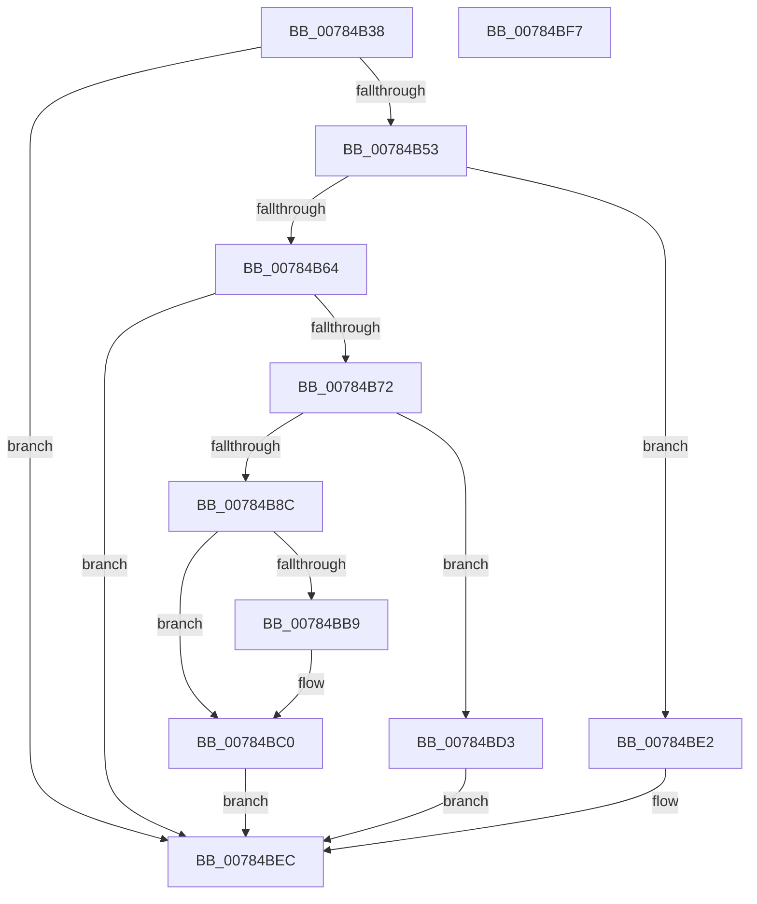

# PspAddProcessToWorkingSetChangeList

- RVA: `0x00784B38`–`0x00784BF8` (길이 `192` bytes)
- VA: `0x0000000140784B38`
- 실행 섹션: `PAGE`
- PDB 이름 있음: `예`; PDB Function 태그: `아니요`
- unwind 정보 RVA: `0x0005CAAC`
- 디코드: `48`개 명령, `192/192` bytes 표시
- 미해석 바이트: `0` (있으면 어셈블리에 `.byte`로 보존)

> 이 문서는 커널 이미지의 기계어와 PDB 기호를 분석해 생성했습니다. 4번과 5번은 함수 원형과 자료형을 바이너리 사용 방식에서 추정한 C 해석이며 원본 소스 복구 결과는 아닙니다.

## 1. Dependencies

- 직접 호출 지점: **4**; 고유 호출 대상: **4**
- 직접 호출자로 확인된 함수: **2**
- RIP 상대 이미지 참조: **3**

### Outgoing calls
- `0x00784B69` → [ObReferenceObjectSafeWithTag](../../text/21/ObReferenceObjectSafeWithTag_function_00210EE0.md) (function, `0x00210EE0`)
- `0x00784B82` → [ExAllocatePool2](../../poolcode/B8/ExAllocatePool2_function_00B820F0.md) (function, `0x00B820F0`)
- `0x00784BDB` → [ObfDereferenceObjectWithTag](../../text/2F/ObfDereferenceObjectWithTag_function_002F78E0.md) (function, `0x002F78E0`)
- `0x00784BE7` → [MmEnforceWorkingSetLimit](../../text/48/MmEnforceWorkingSetLimit_function_004881E0.md) (function, `0x004881E0`)

### Direct callers
- [NtSetInformationJobObject](../9F/NtSetInformationJobObject_function_009F84C0.md) at `0x009F951A`
- [PspSetJobLimitsProcessCallback](../A5/PspSetJobLimitsProcessCallback_function_00A57220.md) at `0x00A57266`

### Static image references
- `0x00784B90` → RVA `0x00FC70A0` (`ALMOSTRO`; read)
- `0x00784BAD` → RVA `0x00FC70A8` (`ALMOSTRO`; read)
- `0x00784BCA` → RVA `0x00FC70A8` (`ALMOSTRO`; write)

## 2. Other-region calls and transfers

- 다른 실행 섹션으로 향하는 call: **4**
  - `0x00784B69` → [ObReferenceObjectSafeWithTag](../../text/21/ObReferenceObjectSafeWithTag_function_00210EE0.md) (`PAGE` → `.text`)
  - `0x00784B82` → [ExAllocatePool2](../../poolcode/B8/ExAllocatePool2_function_00B820F0.md) (`PAGE` → `POOLCODE`)
  - `0x00784BDB` → [ObfDereferenceObjectWithTag](../../text/2F/ObfDereferenceObjectWithTag_function_002F78E0.md) (`PAGE` → `.text`)
  - `0x00784BE7` → [MmEnforceWorkingSetLimit](../../text/48/MmEnforceWorkingSetLimit_function_004881E0.md) (`PAGE` → `.text`)
- 별도 외부 분기/꼬리 이동을 확인하지 못했습니다.

## 3. Assembly (complete function range)

```asm
00784B38  48 89 5C 24 08                  mov qword ptr [rsp + 8], rbx
00784B3D  57                              push rdi
00784B3E  48 83 EC 20                     sub rsp, 0x20
00784B42  8B 81 F0 01 00 00               mov eax, dword ptr [rcx + 0x1f0]
00784B48  48 8B D9                        mov rbx, rcx
00784B4B  A8 01                           test al, 1
00784B4D  0F 85 99 00 00 00               jne 0x140784bec
00784B53  48 8B B9 A0 02 00 00            mov rdi, qword ptr [rcx + 0x2a0]
00784B5A  8B 87 20 04 00 00               mov eax, dword ptr [rdi + 0x420]
00784B60  A8 01                           test al, 1
00784B62  74 7E                           je 0x140784be2
00784B64  BA 50 73 4A 62                  mov edx, 0x624a7350
00784B69  E8 72 C3 A8 FF                  call 0x140210ee0
00784B6E  84 C0                           test al, al
00784B70  74 7A                           je 0x140784bec
00784B72  BA 28 00 00 00                  mov edx, 0x28
00784B77  B9 00 01 00 00                  mov ecx, 0x100
00784B7C  41 B8 50 73 43 72               mov r8d, 0x72437350
00784B82  E8 69 D5 3F 00                  call 0x140b820f0
00784B87  48 85 C0                        test rax, rax
00784B8A  74 47                           je 0x140784bd3
00784B8C  48 89 58 10                     mov qword ptr [rax + 0x10], rbx
00784B90  48 8D 15 09 25 84 00            lea rdx, [rip + 0x842509]
00784B97  48 8B 8F F0 03 00 00            mov rcx, qword ptr [rdi + 0x3f0]
00784B9E  48 89 48 20                     mov qword ptr [rax + 0x20], rcx
00784BA2  48 8B 8F E8 03 00 00            mov rcx, qword ptr [rdi + 0x3e8]
00784BA9  48 89 48 18                     mov qword ptr [rax + 0x18], rcx
00784BAD  48 8B 0D F4 24 84 00            mov rcx, qword ptr [rip + 0x8424f4]
00784BB4  48 39 11                        cmp qword ptr [rcx], rdx
00784BB7  74 07                           je 0x140784bc0
00784BB9  B9 03 00 00 00                  mov ecx, 3
00784BBE  CD 29                           int 0x29
00784BC0  48 89 10                        mov qword ptr [rax], rdx
00784BC3  48 89 48 08                     mov qword ptr [rax + 8], rcx
00784BC7  48 89 01                        mov qword ptr [rcx], rax
00784BCA  48 89 05 D7 24 84 00            mov qword ptr [rip + 0x8424d7], rax
00784BD1  EB 19                           jmp 0x140784bec
00784BD3  BA 50 73 4A 62                  mov edx, 0x624a7350
00784BD8  48 8B CB                        mov rcx, rbx
00784BDB  E8 00 2D B7 FF                  call 0x1402f78e0
00784BE0  EB 0A                           jmp 0x140784bec
00784BE2  BA 02 00 00 00                  mov edx, 2
00784BE7  E8 F4 35 D0 FF                  call 0x1404881e0
00784BEC  48 8B 5C 24 30                  mov rbx, qword ptr [rsp + 0x30]
00784BF1  48 83 C4 20                     add rsp, 0x20
00784BF5  5F                              pop rdi
00784BF6  C3                              ret
00784BF7  CC                              int3
```

## 4. C-style interpretation (structured pseudocode)

```c
__int64 __fastcall PspAddProcessToWorkingSetChangeList(__int64 a1)
{
    __int64 result;
    __int64 v_rsp;
    unsigned __int64 v_stack_p8;

    v_stack_p8 = v_rbx;
    v_rsp = (v_rsp) - (32);
    if ((((unsigned __int8)((unsigned int)(*(unsigned int *)(a1 + 496)))) & (1)) != 0) goto loc_00784BEC;
    if ((((unsigned __int8)((unsigned int)(*(unsigned int *)(*(unsigned __int64 *)(a1 + 672) + 1056)))) & (1)) == 0) goto loc_00784BE2;
    result = ObReferenceObjectSafeWithTag(a1, (unsigned int)(0x624A7350ULL), a3, a4);
    if ((unsigned __int8)(result) == 0) goto loc_00784BEC;
    result = ExAllocatePool2(256, 40, (unsigned int)(0x72437350ULL), a4);
    if (result == 0) goto loc_00784BD3;
    *(unsigned __int64 *)(result + 16) = a1;
    *(unsigned __int64 *)(result + 32) = *(unsigned __int64 *)(*(unsigned __int64 *)(a1 + 672) + 1008);
    *(unsigned __int64 *)(result + 24) = *(unsigned __int64 *)(*(unsigned __int64 *)(a1 + 672) + 1000);
    if ((*(unsigned __int64 *)(*(unsigned __int64 *)(v_rip + 8660212))) != (v_rip + 8660233)) {
        a1 = 3;
    }
    *(unsigned __int64 *)(result) = v_rip + 8660233;
    *(unsigned __int64 *)(result + 8) = a1;
    *(unsigned __int64 *)(a1) = result;
    *(unsigned __int64 *)(v_rip + 8660183) = result;
    goto loc_00784BEC;
loc_00784BD3:
    result = ObfDereferenceObjectWithTag(a1, (unsigned int)(0x624A7350ULL), (unsigned int)(0x72437350ULL), a4);
    goto loc_00784BEC;
loc_00784BE2:
    result = MmEnforceWorkingSetLimit(a1, 2, (unsigned int)(0x72437350ULL), a4);
loc_00784BEC:
    v_rsp = (v_rsp) + (32);
    return result;
}
```

## 5. (Beta) C Style

```c
int64_t PspAddProcessToWorkingSetChangeList(void *Arg1)
{
    uint8_t *arg1 = (uint8_t *)Arg1;

    int64_t result;
    int64_t local_rsp;
    uint64_t v_stack_p8;

    v_stack_p8 = local_rbx;
    local_rsp = (local_rsp) - (32);
    if ((((uint8_t)((uint32_t)(*(uint32_t *)(arg1 + 0x1F0)))) & (1)) != 0) goto loc_00784BEC;
    if ((((uint8_t)((uint32_t)(*(uint32_t *)(*(uint64_t *)(arg1 + 0x2A0) + 0x420)))) & (1)) == 0) goto loc_00784BE2;
    result = ObReferenceObjectSafeWithTag(Arg1, (uint32_t)(0x624A7350ULL), a3, a4);
    if ((uint8_t)(result) == 0) goto loc_00784BEC;
    result = ExAllocatePool2(256, 40, (uint32_t)(0x72437350ULL), a4);
    if (result == 0) goto loc_00784BD3;
    *(void **)(result + 0x10) = Arg1;
    *(uint64_t *)(result + 0x20) = *(uint64_t *)(*(uint64_t *)(arg1 + 0x2A0) + 0x3F0);
    *(uint64_t *)(result + 0x18) = *(uint64_t *)(*(uint64_t *)(arg1 + 0x2A0) + 0x3E8);
    if ((*(uint64_t *)(*(uint64_t *)(v_rip + 0x8424F4))) != (v_rip + 8660233)) {
        Arg1 = 3;
    }
    *(uint64_t *)(result) = v_rip + 8660233;
    *(void **)(result + 0x8) = Arg1;
    *(uint64_t *)(arg1) = result;
    *(uint64_t *)(v_rip + 0x8424D7) = result;
    goto loc_00784BEC;
loc_00784BD3:
    result = ObfDereferenceObjectWithTag(Arg1, (uint32_t)(0x624A7350ULL), (uint32_t)(0x72437350ULL), a4);
    goto loc_00784BEC;
loc_00784BE2:
    result = MmEnforceWorkingSetLimit(Arg1, 2, (uint32_t)(0x72437350ULL), a4);
loc_00784BEC:
    local_rsp = (local_rsp) + (32);
    return result;
}
```

### 관측된 메모리 오프셋

구조체 형식이 확인되지 않은 접근은 인자 기준의 오프셋으로만 기록했습니다.

| 기준 인자 | 오프셋 표현 | 폭 (bit) | 접근 |
|---|---:|---:|---|
| `Arg1` | `+ 0x1F0` | `32` | `R` |
| `Arg1` | `+ 0x2A0` | `64` | `R` |

## 6. Execution-region graph

[열기: 2D/3D 그래프와 함수 탐색 컨트롤 패널](../../../control-panel.html?section=page&rva=0x00784B38&view=graph)

- 2D 그래프는 위에서 아래로 흐르고, 3D 그래프는 빈 공간을 드래그해 회전합니다. Shift+드래그는 이동, 휠은 확대·축소, 함수 노드 선택은 대상 보고서 이동입니다.

### Static fallback


