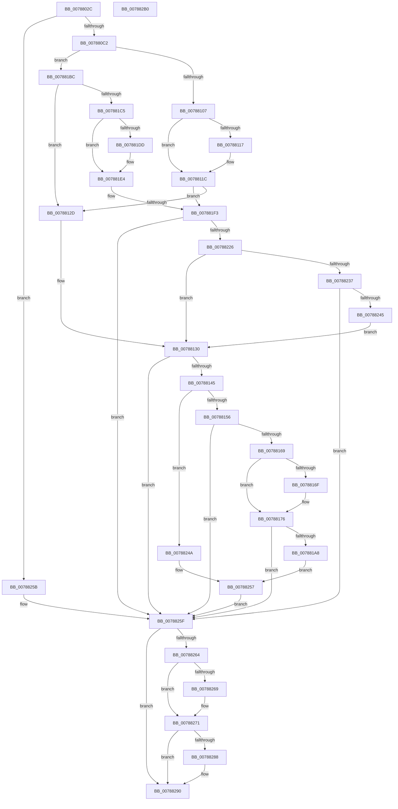

# PspAllocatePartition

- RVA: `0x0078802C`–`0x007882B1` (길이 `645` bytes)
- VA: `0x000000014078802C`
- 실행 섹션: `PAGE`
- PDB 이름 있음: `예`; PDB Function 태그: `아니요`
- unwind 정보 RVA: `0x000CF488`
- 디코드: `176`개 명령, `645/645` bytes 표시
- 미해석 바이트: `0` (있으면 어셈블리에 `.byte`로 보존)

> 이 문서는 커널 이미지의 기계어와 PDB 기호를 분석해 생성했습니다. 4번과 5번은 함수 원형과 자료형을 바이너리 사용 방식에서 추정한 C 해석이며 원본 소스 복구 결과는 아닙니다.

## 1. Dependencies

- 직접 호출 지점: **15**; 고유 호출 대상: **15**
- 직접 호출자로 확인된 함수: **1**
- RIP 상대 이미지 참조: **4**

### Outgoing calls
- `0x007880B3` → [ObCreateObjectEx](../89/ObCreateObjectEx_function_0089B1E0.md) (function, `0x0089B1E0`)
- `0x007880D6` → [memset](../../text/6C/memset_function_006C6C40.md) (function, `0x006C6C40`)
- `0x007880F0` → [ObfReferenceObjectWithTag](../../text/21/ObfReferenceObjectWithTag_function_00210710.md) (function, `0x00210710`)
- `0x00788136` → [MmCreatePartition](../80/MmCreatePartition_function_0080DC3C.md) (function, `0x0080DC3C`)
- `0x00788148` → [PspAddPartitionToGlobalList](../../text/5E/PspAddPartitionToGlobalList_function_005E4B24.md) (function, `0x005E4B24`)
- `0x0078815A` → [ExpPartitionStart](../7C/ExpPartitionStart_function_007CFDCC.md) (function, `0x007CFDCC`)
- `0x00788199` → [ObInsertObjectEx](../8B/ObInsertObjectEx_function_008B97A0.md) (function, `0x008B97A0`)
- `0x00788200` → [KiStackAttachProcess](../../text/21/KiStackAttachProcess_function_00216820.md) (function, `0x00216820`)
- `0x00788210` → [PspCreatePartitionSystemProcess](PspCreatePartitionSystemProcess_function_007882F8.md) (function, `0x007882F8`)
- `0x0078821D` → [KiUnstackDetachProcess](../../text/21/KiUnstackDetachProcess_function_00217D30.md) (function, `0x00217D30`)
- `0x0078823A` → [ExpPartitionInitialize](../7C/ExpPartitionInitialize_function_007CFB9C.md) (function, `0x007CFB9C`)
- `0x0078826C` → [ObfDereferenceObject](../../text/2F/ObfDereferenceObject_function_002F9350.md) (function, `0x002F9350`)
- `0x0078827F` → [PspClosePartitionHandle](PspClosePartitionHandle_function_007882C0.md) (function, `0x007882C0`)
- `0x0078828B` → [PsDereferencePartition](../../text/34/PsDereferencePartition_function_00342E70.md) (function, `0x00342E70`)
- `0x00788299` → [_security_check_cookie](../../text/6A/_security_check_cookie_function_006AC640.md) (function, `0x006AC640`)

### Direct callers
- [PsCreatePartition](PsCreatePartition_function_00787EB0.md) at `0x00787FA4`

### Static image references
- `0x00788043` → RVA `0x00E0A740` (`.data`; read)
- `0x0078809C` → RVA `0x00FC6EB8` (`ALMOSTRO`; read)
- `0x007881C5` → RVA `0x00FC6EA0` (`ALMOSTRO`; read)
- `0x007881F3` → RVA `0x00FC6AB0` (`ALMOSTRO`; read)

## 2. Other-region calls and transfers

- 다른 실행 섹션으로 향하는 call: **8**
  - `0x007880D6` → [memset](../../text/6C/memset_function_006C6C40.md) (`PAGE` → `.text`)
  - `0x007880F0` → [ObfReferenceObjectWithTag](../../text/21/ObfReferenceObjectWithTag_function_00210710.md) (`PAGE` → `.text`)
  - `0x00788148` → [PspAddPartitionToGlobalList](../../text/5E/PspAddPartitionToGlobalList_function_005E4B24.md) (`PAGE` → `.text`)
  - `0x00788200` → [KiStackAttachProcess](../../text/21/KiStackAttachProcess_function_00216820.md) (`PAGE` → `.text`)
  - `0x0078821D` → [KiUnstackDetachProcess](../../text/21/KiUnstackDetachProcess_function_00217D30.md) (`PAGE` → `.text`)
  - `0x0078826C` → [ObfDereferenceObject](../../text/2F/ObfDereferenceObject_function_002F9350.md) (`PAGE` → `.text`)
  - `0x0078828B` → [PsDereferencePartition](../../text/34/PsDereferencePartition_function_00342E70.md) (`PAGE` → `.text`)
  - `0x00788299` → [_security_check_cookie](../../text/6A/_security_check_cookie_function_006AC640.md) (`PAGE` → `.text`)
- 별도 외부 분기/꼬리 이동을 확인하지 못했습니다.

## 3. Assembly (complete function range)

```asm
0078802C  40 55                           push rbp
0078802E  53                              push rbx
0078802F  56                              push rsi
00788030  57                              push rdi
00788031  41 54                           push r12
00788033  41 55                           push r13
00788035  41 56                           push r14
00788037  48 8D 6C 24 F1                  lea rbp, [rsp - 0xf]
0078803C  48 81 EC B0 00 00 00            sub rsp, 0xb0
00788043  48 8B 05 F6 26 68 00            mov rax, qword ptr [rip + 0x6826f6]
0078804A  48 33 C4                        xor rax, rsp
0078804D  48 89 45 FF                     mov qword ptr [rbp - 1], rax
00788051  48 83 64 24 48 00               and qword ptr [rsp + 0x48], 0
00788057  41 8A C0                        mov al, r8b
0078805A  4C 8B 6D 77                     mov r13, qword ptr [rbp + 0x77]
0078805E  4C 8D 45 AF                     lea r8, [rbp - 0x51]
00788062  48 83 65 BF 00                  and qword ptr [rbp - 0x41], 0
00788067  0F 57 C0                        xorps xmm0, xmm0
0078806A  48 83 65 AF 00                  and qword ptr [rbp - 0x51], 0
0078806F  4D 8B F1                        mov r14, r9
00788072  4C 89 44 24 40                  mov qword ptr [rsp + 0x40], r8
00788077  BB 90 00 00 00                  mov ebx, 0x90
0078807C  83 64 24 38 00                  and dword ptr [rsp + 0x38], 0
00788081  4C 8B C1                        mov r8, rcx
00788084  83 64 24 30 00                  and dword ptr [rsp + 0x30], 0
00788089  8A C8                           mov cl, al
0078808B  89 55 B7                        mov dword ptr [rbp - 0x49], edx
0078808E  44 8A C8                        mov r9b, al
00788091  48 8B 55 7F                     mov rdx, qword ptr [rbp + 0x7f]
00788095  45 32 E4                        xor r12b, r12b
00788098  48 89 55 C7                     mov qword ptr [rbp - 0x39], rdx
0078809C  48 8B 15 15 EE 83 00            mov rdx, qword ptr [rip + 0x83ee15]
007880A3  89 5C 24 28                     mov dword ptr [rsp + 0x28], ebx
007880A7  0F 11 45 CF                     movups xmmword ptr [rbp - 0x31], xmm0
007880AB  0F 11 45 DF                     movups xmmword ptr [rbp - 0x21], xmm0
007880AF  0F 11 45 EF                     movups xmmword ptr [rbp - 0x11], xmm0
007880B3  E8 28 31 11 00                  call 0x14089b1e0
007880B8  8B F8                           mov edi, eax
007880BA  85 C0                           test eax, eax
007880BC  0F 88 99 01 00 00               js 0x14078825b
007880C2  44 8B C3                        mov r8d, ebx
007880C5  BF 01 00 00 00                  mov edi, 1
007880CA  48 8B 5D AF                     mov rbx, qword ptr [rbp - 0x51]
007880CE  33 D2                           xor edx, edx
007880D0  48 8B CB                        mov rcx, rbx
007880D3  44 8A E7                        mov r12b, dil
007880D6  E8 65 EB F3 FF                  call 0x1406c6c40
007880DB  8B 75 6F                        mov esi, dword ptr [rbp + 0x6f]
007880DE  BA 48 61 72 64                  mov edx, 0x64726148
007880E3  48 8B CB                        mov rcx, rbx
007880E6  48 C7 43 28 02 00 00 00         mov qword ptr [rbx + 0x28], 2
007880EE  23 F7                           and esi, edi
007880F0  E8 1B 86 A8 FF                  call 0x140210710
007880F5  48 89 7B 30                     mov qword ptr [rbx + 0x30], rdi
007880F9  48 83 63 70 00                  and qword ptr [rbx + 0x70], 0
007880FE  4D 85 F6                        test r14, r14
00788101  0F 84 B5 00 00 00               je 0x1407881bc
00788107  8B C7                           mov eax, edi
00788109  F0 49 0F C1 46 28               lock xadd qword ptr [r14 + 0x28], rax
0078810F  48 03 C7                        add rax, rdi
00788112  48 3B C7                        cmp rax, rdi
00788115  7F 05                           jg 0x14078811c
00788117  8D 4F 0D                        lea ecx, [rdi + 0xd]
0078811A  CD 29                           int 0x29
0078811C  48 8B 5D AF                     mov rbx, qword ptr [rbp - 0x51]
00788120  4C 89 73 48                     mov qword ptr [rbx + 0x48], r14
00788124  40 84 F6                        test sil, sil
00788127  0F 84 C6 00 00 00               je 0x1407881f3
0078812D  44 8B F7                        mov r14d, edi
00788130  41 8B D6                        mov edx, r14d
00788133  48 8B CB                        mov rcx, rbx
00788136  E8 01 5B 08 00                  call 0x14080dc3c
0078813B  8B F8                           mov edi, eax
0078813D  85 C0                           test eax, eax
0078813F  0F 88 1A 01 00 00               js 0x14078825f
00788145  48 8B CB                        mov rcx, rbx
00788148  E8 D7 C9 E5 FF                  call 0x1405e4b24
0078814D  40 84 F6                        test sil, sil
00788150  0F 85 F4 00 00 00               jne 0x14078824a
00788156  48 8B 4B 10                     mov rcx, qword ptr [rbx + 0x10]
0078815A  E8 6D 7C 04 00                  call 0x1407cfdcc
0078815F  8B F8                           mov edi, eax
00788161  85 C0                           test eax, eax
00788163  0F 88 F6 00 00 00               js 0x14078825f
00788169  F6 45 6F 02                     test byte ptr [rbp + 0x6f], 2
0078816D  74 07                           je 0x140788176
0078816F  83 8B 88 00 00 00 01            or dword ptr [rbx + 0x88], 1
00788176  44 8B 45 B7                     mov r8d, dword ptr [rbp - 0x49]
0078817A  48 8D 45 BF                     lea rax, [rbp - 0x41]
0078817E  48 89 44 24 30                  mov qword ptr [rsp + 0x30], rax
00788183  45 33 C9                        xor r9d, r9d
00788186  48 83 64 24 28 00               and qword ptr [rsp + 0x28], 0
0078818C  33 D2                           xor edx, edx
0078818E  83 64 24 20 00                  and dword ptr [rsp + 0x20], 0
00788193  48 8B CB                        mov rcx, rbx
00788196  45 32 E4                        xor r12b, r12b
00788199  E8 02 16 13 00                  call 0x1408b97a0
0078819E  8B F8                           mov edi, eax
007881A0  85 C0                           test eax, eax
007881A2  0F 88 B7 00 00 00               js 0x14078825f
007881A8  48 8B 4D C7                     mov rcx, qword ptr [rbp - 0x39]
007881AC  48 8B 45 BF                     mov rax, qword ptr [rbp - 0x41]
007881B0  49 89 5D 00                     mov qword ptr [r13], rbx
007881B4  48 89 01                        mov qword ptr [rcx], rax
007881B7  E9 9B 00 00 00                  jmp 0x140788257
007881BC  40 84 F6                        test sil, sil
007881BF  0F 85 68 FF FF FF               jne 0x14078812d
007881C5  48 8B 05 D4 EC 83 00            mov rax, qword ptr [rip + 0x83ecd4]
007881CC  48 8B CF                        mov rcx, rdi
007881CF  F0 48 0F C1 48 28               lock xadd qword ptr [rax + 0x28], rcx
007881D5  48 03 CF                        add rcx, rdi
007881D8  48 3B CF                        cmp rcx, rdi
007881DB  7F 07                           jg 0x1407881e4
007881DD  B9 0E 00 00 00                  mov ecx, 0xe
007881E2  CD 29                           int 0x29
007881E4  48 8B 5D AF                     mov rbx, qword ptr [rbp - 0x51]
007881E8  48 8B 05 B1 EC 83 00            mov rax, qword ptr [rip + 0x83ecb1]
007881EF  48 89 43 48                     mov qword ptr [rbx + 0x48], rax
007881F3  48 8B 0D B6 E8 83 00            mov rcx, qword ptr [rip + 0x83e8b6]
007881FA  4C 8D 45 CF                     lea r8, [rbp - 0x31]
007881FE  33 D2                           xor edx, edx
00788200  E8 1B E6 A8 FF                  call 0x140216820
00788205  48 8D 93 80 00 00 00            lea rdx, [rbx + 0x80]
0078820C  48 8D 4B 78                     lea rcx, [rbx + 0x78]
00788210  E8 E3 00 00 00                  call 0x1407882f8
00788215  33 D2                           xor edx, edx
00788217  48 8D 4D CF                     lea rcx, [rbp - 0x31]
0078821B  8B F8                           mov edi, eax
0078821D  E8 0E FB A8 FF                  call 0x140217d30
00788222  85 FF                           test edi, edi
00788224  78 39                           js 0x14078825f
00788226  44 8B 75 6F                     mov r14d, dword ptr [rbp + 0x6f]
0078822A  41 83 E6 02                     and r14d, 2
0078822E  40 84 F6                        test sil, sil
00788231  0F 85 F9 FE FF FF               jne 0x140788130
00788237  48 8B CB                        mov rcx, rbx
0078823A  E8 5D 79 04 00                  call 0x1407cfb9c
0078823F  8B F8                           mov edi, eax
00788241  85 C0                           test eax, eax
00788243  78 1A                           js 0x14078825f
00788245  E9 E6 FE FF FF                  jmp 0x140788130
0078824A  83 8B 88 00 00 00 01            or dword ptr [rbx + 0x88], 1
00788251  49 89 5D 00                     mov qword ptr [r13], rbx
00788255  33 DB                           xor ebx, ebx
00788257  33 FF                           xor edi, edi
00788259  EB 04                           jmp 0x14078825f
0078825B  48 8B 5D AF                     mov rbx, qword ptr [rbp - 0x51]
0078825F  48 85 DB                        test rbx, rbx
00788262  74 2C                           je 0x140788290
00788264  45 84 E4                        test r12b, r12b
00788267  74 08                           je 0x140788271
00788269  48 8B CB                        mov rcx, rbx
0078826C  E8 DF 10 B7 FF                  call 0x1402f9350
00788271  41 B9 01 00 00 00               mov r9d, 1
00788277  45 33 C0                        xor r8d, r8d
0078827A  48 8B D3                        mov rdx, rbx
0078827D  33 C9                           xor ecx, ecx
0078827F  E8 3C 00 00 00                  call 0x1407882c0
00788284  85 FF                           test edi, edi
00788286  79 08                           jns 0x140788290
00788288  48 8B CB                        mov rcx, rbx
0078828B  E8 E0 AB BB FF                  call 0x140342e70
00788290  8B C7                           mov eax, edi
00788292  48 8B 4D FF                     mov rcx, qword ptr [rbp - 1]
00788296  48 33 CC                        xor rcx, rsp
00788299  E8 A2 43 F2 FF                  call 0x1406ac640
0078829E  48 81 C4 B0 00 00 00            add rsp, 0xb0
007882A5  41 5E                           pop r14
007882A7  41 5D                           pop r13
007882A9  41 5C                           pop r12
007882AB  5F                              pop rdi
007882AC  5E                              pop rsi
007882AD  5B                              pop rbx
007882AE  5D                              pop rbp
007882AF  C3                              ret
007882B0  CC                              int3
```

## 4. C-style interpretation (structured pseudocode)

```c
__int64 __fastcall PspAllocatePartition(__int64 a1, int a2, unsigned __int8 a3, __int64 a4, unsigned __int8 a5, __int64 a6, __int64 a7)
{
    __int64 result;
    __int64 v_r12;
    __int64 v_r14;
    __int64 v_rbx;
    __int64 v_rdi;
    __int64 v_rsi;
    __int64 v_rsp;
    unsigned __int64 v_stack_m47;
    unsigned __int64 v_stack_m48;
    unsigned __int64 v_stack_m58;
    unsigned __int64 v_stack_m68;
    unsigned __int64 v_stack_m78;
    unsigned __int64 v_stack_m80;
    unsigned __int64 v_stack_m88;
    unsigned int v_stack_m90;
    unsigned __int64 v_stack_m98;
    unsigned __int64 v_stack_mA0;
    unsigned __int64 v_stack_mA8;
    unsigned int v_stack_mB0;
    unsigned int v_stack_mB8;
    unsigned int v_stack_mC0;
    unsigned int v_stack_mC8;

    v_rsp = (v_rsp) - (176);
    result = (*(unsigned __int64 *)(v_rip + 6825718)) ^ (v_rsp);
    v_stack_m48 = result;
    v_stack_mA8 = v_stack_m98;
    v_stack_m90 = a2;
    v_r12 = 0;
    v_stack_m80 = a7;
    v_stack_mC0 = 144;
    v_stack_m78 = v_xmm0;
    v_stack_m68 = v_xmm0;
    v_stack_m58 = v_xmm0;
    result = ObCreateObjectEx(a3, *(unsigned __int64 *)(v_rip + 8646165), a1, a3);
    if (sign_flag) goto loc_0078825B;
    a2 = 0;
    result = memset(v_stack_m98, a2, 144, a3);
    *(unsigned __int64 *)(v_stack_m98 + 40) = 2;
    v_rsi = (unsigned int)(((unsigned int)(a5)) & (1));
    result = ObfReferenceObjectWithTag(v_stack_m98, (unsigned int)(0x64726148ULL), 144, a3);
    *(unsigned __int64 *)(v_stack_m98 + 48) = 1;
    if (a4 == 0) goto loc_007881BC;
    result = (1) + (1);
    if (result <= 1) {
        a1 = 1 + 13;
    }
    *(unsigned __int64 *)(v_stack_m98 + 72) = a4;
    if ((unsigned __int8)(v_rsi) == 0) goto loc_007881F3;
loc_0078812D:
loc_00788130:
    result = MmCreatePartition(v_stack_m98, 1, 144, a3);
    if (sign_flag) goto loc_0078825F;
    result = PspAddPartitionToGlobalList(v_stack_m98, 1, 144, a3);
    if ((unsigned __int8)(v_rsi) != 0) goto loc_0078824A;
    result = ExpPartitionStart(*(unsigned __int64 *)(v_stack_m98 + 16), 1, 144, a3);
    if (sign_flag) goto loc_0078825F;
    if (((a5) & (2)) != 0) {
    }
    v_stack_mB8 = v_stack_m88;
    a4 = 0;
    a2 = 0;
    v_r12 = 0;
    result = ObInsertObjectEx(v_stack_m98, a2, (unsigned int)(v_stack_m90), a4);
    if (sign_flag) goto loc_0078825F;
    *(unsigned __int64 *)(a6) = v_stack_m98;
    *(unsigned __int64 *)(v_stack_m80) = v_stack_m88;
    goto loc_00788257;
loc_007881BC:
    if ((unsigned __int8)(v_rsi) != 0) goto loc_0078812D;
    a1 = ((unsigned int)((unsigned int)(result))) + ((unsigned int)((unsigned int)(result)));
    if (a1 <= ((unsigned int)((unsigned int)(result)))) {
        a1 = 14;
    }
    *(unsigned __int64 *)(v_stack_m98 + 72) = *(unsigned __int64 *)(v_rip + 8645809);
loc_007881F3:
    a2 = 0;
    result = KiStackAttachProcess(*(unsigned __int64 *)(v_rip + 8644790), a2, v_stack_m78, a4);
    result = PspCreatePartitionSystemProcess(v_stack_m98 + 120, v_stack_m98 + 128, v_stack_m78, a4);
    a2 = 0;
    result = KiUnstackDetachProcess(v_stack_m78, a2, v_stack_m78, a4);
    if (sign_flag) goto loc_0078825F;
    v_r14 = (unsigned int)(((unsigned int)(a5)) & (2));
    if ((unsigned __int8)(v_rsi) != 0) goto loc_00788130;
    result = ExpPartitionInitialize(v_stack_m98, a2, v_stack_m78, a4);
    if (sign_flag) goto loc_0078825F;
    goto loc_00788130;
loc_0078824A:
    *(unsigned __int64 *)(a6) = v_stack_m98;
    v_rbx = 0;
loc_00788257:
    v_rdi = 0;
    goto loc_0078825F;
loc_0078825B:
loc_0078825F:
    if (v_stack_m98 == 0) goto loc_00788290;
    if (0 != 0) {
        a1 = v_stack_m98;
        result = ObfDereferenceObject(a1, a2, v_stack_m78, a4);
    }
    a3 = 0;
    a1 = 0;
    result = PspClosePartitionHandle(a1, v_stack_m98, a3, 1);
    if (sign_flag) {
        a1 = v_stack_m98;
        result = PsDereferencePartition(a1, v_stack_m98, a3, 1);
    }
    a1 = (v_stack_m48) ^ (v_rsp);
    result = _security_check_cookie(a1, v_stack_m98, a3, 1);
    v_rsp = (v_rsp) + (176);
    return result;
}
```

## 5. (Beta) C Style

```c
int64_t PspAllocatePartition(int64_t Arg1, int32_t Arg2, uint8_t Arg3, int64_t Arg4, uint8_t Arg5, void *Arg6, int64_t Arg7)
{
    uint8_t *arg6 = (uint8_t *)Arg6;

    int64_t result;
    int64_t local_r12;
    int64_t local_r14;
    int64_t local_rbx;
    int64_t local_rdi;
    int64_t local_rsi;
    int64_t local_rsp;
    uint64_t v_stack_m47;
    uint64_t v_stack_m48;
    uint64_t v_stack_m58;
    uint64_t v_stack_m68;
    uint64_t v_stack_m78;
    uint64_t v_stack_m80;
    uint64_t v_stack_m88;
    uint32_t v_stack_m90;
    uint64_t v_stack_m98;
    uint64_t v_stack_mA0;
    uint64_t v_stack_mA8;
    uint32_t v_stack_mB0;
    uint32_t v_stack_mB8;
    uint32_t v_stack_mC0;
    uint32_t v_stack_mC8;

    local_rsp = (local_rsp) - (176);
    result = (*(uint64_t *)(v_rip + 0x6826F6)) ^ (local_rsp);
    v_stack_m48 = result;
    v_stack_mA8 = v_stack_m98;
    v_stack_m90 = Arg2;
    local_r12 = 0;
    v_stack_m80 = Arg7;
    v_stack_mC0 = 144;
    v_stack_m78 = v_xmm0;
    v_stack_m68 = v_xmm0;
    v_stack_m58 = v_xmm0;
    result = ObCreateObjectEx(Arg3, *(uint64_t *)(v_rip + 0x83EE15), Arg1, Arg3);
    if (sign_flag) goto loc_0078825B;
    Arg2 = 0;
    result = memset(v_stack_m98, Arg2, 144, Arg3);
    *(uint64_t *)(v_stack_m98 + 0x28) = 2;
    local_rsi = (uint32_t)(((uint32_t)(Arg5)) & (1));
    result = ObfReferenceObjectWithTag(v_stack_m98, (uint32_t)(0x64726148ULL), 144, Arg3);
    *(uint64_t *)(v_stack_m98 + 0x30) = 1;
    if (Arg4 == 0) goto loc_007881BC;
    result = (1) + (1);
    if (result <= 1) {
        Arg1 = 1 + 13;
    }
    *(uint64_t *)(v_stack_m98 + 0x48) = Arg4;
    if ((uint8_t)(local_rsi) == 0) goto loc_007881F3;
loc_0078812D:
loc_00788130:
    result = MmCreatePartition(v_stack_m98, 1, 144, Arg3);
    if (sign_flag) goto loc_0078825F;
    result = PspAddPartitionToGlobalList(v_stack_m98, 1, 144, Arg3);
    if ((uint8_t)(local_rsi) != 0) goto loc_0078824A;
    result = ExpPartitionStart(*(uint64_t *)(v_stack_m98 + 0x10), 1, 144, Arg3);
    if (sign_flag) goto loc_0078825F;
    if (((Arg5) & (2)) != 0) {
    }
    v_stack_mB8 = v_stack_m88;
    Arg4 = 0;
    Arg2 = 0;
    local_r12 = 0;
    result = ObInsertObjectEx(v_stack_m98, Arg2, (uint32_t)(v_stack_m90), Arg4);
    if (sign_flag) goto loc_0078825F;
    *(uint64_t *)(arg6) = v_stack_m98;
    *(uint64_t *)(v_stack_m80) = v_stack_m88;
    goto loc_00788257;
loc_007881BC:
    if ((uint8_t)(local_rsi) != 0) goto loc_0078812D;
    Arg1 = ((uint32_t)((uint32_t)(result))) + ((uint32_t)((uint32_t)(result)));
    if (Arg1 <= ((uint32_t)((uint32_t)(result)))) {
        Arg1 = 14;
    }
    *(uint64_t *)(v_stack_m98 + 0x48) = *(uint64_t *)(v_rip + 0x83ECB1);
loc_007881F3:
    Arg2 = 0;
    result = KiStackAttachProcess(*(uint64_t *)(v_rip + 0x83E8B6), Arg2, v_stack_m78, Arg4);
    result = PspCreatePartitionSystemProcess(v_stack_m98 + 120, v_stack_m98 + 128, v_stack_m78, Arg4);
    Arg2 = 0;
    result = KiUnstackDetachProcess(v_stack_m78, Arg2, v_stack_m78, Arg4);
    if (sign_flag) goto loc_0078825F;
    local_r14 = (uint32_t)(((uint32_t)(Arg5)) & (2));
    if ((uint8_t)(local_rsi) != 0) goto loc_00788130;
    result = ExpPartitionInitialize(v_stack_m98, Arg2, v_stack_m78, Arg4);
    if (sign_flag) goto loc_0078825F;
    goto loc_00788130;
loc_0078824A:
    *(uint64_t *)(arg6) = v_stack_m98;
    local_rbx = 0;
loc_00788257:
    local_rdi = 0;
    goto loc_0078825F;
loc_0078825B:
loc_0078825F:
    if (v_stack_m98 == 0) goto loc_00788290;
    if (0 != 0) {
        Arg1 = v_stack_m98;
        result = ObfDereferenceObject(Arg1, Arg2, v_stack_m78, Arg4);
    }
    Arg3 = 0;
    Arg1 = 0;
    result = PspClosePartitionHandle(Arg1, v_stack_m98, Arg3, 1);
    if (sign_flag) {
        Arg1 = v_stack_m98;
        result = PsDereferencePartition(Arg1, v_stack_m98, Arg3, 1);
    }
    Arg1 = (v_stack_m48) ^ (local_rsp);
    result = _security_check_cookie(Arg1, v_stack_m98, Arg3, 1);
    local_rsp = (local_rsp) + (176);
    return result;
}
```

### 관측된 메모리 오프셋

구조체 형식이 확인되지 않은 접근은 인자 기준의 오프셋으로만 기록했습니다.

| 기준 인자 | 오프셋 표현 | 폭 (bit) | 접근 |
|---|---:|---:|---|
| `Arg6` | `+ 0x0` | `64` | `W` |

## 6. Execution-region graph

[열기: 2D/3D 그래프와 함수 탐색 컨트롤 패널](../../../control-panel.html?section=page&rva=0x0078802C&view=graph)

- 2D 그래프는 위에서 아래로 흐르고, 3D 그래프는 빈 공간을 드래그해 회전합니다. Shift+드래그는 이동, 휠은 확대·축소, 함수 노드 선택은 대상 보고서 이동입니다.

### Static fallback


