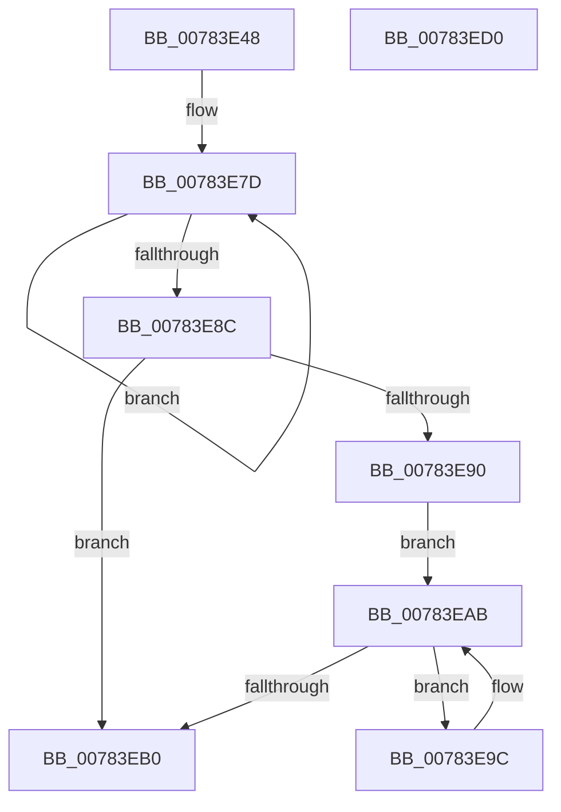

# PspApplyCoreIsolationPolicy

- RVA: `0x00783E48`–`0x00783ED1` (길이 `137` bytes)
- VA: `0x0000000140783E48`
- 실행 섹션: `PAGE`
- PDB 이름 있음: `예`; PDB Function 태그: `아니요`
- unwind 정보 RVA: `0x0005C954`
- 디코드: `35`개 명령, `137/137` bytes 표시
- 미해석 바이트: `0` (있으면 어셈블리에 `.byte`로 보존)

> 이 문서는 커널 이미지의 기계어와 PDB 기호를 분석해 생성했습니다. 4번과 5번은 함수 원형과 자료형을 바이너리 사용 방식에서 추정한 C 해석이며 원본 소스 복구 결과는 아닙니다.

## 1. Dependencies

- 직접 호출 지점: **3**; 고유 호출 대상: **3**
- 직접 호출자로 확인된 함수: **1**
- RIP 상대 이미지 참조: **0**

### Outgoing calls
- `0x00783E6B` → [PspLockProcessShared](../../text/40/PspLockProcessShared_function_004016D0.md) (function, `0x004016D0`)
- `0x00783EA3` → [KeEnableCoreIsolationMitigationPolicyThread](../../text/5C/KeEnableCoreIsolationMitigationPolicyThread_function_005C35B4.md) (function, `0x005C35B4`)
- `0x00783EB6` → [PspUnlockProcessShared](../../text/26/PspUnlockProcessShared_function_00263950.md) (function, `0x00263950`)

### Direct callers
- [NtSetInformationProcess](../AE/NtSetInformationProcess_function_00AE5370.md) at `0x00AE8795`

### Static image references
- 디코드된 RIP-relative 메모리 참조가 없습니다.

## 2. Other-region calls and transfers

- 다른 실행 섹션으로 향하는 call: **3**
  - `0x00783E6B` → [PspLockProcessShared](../../text/40/PspLockProcessShared_function_004016D0.md) (`PAGE` → `.text`)
  - `0x00783EA3` → [KeEnableCoreIsolationMitigationPolicyThread](../../text/5C/KeEnableCoreIsolationMitigationPolicyThread_function_005C35B4.md) (`PAGE` → `.text`)
  - `0x00783EB6` → [PspUnlockProcessShared](../../text/26/PspUnlockProcessShared_function_00263950.md) (`PAGE` → `.text`)
- 별도 외부 분기/꼬리 이동을 확인하지 못했습니다.

## 3. Assembly (complete function range)

```asm
00783E48  48 89 5C 24 08                  mov qword ptr [rsp + 8], rbx
00783E4D  48 89 6C 24 10                  mov qword ptr [rsp + 0x10], rbp
00783E52  48 89 74 24 18                  mov qword ptr [rsp + 0x18], rsi
00783E57  57                              push rdi
00783E58  48 83 EC 20                     sub rsp, 0x20
00783E5C  65 48 8B 2C 25 88 01 00 00      mov rbp, qword ptr gs:[0x188]
00783E65  48 8B F9                        mov rdi, rcx
00783E68  48 8B D5                        mov rdx, rbp
00783E6B  E8 60 D8 C7 FF                  call 0x1404016d0
00783E70  0F 0D 8F D8 07 00 00            prefetchw byte ptr [rdi + 0x7d8]
00783E77  8B 87 D8 07 00 00               mov eax, dword ptr [rdi + 0x7d8]
00783E7D  8B D0                           mov edx, eax
00783E7F  83 CA 01                        or edx, 1
00783E82  F0 0F B1 97 D8 07 00 00         lock cmpxchg dword ptr [rdi + 0x7d8], edx
00783E8A  75 F1                           jne 0x140783e7d
00783E8C  A8 01                           test al, 1
00783E8E  75 20                           jne 0x140783eb0
00783E90  48 8D B7 70 03 00 00            lea rsi, [rdi + 0x370]
00783E97  48 8B 1E                        mov rbx, qword ptr [rsi]
00783E9A  EB 0F                           jmp 0x140783eab
00783E9C  48 8D 8B 88 FA FF FF            lea rcx, [rbx - 0x578]
00783EA3  E8 0C F7 E3 FF                  call 0x1405c35b4
00783EA8  48 8B 1B                        mov rbx, qword ptr [rbx]
00783EAB  48 3B DE                        cmp rbx, rsi
00783EAE  75 EC                           jne 0x140783e9c
00783EB0  48 8B D5                        mov rdx, rbp
00783EB3  48 8B CF                        mov rcx, rdi
00783EB6  E8 95 FA AD FF                  call 0x140263950
00783EBB  48 8B 5C 24 30                  mov rbx, qword ptr [rsp + 0x30]
00783EC0  48 8B 6C 24 38                  mov rbp, qword ptr [rsp + 0x38]
00783EC5  48 8B 74 24 40                  mov rsi, qword ptr [rsp + 0x40]
00783ECA  48 83 C4 20                     add rsp, 0x20
00783ECE  5F                              pop rdi
00783ECF  C3                              ret
00783ED0  CC                              int3
```

## 4. C-style interpretation (structured pseudocode)

```c
__int64 __fastcall PspApplyCoreIsolationPolicy(__int64 a1)
{
    __int64 result;
    __int64 v_rsp;
    unsigned __int64 v_stack_p10;
    unsigned __int64 v_stack_p18;
    unsigned __int64 v_stack_p8;

    v_stack_p8 = v_rbx;
    v_stack_p10 = v_rbp;
    v_stack_p18 = v_rsi;
    v_rsp = (v_rsp) - (32);
    result = PspLockProcessShared(a1, *(unsigned __int64 *)(gs_base + (0 + 392)), a3, a4);
loc_00783E7D:
    a2 = (unsigned int)(((unsigned int)((unsigned int)((unsigned int)(*(unsigned int *)(a1 + 2008))))) | (1));
    if (condition_is_not_equal) goto loc_00783E7D;
    if ((((unsigned __int8)((unsigned int)(*(unsigned int *)(a1 + 2008)))) & (1)) != 0) goto loc_00783EB0;
    goto loc_00783EAB;
loc_00783E9C:
    result = KeEnableCoreIsolationMitigationPolicyThread(*(unsigned __int64 *)(a1 + 880) - 1400, a2, a3, a4);
loc_00783EAB:
    if ((*(unsigned __int64 *)(*(unsigned __int64 *)(a1 + 880))) != (a1 + 880)) goto loc_00783E9C;
loc_00783EB0:
    result = PspUnlockProcessShared(a1, *(unsigned __int64 *)(gs_base + (0 + 392)), a3, a4);
    v_rsp = (v_rsp) + (32);
    return result;
}
```

## 5. (Beta) C Style

```c
int64_t PspApplyCoreIsolationPolicy(void *Arg1)
{
    uint8_t *arg1 = (uint8_t *)Arg1;

    int64_t result;
    int64_t local_rsp;
    uint64_t v_stack_p10;
    uint64_t v_stack_p18;
    uint64_t v_stack_p8;

    v_stack_p8 = local_rbx;
    v_stack_p10 = local_rbp;
    v_stack_p18 = local_rsi;
    local_rsp = (local_rsp) - (32);
    result = PspLockProcessShared(Arg1, *(uint64_t *)(gs_base + (0 + 0x188)), a3, a4);
loc_00783E7D:
    a2 = (uint32_t)(((uint32_t)((uint32_t)((uint32_t)(*(uint32_t *)(arg1 + 0x7D8))))) | (1));
    if (condition_is_not_equal) goto loc_00783E7D;
    if ((((uint8_t)((uint32_t)(*(uint32_t *)(arg1 + 0x7D8)))) & (1)) != 0) goto loc_00783EB0;
    goto loc_00783EAB;
loc_00783E9C:
    result = KeEnableCoreIsolationMitigationPolicyThread(*(uint64_t *)(arg1 + 0x370) - 1400, a2, a3, a4);
loc_00783EAB:
    if ((*(uint64_t *)(*(uint64_t *)(arg1 + 0x370))) != (Arg1 + 880)) goto loc_00783E9C;
loc_00783EB0:
    result = PspUnlockProcessShared(Arg1, *(uint64_t *)(gs_base + (0 + 0x188)), a3, a4);
    local_rsp = (local_rsp) + (32);
    return result;
}
```

### 관측된 메모리 오프셋

구조체 형식이 확인되지 않은 접근은 인자 기준의 오프셋으로만 기록했습니다.

| 기준 인자 | 오프셋 표현 | 폭 (bit) | 접근 |
|---|---:|---:|---|
| `Arg1` | `+ 0x0` | `64` | `R` |
| `Arg1` | `+ 0x370` | `64` | `R` |
| `Arg1` | `+ 0x7D8` | `8` | `R` |
| `Arg1` | `+ 0x7D8` | `32` | `R` |

## 6. Execution-region graph

[열기: 2D/3D 그래프와 함수 탐색 컨트롤 패널](../../../control-panel.html?section=page&rva=0x00783E48&view=graph)

- 2D 그래프는 위에서 아래로 흐르고, 3D 그래프는 빈 공간을 드래그해 회전합니다. Shift+드래그는 이동, 휠은 확대·축소, 함수 노드 선택은 대상 보고서 이동입니다.

### Static fallback


