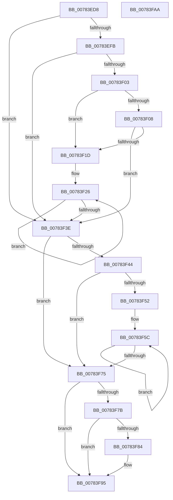

# PspApplyIFEOPerfOptions

- RVA: `0x00783ED8`–`0x00783FAB` (길이 `211` bytes)
- VA: `0x0000000140783ED8`
- 실행 섹션: `PAGE`
- PDB 이름 있음: `예`; PDB Function 태그: `아니요`
- unwind 정보 RVA: `0x000B6A1C`
- 디코드: `63`개 명령, `211/211` bytes 표시
- 미해석 바이트: `0` (있으면 어셈블리에 `.byte`로 보존)

> 이 문서는 커널 이미지의 기계어와 PDB 기호를 분석해 생성했습니다. 4번과 5번은 함수 원형과 자료형을 바이너리 사용 방식에서 추정한 C 해석이며 원본 소스 복구 결과는 아닙니다.

## 1. Dependencies

- 직접 호출 지점: **3**; 고유 호출 대상: **3**
- 직접 호출자로 확인된 함수: **1**
- RIP 상대 이미지 참조: **1**

### Outgoing calls
- `0x00783F12` → [SeSinglePrivilegeCheck](../87/SeSinglePrivilegeCheck_function_00871E20.md) (function, `0x00871E20`)
- `0x00783F48` → [KeQueryHeteroCpuPolicyThread](../../text/48/KeQueryHeteroCpuPolicyThread_function_00488A70.md) (function, `0x00488A70`)
- `0x00783F90` → [PspSetProcessPriorityClass](../9F/PspSetProcessPriorityClass_function_009F61E4.md) (function, `0x009F61E4`)

### Direct callers
- [PspAllocateProcess](../A1/PspAllocateProcess_function_00A13B3C.md) at `0x00A15522`

### Static image references
- `0x00783F08` → RVA `0x00FD9AE8` (`PAGEDATA`; read)

## 2. Other-region calls and transfers

- 다른 실행 섹션으로 향하는 call: **1**
  - `0x00783F48` → [KeQueryHeteroCpuPolicyThread](../../text/48/KeQueryHeteroCpuPolicyThread_function_00488A70.md) (`PAGE` → `.text`)
- 별도 외부 분기/꼬리 이동을 확인하지 못했습니다.

## 3. Assembly (complete function range)

```asm
00783ED8  48 89 5C 24 08                  mov qword ptr [rsp + 8], rbx
00783EDD  48 89 6C 24 18                  mov qword ptr [rsp + 0x18], rbp
00783EE2  48 89 74 24 20                  mov qword ptr [rsp + 0x20], rsi
00783EE7  57                              push rdi
00783EE8  48 83 EC 20                     sub rsp, 0x20
00783EEC  8B 02                           mov eax, dword ptr [rdx]
00783EEE  41 8A E8                        mov bpl, r8b
00783EF1  48 8B DA                        mov rbx, rdx
00783EF4  48 8B F1                        mov rsi, rcx
00783EF7  A8 01                           test al, 1
00783EF9  74 43                           je 0x140783f3e
00783EFB  8B 7A 08                        mov edi, dword ptr [rdx + 8]
00783EFE  83 FF 04                        cmp edi, 4
00783F01  73 3B                           jae 0x140783f3e
00783F03  83 FF 02                        cmp edi, 2
00783F06  76 15                           jbe 0x140783f1d
00783F08  48 8B 0D D9 5B 85 00            mov rcx, qword ptr [rip + 0x855bd9]
00783F0F  41 8A D0                        mov dl, r8b
00783F12  E8 09 DF 0E 00                  call 0x140871e20
00783F17  0F BA E0 00                     bt eax, 0
00783F1B  73 21                           jae 0x140783f3e
00783F1D  8B 86 F4 01 00 00               mov eax, dword ptr [rsi + 0x1f4]
00783F23  C1 E7 1B                        shl edi, 0x1b
00783F26  8B C8                           mov ecx, eax
00783F28  8B D0                           mov edx, eax
00783F2A  81 E1 FF FF FF C7               and ecx, 0xc7ffffff
00783F30  0B CF                           or ecx, edi
00783F32  F0 0F B1 8E F4 01 00 00         lock cmpxchg dword ptr [rsi + 0x1f4], ecx
00783F3A  3B C2                           cmp eax, edx
00783F3C  75 E8                           jne 0x140783f26
00783F3E  8B 03                           mov eax, dword ptr [rbx]
00783F40  A8 02                           test al, 2
00783F42  74 31                           je 0x140783f75
00783F44  44 8B 43 0C                     mov r8d, dword ptr [rbx + 0xc]
00783F48  E8 23 4B D0 FF                  call 0x140488a70
00783F4D  44 3B C0                        cmp r8d, eax
00783F50  73 23                           jae 0x140783f75
00783F52  8B 86 F0 01 00 00               mov eax, dword ptr [rsi + 0x1f0]
00783F58  41 C1 E0 0C                     shl r8d, 0xc
00783F5C  8B C8                           mov ecx, eax
00783F5E  8B D0                           mov edx, eax
00783F60  81 E1 FF 8F FF FF               and ecx, 0xffff8fff
00783F66  41 0B C8                        or ecx, r8d
00783F69  F0 0F B1 8E F0 01 00 00         lock cmpxchg dword ptr [rsi + 0x1f0], ecx
00783F71  3B C2                           cmp eax, edx
00783F73  75 E7                           jne 0x140783f5c
00783F75  8B 03                           mov eax, dword ptr [rbx]
00783F77  A8 04                           test al, 4
00783F79  74 1A                           je 0x140783f95
00783F7B  81 7B 10 FF 00 00 00            cmp dword ptr [rbx + 0x10], 0xff
00783F82  77 11                           ja 0x140783f95
00783F84  8A 53 10                        mov dl, byte ptr [rbx + 0x10]
00783F87  44 8A CD                        mov r9b, bpl
00783F8A  45 33 C0                        xor r8d, r8d
00783F8D  48 8B CE                        mov rcx, rsi
00783F90  E8 4F 22 27 00                  call 0x1409f61e4
00783F95  48 8B 5C 24 30                  mov rbx, qword ptr [rsp + 0x30]
00783F9A  48 8B 6C 24 40                  mov rbp, qword ptr [rsp + 0x40]
00783F9F  48 8B 74 24 48                  mov rsi, qword ptr [rsp + 0x48]
00783FA4  48 83 C4 20                     add rsp, 0x20
00783FA8  5F                              pop rdi
00783FA9  C3                              ret
00783FAA  CC                              int3
```

## 4. C-style interpretation (structured pseudocode)

```c
__int64 __fastcall PspApplyIFEOPerfOptions(__int64 a1, __int64 a2, unsigned __int8 a3)
{
    __int64 result;
    __int64 v_rdi;
    __int64 v_rsp;
    unsigned __int64 v_stack_p18;
    unsigned __int64 v_stack_p20;
    unsigned __int64 v_stack_p8;

    v_stack_p8 = v_rbx;
    v_stack_p18 = v_rbp;
    v_stack_p20 = v_rsi;
    v_rsp = (v_rsp) - (32);
    if ((((unsigned __int8)((unsigned int)(*(unsigned int *)(a2)))) & (1)) == 0) goto loc_00783F3E;
    if (((unsigned int)((unsigned int)(*(unsigned int *)(a2 + 8)))) >= 4) goto loc_00783F3E;
    if (((unsigned int)((unsigned int)(*(unsigned int *)(a2 + 8)))) <= 2) goto loc_00783F1D;
    result = SeSinglePrivilegeCheck(*(unsigned __int64 *)(v_rip + 8739801), a3, a3, a4);
    if (((unsigned int)((unsigned int)(*(unsigned int *)(a2 + 8)))) >= 2) goto loc_00783F3E;
loc_00783F1D:
    v_rdi = (unsigned int)(((unsigned int)(*(unsigned int *)(a2 + 8))) << (27));
loc_00783F26:
    a1 = (unsigned int)(((unsigned int)((unsigned int)((unsigned int)(*(unsigned int *)(a1 + 500))))) & (0xC7FFFFFFULL));
    a1 = (unsigned int)((a1) | ((unsigned int)(v_rdi)));
    if (((unsigned int)((unsigned int)(*(unsigned int *)(a1 + 500)))) != ((unsigned int)((unsigned int)((unsigned int)((unsigned int)(*(unsigned int *)(a1 + 500))))))) goto loc_00783F26;
loc_00783F3E:
    if ((((unsigned __int8)((unsigned int)(*(unsigned int *)(a2)))) & (2)) == 0) goto loc_00783F75;
    result = KeQueryHeteroCpuPolicyThread(a1, (unsigned int)((unsigned int)((unsigned int)(*(unsigned int *)(a1 + 500)))), (unsigned int)(*(unsigned int *)(a2 + 12)), a4);
    if (((unsigned int)((unsigned int)(*(unsigned int *)(a2 + 12)))) >= ((unsigned int)(result))) goto loc_00783F75;
    a3 = (unsigned int)(((unsigned int)(*(unsigned int *)(a2 + 12))) << (12));
loc_00783F5C:
    a1 = (unsigned int)(((unsigned int)((unsigned int)((unsigned int)(*(unsigned int *)(a1 + 496))))) & (0xFFFF8FFFULL));
    a1 = (unsigned int)((a1) | (a3));
    if (((unsigned int)((unsigned int)(*(unsigned int *)(a1 + 496)))) != ((unsigned int)((unsigned int)((unsigned int)((unsigned int)(*(unsigned int *)(a1 + 496))))))) goto loc_00783F5C;
loc_00783F75:
    if ((((unsigned __int8)((unsigned int)(*(unsigned int *)(a2)))) & (4)) == 0) goto loc_00783F95;
    result = (unsigned int)(*(unsigned int *)(a2));
    if ((*(unsigned int *)(a2 + 16)) <= 255) {
        a2 = *(unsigned __int8 *)(a2 + 16);
        a4 = a3;
        a3 = 0;
        a1 = a1;
        result = PspSetProcessPriorityClass(a1, a2, a3, a4);
    }
    v_rsp = (v_rsp) + (32);
    return result;
}
```

## 5. (Beta) C Style

```c
int64_t PspApplyIFEOPerfOptions(void *Arg1, void *Arg2, uint8_t Arg3)
{
    uint8_t *arg1 = (uint8_t *)Arg1;
    uint8_t *arg2 = (uint8_t *)Arg2;

    int64_t result;
    int64_t local_rdi;
    int64_t local_rsp;
    uint64_t v_stack_p18;
    uint64_t v_stack_p20;
    uint64_t v_stack_p8;

    v_stack_p8 = local_rbx;
    v_stack_p18 = local_rbp;
    v_stack_p20 = local_rsi;
    local_rsp = (local_rsp) - (32);
    if ((((uint8_t)((uint32_t)(*(uint32_t *)(arg2)))) & (1)) == 0) goto loc_00783F3E;
    if (((uint32_t)((uint32_t)(*(uint32_t *)(arg2 + 0x8)))) >= 4) goto loc_00783F3E;
    if (((uint32_t)((uint32_t)(*(uint32_t *)(arg2 + 0x8)))) <= 2) goto loc_00783F1D;
    result = SeSinglePrivilegeCheck(*(uint64_t *)(v_rip + 0x855BD9), Arg3, Arg3, a4);
    if (((uint32_t)((uint32_t)(*(uint32_t *)(arg2 + 0x8)))) >= 2) goto loc_00783F3E;
loc_00783F1D:
    local_rdi = (uint32_t)(((uint32_t)(*(uint32_t *)(arg2 + 0x8))) << (27));
loc_00783F26:
    Arg1 = (uint32_t)(((uint32_t)((uint32_t)((uint32_t)(*(uint32_t *)(arg1 + 0x1F4))))) & (0xC7FFFFFFULL));
    Arg1 = (uint32_t)((Arg1) | ((uint32_t)(local_rdi)));
    if (((uint32_t)((uint32_t)(*(uint32_t *)(arg1 + 0x1F4)))) != ((uint32_t)((uint32_t)((uint32_t)((uint32_t)(*(uint32_t *)(arg1 + 0x1F4))))))) goto loc_00783F26;
loc_00783F3E:
    if ((((uint8_t)((uint32_t)(*(uint32_t *)(arg2)))) & (2)) == 0) goto loc_00783F75;
    result = KeQueryHeteroCpuPolicyThread(Arg1, (uint32_t)((uint32_t)((uint32_t)(*(uint32_t *)(arg1 + 0x1F4)))), (uint32_t)(*(uint32_t *)(arg2 + 0xC)), a4);
    if (((uint32_t)((uint32_t)(*(uint32_t *)(arg2 + 0xC)))) >= ((uint32_t)(result))) goto loc_00783F75;
    Arg3 = (uint32_t)(((uint32_t)(*(uint32_t *)(arg2 + 0xC))) << (12));
loc_00783F5C:
    Arg1 = (uint32_t)(((uint32_t)((uint32_t)((uint32_t)(*(uint32_t *)(arg1 + 0x1F0))))) & (0xFFFF8FFFULL));
    Arg1 = (uint32_t)((Arg1) | (Arg3));
    if (((uint32_t)((uint32_t)(*(uint32_t *)(arg1 + 0x1F0)))) != ((uint32_t)((uint32_t)((uint32_t)((uint32_t)(*(uint32_t *)(arg1 + 0x1F0))))))) goto loc_00783F5C;
loc_00783F75:
    if ((((uint8_t)((uint32_t)(*(uint32_t *)(arg2)))) & (4)) == 0) goto loc_00783F95;
    result = (uint32_t)(*(uint32_t *)(arg2));
    if ((*(uint32_t *)(arg2 + 0x10)) <= 255) {
        Arg2 = *(uint8_t *)(arg2 + 0x10);
        a4 = Arg3;
        Arg3 = 0;
        Arg1 = Arg1;
        result = PspSetProcessPriorityClass(Arg1, Arg2, Arg3, a4);
    }
    local_rsp = (local_rsp) + (32);
    return result;
}
```

### 관측된 메모리 오프셋

구조체 형식이 확인되지 않은 접근은 인자 기준의 오프셋으로만 기록했습니다.

| 기준 인자 | 오프셋 표현 | 폭 (bit) | 접근 |
|---|---:|---:|---|
| `Arg1` | `+ 0x1F0` | `32` | `R` |
| `Arg1` | `+ 0x1F4` | `32` | `R` |
| `Arg2` | `+ 0x0` | `32` | `R` |
| `Arg2` | `+ 0x8` | `32` | `R` |
| `Arg2` | `+ 0xC` | `32` | `R` |
| `Arg2` | `+ 0x10` | `8` | `R` |
| `Arg2` | `+ 0x10` | `32` | `R` |

## 6. Execution-region graph

[열기: 2D/3D 그래프와 함수 탐색 컨트롤 패널](../../../control-panel.html?section=page&rva=0x00783ED8&view=graph)

- 2D 그래프는 위에서 아래로 흐르고, 3D 그래프는 빈 공간을 드래그해 회전합니다. Shift+드래그는 이동, 휠은 확대·축소, 함수 노드 선택은 대상 보고서 이동입니다.

### Static fallback


