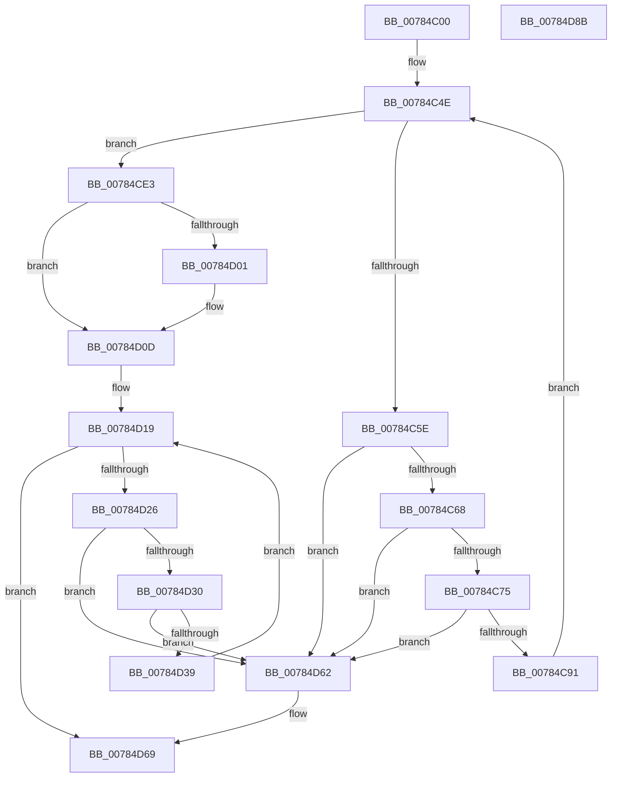

# PspApplyWorkingSetLimits

- RVA: `0x00784C00`–`0x00784D8C` (길이 `396` bytes)
- VA: `0x0000000140784C00`
- 실행 섹션: `PAGE`
- PDB 이름 있음: `예`; PDB Function 태그: `아니요`
- unwind 정보 RVA: `0x000601BC`
- 디코드: `97`개 명령, `396/396` bytes 표시
- 미해석 바이트: `0` (있으면 어셈블리에 `.byte`로 보존)

> 이 문서는 커널 이미지의 기계어와 PDB 기호를 분석해 생성했습니다. 4번과 5번은 함수 원형과 자료형을 바이너리 사용 방식에서 추정한 C 해석이며 원본 소스 복구 결과는 아닙니다.

## 1. Dependencies

- 직접 호출 지점: **9**; 고유 호출 대상: **9**
- 직접 호출자로 확인된 함수: **2**
- RIP 상대 이미지 참조: **5**

### Outgoing calls
- `0x00784CAD` → [KiStackAttachProcess](../../text/21/KiStackAttachProcess_function_00216820.md) (function, `0x00216820`)
- `0x00784CC0` → [MmAdjustWorkingSetSize](../../text/47/MmAdjustWorkingSetSize_function_0047D7F0.md) (function, `0x0047D7F0`)
- `0x00784CCE` → [MmEnforceWorkingSetLimit](../../text/48/MmEnforceWorkingSetLimit_function_004881E0.md) (function, `0x004881E0`)
- `0x00784CD9` → [KiUnstackDetachProcess](../../text/21/KiUnstackDetachProcess_function_00217D30.md) (function, `0x00217D30`)
- `0x00784D08` → [ExfTryToWakePushLock](../../text/26/ExfTryToWakePushLock_function_00265DD0.md) (function, `0x00265DD0`)
- `0x00784D14` → [KeAbPostRelease](../../text/2E/KeAbPostRelease_function_002E1600.md) (function, `0x002E1600`)
- `0x00784D4E` → [ObfDereferenceObjectWithTag](../../text/2F/ObfDereferenceObjectWithTag_function_002F78E0.md) (function, `0x002F78E0`)
- `0x00784D5B` → [ExFreePoolWithTag](../../poolcode/B8/ExFreePoolWithTag_function_00B82870.md) (function, `0x00B82870`)
- `0x00784D70` → [_security_check_cookie](../../text/6A/_security_check_cookie_function_006AC640.md) (function, `0x006AC640`)

### Direct callers
- [NtSetInformationJobObject](../9F/NtSetInformationJobObject_function_009F84C0.md) at `0x009F9539`
- [PspSetJobLimitsJobPostCallback](../A8/PspSetJobLimitsJobPostCallback_function_00A802D0.md) at `0x00A802E8`

### Static image references
- `0x00784C17` → RVA `0x00E0A740` (`.data`; read)
- `0x00784C30` → RVA `0x00FC70A0` (`ALMOSTRO`; read)
- `0x00784C75` → RVA `0x00FC70A0` (`ALMOSTRO`; write)
- `0x00784CF2` → RVA `0x00FC70B0` (`ALMOSTRO`; read/write)
- `0x00784D01` → RVA `0x00FC70B0` (`ALMOSTRO`; read)

## 2. Other-region calls and transfers

- 다른 실행 섹션으로 향하는 call: **9**
  - `0x00784CAD` → [KiStackAttachProcess](../../text/21/KiStackAttachProcess_function_00216820.md) (`PAGE` → `.text`)
  - `0x00784CC0` → [MmAdjustWorkingSetSize](../../text/47/MmAdjustWorkingSetSize_function_0047D7F0.md) (`PAGE` → `.text`)
  - `0x00784CCE` → [MmEnforceWorkingSetLimit](../../text/48/MmEnforceWorkingSetLimit_function_004881E0.md) (`PAGE` → `.text`)
  - `0x00784CD9` → [KiUnstackDetachProcess](../../text/21/KiUnstackDetachProcess_function_00217D30.md) (`PAGE` → `.text`)
  - `0x00784D08` → [ExfTryToWakePushLock](../../text/26/ExfTryToWakePushLock_function_00265DD0.md) (`PAGE` → `.text`)
  - `0x00784D14` → [KeAbPostRelease](../../text/2E/KeAbPostRelease_function_002E1600.md) (`PAGE` → `.text`)
  - `0x00784D4E` → [ObfDereferenceObjectWithTag](../../text/2F/ObfDereferenceObjectWithTag_function_002F78E0.md) (`PAGE` → `.text`)
  - `0x00784D5B` → [ExFreePoolWithTag](../../poolcode/B8/ExFreePoolWithTag_function_00B82870.md) (`PAGE` → `POOLCODE`)
  - `0x00784D70` → [_security_check_cookie](../../text/6A/_security_check_cookie_function_006AC640.md) (`PAGE` → `.text`)
- 별도 외부 분기/꼬리 이동을 확인하지 못했습니다.

## 3. Assembly (complete function range)

```asm
00784C00  48 89 5C 24 10                  mov qword ptr [rsp + 0x10], rbx
00784C05  48 89 74 24 18                  mov qword ptr [rsp + 0x18], rsi
00784C0A  48 89 7C 24 20                  mov qword ptr [rsp + 0x20], rdi
00784C0F  55                              push rbp
00784C10  48 8B EC                        mov rbp, rsp
00784C13  48 83 EC 70                     sub rsp, 0x70
00784C17  48 8B 05 22 5B 68 00            mov rax, qword ptr [rip + 0x685b22]
00784C1E  48 33 C4                        xor rax, rsp
00784C21  48 89 45 F0                     mov qword ptr [rbp - 0x10], rax
00784C25  0F 57 C0                        xorps xmm0, xmm0
00784C28  48 8D 45 B0                     lea rax, [rbp - 0x50]
00784C2C  48 89 45 B8                     mov qword ptr [rbp - 0x48], rax
00784C30  48 8D 35 69 24 84 00            lea rsi, [rip + 0x842469]
00784C37  48 8D 45 B0                     lea rax, [rbp - 0x50]
00784C3B  48 8B F9                        mov rdi, rcx
00784C3E  48 89 45 B0                     mov qword ptr [rbp - 0x50], rax
00784C42  0F 11 45 C0                     movups xmmword ptr [rbp - 0x40], xmm0
00784C46  0F 11 45 D0                     movups xmmword ptr [rbp - 0x30], xmm0
00784C4A  0F 11 45 E0                     movups xmmword ptr [rbp - 0x20], xmm0
00784C4E  48 8B 1D 4B 24 84 00            mov rbx, qword ptr [rip + 0x84244b]
00784C55  48 3B DE                        cmp rbx, rsi
00784C58  0F 84 85 00 00 00               je 0x140784ce3
00784C5E  48 39 73 08                     cmp qword ptr [rbx + 8], rsi
00784C62  0F 85 FA 00 00 00               jne 0x140784d62
00784C68  48 8B 03                        mov rax, qword ptr [rbx]
00784C6B  48 39 58 08                     cmp qword ptr [rax + 8], rbx
00784C6F  0F 85 ED 00 00 00               jne 0x140784d62
00784C75  48 89 05 24 24 84 00            mov qword ptr [rip + 0x842424], rax
00784C7C  48 8D 4D B0                     lea rcx, [rbp - 0x50]
00784C80  48 89 70 08                     mov qword ptr [rax + 8], rsi
00784C84  48 8B 45 B8                     mov rax, qword ptr [rbp - 0x48]
00784C88  48 39 08                        cmp qword ptr [rax], rcx
00784C8B  0F 85 D1 00 00 00               jne 0x140784d62
00784C91  48 89 43 08                     mov qword ptr [rbx + 8], rax
00784C95  48 8D 4D B0                     lea rcx, [rbp - 0x50]
00784C99  48 89 0B                        mov qword ptr [rbx], rcx
00784C9C  4C 8D 45 C0                     lea r8, [rbp - 0x40]
00784CA0  48 89 18                        mov qword ptr [rax], rbx
00784CA3  33 D2                           xor edx, edx
00784CA5  48 89 5D B8                     mov qword ptr [rbp - 0x48], rbx
00784CA9  48 8B 4B 10                     mov rcx, qword ptr [rbx + 0x10]
00784CAD  E8 6E 1B A9 FF                  call 0x140216820
00784CB2  48 8B 53 20                     mov rdx, qword ptr [rbx + 0x20]
00784CB6  41 B1 01                        mov r9b, 1
00784CB9  48 8B 4B 18                     mov rcx, qword ptr [rbx + 0x18]
00784CBD  45 33 C0                        xor r8d, r8d
00784CC0  E8 2B 8B CF FF                  call 0x14047d7f0
00784CC5  48 8B 4B 10                     mov rcx, qword ptr [rbx + 0x10]
00784CC9  BA 01 00 00 00                  mov edx, 1
00784CCE  E8 0D 35 D0 FF                  call 0x1404881e0
00784CD3  33 D2                           xor edx, edx
00784CD5  48 8D 4D C0                     lea rcx, [rbp - 0x40]
00784CD9  E8 52 30 A9 FF                  call 0x140217d30
00784CDE  E9 6B FF FF FF                  jmp 0x140784c4e
00784CE3  F0 81 A7 10 06 00 00 FF FE FF FF  lock and dword ptr [rdi + 0x610], 0xfffffeff
00784CEE  48 83 C8 FF                     or rax, 0xffffffffffffffff
00784CF2  F0 48 0F C1 05 B5 23 84 00      lock xadd qword ptr [rip + 0x8423b5], rax
00784CFB  24 06                           and al, 6
00784CFD  3C 02                           cmp al, 2
00784CFF  75 0C                           jne 0x140784d0d
00784D01  48 8D 0D A8 23 84 00            lea rcx, [rip + 0x8423a8]
00784D08  E8 C3 10 AE FF                  call 0x140265dd0
00784D0D  48 8D 0D 9C 23 84 00            lea rcx, [rip + 0x84239c]
00784D14  E8 E7 C8 B5 FF                  call 0x1402e1600
00784D19  48 8B 5D B0                     mov rbx, qword ptr [rbp - 0x50]
00784D1D  48 8D 45 B0                     lea rax, [rbp - 0x50]
00784D21  48 3B D8                        cmp rbx, rax
00784D24  74 43                           je 0x140784d69
00784D26  48 8D 45 B0                     lea rax, [rbp - 0x50]
00784D2A  48 39 43 08                     cmp qword ptr [rbx + 8], rax
00784D2E  75 32                           jne 0x140784d62
00784D30  48 8B 03                        mov rax, qword ptr [rbx]
00784D33  48 39 58 08                     cmp qword ptr [rax + 8], rbx
00784D37  75 29                           jne 0x140784d62
00784D39  48 89 45 B0                     mov qword ptr [rbp - 0x50], rax
00784D3D  48 8D 4D B0                     lea rcx, [rbp - 0x50]
00784D41  48 89 48 08                     mov qword ptr [rax + 8], rcx
00784D45  BA 50 73 4A 62                  mov edx, 0x624a7350
00784D4A  48 8B 4B 10                     mov rcx, qword ptr [rbx + 0x10]
00784D4E  E8 8D 2B B7 FF                  call 0x1402f78e0
00784D53  BA 50 73 43 72                  mov edx, 0x72437350
00784D58  48 8B CB                        mov rcx, rbx
00784D5B  E8 10 DB 3F 00                  call 0x140b82870
00784D60  EB B7                           jmp 0x140784d19
00784D62  B9 03 00 00 00                  mov ecx, 3
00784D67  CD 29                           int 0x29
00784D69  48 8B 4D F0                     mov rcx, qword ptr [rbp - 0x10]
00784D6D  48 33 CC                        xor rcx, rsp
00784D70  E8 CB 78 F2 FF                  call 0x1406ac640
00784D75  4C 8D 5C 24 70                  lea r11, [rsp + 0x70]
00784D7A  49 8B 5B 18                     mov rbx, qword ptr [r11 + 0x18]
00784D7E  49 8B 73 20                     mov rsi, qword ptr [r11 + 0x20]
00784D82  49 8B 7B 28                     mov rdi, qword ptr [r11 + 0x28]
00784D86  49 8B E3                        mov rsp, r11
00784D89  5D                              pop rbp
00784D8A  C3                              ret
00784D8B  CC                              int3
```

## 4. C-style interpretation (structured pseudocode)

```c
__int64 __fastcall PspApplyWorkingSetLimits(__int64 a1, int a2)
{
    __int64 result;
    __int64 v_rsp;
    unsigned __int64 v_stack_m18;
    unsigned __int64 v_stack_m28;
    unsigned __int64 v_stack_m38;
    unsigned __int64 v_stack_m48;
    unsigned __int64 v_stack_m50;
    unsigned __int64 v_stack_m58;
    unsigned __int64 v_stack_m8;
    unsigned __int64 v_stack_p10;
    unsigned __int64 v_stack_p18;
    unsigned __int64 v_stack_p20;

    v_stack_p10 = v_rbx;
    v_stack_p18 = v_rsi;
    v_stack_p20 = v_rdi;
    v_rsp = (v_rsp) - (112);
    result = (*(unsigned __int64 *)(v_rip + 6839074)) ^ (v_rsp);
    v_stack_m18 = result;
    v_stack_m50 = v_stack_m58;
    v_stack_m58 = v_stack_m58;
    v_stack_m48 = v_xmm0;
    v_stack_m38 = v_xmm0;
    v_stack_m28 = v_xmm0;
loc_00784C4E:
    if ((*(unsigned __int64 *)(v_rip + 8660043)) == (v_rip + 8660073)) goto loc_00784CE3;
    if ((*(unsigned __int64 *)(*(unsigned __int64 *)(v_rip + 8660043) + 8)) != (v_rip + 8660073)) goto loc_00784D62;
    if ((*(unsigned __int64 *)(*(unsigned __int64 *)(*(unsigned __int64 *)(v_rip + 8660043)) + 8)) != (*(unsigned __int64 *)(v_rip + 8660043))) goto loc_00784D62;
    *(unsigned __int64 *)(v_rip + 8660004) = *(unsigned __int64 *)(*(unsigned __int64 *)(v_rip + 8660043));
    *(unsigned __int64 *)(*(unsigned __int64 *)(*(unsigned __int64 *)(v_rip + 8660043)) + 8) = v_rip + 8660073;
    if ((*(unsigned __int64 *)(v_stack_m50)) != v_stack_m58) goto loc_00784D62;
    *(unsigned __int64 *)(*(unsigned __int64 *)(v_rip + 8660043) + 8) = v_stack_m50;
    *(unsigned __int64 *)(*(unsigned __int64 *)(v_rip + 8660043)) = v_stack_m58;
    *(unsigned __int64 *)(v_stack_m50) = *(unsigned __int64 *)(v_rip + 8660043);
    a2 = 0;
    v_stack_m50 = *(unsigned __int64 *)(v_rip + 8660043);
    result = KiStackAttachProcess(*(unsigned __int64 *)(*(unsigned __int64 *)(v_rip + 8660043) + 16), a2, v_stack_m48, a4);
    a3 = 0;
    result = MmAdjustWorkingSetSize(*(unsigned __int64 *)(*(unsigned __int64 *)(v_rip + 8660043) + 24), *(unsigned __int64 *)(*(unsigned __int64 *)(v_rip + 8660043) + 32), a3, 1);
    result = MmEnforceWorkingSetLimit(*(unsigned __int64 *)(*(unsigned __int64 *)(v_rip + 8660043) + 16), 1, a3, 1);
    a2 = 0;
    result = KiUnstackDetachProcess(v_stack_m48, a2, a3, 1);
    goto loc_00784C4E;
loc_00784CE3:
    result = (result) | (-1);
    result = (unsigned __int8)((result) & (6));
    if (((unsigned __int8)(result)) == 2) {
        a1 = v_rip + 8659880;
        result = ExfTryToWakePushLock(a1, a2, a3, 1);
    }
    result = KeAbPostRelease(v_rip + 8659868, a2, a3, 1);
loc_00784D19:
    if (v_stack_m58 == v_stack_m58) goto loc_00784D69;
    if ((*(unsigned __int64 *)(v_stack_m58 + 8)) != v_stack_m58) goto loc_00784D62;
    if ((*(unsigned __int64 *)(*(unsigned __int64 *)(v_stack_m58) + 8)) != v_stack_m58) goto loc_00784D62;
    v_stack_m58 = *(unsigned __int64 *)(v_stack_m58);
    *(unsigned __int64 *)(*(unsigned __int64 *)(v_stack_m58) + 8) = v_stack_m58;
    result = ObfDereferenceObjectWithTag(*(unsigned __int64 *)(v_stack_m58 + 16), (unsigned int)(0x624A7350ULL), a3, 1);
    result = ExFreePoolWithTag(v_stack_m58, (unsigned int)(0x72437350ULL), a3, 1);
    goto loc_00784D19;
loc_00784D62:
loc_00784D69:
    a1 = (v_stack_m18) ^ (v_rsp);
    result = _security_check_cookie(a1, (unsigned int)(0x72437350ULL), a3, 1);
    return result;
}
```

## 5. (Beta) C Style

```c
int64_t PspApplyWorkingSetLimits(void *Arg1, int32_t Arg2)
{
    uint8_t *arg1 = (uint8_t *)Arg1;

    int64_t result;
    int64_t local_rsp;
    uint64_t v_stack_m18;
    uint64_t v_stack_m28;
    uint64_t v_stack_m38;
    uint64_t v_stack_m48;
    uint64_t v_stack_m50;
    uint64_t v_stack_m58;
    uint64_t v_stack_m8;
    uint64_t v_stack_p10;
    uint64_t v_stack_p18;
    uint64_t v_stack_p20;

    v_stack_p10 = local_rbx;
    v_stack_p18 = local_rsi;
    v_stack_p20 = local_rdi;
    local_rsp = (local_rsp) - (112);
    result = (*(uint64_t *)(v_rip + 0x685B22)) ^ (local_rsp);
    v_stack_m18 = result;
    v_stack_m50 = v_stack_m58;
    v_stack_m58 = v_stack_m58;
    v_stack_m48 = v_xmm0;
    v_stack_m38 = v_xmm0;
    v_stack_m28 = v_xmm0;
loc_00784C4E:
    if ((*(uint64_t *)(v_rip + 0x84244B)) == (v_rip + 8660073)) goto loc_00784CE3;
    if ((*(uint64_t *)(*(uint64_t *)(v_rip + 0x84244B) + 0x8)) != (v_rip + 8660073)) goto loc_00784D62;
    if ((*(uint64_t *)(*(uint64_t *)(*(uint64_t *)(v_rip + 0x84244B)) + 0x8)) != (*(uint64_t *)(v_rip + 0x84244B))) goto loc_00784D62;
    *(uint64_t *)(v_rip + 0x842424) = *(uint64_t *)(*(uint64_t *)(v_rip + 0x84244B));
    *(uint64_t *)(*(uint64_t *)(*(uint64_t *)(v_rip + 0x84244B)) + 0x8) = v_rip + 8660073;
    if ((*(uint64_t *)(v_stack_m50)) != v_stack_m58) goto loc_00784D62;
    *(uint64_t *)(*(uint64_t *)(v_rip + 0x84244B) + 0x8) = v_stack_m50;
    *(uint64_t *)(*(uint64_t *)(v_rip + 0x84244B)) = v_stack_m58;
    *(uint64_t *)(v_stack_m50) = *(uint64_t *)(v_rip + 0x84244B);
    Arg2 = 0;
    v_stack_m50 = *(uint64_t *)(v_rip + 0x84244B);
    result = KiStackAttachProcess(*(uint64_t *)(*(uint64_t *)(v_rip + 0x84244B) + 0x10), Arg2, v_stack_m48, a4);
    a3 = 0;
    result = MmAdjustWorkingSetSize(*(uint64_t *)(*(uint64_t *)(v_rip + 0x84244B) + 0x18), *(uint64_t *)(*(uint64_t *)(v_rip + 0x84244B) + 0x20), a3, 1);
    result = MmEnforceWorkingSetLimit(*(uint64_t *)(*(uint64_t *)(v_rip + 0x84244B) + 0x10), 1, a3, 1);
    Arg2 = 0;
    result = KiUnstackDetachProcess(v_stack_m48, Arg2, a3, 1);
    goto loc_00784C4E;
loc_00784CE3:
    result = (result) | (-1);
    result = (uint8_t)((result) & (6));
    if (((uint8_t)(result)) == 2) {
        Arg1 = v_rip + 8659880;
        result = ExfTryToWakePushLock(Arg1, Arg2, a3, 1);
    }
    result = KeAbPostRelease(v_rip + 8659868, Arg2, a3, 1);
loc_00784D19:
    if (v_stack_m58 == v_stack_m58) goto loc_00784D69;
    if ((*(uint64_t *)(v_stack_m58 + 0x8)) != v_stack_m58) goto loc_00784D62;
    if ((*(uint64_t *)(*(uint64_t *)(v_stack_m58) + 0x8)) != v_stack_m58) goto loc_00784D62;
    v_stack_m58 = *(uint64_t *)(v_stack_m58);
    *(uint64_t *)(*(uint64_t *)(v_stack_m58) + 0x8) = v_stack_m58;
    result = ObfDereferenceObjectWithTag(*(uint64_t *)(v_stack_m58 + 0x10), (uint32_t)(0x624A7350ULL), a3, 1);
    result = ExFreePoolWithTag(v_stack_m58, (uint32_t)(0x72437350ULL), a3, 1);
    goto loc_00784D19;
loc_00784D62:
loc_00784D69:
    Arg1 = (v_stack_m18) ^ (local_rsp);
    result = _security_check_cookie(Arg1, (uint32_t)(0x72437350ULL), a3, 1);
    return result;
}
```

### 관측된 메모리 오프셋

구조체 형식이 확인되지 않은 접근은 인자 기준의 오프셋으로만 기록했습니다.

| 기준 인자 | 오프셋 표현 | 폭 (bit) | 접근 |
|---|---:|---:|---|
| `Arg1` | `+ 0x610` | `32` | `R/W` |

## 6. Execution-region graph

[열기: 2D/3D 그래프와 함수 탐색 컨트롤 패널](../../../control-panel.html?section=page&rva=0x00784C00&view=graph)

- 2D 그래프는 위에서 아래로 흐르고, 3D 그래프는 빈 공간을 드래그해 회전합니다. Shift+드래그는 이동, 휠은 확대·축소, 함수 노드 선택은 대상 보고서 이동입니다.

### Static fallback


