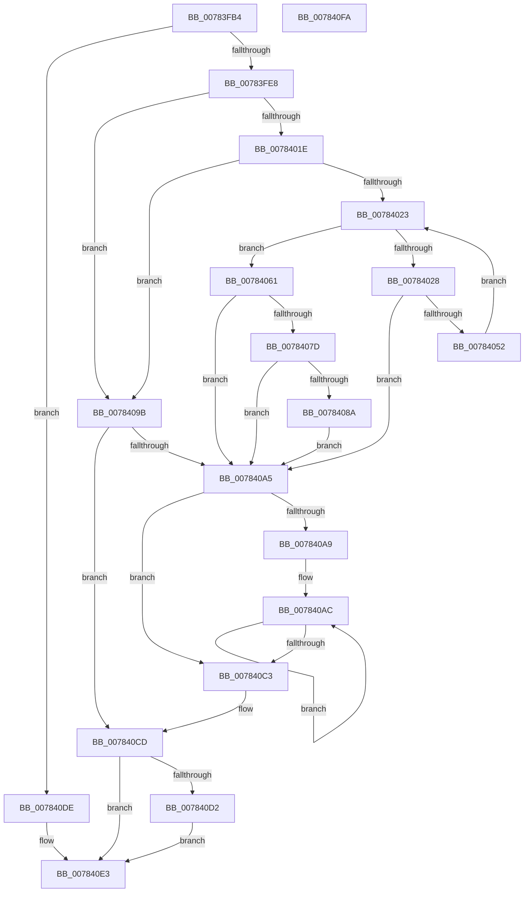

# PspAssignCpuPartitionsToProcess

- RVA: `0x00783FB4`–`0x007840FB` (길이 `327` bytes)
- VA: `0x0000000140783FB4`
- 실행 섹션: `PAGE`
- PDB 이름 있음: `예`; PDB Function 태그: `아니요`
- unwind 정보 RVA: `0x000CEFA4`
- 디코드: `99`개 명령, `327/327` bytes 표시
- 미해석 바이트: `0` (있으면 어셈블리에 `.byte`로 보존)

> 이 문서는 커널 이미지의 기계어와 PDB 기호를 분석해 생성했습니다. 4번과 5번은 함수 원형과 자료형을 바이너리 사용 방식에서 추정한 C 해석이며 원본 소스 복구 결과는 아닙니다.

## 1. Dependencies

- 직접 호출 지점: **8**; 고유 호출 대상: **6**
- 직접 호출자로 확인된 함수: **1**
- RIP 상대 이미지 참조: **0**

### Outgoing calls
- `0x00783FFD` → [ExAllocatePool2](../../poolcode/B8/ExAllocatePool2_function_00B820F0.md) (function, `0x00B820F0`)
- `0x00784011` → [ExAllocatePool2](../../poolcode/B8/ExAllocatePool2_function_00B820F0.md) (function, `0x00B820F0`)
- `0x00784047` → [PspReferenceCpuPartitionByHandle](PspReferenceCpuPartitionByHandle_function_007846F4.md) (function, `0x007846F4`)
- `0x00784072` → [KeAssignCpuPartitionsToProcess](../../text/5C/KeAssignCpuPartitionsToProcess_function_005C08D0.md) (function, `0x005C08D0`)
- `0x00784094` → [KeRecomputeCpuSetAffinityProcess](../../text/5C/KeRecomputeCpuSetAffinityProcess_function_005C1078.md) (function, `0x005C1078`)
- `0x007840B4` → [ObfDereferenceObjectWithTag](../../text/2F/ObfDereferenceObjectWithTag_function_002F78E0.md) (function, `0x002F78E0`)
- `0x007840C8` → [ExFreePoolWithTag](../../poolcode/B8/ExFreePoolWithTag_function_00B82870.md) (function, `0x00B82870`)
- `0x007840D7` → [ExFreePoolWithTag](../../poolcode/B8/ExFreePoolWithTag_function_00B82870.md) (function, `0x00B82870`)

### Direct callers
- [NtSetInformationProcess](../AE/NtSetInformationProcess_function_00AE5370.md) at `0x00AE9EAA`

### Static image references
- 디코드된 RIP-relative 메모리 참조가 없습니다.

## 2. Other-region calls and transfers

- 다른 실행 섹션으로 향하는 call: **7**
  - `0x00783FFD` → [ExAllocatePool2](../../poolcode/B8/ExAllocatePool2_function_00B820F0.md) (`PAGE` → `POOLCODE`)
  - `0x00784011` → [ExAllocatePool2](../../poolcode/B8/ExAllocatePool2_function_00B820F0.md) (`PAGE` → `POOLCODE`)
  - `0x00784072` → [KeAssignCpuPartitionsToProcess](../../text/5C/KeAssignCpuPartitionsToProcess_function_005C08D0.md) (`PAGE` → `.text`)
  - `0x00784094` → [KeRecomputeCpuSetAffinityProcess](../../text/5C/KeRecomputeCpuSetAffinityProcess_function_005C1078.md) (`PAGE` → `.text`)
  - `0x007840B4` → [ObfDereferenceObjectWithTag](../../text/2F/ObfDereferenceObjectWithTag_function_002F78E0.md) (`PAGE` → `.text`)
  - `0x007840C8` → [ExFreePoolWithTag](../../poolcode/B8/ExFreePoolWithTag_function_00B82870.md) (`PAGE` → `POOLCODE`)
  - `0x007840D7` → [ExFreePoolWithTag](../../poolcode/B8/ExFreePoolWithTag_function_00B82870.md) (`PAGE` → `POOLCODE`)
- 별도 외부 분기/꼬리 이동을 확인하지 못했습니다.

## 3. Assembly (complete function range)

```asm
00783FB4  48 89 5C 24 08                  mov qword ptr [rsp + 8], rbx
00783FB9  4C 89 44 24 18                  mov qword ptr [rsp + 0x18], r8
00783FBE  88 54 24 10                     mov byte ptr [rsp + 0x10], dl
00783FC2  55                              push rbp
00783FC3  56                              push rsi
00783FC4  57                              push rdi
00783FC5  41 54                           push r12
00783FC7  41 55                           push r13
00783FC9  41 56                           push r14
00783FCB  41 57                           push r15
00783FCD  48 83 EC 30                     sub rsp, 0x30
00783FD1  45 8B F1                        mov r14d, r9d
00783FD4  33 FF                           xor edi, edi
00783FD6  48 8B E9                        mov rbp, rcx
00783FD9  41 8D 46 FF                     lea eax, [r14 - 1]
00783FDD  3D FF 07 00 00                  cmp eax, 0x7ff
00783FE2  0F 87 F6 00 00 00               ja 0x1407840de
00783FE8  41 8B DE                        mov ebx, r14d
00783FEB  41 B8 50 73 70 50               mov r8d, 0x50707350
00783FF1  48 C1 E3 03                     shl rbx, 3
00783FF5  B9 00 01 00 00                  mov ecx, 0x100
00783FFA  48 8B D3                        mov rdx, rbx
00783FFD  E8 EE E0 3F 00                  call 0x140b820f0
00784002  41 B8 50 73 70 50               mov r8d, 0x50707350
00784008  8D 4F 40                        lea ecx, [rdi + 0x40]
0078400B  48 8B D3                        mov rdx, rbx
0078400E  4C 8B F8                        mov r15, rax
00784011  E8 DA E0 3F 00                  call 0x140b820f0
00784016  48 8B F0                        mov rsi, rax
00784019  4D 85 FF                        test r15, r15
0078401C  74 7D                           je 0x14078409b
0078401E  48 85 C0                        test rax, rax
00784021  74 78                           je 0x14078409b
00784023  41 3B FE                        cmp edi, r14d
00784026  73 39                           jae 0x140784061
00784028  48 8B 84 24 80 00 00 00         mov rax, qword ptr [rsp + 0x80]
00784030  4D 8D 2C FF                     lea r13, [r15 + rdi*8]
00784034  44 8A 44 24 78                  mov r8b, byte ptr [rsp + 0x78]
00784039  BA 04 00 00 00                  mov edx, 4
0078403E  4C 89 6C 24 20                  mov qword ptr [rsp + 0x20], r13
00784043  48 8B 0C F8                     mov rcx, qword ptr [rax + rdi*8]
00784047  E8 A8 06 00 00                  call 0x1407846f4
0078404C  8B D8                           mov ebx, eax
0078404E  85 C0                           test eax, eax
00784050  78 53                           js 0x1407840a5
00784052  49 8B 45 00                     mov rax, qword ptr [r13]
00784056  48 8B 08                        mov rcx, qword ptr [rax]
00784059  48 89 0C FE                     mov qword ptr [rsi + rdi*8], rcx
0078405D  FF C7                           inc edi
0078405F  EB C2                           jmp 0x140784023
00784061  44 8A 8C 24 90 00 00 00         mov r9b, byte ptr [rsp + 0x90]
00784069  4C 8B C5                        mov r8, rbp
0078406C  41 8B D6                        mov edx, r14d
0078406F  48 8B CE                        mov rcx, rsi
00784072  E8 59 C8 E3 FF                  call 0x1405c08d0
00784077  8B D8                           mov ebx, eax
00784079  85 C0                           test eax, eax
0078407B  78 28                           js 0x1407840a5
0078407D  B9 00 00 00 08                  mov ecx, 0x8000000
00784082  85 8D F0 01 00 00               test dword ptr [rbp + 0x1f0], ecx
00784088  75 1B                           jne 0x1407840a5
0078408A  F0 09 8D F0 01 00 00            lock or dword ptr [rbp + 0x1f0], ecx
00784091  48 8B CD                        mov rcx, rbp
00784094  E8 DF CF E3 FF                  call 0x1405c1078
00784099  EB 0A                           jmp 0x1407840a5
0078409B  BB 9A 00 00 C0                  mov ebx, 0xc000009a
007840A0  4D 85 FF                        test r15, r15
007840A3  74 28                           je 0x1407840cd
007840A5  85 FF                           test edi, edi
007840A7  74 1A                           je 0x1407840c3
007840A9  4D 8B F7                        mov r14, r15
007840AC  49 8B 0E                        mov rcx, qword ptr [r14]
007840AF  BA 50 73 70 50                  mov edx, 0x50707350
007840B4  E8 27 38 B7 FF                  call 0x1402f78e0
007840B9  4D 8D 76 08                     lea r14, [r14 + 8]
007840BD  48 83 EF 01                     sub rdi, 1
007840C1  75 E9                           jne 0x1407840ac
007840C3  33 D2                           xor edx, edx
007840C5  49 8B CF                        mov rcx, r15
007840C8  E8 A3 E7 3F 00                  call 0x140b82870
007840CD  48 85 F6                        test rsi, rsi
007840D0  74 11                           je 0x1407840e3
007840D2  33 D2                           xor edx, edx
007840D4  48 8B CE                        mov rcx, rsi
007840D7  E8 94 E7 3F 00                  call 0x140b82870
007840DC  EB 05                           jmp 0x1407840e3
007840DE  BB 0D 00 00 C0                  mov ebx, 0xc000000d
007840E3  8B C3                           mov eax, ebx
007840E5  48 8B 5C 24 70                  mov rbx, qword ptr [rsp + 0x70]
007840EA  48 83 C4 30                     add rsp, 0x30
007840EE  41 5F                           pop r15
007840F0  41 5E                           pop r14
007840F2  41 5D                           pop r13
007840F4  41 5C                           pop r12
007840F6  5F                              pop rdi
007840F7  5E                              pop rsi
007840F8  5D                              pop rbp
007840F9  C3                              ret
007840FA  CC                              int3
```

## 4. C-style interpretation (structured pseudocode)

```c
__int64 __fastcall PspAssignCpuPartitionsToProcess(__int64 a1, unsigned __int8 a2, __int64 a3, int a4, unsigned __int8 a5)
{
    __int64 result;
    __int64 v_rbx;
    __int64 v_rdi;
    __int64 v_rsp;
    unsigned __int64 v_stack_m48;
    unsigned __int8 v_stack_p10;
    unsigned __int64 v_stack_p18;
    unsigned __int64 v_stack_p8;

    v_stack_p8 = v_rbx;
    v_stack_p18 = a3;
    v_stack_p10 = a2;
    v_rsp = (v_rsp) - (48);
    v_rdi = 0;
    if (((unsigned int)((unsigned int)(a4) - 1)) > 0x7FFULL) goto loc_007840DE;
    v_rbx = ((unsigned int)((unsigned int)((unsigned int)(a4)))) << (3);
    result = ExAllocatePool2(256, v_rbx, (unsigned int)(0x50707350ULL), a4);
    result = ExAllocatePool2(v_rdi + 64, v_rbx, (unsigned int)(0x50707350ULL), a4);
    if (result == 0) goto loc_0078409B;
    if (result == 0) goto loc_0078409B;
loc_00784023:
    if (0 >= ((unsigned int)((unsigned int)(a4)))) goto loc_00784061;
    v_stack_m48 = result + v_rdi * 8;
    result = PspReferenceCpuPartitionByHandle(*(unsigned __int64 *)(v_stack_p18 + v_rdi * 8), 4, v_stack_p10, a4);
    if (sign_flag) goto loc_007840A5;
    *(unsigned __int64 *)(result + v_rdi * 8) = *(unsigned __int64 *)(*(unsigned __int64 *)(result + v_rdi * 8));
    v_rdi = (unsigned int)((v_rdi) + 1);
    goto loc_00784023;
loc_00784061:
    result = KeAssignCpuPartitionsToProcess(result, (unsigned int)((unsigned int)((unsigned int)(a4))), a1, a5);
    if (sign_flag) goto loc_007840A5;
    if (((*(unsigned int *)(a1 + 496)) & ((unsigned int)((unsigned int)(0x8000000ULL)))) != 0) goto loc_007840A5;
    result = KeRecomputeCpuSetAffinityProcess(a1, (unsigned int)((unsigned int)((unsigned int)(a4))), a1, a5);
    goto loc_007840A5;
loc_0078409B:
    if (result == 0) goto loc_007840CD;
loc_007840A5:
    if ((unsigned int)(v_rdi) == 0) goto loc_007840C3;
loc_007840AC:
    result = ObfDereferenceObjectWithTag(*(unsigned __int64 *)(result), (unsigned int)(0x50707350ULL), a1, a5);
    v_rdi = (v_rdi) - (1);
    if (condition_is_not_equal) goto loc_007840AC;
loc_007840C3:
    a2 = 0;
    result = ExFreePoolWithTag(result, a2, a1, a5);
loc_007840CD:
    if (result == 0) goto loc_007840E3;
    a2 = 0;
    result = ExFreePoolWithTag(result, a2, a1, a5);
    goto loc_007840E3;
loc_007840DE:
loc_007840E3:
    v_rsp = (v_rsp) + (48);
    return (unsigned int)((unsigned int)((unsigned int)(0xC000000DULL)));
}
```

## 5. (Beta) C Style

```c
int64_t PspAssignCpuPartitionsToProcess(void *Arg1, uint8_t Arg2, int64_t Arg3, void *Arg4, uint8_t Arg5)
{
    uint8_t *arg1 = (uint8_t *)Arg1;
    uint8_t *arg4 = (uint8_t *)Arg4;

    int64_t result;
    int64_t local_rbx;
    int64_t local_rdi;
    int64_t local_rsp;
    uint64_t v_stack_m48;
    uint8_t v_stack_p10;
    uint64_t v_stack_p18;
    uint64_t v_stack_p8;

    v_stack_p8 = local_rbx;
    v_stack_p18 = Arg3;
    v_stack_p10 = Arg2;
    local_rsp = (local_rsp) - (48);
    local_rdi = 0;
    if (((uint32_t)((uint32_t)(Arg4) - 1)) > 0x7FFULL) goto loc_007840DE;
    local_rbx = ((uint32_t)((uint32_t)((uint32_t)(Arg4)))) << (3);
    result = ExAllocatePool2(256, local_rbx, (uint32_t)(0x50707350ULL), Arg4);
    result = ExAllocatePool2(local_rdi + 64, local_rbx, (uint32_t)(0x50707350ULL), Arg4);
    if (result == 0) goto loc_0078409B;
    if (result == 0) goto loc_0078409B;
loc_00784023:
    if (0 >= ((uint32_t)((uint32_t)(Arg4)))) goto loc_00784061;
    v_stack_m48 = result + local_rdi * 8;
    result = PspReferenceCpuPartitionByHandle(*(uint64_t *)(v_stack_p18 + local_rdi * 8), 4, v_stack_p10, Arg4);
    if (sign_flag) goto loc_007840A5;
    *(uint64_t *)(result + local_rdi * 8) = *(uint64_t *)(*(uint64_t *)(result + local_rdi * 8));
    local_rdi = (uint32_t)((local_rdi) + 1);
    goto loc_00784023;
loc_00784061:
    result = KeAssignCpuPartitionsToProcess(result, (uint32_t)((uint32_t)((uint32_t)(Arg4))), Arg1, Arg5);
    if (sign_flag) goto loc_007840A5;
    if (((*(uint32_t *)(arg1 + 0x1F0)) & ((uint32_t)((uint32_t)(0x8000000ULL)))) != 0) goto loc_007840A5;
    result = KeRecomputeCpuSetAffinityProcess(Arg1, (uint32_t)((uint32_t)((uint32_t)(Arg4))), Arg1, Arg5);
    goto loc_007840A5;
loc_0078409B:
    if (result == 0) goto loc_007840CD;
loc_007840A5:
    if ((uint32_t)(local_rdi) == 0) goto loc_007840C3;
loc_007840AC:
    result = ObfDereferenceObjectWithTag(*(uint64_t *)(result), (uint32_t)(0x50707350ULL), Arg1, Arg5);
    local_rdi = (local_rdi) - (1);
    if (condition_is_not_equal) goto loc_007840AC;
loc_007840C3:
    Arg2 = 0;
    result = ExFreePoolWithTag(result, Arg2, Arg1, Arg5);
loc_007840CD:
    if (result == 0) goto loc_007840E3;
    Arg2 = 0;
    result = ExFreePoolWithTag(result, Arg2, Arg1, Arg5);
    goto loc_007840E3;
loc_007840DE:
loc_007840E3:
    local_rsp = (local_rsp) + (48);
    return (uint32_t)((uint32_t)((uint32_t)(0xC000000DULL)));
}
```

### 관측된 메모리 오프셋

구조체 형식이 확인되지 않은 접근은 인자 기준의 오프셋으로만 기록했습니다.

| 기준 인자 | 오프셋 표현 | 폭 (bit) | 접근 |
|---|---:|---:|---|
| `Arg1` | `+ 0x1F0` | `32` | `R` |
| `Arg1` | `+ 0x1F0` | `32` | `R/W` |
| `Arg4` | `- 0x1` | `32` | `R` |

## 6. Execution-region graph

[열기: 2D/3D 그래프와 함수 탐색 컨트롤 패널](../../../control-panel.html?section=page&rva=0x00783FB4&view=graph)

- 2D 그래프는 위에서 아래로 흐르고, 3D 그래프는 빈 공간을 드래그해 회전합니다. Shift+드래그는 이동, 휠은 확대·축소, 함수 노드 선택은 대상 보고서 이동입니다.

### Static fallback


