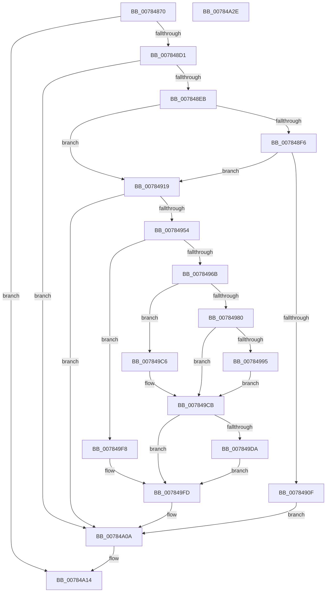

# PspAssignPrimaryToken

- RVA: `0x00784870`–`0x00784A2F` (길이 `447` bytes)
- VA: `0x0000000140784870`
- 실행 섹션: `PAGE`
- PDB 이름 있음: `예`; PDB Function 태그: `아니요`
- unwind 정보 RVA: `0x000991EC`
- 디코드: `115`개 명령, `447/447` bytes 표시
- 미해석 바이트: `0` (있으면 어셈블리에 `.byte`로 보존)

> 이 문서는 커널 이미지의 기계어와 PDB 기호를 분석해 생성했습니다. 4번과 5번은 함수 원형과 자료형을 바이너리 사용 방식에서 추정한 C 해석이며 원본 소스 복구 결과는 아닙니다.

## 1. Dependencies

- 직접 호출 지점: **13**; 고유 호출 대상: **12**
- 직접 호출자로 확인된 함수: **1**
- RIP 상대 이미지 참조: **4**

### Outgoing calls
- `0x007848C4` → [ObReferenceObjectByHandle](../86/ObReferenceObjectByHandle_function_00868DB0.md) (function, `0x00868DB0`)
- `0x007848DC` → [SeIsTokenAssignableToProcess](../A3/SeIsTokenAssignableToProcess_function_00A3B2C0.md) (function, `0x00A3B2C0`)
- `0x00784906` → [SeCheckPrivilegedObject](../9F/SeCheckPrivilegedObject_function_009F62CC.md) (function, `0x009F62CC`)
- `0x00784945` → [ObpReferenceObjectByHandleWithTag](../86/ObpReferenceObjectByHandleWithTag_function_00869650.md) (function, `0x00869650`)
- `0x00784971` → [PspLockProcessShared](../../text/40/PspLockProcessShared_function_004016D0.md) (function, `0x004016D0`)
- `0x0078498A` → [SeExchangePrimaryToken](../7A/SeExchangePrimaryToken_function_007A07BC.md) (function, `0x007A07BC`)
- `0x007849BB` → [PspSynchronizeThreadIsolationDomains](../../text/3C/PspSynchronizeThreadIsolationDomains_function_003C479C.md) (function, `0x003C479C`)
- `0x007849D1` → [PspUnlockProcessShared](../../text/26/PspUnlockProcessShared_function_00263950.md) (function, `0x00263950`)
- `0x007849E0` → [PspLockUnlockProcessExclusive](../../text/41/PspLockUnlockProcessExclusive_function_00419B48.md) (function, `0x00419B48`)
- `0x007849E9` → [ObfDereferenceObject](../../text/2F/ObfDereferenceObject_function_002F9350.md) (function, `0x002F9350`)
- `0x007849F1` → [ObClearProcessDeviceMap](../90/ObClearProcessDeviceMap_function_00907688.md) (function, `0x00907688`)
- `0x00784A05` → [ObfDereferenceObjectWithTag](../../text/2F/ObfDereferenceObjectWithTag_function_002F78E0.md) (function, `0x002F78E0`)
- `0x00784A0D` → [ObfDereferenceObject](../../text/2F/ObfDereferenceObject_function_002F9350.md) (function, `0x002F9350`)

### Direct callers
- [NtSetInformationProcess](../AE/NtSetInformationProcess_function_00AE5370.md) at `0x00AE614C`

### Static image references
- `0x007848AB` → RVA `0x00FD8020` (`PAGEDATA`; read)
- `0x007848F6` → RVA `0x00FD9BC8` (`PAGEDATA`; read)
- `0x0078492C` → RVA `0x00FC6A98` (`ALMOSTRO`; read)
- `0x0078499A` → RVA `0x00E0C590` (`.data`; read/write)

## 2. Other-region calls and transfers

- 다른 실행 섹션으로 향하는 call: **7**
  - `0x00784971` → [PspLockProcessShared](../../text/40/PspLockProcessShared_function_004016D0.md) (`PAGE` → `.text`)
  - `0x007849BB` → [PspSynchronizeThreadIsolationDomains](../../text/3C/PspSynchronizeThreadIsolationDomains_function_003C479C.md) (`PAGE` → `.text`)
  - `0x007849D1` → [PspUnlockProcessShared](../../text/26/PspUnlockProcessShared_function_00263950.md) (`PAGE` → `.text`)
  - `0x007849E0` → [PspLockUnlockProcessExclusive](../../text/41/PspLockUnlockProcessExclusive_function_00419B48.md) (`PAGE` → `.text`)
  - `0x007849E9` → [ObfDereferenceObject](../../text/2F/ObfDereferenceObject_function_002F9350.md) (`PAGE` → `.text`)
  - `0x00784A05` → [ObfDereferenceObjectWithTag](../../text/2F/ObfDereferenceObjectWithTag_function_002F78E0.md) (`PAGE` → `.text`)
  - `0x00784A0D` → [ObfDereferenceObject](../../text/2F/ObfDereferenceObject_function_002F9350.md) (`PAGE` → `.text`)
- 별도 외부 분기/꼬리 이동을 확인하지 못했습니다.

## 3. Assembly (complete function range)

```asm
00784870  4C 8B DC                        mov r11, rsp
00784873  49 89 5B 08                     mov qword ptr [r11 + 8], rbx
00784877  49 89 73 10                     mov qword ptr [r11 + 0x10], rsi
0078487B  49 89 7B 18                     mov qword ptr [r11 + 0x18], rdi
0078487F  55                              push rbp
00784880  41 56                           push r14
00784882  41 57                           push r15
00784884  48 8B EC                        mov rbp, rsp
00784887  48 83 EC 60                     sub rsp, 0x60
0078488B  49 83 63 B0 00                  and qword ptr [r11 - 0x50], 0
00784890  4C 8B F1                        mov r14, rcx
00784893  48 83 65 E8 00                  and qword ptr [rbp - 0x18], 0
00784898  48 8D 4D F0                     lea rcx, [rbp - 0x10]
0078489C  48 83 65 F0 00                  and qword ptr [rbp - 0x10], 0
007848A1  49 8B C1                        mov rax, r9
007848A4  49 89 4B A8                     mov qword ptr [r11 - 0x58], rcx
007848A8  4D 8B F8                        mov r15, r8
007848AB  4C 8B 05 6E 37 85 00            mov r8, qword ptr [rip + 0x85376e]
007848B2  40 8A FA                        mov dil, dl
007848B5  44 8A CA                        mov r9b, dl
007848B8  C6 45 E0 00                     mov byte ptr [rbp - 0x20], 0
007848BC  48 8B C8                        mov rcx, rax
007848BF  BA 01 00 00 00                  mov edx, 1
007848C4  E8 E7 44 0E 00                  call 0x140868db0
007848C9  85 C0                           test eax, eax
007848CB  0F 88 43 01 00 00               js 0x140784a14
007848D1  48 8B 75 F0                     mov rsi, qword ptr [rbp - 0x10]
007848D5  48 8D 55 E0                     lea rdx, [rbp - 0x20]
007848D9  48 8B CE                        mov rcx, rsi
007848DC  E8 DF 69 2B 00                  call 0x140a3b2c0
007848E1  8B D8                           mov ebx, eax
007848E3  85 C0                           test eax, eax
007848E5  0F 88 1F 01 00 00               js 0x140784a0a
007848EB  80 7D E0 00                     cmp byte ptr [rbp - 0x20], 0
007848EF  BB 00 02 00 00                  mov ebx, 0x200
007848F4  75 23                           jne 0x140784919
007848F6  48 8B 0D CB 52 85 00            mov rcx, qword ptr [rip + 0x8552cb]
007848FD  44 8A CF                        mov r9b, dil
00784900  44 8B C3                        mov r8d, ebx
00784903  49 8B D7                        mov rdx, r15
00784906  E8 C1 19 27 00                  call 0x1409f62cc
0078490B  84 C0                           test al, al
0078490D  75 0A                           jne 0x140784919
0078490F  BB 61 00 00 C0                  mov ebx, 0xc0000061
00784914  E9 F1 00 00 00                  jmp 0x140784a0a
00784919  48 83 64 24 38 00               and qword ptr [rsp + 0x38], 0
0078491F  48 8D 45 E8                     lea rax, [rbp - 0x18]
00784923  48 83 64 24 30 00               and qword ptr [rsp + 0x30], 0
00784929  44 8A CF                        mov r9b, dil
0078492C  4C 8B 05 65 21 84 00            mov r8, qword ptr [rip + 0x842165]
00784933  8B D3                           mov edx, ebx
00784935  48 89 44 24 28                  mov qword ptr [rsp + 0x28], rax
0078493A  49 8B CF                        mov rcx, r15
0078493D  C7 44 24 20 50 73 53 65         mov dword ptr [rsp + 0x20], 0x65537350
00784945  E8 06 4D 0E 00                  call 0x140869650
0078494A  8B D8                           mov ebx, eax
0078494C  85 C0                           test eax, eax
0078494E  0F 88 B6 00 00 00               js 0x140784a0a
00784954  48 8B 7D E8                     mov rdi, qword ptr [rbp - 0x18]
00784958  48 83 65 F8 00                  and qword ptr [rbp - 8], 0
0078495D  0F BA A7 F0 01 00 00 0F         bt dword ptr [rdi + 0x1f0], 0xf
00784965  0F 82 8D 00 00 00               jb 0x1407849f8
0078496B  49 8B D6                        mov rdx, r14
0078496E  48 8B CF                        mov rcx, rdi
00784971  E8 5A CD C7 FF                  call 0x1404016d0
00784976  0F BA A7 F0 01 00 00 0F         bt dword ptr [rdi + 0x1f0], 0xf
0078497E  72 46                           jb 0x1407849c6
00784980  4C 8D 45 F8                     lea r8, [rbp - 8]
00784984  48 8B D6                        mov rdx, rsi
00784987  48 8B CF                        mov rcx, rdi
0078498A  E8 2D BE 01 00                  call 0x1407a07bc
0078498F  8B D8                           mov ebx, eax
00784991  85 C0                           test eax, eax
00784993  78 36                           js 0x1407849cb
00784995  B8 01 00 00 00                  mov eax, 1
0078499A  F0 48 0F C1 05 ED 7B 68 00      lock xadd qword ptr [rip + 0x687bed], rax
007849A3  48 8B 7D E8                     mov rdi, qword ptr [rbp - 0x18]
007849A7  48 FF C0                        inc rax
007849AA  48 8B CF                        mov rcx, rdi
007849AD  48 89 87 60 07 00 00            mov qword ptr [rdi + 0x760], rax
007849B4  48 89 87 68 07 00 00            mov qword ptr [rdi + 0x768], rax
007849BB  E8 DC FD C3 FF                  call 0x1403c479c
007849C0  48 8B 75 F0                     mov rsi, qword ptr [rbp - 0x10]
007849C4  EB 05                           jmp 0x1407849cb
007849C6  BB BB 00 00 C0                  mov ebx, 0xc00000bb
007849CB  49 8B D6                        mov rdx, r14
007849CE  48 8B CF                        mov rcx, rdi
007849D1  E8 7A EF AD FF                  call 0x140263950
007849D6  85 DB                           test ebx, ebx
007849D8  78 23                           js 0x1407849fd
007849DA  49 8B D6                        mov rdx, r14
007849DD  48 8B CF                        mov rcx, rdi
007849E0  E8 63 51 C9 FF                  call 0x140419b48
007849E5  48 8B 4D F8                     mov rcx, qword ptr [rbp - 8]
007849E9  E8 62 49 B7 FF                  call 0x1402f9350
007849EE  48 8B CF                        mov rcx, rdi
007849F1  E8 92 2C 18 00                  call 0x140907688
007849F6  EB 05                           jmp 0x1407849fd
007849F8  BB BB 00 00 C0                  mov ebx, 0xc00000bb
007849FD  BA 50 73 53 65                  mov edx, 0x65537350
00784A02  48 8B CF                        mov rcx, rdi
00784A05  E8 D6 2E B7 FF                  call 0x1402f78e0
00784A0A  48 8B CE                        mov rcx, rsi
00784A0D  E8 3E 49 B7 FF                  call 0x1402f9350
00784A12  8B C3                           mov eax, ebx
00784A14  4C 8D 5C 24 60                  lea r11, [rsp + 0x60]
00784A19  49 8B 5B 20                     mov rbx, qword ptr [r11 + 0x20]
00784A1D  49 8B 73 28                     mov rsi, qword ptr [r11 + 0x28]
00784A21  49 8B 7B 30                     mov rdi, qword ptr [r11 + 0x30]
00784A25  49 8B E3                        mov rsp, r11
00784A28  41 5F                           pop r15
00784A2A  41 5E                           pop r14
00784A2C  5D                              pop rbp
00784A2D  C3                              ret
00784A2E  CC                              int3
```

## 4. C-style interpretation (structured pseudocode)

```c
__int64 __fastcall PspAssignPrimaryToken(__int64 a1, unsigned __int8 a2, __int64 a3, __int64 a4)
{
    __int64 result;
    __int64 v_rsp;
    unsigned __int64 v_stack_m18;
    unsigned __int64 v_stack_m20;
    unsigned __int64 v_stack_m28;
    unsigned __int64 v_stack_m30;
    unsigned __int8 v_stack_m38;
    unsigned __int64 v_stack_m40;
    unsigned __int64 v_stack_m48;
    unsigned __int64 v_stack_m50;
    unsigned int v_stack_m58;

    *(unsigned __int64 *)(v_rsp + 8) = v_rbx;
    *(unsigned __int64 *)(v_rsp + 16) = v_rsi;
    *(unsigned __int64 *)(v_rsp + 24) = v_rdi;
    v_rsp = (v_rsp) - (96);
    *(unsigned __int64 *)(v_rsp - 88) = v_stack_m28;
    v_stack_m38 = 0;
    result = ObReferenceObjectByHandle(a4, 1, *(unsigned __int64 *)(v_rip + 8730478), a2);
    if (sign_flag) goto loc_00784A14;
    result = SeIsTokenAssignableToProcess(v_stack_m28, v_stack_m38, *(unsigned __int64 *)(v_rip + 8730478), a2);
    if (sign_flag) goto loc_00784A0A;
    if (v_stack_m38 != 0) goto loc_00784919;
    result = SeCheckPrivilegedObject(*(unsigned __int64 *)(v_rip + 8737483), a3, 512, a2);
    if ((unsigned __int8)(result) != 0) goto loc_00784919;
    goto loc_00784A0A;
loc_00784919:
    v_stack_m50 = v_stack_m30;
    v_stack_m58 = 0x65537350ULL;
    result = ObpReferenceObjectByHandleWithTag(a3, (unsigned int)((unsigned int)((unsigned int)(0xC0000061ULL))), *(unsigned __int64 *)(v_rip + 8659301), a2);
    if (sign_flag) goto loc_00784A0A;
    if (condition_is_below) goto loc_007849F8;
    result = PspLockProcessShared(v_stack_m30, a1, *(unsigned __int64 *)(v_rip + 8659301), a2);
    if (condition_is_below) goto loc_007849C6;
    result = SeExchangePrimaryToken(v_stack_m30, v_stack_m28, v_stack_m20, a2);
    if (sign_flag) goto loc_007849CB;
    result = (1) + 1;
    *(unsigned __int64 *)(v_stack_m30 + 1888) = result;
    *(unsigned __int64 *)(v_stack_m30 + 1896) = result;
    result = PspSynchronizeThreadIsolationDomains(v_stack_m30, v_stack_m28, v_stack_m20, a2);
    goto loc_007849CB;
loc_007849C6:
loc_007849CB:
    result = PspUnlockProcessShared(v_stack_m30, a1, v_stack_m20, a2);
    if (sign_flag) goto loc_007849FD;
    result = PspLockUnlockProcessExclusive(v_stack_m30, a1, v_stack_m20, a2);
    result = ObfDereferenceObject(v_stack_m20, a1, v_stack_m20, a2);
    result = ObClearProcessDeviceMap(v_stack_m30, a1, v_stack_m20, a2);
    goto loc_007849FD;
loc_007849F8:
loc_007849FD:
    result = ObfDereferenceObjectWithTag(v_stack_m30, (unsigned int)(0x65537350ULL), v_stack_m20, a2);
loc_00784A0A:
    result = ObfDereferenceObject(v_stack_m28, (unsigned int)(0x65537350ULL), v_stack_m20, a2);
loc_00784A14:
    return (unsigned int)((unsigned int)((unsigned int)(0xC00000BBULL)));
}
```

## 5. (Beta) C Style

```c
int64_t PspAssignPrimaryToken(int64_t Arg1, uint8_t Arg2, int64_t Arg3, int64_t Arg4)
{
    int64_t result;
    int64_t local_rsp;
    uint64_t v_stack_m18;
    uint64_t v_stack_m20;
    uint64_t v_stack_m28;
    uint64_t v_stack_m30;
    uint8_t v_stack_m38;
    uint64_t v_stack_m40;
    uint64_t v_stack_m48;
    uint64_t v_stack_m50;
    uint32_t v_stack_m58;

    *(uint64_t *)(local_rsp + 0x8) = local_rbx;
    *(uint64_t *)(local_rsp + 0x10) = local_rsi;
    *(uint64_t *)(local_rsp + 0x18) = local_rdi;
    local_rsp = (local_rsp) - (96);
    *(uint64_t *)(local_rsp - 0x58) = v_stack_m28;
    v_stack_m38 = 0;
    result = ObReferenceObjectByHandle(Arg4, 1, *(uint64_t *)(v_rip + 0x85376E), Arg2);
    if (sign_flag) goto loc_00784A14;
    result = SeIsTokenAssignableToProcess(v_stack_m28, v_stack_m38, *(uint64_t *)(v_rip + 0x85376E), Arg2);
    if (sign_flag) goto loc_00784A0A;
    if (v_stack_m38 != 0) goto loc_00784919;
    result = SeCheckPrivilegedObject(*(uint64_t *)(v_rip + 0x8552CB), Arg3, 512, Arg2);
    if ((uint8_t)(result) != 0) goto loc_00784919;
    goto loc_00784A0A;
loc_00784919:
    v_stack_m50 = v_stack_m30;
    v_stack_m58 = 0x65537350ULL;
    result = ObpReferenceObjectByHandleWithTag(Arg3, (uint32_t)((uint32_t)((uint32_t)(0xC0000061ULL))), *(uint64_t *)(v_rip + 0x842165), Arg2);
    if (sign_flag) goto loc_00784A0A;
    if (condition_is_below) goto loc_007849F8;
    result = PspLockProcessShared(v_stack_m30, Arg1, *(uint64_t *)(v_rip + 0x842165), Arg2);
    if (condition_is_below) goto loc_007849C6;
    result = SeExchangePrimaryToken(v_stack_m30, v_stack_m28, v_stack_m20, Arg2);
    if (sign_flag) goto loc_007849CB;
    result = (1) + 1;
    *(uint64_t *)(v_stack_m30 + 0x760) = result;
    *(uint64_t *)(v_stack_m30 + 0x768) = result;
    result = PspSynchronizeThreadIsolationDomains(v_stack_m30, v_stack_m28, v_stack_m20, Arg2);
    goto loc_007849CB;
loc_007849C6:
loc_007849CB:
    result = PspUnlockProcessShared(v_stack_m30, Arg1, v_stack_m20, Arg2);
    if (sign_flag) goto loc_007849FD;
    result = PspLockUnlockProcessExclusive(v_stack_m30, Arg1, v_stack_m20, Arg2);
    result = ObfDereferenceObject(v_stack_m20, Arg1, v_stack_m20, Arg2);
    result = ObClearProcessDeviceMap(v_stack_m30, Arg1, v_stack_m20, Arg2);
    goto loc_007849FD;
loc_007849F8:
loc_007849FD:
    result = ObfDereferenceObjectWithTag(v_stack_m30, (uint32_t)(0x65537350ULL), v_stack_m20, Arg2);
loc_00784A0A:
    result = ObfDereferenceObject(v_stack_m28, (uint32_t)(0x65537350ULL), v_stack_m20, Arg2);
loc_00784A14:
    return (uint32_t)((uint32_t)((uint32_t)(0xC00000BBULL)));
}
```

## 6. Execution-region graph

[열기: 2D/3D 그래프와 함수 탐색 컨트롤 패널](../../../control-panel.html?section=page&rva=0x00784870&view=graph)

- 2D 그래프는 위에서 아래로 흐르고, 3D 그래프는 빈 공간을 드래그해 회전합니다. Shift+드래그는 이동, 휠은 확대·축소, 함수 노드 선택은 대상 보고서 이동입니다.

### Static fallback


