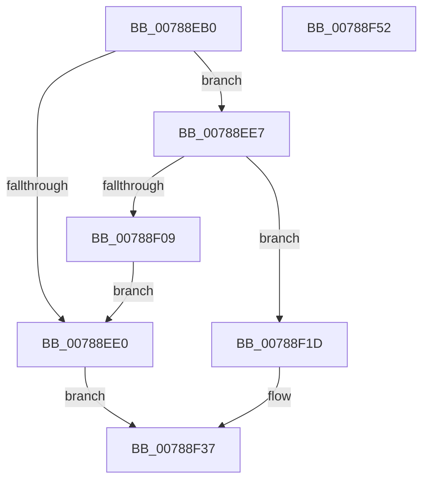

# PspAttachSession

- RVA: `0x00788EB0`–`0x00788F53` (길이 `163` bytes)
- VA: `0x0000000140788EB0`
- 실행 섹션: `PAGE`
- PDB 이름 있음: `예`; PDB Function 태그: `아니요`
- unwind 정보 RVA: `0x0005E6B4`
- 디코드: `45`개 명령, `163/163` bytes 표시
- 미해석 바이트: `0` (있으면 어셈블리에 `.byte`로 보존)

> 이 문서는 커널 이미지의 기계어와 PDB 기호를 분석해 생성했습니다. 4번과 5번은 함수 원형과 자료형을 바이너리 사용 방식에서 추정한 C 해석이며 원본 소스 복구 결과는 아닙니다.

## 1. Dependencies

- 직접 호출 지점: **6**; 고유 호출 대상: **5**
- 직접 호출자로 확인된 함수: **1**
- RIP 상대 이미지 참조: **0**

### Outgoing calls
- `0x00788ED3` → [PsGetSessionById](../../text/22/PsGetSessionById_function_00225150.md) (function, `0x00225150`)
- `0x00788EFA` → [PspLockProcessListExclusive](../../text/22/PspLockProcessListExclusive_function_0022578C.md) (function, `0x0022578C`)
- `0x00788F09` → [PspUnlockProcessListExclusive](../../text/2D/PspUnlockProcessListExclusive_function_002DFD18.md) (function, `0x002DFD18`)
- `0x00788F16` → [ObfDereferenceObjectWithTag](../../text/2F/ObfDereferenceObjectWithTag_function_002F78E0.md) (function, `0x002F78E0`)
- `0x00788F20` → [PspUnlockProcessListExclusive](../../text/2D/PspUnlockProcessListExclusive_function_002DFD18.md) (function, `0x002DFD18`)
- `0x00788F2D` → [KiStackAttachProcess](../../text/21/KiStackAttachProcess_function_00216820.md) (function, `0x00216820`)

### Direct callers
- [PspAllocateProcess](../A1/PspAllocateProcess_function_00A13B3C.md) at `0x00A15066`

### Static image references
- 디코드된 RIP-relative 메모리 참조가 없습니다.

## 2. Other-region calls and transfers

- 다른 실행 섹션으로 향하는 call: **6**
  - `0x00788ED3` → [PsGetSessionById](../../text/22/PsGetSessionById_function_00225150.md) (`PAGE` → `.text`)
  - `0x00788EFA` → [PspLockProcessListExclusive](../../text/22/PspLockProcessListExclusive_function_0022578C.md) (`PAGE` → `.text`)
  - `0x00788F09` → [PspUnlockProcessListExclusive](../../text/2D/PspUnlockProcessListExclusive_function_002DFD18.md) (`PAGE` → `.text`)
  - `0x00788F16` → [ObfDereferenceObjectWithTag](../../text/2F/ObfDereferenceObjectWithTag_function_002F78E0.md) (`PAGE` → `.text`)
  - `0x00788F20` → [PspUnlockProcessListExclusive](../../text/2D/PspUnlockProcessListExclusive_function_002DFD18.md) (`PAGE` → `.text`)
  - `0x00788F2D` → [KiStackAttachProcess](../../text/21/KiStackAttachProcess_function_00216820.md) (`PAGE` → `.text`)
- 별도 외부 분기/꼬리 이동을 확인하지 못했습니다.

## 3. Assembly (complete function range)

```asm
00788EB0  48 8B C4                        mov rax, rsp
00788EB3  48 89 58 08                     mov qword ptr [rax + 8], rbx
00788EB7  48 89 68 10                     mov qword ptr [rax + 0x10], rbp
00788EBB  48 89 70 18                     mov qword ptr [rax + 0x18], rsi
00788EBF  48 89 78 20                     mov qword ptr [rax + 0x20], rdi
00788EC3  41 56                           push r14
00788EC5  48 83 EC 20                     sub rsp, 0x20
00788EC9  49 83 20 00                     and qword ptr [r8], 0
00788ECD  4D 8B F0                        mov r14, r8
00788ED0  48 8B EA                        mov rbp, rdx
00788ED3  E8 78 C2 A9 FF                  call 0x140225150
00788ED8  48 8B D8                        mov rbx, rax
00788EDB  48 85 C0                        test rax, rax
00788EDE  75 07                           jne 0x140788ee7
00788EE0  B8 0A 01 00 C0                  mov eax, 0xc000010a
00788EE5  EB 50                           jmp 0x140788f37
00788EE7  65 48 8B 3C 25 88 01 00 00      mov rdi, qword ptr gs:[0x188]
00788EF0  48 8B B0 E8 02 00 00            mov rsi, qword ptr [rax + 0x2e8]
00788EF7  48 8B CF                        mov rcx, rdi
00788EFA  E8 8D C8 A9 FF                  call 0x14022578c
00788EFF  8B 46 04                        mov eax, dword ptr [rsi + 4]
00788F02  48 8B CF                        mov rcx, rdi
00788F05  A8 02                           test al, 2
00788F07  74 14                           je 0x140788f1d
00788F09  E8 0A 6E B5 FF                  call 0x1402dfd18
00788F0E  BA 50 73 51 79                  mov edx, 0x79517350
00788F13  48 8B CB                        mov rcx, rbx
00788F16  E8 C5 E9 B6 FF                  call 0x1402f78e0
00788F1B  EB C3                           jmp 0x140788ee0
00788F1D  FF 46 34                        inc dword ptr [rsi + 0x34]
00788F20  E8 F3 6D B5 FF                  call 0x1402dfd18
00788F25  4C 8B C5                        mov r8, rbp
00788F28  33 D2                           xor edx, edx
00788F2A  48 8B CB                        mov rcx, rbx
00788F2D  E8 EE D8 A8 FF                  call 0x140216820
00788F32  33 C0                           xor eax, eax
00788F34  49 89 1E                        mov qword ptr [r14], rbx
00788F37  48 8B 5C 24 30                  mov rbx, qword ptr [rsp + 0x30]
00788F3C  48 8B 6C 24 38                  mov rbp, qword ptr [rsp + 0x38]
00788F41  48 8B 74 24 40                  mov rsi, qword ptr [rsp + 0x40]
00788F46  48 8B 7C 24 48                  mov rdi, qword ptr [rsp + 0x48]
00788F4B  48 83 C4 20                     add rsp, 0x20
00788F4F  41 5E                           pop r14
00788F51  C3                              ret
00788F52  CC                              int3
```

## 4. C-style interpretation (structured pseudocode)

```c
__int64 __fastcall PspAttachSession(__int64 a1, __int64 a2, __int64 a3)
{
    __int64 result;
    __int64 v_rsp;
    unsigned __int64 v_stack_p10;
    unsigned __int64 v_stack_p18;
    unsigned __int64 v_stack_p20;
    unsigned __int64 v_stack_p8;

    *(unsigned __int64 *)(v_rsp + 8) = v_rbx;
    *(unsigned __int64 *)(v_rsp + 16) = v_rbp;
    *(unsigned __int64 *)(v_rsp + 24) = v_rsi;
    *(unsigned __int64 *)(v_rsp + 32) = v_rdi;
    v_rsp = (v_rsp) - (32);
    result = PsGetSessionById(a1, a2, a3, a4);
    if (result != 0) goto loc_00788EE7;
loc_00788EE0:
    goto loc_00788F37;
loc_00788EE7:
    result = PspLockProcessListExclusive(*(unsigned __int64 *)(gs_base + (0 + 392)), a2, a3, a4);
    if ((((unsigned __int8)((unsigned int)(*(unsigned int *)(*(unsigned __int64 *)((unsigned int)(0xC000010AULL) + 744) + 4)))) & (2)) == 0) goto loc_00788F1D;
    result = PspUnlockProcessListExclusive(*(unsigned __int64 *)(gs_base + (0 + 392)), a2, a3, a4);
    result = ObfDereferenceObjectWithTag(result, (unsigned int)(0x79517350ULL), a3, a4);
    goto loc_00788EE0;
loc_00788F1D:
    result = PspUnlockProcessListExclusive(result, (unsigned int)(0x79517350ULL), a3, a4);
    a2 = 0;
    result = KiStackAttachProcess(result, a2, a2, a4);
    result = 0;
    *(unsigned __int64 *)(a3) = 0;
loc_00788F37:
    v_rsp = (v_rsp) + (32);
    return result;
}
```

## 5. (Beta) C Style

```c
int64_t PspAttachSession(int64_t Arg1, int64_t Arg2, void *Arg3)
{
    uint8_t *arg3 = (uint8_t *)Arg3;

    int64_t result;
    int64_t local_rsp;
    uint64_t v_stack_p10;
    uint64_t v_stack_p18;
    uint64_t v_stack_p20;
    uint64_t v_stack_p8;

    *(uint64_t *)(local_rsp + 0x8) = local_rbx;
    *(uint64_t *)(local_rsp + 0x10) = local_rbp;
    *(uint64_t *)(local_rsp + 0x18) = local_rsi;
    *(uint64_t *)(local_rsp + 0x20) = local_rdi;
    local_rsp = (local_rsp) - (32);
    result = PsGetSessionById(Arg1, Arg2, Arg3, a4);
    if (result != 0) goto loc_00788EE7;
loc_00788EE0:
    goto loc_00788F37;
loc_00788EE7:
    result = PspLockProcessListExclusive(*(uint64_t *)(gs_base + (0 + 0x188)), Arg2, Arg3, a4);
    if ((((uint8_t)((uint32_t)(*(uint32_t *)(*(uint64_t *)((uint32_t)(0xC000010AULL) + 0x2E8) + 0x4)))) & (2)) == 0) goto loc_00788F1D;
    result = PspUnlockProcessListExclusive(*(uint64_t *)(gs_base + (0 + 0x188)), Arg2, Arg3, a4);
    result = ObfDereferenceObjectWithTag(result, (uint32_t)(0x79517350ULL), Arg3, a4);
    goto loc_00788EE0;
loc_00788F1D:
    result = PspUnlockProcessListExclusive(result, (uint32_t)(0x79517350ULL), Arg3, a4);
    Arg2 = 0;
    result = KiStackAttachProcess(result, Arg2, Arg2, a4);
    result = 0;
    *(uint64_t *)(arg3) = 0;
loc_00788F37:
    local_rsp = (local_rsp) + (32);
    return result;
}
```

### 관측된 메모리 오프셋

구조체 형식이 확인되지 않은 접근은 인자 기준의 오프셋으로만 기록했습니다.

| 기준 인자 | 오프셋 표현 | 폭 (bit) | 접근 |
|---|---:|---:|---|
| `Arg3` | `+ 0x0` | `64` | `R/W` |
| `Arg3` | `+ 0x0` | `64` | `W` |

## 6. Execution-region graph

[열기: 2D/3D 그래프와 함수 탐색 컨트롤 패널](../../../control-panel.html?section=page&rva=0x00788EB0&view=graph)

- 2D 그래프는 위에서 아래로 흐르고, 3D 그래프는 빈 공간을 드래그해 회전합니다. Shift+드래그는 이동, 휠은 확대·축소, 함수 노드 선택은 대상 보고서 이동입니다.

### Static fallback


