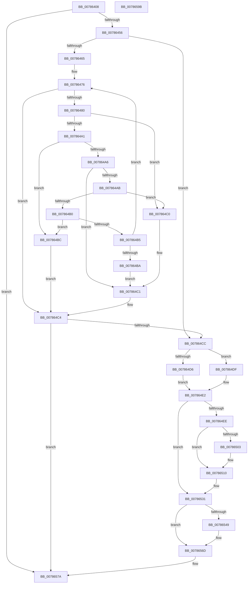

# PspCatchCriticalBreak

- RVA: `0x00786408`–`0x0078659C` (길이 `404` bytes)
- VA: `0x0000000140786408`
- 실행 섹션: `PAGE`
- PDB 이름 있음: `예`; PDB Function 태그: `아니요`
- unwind 정보 RVA: `0x000CF26C`
- 디코드: `112`개 명령, `404/404` bytes 표시
- 미해석 바이트: `0` (있으면 어셈블리에 `.byte`로 보존)

> 이 문서는 커널 이미지의 기계어와 PDB 기호를 분석해 생성했습니다. 4번과 5번은 함수 원형과 자료형을 바이너리 사용 방식에서 추정한 C 해석이며 원본 소스 복구 결과는 아닙니다.

## 1. Dependencies

- 직접 호출 지점: **10**; 고유 호출 대상: **10**
- 직접 호출자로 확인된 함수: **4**
- RIP 상대 이미지 참조: **4**

### Outgoing calls
- `0x00786448` → [PsGetServerSiloState](../../text/22/PsGetServerSiloState_function_002259FC.md) (function, `0x002259FC`)
- `0x00786471` → [DbgPrintEx](../../text/35/DbgPrintEx_function_00359290.md) (function, `0x00359290`)
- `0x00786492` → [DbgPrompt](../../text/5E/DbgPrompt_function_005E5880.md) (function, `0x005E5880`)
- `0x007864E5` → [PsIsHostSilo](../../text/44/PsIsHostSilo_function_00443B30.md) (function, `0x00443B30`)
- `0x0078650B` → [KeStackAttachProcess](../../text/21/KeStackAttachProcess_function_00216800.md) (function, `0x00216800`)
- `0x0078652B` → [KeBugCheckEx](../../text/4F/KeBugCheckEx_function_004FD660.md) (function, `0x004FD660`)
- `0x00786534` → [PsGetServerSiloGlobals](../../text/22/PsGetServerSiloGlobals_function_002250A0.md) (function, `0x002250A0`)
- `0x0078655B` → [strncpy_s](../../text/50/strncpy_s_function_00506140.md) (function, `0x00506140`)
- `0x00786575` → [PsTerminateServerSilo](../77/PsTerminateServerSilo_function_0077F620.md) (function, `0x0077F620`)
- `0x00786582` → [_security_check_cookie](../../text/6A/_security_check_cookie_function_006AC640.md) (function, `0x006AC640`)

### Direct callers
- [PspTerminateAllThreads](../8C/PspTerminateAllThreads_function_008C97D0.md) at `0x008C9A4A`
- [PspExitLastThread](../90/PspExitLastThread_function_00904184.md) at `0x00904354`
- [PspTerminateThreadByPointer](../90/PspTerminateThreadByPointer_function_00905E80.md) at `0x00905F48`
- [sub_00B20D7E](../B2/Unknown_function_00B20D7E.md) at `0x00B20E4F`

### Static image references
- `0x00786418` → RVA `0x00E0A740` (`.data`; read)
- `0x00786456` → RVA `0x00F475F8` (`.data`; read)
- `0x00786478` → RVA `0x00F475DC` (`.data`; read)
- `0x0078648B` → RVA `0x00B04FC0` (` ?? ::NNGAKEGL::`string'`; read)

## 2. Other-region calls and transfers

- 다른 실행 섹션으로 향하는 call: **9**
  - `0x00786448` → [PsGetServerSiloState](../../text/22/PsGetServerSiloState_function_002259FC.md) (`PAGE` → `.text`)
  - `0x00786471` → [DbgPrintEx](../../text/35/DbgPrintEx_function_00359290.md) (`PAGE` → `.text`)
  - `0x00786492` → [DbgPrompt](../../text/5E/DbgPrompt_function_005E5880.md) (`PAGE` → `.text`)
  - `0x007864E5` → [PsIsHostSilo](../../text/44/PsIsHostSilo_function_00443B30.md) (`PAGE` → `.text`)
  - `0x0078650B` → [KeStackAttachProcess](../../text/21/KeStackAttachProcess_function_00216800.md) (`PAGE` → `.text`)
  - `0x0078652B` → [KeBugCheckEx](../../text/4F/KeBugCheckEx_function_004FD660.md) (`PAGE` → `.text`)
  - `0x00786534` → [PsGetServerSiloGlobals](../../text/22/PsGetServerSiloGlobals_function_002250A0.md) (`PAGE` → `.text`)
  - `0x0078655B` → [strncpy_s](../../text/50/strncpy_s_function_00506140.md) (`PAGE` → `.text`)
  - `0x00786582` → [_security_check_cookie](../../text/6A/_security_check_cookie_function_006AC640.md) (`PAGE` → `.text`)
- 별도 외부 분기/꼬리 이동을 확인하지 못했습니다.

## 3. Assembly (complete function range)

```asm
00786408  48 89 5C 24 08                  mov qword ptr [rsp + 8], rbx
0078640D  55                              push rbp
0078640E  56                              push rsi
0078640F  57                              push rdi
00786410  41 54                           push r12
00786412  41 56                           push r14
00786414  48 83 EC 70                     sub rsp, 0x70
00786418  48 8B 05 21 43 68 00            mov rax, qword ptr [rip + 0x684321]
0078641F  48 33 C4                        xor rax, rsp
00786422  48 89 44 24 68                  mov qword ptr [rsp + 0x68], rax
00786427  0F 57 C0                        xorps xmm0, xmm0
0078642A  4D 8B F0                        mov r14, r8
0078642D  4C 8B C1                        mov r8, rcx
00786430  49 8B E9                        mov rbp, r9
00786433  49 8B C9                        mov rcx, r9
00786436  48 8B F2                        mov rsi, rdx
00786439  0F 11 44 24 38                  movups xmmword ptr [rsp + 0x38], xmm0
0078643E  0F 11 44 24 48                  movups xmmword ptr [rsp + 0x48], xmm0
00786443  0F 11 44 24 58                  movups xmmword ptr [rsp + 0x58], xmm0
00786448  E8 AF F5 A9 FF                  call 0x1402259fc
0078644D  83 F8 02                        cmp eax, 2
00786450  0F 8D 24 01 00 00               jge 0x14078657a
00786456  80 3D 9B 11 7C 00 00            cmp byte ptr [rip + 0x7c119b], 0
0078645D  41 BC 01 00 00 00               mov r12d, 1
00786463  74 67                           je 0x1407864cc
00786465  4C 8B CA                        mov r9, rdx
00786468  4C 89 74 24 20                  mov qword ptr [rsp + 0x20], r14
0078646D  33 D2                           xor edx, edx
0078646F  33 C9                           xor ecx, ecx
00786471  E8 1A 2E BD FF                  call 0x140359290
00786476  32 C0                           xor al, al
00786478  38 05 5E 11 7C 00               cmp byte ptr [rip + 0x7c115e], al
0078647E  75 44                           jne 0x1407864c4
00786480  41 B8 02 00 00 00               mov r8d, 2
00786486  48 8D 54 24 30                  lea rdx, [rsp + 0x30]
0078648B  48 8D 0D 2E EB 37 00            lea rcx, [rip + 0x37eb2e]
00786492  E8 E9 F3 E5 FF                  call 0x1405e5880
00786497  0F BE 4C 24 30                  movsx ecx, byte ptr [rsp + 0x30]
0078649C  83 E9 42                        sub ecx, 0x42
0078649F  74 1F                           je 0x1407864c0
007864A1  41 2B CC                        sub ecx, r12d
007864A4  74 16                           je 0x1407864bc
007864A6  83 E9 06                        sub ecx, 6
007864A9  74 16                           je 0x1407864c1
007864AB  83 E9 19                        sub ecx, 0x19
007864AE  74 10                           je 0x1407864c0
007864B0  41 2B CC                        sub ecx, r12d
007864B3  74 07                           je 0x1407864bc
007864B5  83 F9 06                        cmp ecx, 6
007864B8  75 BC                           jne 0x140786476
007864BA  EB 05                           jmp 0x1407864c1
007864BC  32 C0                           xor al, al
007864BE  EB 04                           jmp 0x1407864c4
007864C0  CC                              int3
007864C1  41 8A C4                        mov al, r12b
007864C4  84 C0                           test al, al
007864C6  0F 85 AE 00 00 00               jne 0x14078657a
007864CC  8A 1E                           mov bl, byte ptr [rsi]
007864CE  80 E3 7F                        and bl, 0x7f
007864D1  80 FB 06                        cmp bl, 6
007864D4  75 09                           jne 0x1407864df
007864D6  48 8B BE 20 02 00 00            mov rdi, qword ptr [rsi + 0x220]
007864DD  EB 03                           jmp 0x1407864e2
007864DF  48 8B FE                        mov rdi, rsi
007864E2  48 8B CD                        mov rcx, rbp
007864E5  E8 46 D6 CB FF                  call 0x140443b30
007864EA  84 C0                           test al, al
007864EC  74 43                           je 0x140786531
007864EE  65 48 8B 04 25 88 01 00 00      mov rax, qword ptr gs:[0x188]
007864F7  48 8B A8 B8 00 00 00            mov rbp, qword ptr [rax + 0xb8]
007864FE  48 3B FD                        cmp rdi, rbp
00786501  74 0D                           je 0x140786510
00786503  48 8D 54 24 38                  lea rdx, [rsp + 0x38]
00786508  48 8B CF                        mov rcx, rdi
0078650B  E8 F0 02 A9 FF                  call 0x140216800
00786510  45 33 C0                        xor r8d, r8d
00786513  4C 8B CD                        mov r9, rbp
00786516  80 FB 06                        cmp bl, 6
00786519  48 8B D6                        mov rdx, rsi
0078651C  B9 EF 00 00 00                  mov ecx, 0xef
00786521  41 0F 94 C0                     sete r8b
00786525  48 83 64 24 20 00               and qword ptr [rsp + 0x20], 0
0078652B  E8 30 71 D7 FF                  call 0x1404fd660
00786530  CC                              int3
00786531  48 8B CD                        mov rcx, rbp
00786534  E8 67 EB A9 FF                  call 0x1402250a0
00786539  48 8B D8                        mov rbx, rax
0078653C  33 C0                           xor eax, eax
0078653E  F0 44 0F B1 A3 3C 05 00 00      lock cmpxchg dword ptr [rbx + 0x53c], r12d
00786547  75 24                           jne 0x14078656d
00786549  49 83 C9 FF                     or r9, 0xffffffffffffffff
0078654D  48 8D 8B 44 05 00 00            lea rcx, [rbx + 0x544]
00786554  4D 8B C6                        mov r8, r14
00786557  41 8D 51 10                     lea edx, [r9 + 0x10]
0078655B  E8 E0 FB D7 FF                  call 0x140506140
00786560  8B 94 24 C0 00 00 00            mov edx, dword ptr [rsp + 0xc0]
00786567  89 93 40 05 00 00               mov dword ptr [rbx + 0x540], edx
0078656D  BA 1A 02 00 C0                  mov edx, 0xc000021a
00786572  48 8B CD                        mov rcx, rbp
00786575  E8 A6 90 FF FF                  call 0x14077f620
0078657A  48 8B 4C 24 68                  mov rcx, qword ptr [rsp + 0x68]
0078657F  48 33 CC                        xor rcx, rsp
00786582  E8 B9 60 F2 FF                  call 0x1406ac640
00786587  48 8B 9C 24 A0 00 00 00         mov rbx, qword ptr [rsp + 0xa0]
0078658F  48 83 C4 70                     add rsp, 0x70
00786593  41 5E                           pop r14
00786595  41 5C                           pop r12
00786597  5F                              pop rdi
00786598  5E                              pop rsi
00786599  5D                              pop rbp
0078659A  C3                              ret
0078659B  CC                              int3
```

## 4. C-style interpretation (structured pseudocode)

```c
__int64 __fastcall PspCatchCriticalBreak(__int64 a1, __int64 a2, __int64 a3, __int64 a4, unsigned int a5)
{
    __int64 result;
    __int64 v_rbx;
    __int64 v_rsp;
    unsigned __int64 v_stack_m30;
    unsigned __int64 v_stack_m40;
    unsigned __int64 v_stack_m50;
    unsigned __int64 v_stack_m60;
    unsigned __int64 v_stack_m68;
    unsigned __int64 v_stack_m78;
    unsigned __int64 v_stack_p8;

    v_stack_p8 = v_rbx;
    v_rsp = (v_rsp) - (112);
    result = (*(unsigned __int64 *)(v_rip + 6832929)) ^ (v_rsp);
    v_stack_m30 = result;
    v_stack_m60 = v_xmm0;
    v_stack_m50 = v_xmm0;
    v_stack_m40 = v_xmm0;
    result = PsGetServerSiloState(a4, a2, a1, a4);
    if (((unsigned int)(result)) >= 2) goto loc_0078657A;
    if ((*(unsigned __int8 *)(v_rip + 8130971)) == 0) goto loc_007864CC;
    v_stack_m78 = a3;
    a2 = 0;
    a1 = 0;
    result = DbgPrintEx(a1, a2, a1, a2);
loc_00786476:
    result = 0;
    if ((*(unsigned __int8 *)(v_rip + 8130910)) != 0) goto loc_007864C4;
    result = DbgPrompt(v_rip + 3664686, v_stack_m68, 2, a2);
    a1 = (unsigned int)(((__int8)(v_stack_m68)) - (66));
    if (condition_is_equal) goto loc_007864C0;
    a1 = (unsigned int)((a1) - (1));
    if (condition_is_equal) goto loc_007864BC;
    a1 = (unsigned int)((a1) - (6));
    if (condition_is_equal) goto loc_007864C1;
    a1 = (unsigned int)((a1) - (25));
    if (condition_is_equal) goto loc_007864C0;
    a1 = (unsigned int)((a1) - (1));
    if (condition_is_equal) goto loc_007864BC;
    if (((unsigned int)(a1)) != 6) goto loc_00786476;
    goto loc_007864C1;
loc_007864BC:
    result = 0;
    goto loc_007864C4;
loc_007864C0:
loc_007864C1:
loc_007864C4:
    if (1 != 0) goto loc_0078657A;
loc_007864CC:
    v_rbx = (unsigned __int8)((*(unsigned __int8 *)(a2)) & (127));
    if (((unsigned __int8)(v_rbx)) != 6) goto loc_007864DF;
    goto loc_007864E2;
loc_007864DF:
loc_007864E2:
    result = PsIsHostSilo(a4, v_stack_m68, 2, a2);
    if ((unsigned __int8)(result) == 0) goto loc_00786531;
    result = *(unsigned __int64 *)(gs_base + (0 + 392));
    if (0 != (*(unsigned __int64 *)(*(unsigned __int64 *)(gs_base + (0 + 392)) + 184))) {
        a2 = v_stack_m60;
        a1 = 0;
        result = KeStackAttachProcess(a1, a2, 2, a2);
    }
    a3 = 0;
    a3 = (((unsigned __int8)(v_rbx)) == 6) ? 1 : 0;
    result = KeBugCheckEx(239, a2, a3, *(unsigned __int64 *)(*(unsigned __int64 *)(gs_base + (0 + 392)) + 184));
loc_00786531:
    result = PsGetServerSiloGlobals(*(unsigned __int64 *)(*(unsigned __int64 *)(gs_base + (0 + 392)) + 184), a2, a3, *(unsigned __int64 *)(*(unsigned __int64 *)(gs_base + (0 + 392)) + 184));
    result = 0;
    if (!(condition_is_not_equal)) {
        a4 = (*(unsigned __int64 *)(*(unsigned __int64 *)(gs_base + (0 + 392)) + 184)) | (-1);
        a1 = result + 1348;
        a3 = a3;
        a2 = a4 + 16;
        result = strncpy_s(a1, a2, a3, a4);
        a2 = a5;
        *(unsigned int *)(result + 1344) = (unsigned int)(a2);
    }
    result = PsTerminateServerSilo(*(unsigned __int64 *)(*(unsigned __int64 *)(gs_base + (0 + 392)) + 184), (unsigned int)(0xC000021AULL), a3, a4);
loc_0078657A:
    a1 = (v_stack_m30) ^ (v_rsp);
    result = _security_check_cookie(a1, (unsigned int)(0xC000021AULL), a3, a4);
    v_rsp = (v_rsp) + (112);
    return result;
}
```

## 5. (Beta) C Style

```c
int64_t PspCatchCriticalBreak(int64_t Arg1, void *Arg2, int64_t Arg3, int64_t Arg4, uint32_t Arg5)
{
    uint8_t *arg2 = (uint8_t *)Arg2;

    int64_t result;
    int64_t local_rbx;
    int64_t local_rsp;
    uint64_t v_stack_m30;
    uint64_t v_stack_m40;
    uint64_t v_stack_m50;
    uint64_t v_stack_m60;
    uint64_t v_stack_m68;
    uint64_t v_stack_m78;
    uint64_t v_stack_p8;

    v_stack_p8 = local_rbx;
    local_rsp = (local_rsp) - (112);
    result = (*(uint64_t *)(v_rip + 0x684321)) ^ (local_rsp);
    v_stack_m30 = result;
    v_stack_m60 = v_xmm0;
    v_stack_m50 = v_xmm0;
    v_stack_m40 = v_xmm0;
    result = PsGetServerSiloState(Arg4, Arg2, Arg1, Arg4);
    if (((uint32_t)(result)) >= 2) goto loc_0078657A;
    if ((*(uint8_t *)(v_rip + 0x7C119B)) == 0) goto loc_007864CC;
    v_stack_m78 = Arg3;
    Arg2 = 0;
    Arg1 = 0;
    result = DbgPrintEx(Arg1, Arg2, Arg1, Arg2);
loc_00786476:
    result = 0;
    if ((*(uint8_t *)(v_rip + 0x7C115E)) != 0) goto loc_007864C4;
    result = DbgPrompt(v_rip + 3664686, v_stack_m68, 2, Arg2);
    Arg1 = (uint32_t)(((int8_t)(v_stack_m68)) - (66));
    if (condition_is_equal) goto loc_007864C0;
    Arg1 = (uint32_t)((Arg1) - (1));
    if (condition_is_equal) goto loc_007864BC;
    Arg1 = (uint32_t)((Arg1) - (6));
    if (condition_is_equal) goto loc_007864C1;
    Arg1 = (uint32_t)((Arg1) - (25));
    if (condition_is_equal) goto loc_007864C0;
    Arg1 = (uint32_t)((Arg1) - (1));
    if (condition_is_equal) goto loc_007864BC;
    if (((uint32_t)(Arg1)) != 6) goto loc_00786476;
    goto loc_007864C1;
loc_007864BC:
    result = 0;
    goto loc_007864C4;
loc_007864C0:
loc_007864C1:
loc_007864C4:
    if (1 != 0) goto loc_0078657A;
loc_007864CC:
    local_rbx = (uint8_t)((*(uint8_t *)(arg2)) & (127));
    if (((uint8_t)(local_rbx)) != 6) goto loc_007864DF;
    goto loc_007864E2;
loc_007864DF:
loc_007864E2:
    result = PsIsHostSilo(Arg4, v_stack_m68, 2, Arg2);
    if ((uint8_t)(result) == 0) goto loc_00786531;
    result = *(uint64_t *)(gs_base + (0 + 0x188));
    if (0 != (*(uint64_t *)(*(uint64_t *)(gs_base + (0 + 0x188)) + 0xB8))) {
        Arg2 = v_stack_m60;
        Arg1 = 0;
        result = KeStackAttachProcess(Arg1, Arg2, 2, Arg2);
    }
    Arg3 = 0;
    Arg3 = (((uint8_t)(local_rbx)) == 6) ? 1 : 0;
    result = KeBugCheckEx(239, Arg2, Arg3, *(uint64_t *)(*(uint64_t *)(gs_base + (0 + 0x188)) + 0xB8));
loc_00786531:
    result = PsGetServerSiloGlobals(*(uint64_t *)(*(uint64_t *)(gs_base + (0 + 0x188)) + 0xB8), Arg2, Arg3, *(uint64_t *)(*(uint64_t *)(gs_base + (0 + 0x188)) + 0xB8));
    result = 0;
    if (!(condition_is_not_equal)) {
        Arg4 = (*(uint64_t *)(*(uint64_t *)(gs_base + (0 + 0x188)) + 0xB8)) | (-1);
        Arg1 = result + 1348;
        Arg3 = Arg3;
        Arg2 = Arg4 + 16;
        result = strncpy_s(Arg1, Arg2, Arg3, Arg4);
        Arg2 = Arg5;
        *(uint32_t *)(result + 0x540) = (uint32_t)(Arg2);
    }
    result = PsTerminateServerSilo(*(uint64_t *)(*(uint64_t *)(gs_base + (0 + 0x188)) + 0xB8), (uint32_t)(0xC000021AULL), Arg3, Arg4);
loc_0078657A:
    Arg1 = (v_stack_m30) ^ (local_rsp);
    result = _security_check_cookie(Arg1, (uint32_t)(0xC000021AULL), Arg3, Arg4);
    local_rsp = (local_rsp) + (112);
    return result;
}
```

### 관측된 메모리 오프셋

구조체 형식이 확인되지 않은 접근은 인자 기준의 오프셋으로만 기록했습니다.

| 기준 인자 | 오프셋 표현 | 폭 (bit) | 접근 |
|---|---:|---:|---|
| `Arg2` | `+ 0x0` | `8` | `R` |
| `Arg2` | `+ 0x220` | `64` | `R` |

## 6. Execution-region graph

[열기: 2D/3D 그래프와 함수 탐색 컨트롤 패널](../../../control-panel.html?section=page&rva=0x00786408&view=graph)

- 2D 그래프는 위에서 아래로 흐르고, 3D 그래프는 빈 공간을 드래그해 회전합니다. Shift+드래그는 이동, 휠은 확대·축소, 함수 노드 선택은 대상 보고서 이동입니다.

### Static fallback


